# 🌟 GitHub Trending 概览

> 数据更新于：2026-07-13

---

## 🔍 项目详情

### 1. [iptv-org/iptv](https://github.com/iptv-org/iptv)
- 📅 **创建日期**：2018-11-14  
- 🔄 **最近更新**：2026-07-13  
- ⭐ **Stars**：133,875（日 +183｜周 +2125｜月 +14952）  
- 📝 **描述**：Collection of publicly available IPTV channels from all over the world  

<b>📈 Star 与 Commit 历史趋势</b>

> *蓝色：累计 Stars｜橙色：累计 Commits（次 Y 轴）*

<b>📄 README 摘要</b>

1. **该项目的功能**  
该项目是一个全球公开可用的 IPTV（网络协议电视）频道集合，旨在整理、维护并提供来自世界各地的免费、公开直播流媒体频道列表。它不托管任何视频内容，仅收集和分发由版权方主动公开发布的流媒体 URL 链接（M3U 格式播放列表），供用户通过支持 IPTV 的播放器（如 VLC）直接观看。

2. **核心功能**  
- 提供主播放列表（`https://iptv-org.github.io/iptv/index.m3u`）及按国家、语言、类型等分类的多维度子播放列表；  
- 支持电子节目单（EPG）集成，通过关联仓库 `iptv-org/epg` 提供节目时间表数据；  
- 基于结构化数据库（`iptv-org/database`）管理所有频道元数据（如名称、国家、语言、分辨率、LOGO 等），确保数据可查、可验证、可协作更新；  
- 提供配套 API（`iptv-org/api`）用于程序化访问频道与播放列表信息；  
- 维护资源聚合库（`iptv-org/awesome-iptv`），收录 IPTV 相关工具、客户端、规范与最佳实践；  
- 全流程开源协作机制：支持 Issue 报错、Pull Request 贡献、Discussions 社区讨论，并明确法律免责与版权处理流程。

3. **技术栈**  
- **数据格式**：纯文本 M3U/M3U8 播放列表、JSON 结构化频道数据库；  
- **基础设施**：GitHub Pages 托管静态播放列表链接，GitHub Actions 自动化更新工作流（如 `update.yml`）；  
- **关联服务**：独立维护的微服务/子仓库体系，包括 `database`（频道元数据）、`epg`（节目指南生成与分发）、`api`（RESTful 接口）、`awesome-iptv`（资源导航）；  
- **协作生态**：基于 GitHub Issues、Discussions、Open Collective（资金支持）及标准化贡献流程（CONTRIBUTING.md）；  
- **许可协议**：采用 CC0 1.0 通用公共领域许可，内容完全免版权限制，允许自由使用、修改与分发。

---

### 2. [Shubhamsaboo/awesome-llm-apps](https://github.com/Shubhamsaboo/awesome-llm-apps)
- 📅 **创建日期**：2024-04-29  
- 🔄 **最近更新**：2026-07-13  
- ⭐ **Stars**：119,860（日 +540｜周 +2123｜月 +4528）  
- 📝 **描述**：100+ AI Agent & RAG apps you can actually run — clone, customize, ship.  

<b>📈 Star 与 Commit 历史趋势</b>

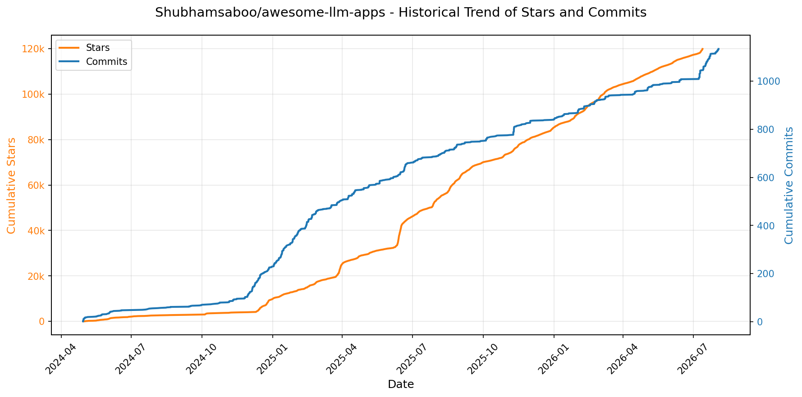

> *蓝色：累计 Stars｜橙色：累计 Commits（次 Y 轴）*

<b>📄 README 摘要</b>

1. **项目功能**  
该项目是一个开源的、可直接运行的大型语言模型（LLM）应用模板集合，旨在为开发者提供开箱即用的AI智能体（Agent）与检索增强生成（RAG）系统实战样板。它不是简单的资源列表或链接聚合，而是**100+个完整、自包含、经端到端测试的生产级代码模板**，覆盖从单文件入门Agent到复杂多智能体协作系统的全栈场景。用户可通过`git clone` → `pip install` → `streamlit run`三步快速启动任意应用，并支持一键定制、部署和商业化。

2. **核心特性**  
- ✅ **全栈覆盖**：深度支持AI Agent（单/多/常驻/语音/自进化）、RAG（基础链式→Agentic→多模态→知识图谱）、Agent Skills（可插拔能力模块）、MCP（Model Context Protocol工具集成）、Fine-tuning（Gemma 3 / Llama 3.2全流程）、Generative UI（交互式前端组件生成）等前沿范式；  
- ✅ **厂商无关架构**：统一配置即可无缝切换OpenAI、Claude、Gemini、Qwen、Llama、xAI等主流大模型后端；  
- ✅ **极简上手体验**：所有模板均通过严格验证，无“broken requirements”，3条命令即可本地运行；  
- ✅ **工程就绪设计**：内置记忆管理、工具调用（含浏览器/GitHub/Notion等MCP集成）、结构化输出（Pydantic）、回调机制、多智能体协作模式及成本优化工具（如TOON格式Token压缩）；  
- ✅ **配套教学闭环**：每个精选模板均配免费图文+视频教程（托管于Unwind AI平台），涵盖原理讲解、代码解析与部署指南；  
- ✅ **开放许可**：采用Apache-2.0协议，允许自由fork、修改、商用，无付费墙、无注册门槛、无遥测数据收集。

3. **技术栈**  
- **核心框架**：Google ADK（Agent Development Kit）、OpenAI Agents SDK、CrewAI、LangChain生态；  
- **前端交互**：Streamlit（主流模板默认UI）、Shadcn UI组件库、WebRTC（语音Agent）、浏览器自动化（Playwright/Puppeteer）；  
- **模型与推理**：支持OpenAI GPT系列、Anthropic Claude、Google Gemini、Meta Llama 3.x、Qwen、DeepSeek、xLAM等；本地部署含Llama.cpp、Ollama、vLLM等轻量方案；  
- **RAG与数据层**：ChromaDB、FAISS、Weaviate、PostgreSQL（带向量扩展）、Hybrid Search（关键词+语义）、Knowledge Graph（Neo4j/Citation-aware）；  
- **语音与多模态**：Gemini Live API、OpenAI Realtime API、Whisper、Nano Banana Pro（视觉理解）、Vision RAG；  
- **基础设施**：Python 3.9+、Docker容器化支持、Scheduled Tasks（APScheduler）、云原生适配（AWS/Azure/GCP）；  
- **开发工具链**：Git + GitHub Actions CI/CD、Pydantic v2（Schema验证）、Logging/Callback追踪、Token优化工具（Toonify/Headroom）。

---

### 3. [home-assistant/core](https://github.com/home-assistant/core)
- 📅 **创建日期**：2013-09-17  
- 🔄 **最近更新**：2026-07-13  
- ⭐ **Stars**：89,398（日 +385｜周 +961｜月 +1596）  
- 📝 **描述**：:house_with_garden: Open source home automation that puts local control and privacy first.  

<b>📈 Star 与 Commit 历史趋势</b>

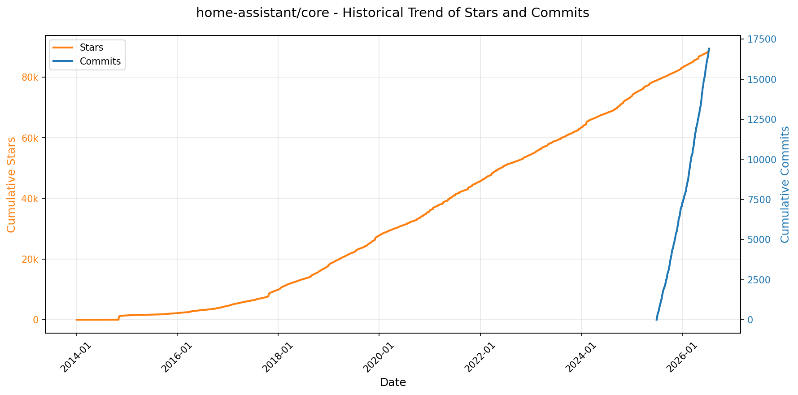

> *蓝色：累计 Stars｜橙色：累计 Commits（次 Y 轴）*

---

### 4. [JuliusBrussee/caveman](https://github.com/JuliusBrussee/caveman)
- 📅 **创建日期**：2026-04-04  
- 🔄 **最近更新**：2026-07-13  
- ⭐ **Stars**：88,670（日 +361｜周 +3626｜月 +17038）  
- 📝 **描述**：🪨 why use many token when few token do trick — Claude Code skill that cuts 65% of tokens by talking like caveman  

<b>📈 Star 与 Commit 历史趋势</b>

> *蓝色：累计 Stars｜橙色：累计 Commits（次 Y 轴）*

<b>📄 README 摘要</b>

1. **项目功能**  
该项目是一个轻量级、跨平台的AI编码代理（如Claude Code、Gemini、Cursor、Copilot等30+主流工具）插件/技能，旨在将大语言模型生成的冗长自然语言回复压缩为高度精简的“原始人式”表达（Caveman-speak），在**完全保留技术准确性、代码片段、命令行指令和错误信息字节级精确性**的前提下，显著减少输出token数量。其核心价值不是改变模型推理过程，而是优化输出表述——“让嘴变小，不让脑变小”。

2. **关键特性**  
- ✅ **高达65%平均输出token缩减**：经实测10个典型开发任务（如React重渲染分析、PostgreSQL连接池配置等），输出token减少22%–87%，平均达65%；  
- ✅ **多级压缩模式**：支持`lite`/`full`（默认）/`ultra`/`wenyan`（文言文）等6档可动态切换的精简等级，适配不同场景对简洁性与可读性的权衡；  
- ✅ **全链路token节省能力**：除实时回复压缩外，还提供`/caveman-compress`命令永久压缩记忆文件（如`CLAUDE.md`），平均降低输入token 46%；  
- ✅ **开箱即用的多代理兼容性**：一键安装脚本自动识别并部署至本地所有已安装的AI编码代理（macOS/Linux/WSL/Windows PowerShell）；  
- ✅ **增强型开发者工作流命令**：内置`/caveman-commit`（≤50字符规范提交）、`/caveman-review`（单行PR评论）、`/caveman-stats`（实时token节省统计与成本估算）等实用指令；  
- ✅ **零隐私泄露设计**：完全离线运行，无遥测、无账号、无后端通信，所有处理均在本地完成；  
- ✅ **生态协同扩展**：作为“Cave”系列核心组件，与`caveman-code`（全栈精简代理）、`cavemem`（记忆压缩）、`cavekit`（构建流程精简）等形成统一“少即是多”技术栈。

3. **技术栈**  
- **核心实现层**：基于Prompt Engineering与规则驱动的文本重写逻辑（非微调模型），通过结构化指令约束LLM输出风格（去填充词、用碎片句、保技术实体）；  
- **部署层**：Shell脚本（`install.sh`）与PowerShell脚本（`install.ps1`）实现跨平台自动化安装；  
- **集成协议**：适配各AI代理的插件机制（如Claude插件市场、Gemini CLI扩展、Cursor/Codex技能注册系统、MCP中间件标准）；  
- **辅助工具链**：Node.js（要求≥v18）、npm包（`caveman-shrink` MCP中间件）、本地日志解析（`/caveman-stats`依赖会话日志文件）；  
- **生态支撑**：GitHub仓库托管、CI/CD同步、MIT开源协议；配套文档采用Markdown+自定义注释块（如`[!TIP]`/`[!NOTE]`）增强可维护性。

---

### 5. [ocornut/imgui](https://github.com/ocornut/imgui)
- 📅 **创建日期**：2014-07-21  
- 🔄 **最近更新**：2026-07-13  
- ⭐ **Stars**：74,544（日 +42｜周 +265｜月 +856）  
- 📝 **描述**：Dear ImGui: Bloat-free Graphical User interface for C++ with minimal dependencies  

<b>📈 Star 与 Commit 历史趋势</b>

> *蓝色：累计 Stars｜橙色：累计 Commits（次 Y 轴）*

---

### 6. [ruvnet/RuView](https://github.com/ruvnet/RuView)
- 📅 **创建日期**：2025-06-07  
- 🔄 **最近更新**：2026-07-13  
- ⭐ **Stars**：67,359（日 +202｜周 +3603｜月 +7295）  
- 📝 **描述**：π RuView turns commodity WiFi signals into real-time spatial intelligence, vital sign monitoring, and presence detection — all without a single pixel of video.  

<b>📈 Star 与 Commit 历史趋势</b>

> *蓝色：累计 Stars｜橙色：累计 Commits（次 Y 轴）*

<b>📄 README 摘要</b>

1. **项目功能**  
π RuView 是一个基于 WiFi 信道状态信息（CSI）的无感空间感知平台，将普通 WiFi 设备（如路由器、ESP32 节点）转化为隐私优先、无需摄像头与可穿戴设备的边缘智能传感器。它利用无线电波在人体运动、呼吸、心跳等生理活动下的微扰特性，实现穿墙级非接触式感知：包括多目标存在检测与计数、实时呼吸/心率监测、17 关键点无线姿态估计（WiFi DensePose）、跌倒识别、睡眠质量分析、房间级活动识别（如“浴室占用”“会议进行中”“老人异常静止”等 10 类语义状态），以及支持多频段 mesh 组网的环境建模与 RF 指纹定位。系统完全离线运行，不依赖云端，所有计算在边缘硬件完成。

2. **核心特性**  
- **全栈隐私保护架构**：零摄像头、零生物数据上传、零用户手机 App；所有信号处理与 AI 推理均在本地（ESP32/Cognitum Seed/RPi）完成；采用 Ed25519 密码学见证链对每条测量结果进行不可篡改认证。  
- **跨生态无缝集成**：原生支持 Home Assistant（MQTT/HA-DISCO）、Apple Home（HAP-1.1 桥接）、Google Home、Amazon Alexa 和 SmartThings，通过 Matter 协议或 HA 桥接实现语音控制（如 Siri 询问“卧室有人吗？”或“爷爷心率正常吗？”）。  
- **超轻量 AI 模型**：预训练模型 `ruvnet/wifi-densepose-pretrained`（4-bit 量化仅 8 KB）支持毫秒级推理；17 关键点姿态模型 `ruvnet/wifi-densepose-mmfi-pose` 在 MM-Fi 数据集达 SOTA 82.69% torso-PCK@20；全部模型开源并托管于 Hugging Face。  
- **自适应边缘智能**：基于脉冲神经网络（SNN）的本地在线学习，30 秒内完成环境自校准；支持 105 个即插即用的“Cog”边缘模块（健康/安防/工业/零售等场景），通过 `app-registry.json` 动态加载。  
- **多硬件兼容与低成本部署**：主推 ESP32-S3（$9/节点）+ Cognitum Seed（$140 全功能套件）方案；亦支持 ESP32-C6（Wi-Fi 6/802.15.4）、Intel 5300 等科研 NIC；提供 Docker 仿真版供快速验证。  
- **多模态融合能力**：支持 WiFi CSI + 摄像头深度（MiDaS）+ 毫米波雷达的 3D 点云统一建模（22 ms/pipeline，19K+ 点/帧），并开放 three.js 实时可视化与 MediaPipe→Mixamo 动作重定向演示。

3. **技术栈**  
- **编程语言与框架**：Rust（核心传感服务、SNN 处理器、RVF 模型加载器）、Python（PyO3 封装的 `ruview` / `wifi-densepose` PyPI 包、训练/评估/客户端）、C/C++（ESP-IDF 驱动 ESP32-S3/C6 的 CSI 流采集）、JavaScript/TypeScript（Web 前端、three.js 可视化、HAP 桥接）。  
- **AI 与模型技术**：对比学习预训练 CSI 编码器（128-dim）、LoRA 微调适配器、轻量级 Pose Estimation 模型（Candle 推理引擎）、OccWorld TransVQVAE 世界模型、Spiking Neural Networks（SNN）在线学习。  
- **通信与协议**：WiFi CSI（ESP32-S3/C6 原生支持）、MQTT（HA 集成）、HAP（HomeKit）、Matter（v1.3）、ESP-NOW（C6 mesh 同步）、UDP/TDM 时分调度多频扫描（6 个 WiFi 信道）。  
- **硬件与部署**：ESP32-S3/C6 作为 CSI 采集节点；Cognitum Seed 提供持久化向量存储、kNN 检索与加密见证；树莓派/ARM64/x86_64 作为边缘服务器；Docker 多架构镜像（amd64/arm64）；支持 Windows/macOS/Linux 客户端。  
- **基础设施与工具链**：Hugging Face（模型托管与基准评测）、GitHub Actions CI/CD（1463+ 测试用例）、crates.io（Rust crate `wifi-densepose-ruvector`）、PyPI（`ruview` & `wifi-densepose`）、AetherArena（可审计的 MM-Fi 排行榜）。

---

### 7. [virattt/ai-hedge-fund](https://github.com/virattt/ai-hedge-fund)
- 📅 **创建日期**：2024-11-29  
- 🔄 **最近更新**：2026-07-13  
- ⭐ **Stars**：62,252（日 +275｜周 +643｜月 +1646）  
- 📝 **描述**：An AI Hedge Fund Team  

<b>📈 Star 与 Commit 历史趋势</b>

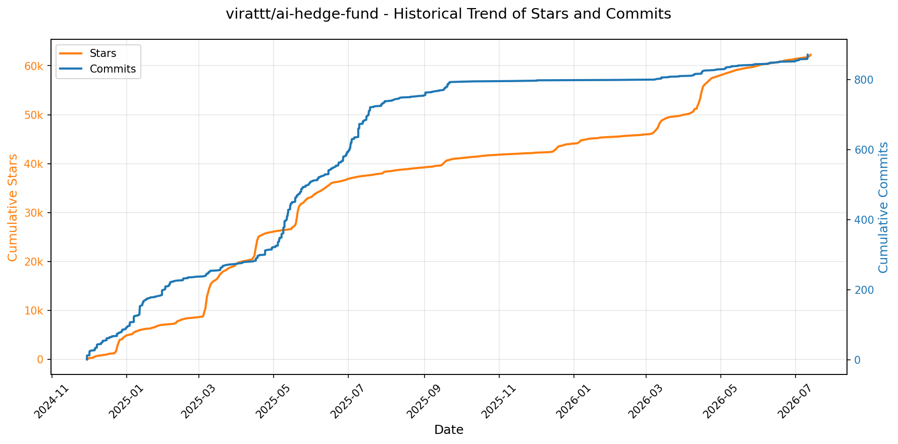

> *蓝色：累计 Stars｜橙色：累计 Commits（次 Y 轴）*

<b>📄 README 摘要</b>

1. **该项目做什么？**  
该项目是一个面向教育与研究目的的AI驱动对冲基金概念验证系统，旨在探索人工智能在股票交易决策中的应用。它模拟一个由19个专业化投资代理（Agents）协同工作的虚拟对冲基金，每个代理代表一位著名投资者（如巴菲特、达摩达兰、塔勒布等）或特定分析维度（基本面、技术面、情绪面、估值、风险管理等）。系统可执行回测（backtesting）、模拟交易（paper trading），并计划支持可选的实盘运行；但当前版本**不执行真实交易**，所有操作均在仿真环境中完成，仅供学习和算法研究使用。

2. **核心功能**  
- **多代理协同决策架构**：集成19个风格迥异的投资代理，覆盖价值投资、成长投资、宏观策略、尾部风险分析、Dhandho策略等多种流派，实现多元化Alpha信号生成。  
- **全栈分析能力**：整合估值分析（内在价值计算）、基本面分析（财务数据）、技术面分析（指标信号）、市场情绪分析（NLP驱动）及量化风险管理（头寸限制、风险度量）。  
- **灵活运行模式**：支持命令行（CLI）与Web图形界面双入口；提供回测（`backtester.py`）、单次推理（`main.py`）、时间区间分析（指定起止日期）及本地大模型（Ollama）离线运行选项。  
- **可扩展基金实体设计**：将“基金”抽象为一等公民（first-class entity），支持背测、模拟交易及未来可选实盘接入；投资者代理被重构为可插拔、可独立回测的“Alpha模型”，便于模块化开发与验证。  
- **生产就绪基础设施**：含环境变量管理（`.env`）、多LLM API支持（OpenAI/Groq/Anthropic/DeepSeek/Ollama）、Poetry依赖管理及结构化项目布局（CLI/Web/Backtest分层）。

3. **技术栈**  
- **编程语言**：Python（主语言，含`src/`核心逻辑与CLI）  
- **依赖管理**：Poetry（标准化包管理与虚拟环境）  
- **大语言模型（LLM）集成**：支持云端API（OpenAI GPT-4o系列、Groq、Anthropic Claude、DeepSeek）及本地Ollama部署（用于离线推理）  
- **金融数据源**：Financial DataSets API（提供实时/历史行情与基本面数据）  
- **Web前端（可选）**：独立`app/`子目录，采用现代Web框架（未明确说明，但截图显示为响应式单页应用，推测含React/Vue或Streamlit/Gradio等轻量方案）  
- **配置与环境**：`.env`文件管理密钥，遵循安全实践  
- **许可证**：MIT License（开源、允许自由使用与修改）

---

### 8. [asgeirtj/system_prompts_leaks](https://github.com/asgeirtj/system_prompts_leaks)
- 📅 **创建日期**：2025-05-03  
- 🔄 **最近更新**：2026-07-13  
- ⭐ **Stars**：57,313（日 +478｜周 +6621｜月 +15123）  
- 📝 **描述**：Extracted system prompts from Anthropic - Claude Fable 5, Opus 4.8, Claude Code, Claude Design. OpenAI - ChatGPT GPT-5.6, Codex GPT-5.6, GPT-5.5. Google - Gemini 3.5 Flash, 3.1 Pro, Antigravity. xAI - Grok, Cursor, Copilot, VS Code, Perplexity, and more. Updated regularly.  

<b>📈 Star 与 Commit 历史趋势</b>

> *蓝色：累计 Stars｜橙色：累计 Commits（次 Y 轴）*

<b>📄 README 摘要</b>

1. **项目功能**  
该项目是一个开源知识库，系统性地收集、整理并公开主流大语言模型（LLM）及其产品背后的**系统提示词（System Prompts）**——即模型在推理过程中被硬编码或隐式注入的底层指令、角色设定、行为约束与安全规则。内容覆盖ChatGPT（OpenAI）、Claude（Anthropic）、Gemini（Google）、Grok（xAI）、Perplexity、Microsoft Copilot、GitHub Copilot、Cursor、Meta AI、Mistral、Notion AI、Qwen及众多垂直AI工具（如Docker Gordon AI、Zed AI、VS Code Copilot Agent等），旨在揭示各AI系统实际运行所依赖的“隐藏操作手册”。

2. **核心特性**  
- **全栈式系统提示归档**：按厂商（Anthropic/OpenAI/Google/xAI等）和产品线（如Claude Opus/Sonnet/Fable、GPT-5.x系列、Gemini 3.5 Flash等）结构化组织，支持版本迭代追踪（含Opus 4.8→4.7→4.6等历史演进）；  
- **多维度分类呈现**：区分基础模型、代码专用模型（Claude Code、GPT Codex）、CLI工具（Antigravity CLI、Copilot CLI）、集成场景（Copilot for macOS、Claude in PowerPoint）、工具链（Glob/Grep工具、Deep Research插件）及安全策略（图像安全、自动化上下文）；  
- **深度细节支持**：提供带工具/无工具版、原始未处理提示（raw）、人类可读格式、Diff对比（如Fable 5 vs Opus 4.8）、可视化分析（Anthropic/visualize.md）及官方发布快照（Official/目录）；  
- **跨平台覆盖**：不仅涵盖通用聊天模型，还收录开发工具链（VS Code Copilot Agent）、办公套件插件（Claude for Excel/Word）、浏览器扩展（Claude in Chrome）、操作系统级应用（Copilot for macOS）及新兴AI基础设施（Docker Gordon AI、Warp 2.0 Agent）。

3. **技术栈**  
- **内容组织**：纯静态文档仓库，采用Markdown文件结构化存储全部系统提示，按厂商/产品/版本分层目录（如`Anthropic/claude-opus-4.8.md`、`OpenAI/Codex/gpt-5.6.md`）；  
- **前端展示**：GitHub原生渲染 + 自定义响应式Banner图（适配深色/浅色模式）、动态徽章（Shields.io构建的Last Commit、PRs Welcome等状态标识）；  
- **辅助能力**：集成Star History图表（star-history.com）、Trendshift趋势分析、外部Diff工具链接（diffchecker.com）、第三方徽章服务（shieldcn.dev）；  
- **协作机制**：明确鼓励社区贡献（“PRs Welcome”），通过GitHub Pull Request流程实现提示词更新与校验，依赖开发者手动提交新泄露或验证后的系统提示文本。

---

### 9. [Panniantong/Agent-Reach](https://github.com/Panniantong/Agent-Reach)
- 📅 **创建日期**：2026-02-24  
- 🔄 **最近更新**：2026-07-13  
- ⭐ **Stars**：55,552（日 +353｜周 +3995｜月 +28855）  
- 📝 **描述**：Give your AI agent eyes to see the entire internet. Read & search Twitter, Reddit, YouTube, GitHub, Bilibili, XiaoHongShu — one CLI, zero API fees.  

<b>📈 Star 与 Commit 历史趋势</b>

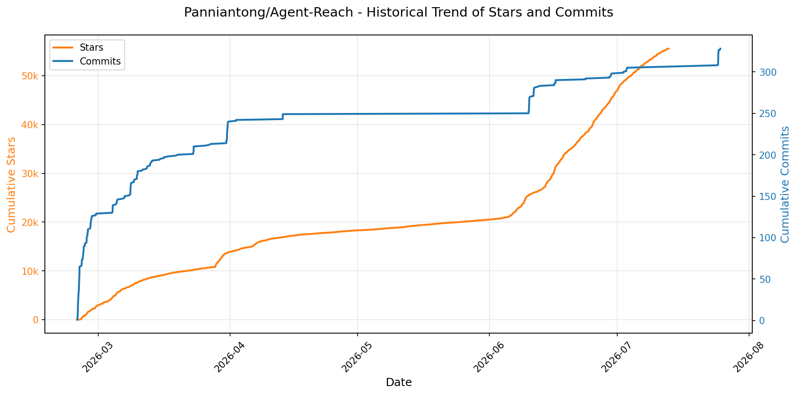

> *蓝色：累计 Stars｜橙色：累计 Commits（次 Y 轴）*

<b>📄 README 摘要</b>

1. **项目功能**  
Agent Reach 是一个专为 AI Agent 设计的「互联网能力接入层」，旨在一键赋予任意命令行可执行的 AI Agent（如 Claude Code、OpenClaw、Cursor、Windsurf 等）稳定、免配置、可持续演进的网络访问能力。它不替代 Agent，而是作为能力增强中间件，自动解决 Agent 在实际使用中普遍面临的「无法联网」痛点——包括读取网页、提取 YouTube/B站视频字幕、搜索 Twitter/Reddit/小红书、解析 RSS、调用 GitHub API、语义化全网搜索等，将原本需手动选型、安装、调试、维护的多平台接入工作，压缩为一句自然语言指令（如“帮我安装 Agent Reach”），由 Agent 自动完成全部环境部署与渠道激活。

2. **关键特性**  
- ✅ **零配置即用**：网页、YouTube（字幕+搜索）、RSS、V2EX、雪球、GitHub 公开仓库等 6 大高频场景无需任何配置，装完即用；  
- 🔄 **智能多后端路由与自动降级**：每个平台预置「首选 + 备选」多个技术方案（如 Twitter → twitter-cli ▸ OpenCLI ▸ bird），`agent-reach doctor` 实时探测并自动启用首个可用后端，某路径失效（如 yt-dlp 被 B站风控封禁）时无缝切换至备选，用户无感；  
- 🧰 **全链路自动化部署**：支持一键安装 CLI 工具、系统依赖（Node.js/gh CLI/mcporter）、搜索引擎（Exa 免 Key 接入）、技能注册（SKILL.md）及环境适配（本地/服务器差异处理）；  
- 🛡️ **安全可信架构**：Cookie/Token 严格本地存储（`~/.agent-reach/config.yaml`，权限 600），不上传、不外传；提供 `--safe`（仅提示不执行）和 `--dry-run`（预览操作）模式；代码与所有依赖工具完全开源可审计；  
- 🤖 **自然语言驱动配置**：对需登录态平台（Twitter、小红书、Reddit 等），用户只需说“帮我配 XXX”，Agent 即引导完成浏览器登录复用（OpenCLI）或 Cookie 配置，无需查文档；  
- 🩺 **内置健康诊断系统**：`agent-reach doctor` 一条命令输出各平台连通状态、当前生效后端、故障原因及修复建议；  
- 🌐 **跨平台兼容性**：原生支持所有能执行 shell 命令的 Agent 框架，不限定模型或运行时；明确区分「读内容」（本项目核心）与「操作网页」（推荐搭配 BrowserAct 等浏览器自动化工具）的能力边界。

3. **技术栈**  
- **核心语言**：Python 3.10+（主程序、CLI、channel 路由逻辑、doctor 诊断）；  
- **底层工具链**（按平台动态调度）：  
  - 网页阅读：[Jina Reader](https://github.com/jina-ai/reader)（首选）；  
  - YouTube：[yt-dlp](https://github.com/yt-dlp/yt-dlp)（字幕/搜索）；  
  - B站：[bili-cli](https://github.com/public-clis/bilibili-cli)（首选）+ OpenCLI（备选）；  
  - Twitter/X：[twitter-cli](https://github.com/public-clis/twitter-cli)（首选）+ [OpenCLI](https://github.com/jackwener/opencli)（登录态兜底）；  
  - Reddit/Facebook/Instagram/小红书：统一基于 [OpenCLI](https://github.com/jackwener/opencli)（复用桌面 Chrome 登录态）；  
  - GitHub：官方 [gh CLI](https://cli.github.com)；  
  - RSS：Python 标准库 [feedparser](https://github.com/kurtmckee/feedparser)；  
  - 全网语义搜索：[Exa.ai](https://exa.ai) 通过 [mcporter](https://github.com/nicobailon/mcporter)（MCP 协议）免 Key 接入；  
  - LinkedIn：[linkedin-scraper-mcp](https://github.com/stickerdaniel/linkedin-mcp-server)；  
- **基础设施**：Node.js（OpenCLI 依赖）、Git（gh CLI）、mcporter（MCP 客户端）、pip（Python 包管理）；  
- **安全机制**：本地文件权限控制（600）、YAML 配置加密存储、Dry Run 模式、模块化 channel 插件架构；  
- **部署友好**：支持本地开发机（免代理）与云服务器（仅需约 $1/月代理服务）双环境。

---

### 10. [anthropics/claude-cookbooks](https://github.com/anthropics/claude-cookbooks)
- 📅 **创建日期**：2023-08-15  
- 🔄 **最近更新**：2026-07-13  
- ⭐ **Stars**：48,463（日 +456｜周 +2041｜月 +3219）  
- 📝 **描述**：A collection of notebooks/recipes showcasing some fun and effective ways of using Claude.  

<b>📈 Star 与 Commit 历史趋势</b>

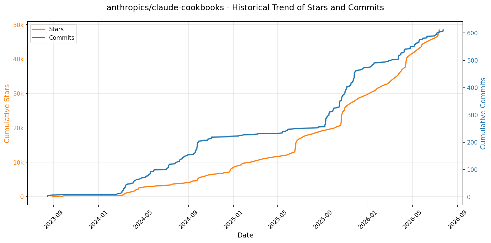

> *蓝色：累计 Stars｜橙色：累计 Commits（次 Y 轴）*

<b>📄 README 摘要</b>

1. **项目功能**  
该项目是一个面向开发者的实践型资源库，提供可直接复用的代码示例（“菜谱”）和操作指南，旨在帮助开发者高效构建基于 Anthropic Claude 大模型的应用。它覆盖从基础调用到高级架构的完整链路，包括文本处理（分类、摘要）、工具集成（计算器、SQL、客服代理）、多模态能力（图像理解、PDF解析、图表识别）、RAG（检索增强生成）、第三方服务对接（Pinecone、Wikipedia、Web 页面、Voyage AI 嵌入）、自动化评估、内容审核、JSON 输出控制及提示词缓存等实际场景，所有示例均以可运行的代码（如 Jupyter Notebook）形式呈现，支持快速集成与二次开发。

2. **核心特性**  
- **模块化菜谱结构**：按能力维度清晰划分为五大类——基础能力（分类/摘要/RAG）、工具调用（函数调用、外部服务集成）、第三方生态集成（向量数据库、知识源接入）、多模态应用（图像输入、文档解析、图表理解、图文生成）、进阶技术（子智能体协作、自动化评测、JSON 模式、内容审核、提示缓存）。  
- **开箱即用的实战代码**：全部示例为可复制粘贴的 Python 代码（含 `.ipynb` 和 `.md` 文件），附详细注释与上下文说明，降低学习与落地门槛。  
- **跨语言通用性设计**：虽以 Python 为主，但强调核心概念与 API 调用逻辑适用于任何支持 HTTP 请求的语言。  
- **社区共建机制**：开放 GitHub Issues 与 PR 流程，鼓励开发者提交新案例、优化现有指南或修复问题，形成持续演进的技术共享生态。  
- **深度集成支持**：涵盖 Claude 最新特性（如工具调用、多模态输入、JSON 模式、子智能体协同）及主流基础设施（AWS 集成示例），并提供与 Pinecone、Stable Diffusion、Voyage AI 等第三方服务的互操作方案。

3. **技术栈**  
- **核心依赖**：Anthropic 官方 Python SDK（`anthropic` 库），用于调用 Claude API（包括 `claude-3` 系列模型）。  
- **编程语言**：主语言为 Python；部分示例涉及 Shell 命令、Markdown 文档及 Jupyter Notebook 格式。  
- **第三方库与服务**：  
  - 工具集成：`sqlite3`、`requests`、自定义工具函数；  
  - RAG 与向量检索：Pinecone（向量数据库）、Wikipedia API、网页爬取（如 `requests` + `BeautifulSoup` 或专用库）；  
  - 多模态处理：PDF 解析（`PyPDF2` / `pymupdf` 等）、图像编码（Base64）、Stable Diffusion（图像生成协同）；  
  - 嵌入模型：Voyage AI 提供的嵌入服务；  
  - 云平台：AWS 相关示例（如 EC2、Lambda、Bedrock 集成）；  
- **开发与协作工具**：GitHub 作为代码托管与协作平台，使用标准开源流程（Issues、Pull Requests、README 文档组织）。

---

### 11. [ChromeDevTools/chrome-devtools-mcp](https://github.com/ChromeDevTools/chrome-devtools-mcp)
- 📅 **创建日期**：2025-09-11  
- 🔄 **最近更新**：2026-07-13  
- ⭐ **Stars**：47,274（日 +67｜周 +845｜月 +3409）  
- 📝 **描述**：Chrome DevTools for coding agents  

<b>📈 Star 与 Commit 历史趋势</b>

> *蓝色：累计 Stars｜橙色：累计 Commits（次 Y 轴）*

<b>📄 README 摘要</b>

1. **项目功能**  
该项目（`chrome-devtools-mcp`）是一个专为AI编程代理（如Antigravity、Claude Code、Cursor、GitHub Copilot等）设计的Model-Context-Protocol（MCP）服务器，使AI代理能够**控制并深度检测正在运行的Chrome浏览器实例**。它将完整的Chrome DevTools能力（包括自动化操作、调试分析、性能评测与内存诊断）以标准化MCP接口暴露给AI代理，从而支持可靠网页自动化、端到端调试、真实用户性能分析（CrUX集成）、源码映射堆栈追踪、截图录屏、网络请求审查、扩展管理等任务。同时提供独立CLI模式，无需MCP环境亦可直接使用。

2. **核心特性**  
- **性能洞察**：基于Chrome DevTools前端录制性能轨迹（trace），结合Google CrUX API获取真实用户体验（RUM）数据，生成可操作的性能优化建议（默认启用，可禁用）；  
- **高级调试能力**：支持分析网络请求（含完整请求/响应头、时序）、捕获带源码映射的控制台错误日志、截取全屏/元素级截图、启动/停止屏幕录像、执行任意JavaScript脚本、运行Lighthouse审计；  
- **高可靠性自动化**：底层基于Puppeteer实现，自动等待页面加载、元素就绪、网络空闲等关键状态，确保操作稳定性；  
- **全栈诊断工具集**：覆盖7大类共超40个精细工具，包括输入交互（点击、拖拽、表单填充、文件上传）、页面导航（新开页、跳转、切换、关闭）、设备模拟（分辨率调整、UA/网络条件模拟）、内存分析（堆快照采集、对比、路径追踪、重复字符串识别）、浏览器扩展管理（安装/重载/列表）等；  
- **轻量模式（`--slim`）**：针对基础任务优化，禁用高级调试与性能工具，降低资源占用，支持无头运行；  
- **多客户端无缝集成**：提供针对Amp、Antigravity、Claude Code、Copilot（VS Code/CLI）、Cursor、Gemini、JetBrains、Katalon等数十种主流AI开发工具的详细配置指南与一键安装方式。

3. **技术栈**  
- **协议层**：严格遵循[Model-Context-Protocol (MCP)](https://model-context-protocol.dev/)规范，作为标准MCP服务器提供JSON-RPC over stdio/HTTP接口；  
- **浏览器控制层**：基于[Puppeteer](https://github.com/puppeteer/puppeteer) v22+（依赖Chromium自动化协议），官方仅支持Google Chrome稳定版及[Chrome for Testing](https://developer.chrome.com/blog/chrome-for-testing/)；  
- **DevTools能力层**：深度集成[Chrome DevTools Frontend](https://github.com/ChromeDevTools/devtools-frontend)的协议能力（CDP），直接调用底层Domain API（如`Performance`、`Network`、`Console`、`HeapProfiler`、`Page`、`Emulation`等）；  
- **运行时环境**：要求Node.js LTS版本（v18+），通过`npx`分发，零本地构建依赖；  
- **辅助服务**：内置CrUX API调用（可选）、匿名化使用统计上报（可禁用）、自动版本更新检查（可禁用）、MCP代理兼容（如Katalon StudioAssist场景）。

---

### 12. [davila7/claude-code-templates](https://github.com/davila7/claude-code-templates)
- 📅 **创建日期**：2025-07-04  
- 🔄 **最近更新**：2026-07-13  
- ⭐ **Stars**：46,932（日 +206｜周 +838｜月 +1350）  
- 📝 **描述**：CLI tool for configuring and monitoring Claude Code  

<b>📈 Star 与 Commit 历史趋势</b>

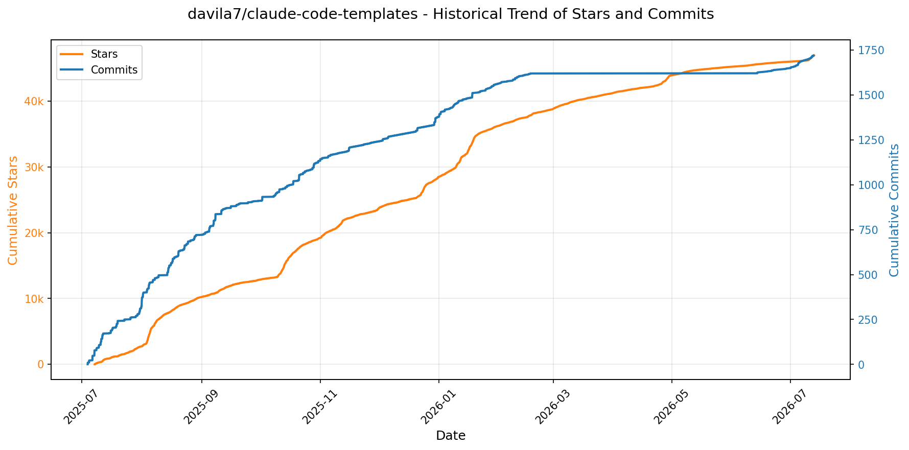

> *蓝色：累计 Stars｜橙色：累计 Commits（次 Y 轴）*

<b>📄 README 摘要</b>

1. **项目功能**  
该项目是一个面向 Anthropic Claude Code 的开源模板管理工具，提供即开即用的 AI 开发配置套件。它通过标准化、模块化的方式，帮助开发者快速集成和部署各类 AI 增强能力——包括 AI 代理（Agents）、自定义命令（Commands）、外部服务集成（MCPs）、系统设置（Settings）、自动化钩子（Hooks）以及可复用技能（Skills），从而显著提升基于 Claude Code 的开发效率与工程化水平。

2. **核心特性**  
- **多维度组件库**：涵盖 100+ 经过验证的组件，按类型细分为 AI 代理（如安全审计员、React 性能优化师）、命令（如 `/generate-tests`）、MCP 集成（GitHub/PostgreSQL/Stripe/AWS 等）、配置项（超时、内存、输出格式）、Git 钩子（pre-commit 校验）及专业技能（PDF 处理、Excel 自动化）。  
- **交互式安装体验**：支持 CLI 快速安装单个或组合组件（如 `--agent frontend-developer --command generate-tests --mcp github-integration`），亦可通过 Web 仪表盘（[aitmpl.com](https://www.aitmpl.com)）可视化浏览、搜索与一键安装。  
- **配套开发工具链**：内置四大实用工具——实时会话分析（Analytics）、移动端友好的对话监控器（Chats，支持 Cloudflare Tunnel 远程访问）、系统健康检查（Health Check）和插件统一管理面板（Plugins Dashboard）。  
- **生态兼容与合规整合**：聚合并规范整合来自 Anthropic 官方、K-Dense-AI、obra、Alireza Rezvani、wshobson 等多个社区项目的 MIT/Apache/CC0 许可技能与代理，严格保留原始许可与署名，构建可信、可追溯的 Claude 生态组件市场。

3. **技术栈**  
- **运行时环境**：Node.js（基于 `npx` CLI 工具分发，无需全局安装）  
- **前端界面**：Web 仪表盘（[aitmpl.com](https://www.aitmpl.com)）未明确说明框架，但结合 Vercel OSS 支持及现代部署特征，推测采用 React/Vite 或 Next.js 构建；CLI 工具基于标准 Node.js 模块与命令行交互逻辑。  
- **基础设施与集成**：深度依赖 Anthropic Claude Code 原生能力；MCP（Model Calling Protocol）作为核心扩展机制，实现与 GitHub、PostgreSQL、Stripe、AWS、OpenAI 等外部服务的安全对接；使用 Cloudflare Tunnel 实现本地对话监控的加密远程访问。  
- **工程与协作**：MIT 许可协议；CI/CD 及托管由 Vercel、Neon（PostgreSQL）、GitHub Sponsors 等开源计划支持；文档站点（docs.aitmpl.com）采用静态站点生成方案（可能为 Docusaurus 或 Next.js App Router）。

---

### 13. [chen08209/FlClash](https://github.com/chen08209/FlClash)
- 📅 **创建日期**：2023-08-15  
- 🔄 **最近更新**：2026-07-13  
- ⭐ **Stars**：45,268（日 +213｜周 +830｜月 +3253）  
- 📝 **描述**：A multi-platform proxy client based on ClashMeta,simple and easy to use, open-source and ad-free.  

<b>📈 Star 与 Commit 历史趋势</b>

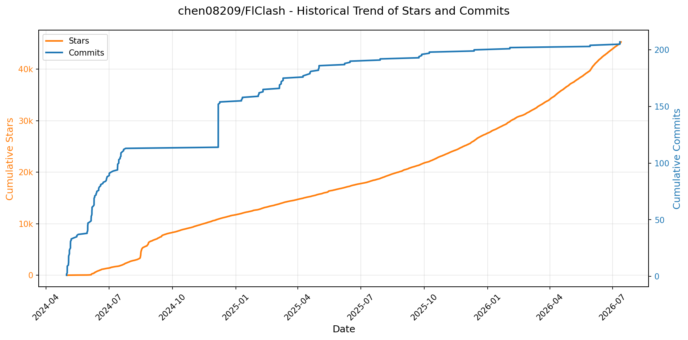

> *蓝色：累计 Stars｜橙色：累计 Commits（次 Y 轴）*

<b>📄 README 摘要</b>

1. **项目功能**  
FlClash 是一款基于 Clash Meta 核心的跨平台开源代理客户端，旨在提供简洁、易用、无广告的网络代理服务。它支持桌面端（Windows/macOS/Linux）和移动端（Android），可加载 Clash 配置文件与订阅链接，实现流量代理、规则分流、策略切换等核心代理功能，并通过 WebDAV 实现多设备间配置与数据同步。

2. **关键特性**  
- ✈️ 全平台支持：原生适配 Android、Windows、macOS 和 Linux；  
- 💻 响应式 UI：自适应不同屏幕尺寸，内置多种色彩主题，遵循 Material You 设计语言，界面风格类似 Surfboard；  
- ☁️ 云同步能力：支持通过 WebDAV 协议自动同步配置、代理节点、历史记录等数据；  
- ✨ 实用功能：支持订阅链接一键导入、深色模式、系统级托盘/状态栏控制（如启动/停止/开关代理）、Android 广播意图控制（START/STOP/TOGGLE）；  
- 🚫 纯净体验：完全开源、无广告、无追踪、无捆绑软件。

3. **技术栈**  
- 前端框架：Flutter（用于构建跨平台 UI，统一管理 Android、Windows、macOS、Linux 四端界面与逻辑）；  
- 核心代理引擎：Clash Meta（作为底层代理内核，提供 TUN 模式、Rule/Script/External Controller 等高级功能）；  
- 构建与集成：Dart（构建脚本 `setup.dart`）、Go（用于编译或调用 Clash Meta 内核相关工具）、Shell/Bash（Linux/macOS 构建辅助）、Inno Setup（Windows 安装包打包）、Android SDK/NDK（Android 构建依赖）；  
- 依赖管理：Git 子模块（管理 Clash Meta 等外部依赖）；  
- 发布生态：GitHub Releases、F-Droid 仓库、Homebrew Cask（macOS）。

---

### 14. [usestrix/strix](https://github.com/usestrix/strix)
- 📅 **创建日期**：2025-08-05  
- 🔄 **最近更新**：2026-07-13  
- ⭐ **Stars**：40,991（日 +311｜周 +3646｜月 +15113）  
- 📝 **描述**：Open-source AI penetration testing tool to find and fix your app’s vulnerabilities.  

<b>📈 Star 与 Commit 历史趋势</b>

> *蓝色：累计 Stars｜橙色：累计 Commits（次 Y 轴）*

<b>📄 README 摘要</b>

1. **项目功能**  
Strix 是一个开源的 AI 驱动型渗透测试工具，旨在模拟真实黑客行为，对应用程序进行全自动、端到端的安全评估。它能动态运行目标代码（本地源码、GitHub 仓库或线上 Web 应用），主动探测、利用并验证真实漏洞（提供可复现的 PoC），而非仅依赖静态分析生成误报。核心价值在于将专业红队能力产品化：支持从侦察、攻击链构建、漏洞利用到修复建议与合规报告的完整攻防闭环，适用于开发人员和安全团队在开发流程中快速识别高危风险。

2. **关键特性**  
- **多智能体协同渗透（Graph of Agents）**：由分工明确的 AI 代理组成（如 Recon Agent、Exploit Agent、Post-Exploit Agent），可并行扫描、共享情报、串联漏洞，实现类人工红队协作；  
- **真实漏洞验证机制**：所有发现均附带可执行的 Proof-of-Concept（PoC），包括 HTTP 请求篡改、浏览器自动化 XSS/CSRF 测试、命令注入执行、Python 沙箱内 exploit 运行等，杜绝传统扫描器的假阳性；  
- **全栈安全能力覆盖**：集成 HTTP 代理（Caido）、无头浏览器（Playwright）、Shell 终端、自定义 exploit 运行时、OSINT 侦察、SAST/DAST 混合分析及结构化漏洞知识库（CVSS/OWASP Top 10 分类）；  
- **开发者友好工作流**：CLI 工具支持一键扫描（本地目录/GitHub/URL）、指令驱动测试（含认证上下文、业务逻辑聚焦）、PR 差异感知（CI 中仅扫描变更文件）、非交互式静默模式（适配自动化流水线）；  
- **闭环修复与合规输出**：自动生成可合并的安全补丁（Pull Request）、符合 SOC 2/ISO 27001/PCI DSS 的定制化渗透测试报告，并支持 GitHub/GitLab/Slack/Jira 等 DevSecOps 工具链深度集成。

3. **技术栈**  
- **AI 层**：基于多模型 LLM 编排（支持 OpenAI GPT-5.4、Anthropic Claude Sonnet 4.6、Google Gemini 3 Pro 等），通过 LiteLLM 统一抽象 API 接口，兼容云端（Azure/Bedrock/Vertex AI）与本地模型（Ollama/LMStudio）；  
- **执行层**：Docker 容器化沙箱环境保障安全隔离；内置 Caido（HTTP 代理）、Playwright（浏览器自动化）、Nuclei（模板化漏洞检测）等成熟安全工具；  
- **架构与框架**：CLI 基于 Python 构建，前端交互使用 Textual 框架；平台后端为全栈 Web 应用（app.strix.ai），支持 SSO（SAML/OIDC）、VPC 自托管及 BYOK（Bring Your Own Key）模型部署；  
- **集成生态**：原生支持 GitHub Actions、GitLab CI、Bitbucket Pipelines，提供标准化配置（环境变量驱动 LLM/凭证/参数），并兼容主流 DevOps 平台与协作工具。

---

### 15. [calesthio/OpenMontage](https://github.com/calesthio/OpenMontage)
- 📅 **创建日期**：2026-03-29  
- 🔄 **最近更新**：2026-07-13  
- ⭐ **Stars**：37,697（日 +406｜周 +3889｜月 +33069）  
- 📝 **描述**：World's first open-source, agentic video production system. 12 pipelines, 52 tools, 500+ agent skills. Turn your AI coding assistant into a full video production studio.  

<b>📈 Star 与 Commit 历史趋势</b>

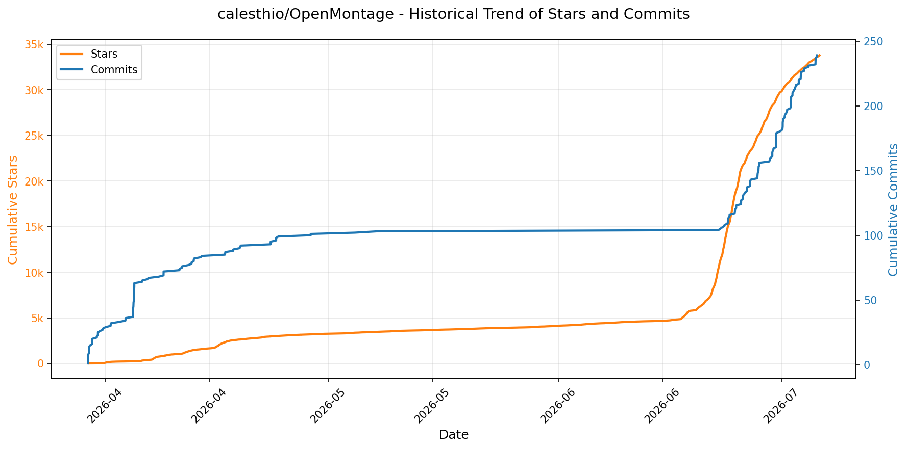

> *蓝色：累计 Stars｜橙色：累计 Commits（次 Y 轴）*

<b>📄 README 摘要</b>

1. **项目功能**  
OpenMontage 是首个开源的、基于智能体（agentic）架构的端到端视频生成系统。它将AI编码助手（如Claude Code、Cursor等）转化为全自动视频制作工作室：用户仅需用自然语言描述创意（例如“制作一段60秒的神经网络学习原理动画”），系统即可自主完成全流程——包括主题研究、脚本撰写、多模态资产生成（图像/真实视频片段/语音/音乐）、分镜策划、字幕同步（词级时间戳）、多引擎合成渲染（Remotion或HyperFrames），直至输出可发布的成品视频（MP4）。其核心突破在于支持**真正基于实拍素材的视频制作**：不依赖“静态图+动画效果”的伪视频方案，而是通过CLIP检索从Archive.org、NASA、Wikimedia Commons、Pexels等开放资源库中精准获取真实运动镜头，剪辑合成具备纪录片质感的原创视频；同时兼容AI生成图像/视频（FLUX、Kling、Veo等）与本地GPU加速视频生成（如wan2.1系列模型）。

2. **关键特性**  
- **双轨视频生成路径**：支持「AI图像驱动」（免费离线Piper TTS + Remotion动画）与「真实 footage 驱动」（开放档案库检索+剪辑）两种零成本生产模式；  
- **实时可视化生产看板（Backlot）**：提供动态故事板界面，实时展示脚本生成、分镜卡、资产生成进度、每帧成本、质量评分及人工审批节点（如视觉资产需确认后才进入渲染）；  
- **全流程自动化决策与审计**：所有工具调用（API选择/模型选型/参数配置）均经7维评分并记录可追溯日志；输出前执行FFmpeg校验、音频电平分析、字幕精度检测等多层自检；  
- **多渲染引擎智能路由**：根据任务类型自动选择Remotion（React驱动，适合数据可视化/图文动画）或HyperFrames（HTML/GSAP驱动，适合动态图形/SVG角色动画）；  
- **参考视频驱动创作**：支持粘贴YouTube/TikTok等链接，自动解析转录文本、节奏、关键帧与风格，生成保留原结构但更换主题/视觉的差异化方案，并预估成本与效果；  
- **全栈免密可用**：开箱即用即支持Piper TTS、开源档案库、FFmpeg后期、内置字幕生成等能力，无需任何API Key即可产出完整视频；  
- **模块化Pipeline架构**：预置9类标准化工作流（如Animated Explainer、Documentary Montage、Cinematic Trailer等），每类封装专属技能链与工具集，支持按需扩展。

3. **技术栈**  
- **核心语言与运行时**：Python 3.10+（主控逻辑、Agent调度、工具注册中心）、Node.js 18+（Remotion/HyperFrames渲染引擎）；  
- **视频处理**：FFmpeg（编码/混音/字幕烧录/色彩校正）、WhisperX（词级语音转文字）、Piper TTS（离线高质量语音合成）；  
- **渲染引擎**：Remotion（React框架实现动态图文/图表/字幕动画）、HyperFrames（HTML/CSS/GSAP实现SVG角色动画/动态排版/网页转视频）；  
- **AI模型集成**：  
  - 图像生成：FLUX、GPT-4o Image、Imagen、Recraft（通过FAL/KLING/GOOGLE等API）；  
  - 视频生成：Google Veo、Kling、MiniMax、Runway Gen-4、HeyGen网关（含Sora/VEO）、本地GPU模型（wan2.1、Hunyuan、CogVideo）；  
  - 语音合成：ElevenLabs、OpenAI TTS、Google Cloud Text-to-Speech、XAI Grok；  
  - 音乐生成：Suno AI；  
- **开放数据源**：Archive.org、NASA Public Domain、Wikimedia Commons、Pexels、Pixabay、Unsplash（均支持免费API接入）；  
- **开发与部署**：Git版本控制、Makefile自动化构建、.env环境配置、模块化技能注册表（`tools/tool_registry.py`）、Pipeline定义文件（`pipeline_defs/`）、Stage Director技能库（`skills/pipelines/`）。

---

### 16. [Crosstalk-Solutions/project-nomad](https://github.com/Crosstalk-Solutions/project-nomad)
- 📅 **创建日期**：2025-06-24  
- 🔄 **最近更新**：2026-07-13  
- ⭐ **Stars**：34,106（日 +245｜周 +934｜月 +3250）  
- 📝 **描述**：Project N.O.M.A.D, is a self-contained, offline survival computer packed with critical tools, knowledge, and AI to keep you informed and empowered—anytime, anywhere.  

<b>📈 Star 与 Commit 历史趋势</b>

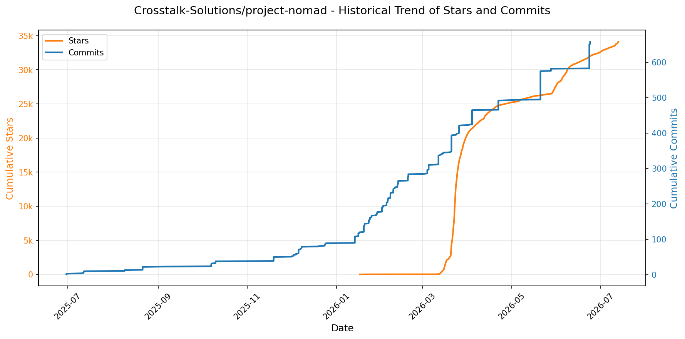

> *蓝色：累计 Stars｜橙色：累计 Commits（次 Y 轴）*

<b>📄 README 摘要</b>

1. **项目功能**  
Project N.O.M.A.D. 是一个自包含、离线优先的本地知识与教育服务器平台，旨在为用户提供无需互联网连接即可访问的关键信息、教育资源和AI能力。它通过统一的浏览器管理界面（“Command Center”）集中编排和运行多个容器化工具，支持在无网络环境下持续获取知识、开展学习、处理数据、记录笔记、查看离线地图，并执行系统性能基准测试。核心定位是构建一个可部署于物理设备上的“永不掉线的知识节点”，适用于应急场景、偏远地区、隐私敏感环境或网络受限场合。

2. **关键特性**  
- **本地AI助手**：集成 Ollama（支持本地大模型运行）或兼容 OpenAI API 的后端（如 LM Studio、llama.cpp），结合 Qdrant 实现文档上传与语义检索（RAG）；  
- **离线知识库**：内置 Kiwix 提供的离线维基百科、医学指南、生存手册、电子书等 ZIM 格式资源；  
- **离线教育平台**：基于 Kolibri 部署 Khan Academy 全套课程，支持多用户、进度追踪与离线学习；  
- **离线地图服务**：通过 ProtoMaps 提供可下载的区域矢量地图，支持离线浏览与搜索；  
- **数据处理工具集**：集成 CyberChef，提供加密、编码、哈希、数据清洗与分析等一站式安全数据操作能力；  
- **轻量级笔记系统**：采用 FlatNotes，支持 Markdown 编辑与本地存储；  
- **硬件基准测试与社区排行榜**：内置系统性能评分工具，结果同步至公开社区榜单（benchmark.projectnomad.us）；  
- **应用中心（Supply Depot）**：一键安装 PDF 工具、文件浏览器、密码管理器等第三方应用，并支持用户自主部署自定义 Docker 容器；  
- **全自动更新机制**：支持按需配置的定时静默更新（含核心系统、已装应用及离线内容），区分 minor/patch 自动升级与 major 版本手动升级；  
- **向导式初始化**：首次启动提供图形化设置向导，支持按需选择预置内容包（如医疗包、教育包、技术包等）；  
- **零 telemetry 与隐私优先设计**：默认完全离线运行，无任何遥测；仅安装阶段需联网，后续使用不依赖网络；  
- **硬件无关性与灵活部署**：既支持低配设备运行基础管理界面，也适配高性能 GPU 设备以本地运行大语言模型（LLM）。

3. **技术栈**  
- **编排与容器化**：Docker + Docker Compose（核心部署与服务管理）；  
- **前端管理界面**：基于 Web 的浏览器 UI（Command Center），具体框架未明示，但含 Node.js 运行时（见 Ace CLI 脚本）；  
- **AI 后端**：Ollama（首选本地 LLM 运行时）、Qdrant（向量数据库，支撑 RAG）；兼容 OpenAI API 的替代方案（LM Studio、llama.cpp）；  
- **离线内容引擎**：Kiwix（ZIM 文件读取与服务）、Kolibri（教育内容分发与学习管理系统）、ProtoMaps（离线地图渲染与查询）；  
- **工具集成**：CyberChef（WebAssembly/Node.js 混合架构）、FlatNotes（Node.js + SQLite 或文件系统存储）；  
- **基础设施组件**：MySQL（用于部分应用状态存储，如 Kolibri、FlatNotes 等）；  
- **开发与运维工具**：Node.js（Ace CLI 用于自动化测试与更新模拟）、Bash（安装/启停/卸载脚本）、GitHub Actions（CI/CD 与发布流程）；  
- **网络与安全**：无内置认证机制，依赖网络层（防火墙/端口控制）实现访问隔离；HTTP 服务默认监听 `:8080`；  
- **操作系统支持**：官方主推 Debian/Ubuntu（APT 包管理），提供 WSL2（Windows）支持路径；不原生支持 macOS 或 Windows 原生部署。

---

### 17. [DeusData/codebase-memory-mcp](https://github.com/DeusData/codebase-memory-mcp)
- 📅 **创建日期**：2026-02-24  
- 🔄 **最近更新**：2026-07-13  
- ⭐ **Stars**：30,716（日 +417｜周 +3833｜月 +27339）  
- 📝 **描述**：High-performance code intelligence MCP server. Indexes codebases into a persistent knowledge graph — average repo in milliseconds. 158 languages, sub-ms queries, 99% fewer tokens. Single static binary, zero dependencies.  

<b>📈 Star 与 Commit 历史趋势</b>

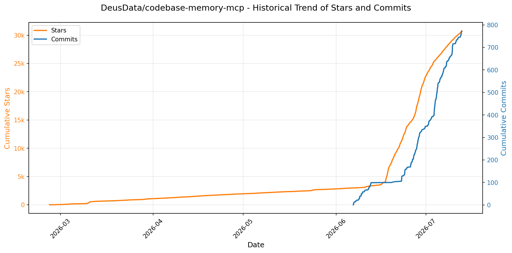

> *蓝色：累计 Stars｜橙色：累计 Commits（次 Y 轴）*

<b>📄 README 摘要</b>

1. **该项目的功能**  
该项目是一个面向 AI 编程代理（AI coding agents）的超高速、本地化代码智能引擎，核心功能是为任意代码库构建并维护一个持久化的结构化知识图谱（Knowledge Graph）。它通过深度静态分析（而非运行时或 LLM 生成）对代码进行全量索引，支持毫秒级响应结构化查询（如“谁调用了 `ProcessOrder`？”、“HTTP 路由 `/api/users` 对应哪些处理函数？”），并作为 MCP（Model Context Protocol）标准兼容的服务端，为各类 AI 编程代理提供底层代码理解能力。所有处理完全在本地完成，代码永不离开用户设备。

2. **关键特性**  
- **极速索引与查询**：Linux 内核（2800 万行代码）3 分钟完成全量索引；结构化查询响应 <1ms；内存优先流水线（LZ4 压缩 + 内存 SQLite + 单次落盘），索引后自动释放内存。  
- **多语言深度解析**：原生支持 158 种编程语言，全部 tree-sitter 语法树解析；对 Python、TypeScript/JS、Go、C/C++、Java、Rust 等 12 种语言提供轻量级 C 实现的 **Hybrid LSP 语义类型解析**（含参数绑定、泛型推导、继承链、HTTP 路由识别等），生成高保真知识图谱节点（函数、类、HTTP 路由、K8s 资源、Kustomize 模块等）。  
- **14 个开箱即用 MCP 工具**：涵盖架构概览（`get_architecture`）、调用链追踪（`trace_path`）、影响分析（`detect_changes`）、死代码检测、Cypher 类图查询、ADR 管理、跨服务 HTTP/gRPC/GraphQL 链接、通道事件（`EMITS`/`LISTENS_ON`）识别、跨仓库关联（`CROSS_*` 边）等。  
- **零依赖单二进制分发**：macOS/Linux/Windows 全平台静态链接二进制，无 Docker、无运行时依赖、无 API Key；内置 CLI 模式与可选 3D 图形化 UI（`localhost:9749`）。  
- **智能协作与增量同步**：支持 `.codebase-memory/graph.db.zst` 压缩图谱快照提交至 Git（自动配置 `merge=ours` 避免冲突），新成员克隆后秒级加载+增量补全；后台 Git 文件变更监听自动触发增量重索引。  
- **极致 Token 效率**：相比传统文件遍历搜索，5 个典型结构查询仅需约 3,400 tokens（降低 99.2%），显著减少 LLM 上下文消耗与成本。

3. **技术栈**  
- **核心解析引擎**：Tree-sitter（158 种语言语法树，全部 vendored 并编译进二进制）；自研 Hybrid LSP（纯 C 实现，兼容主流语言服务器语义逻辑）。  
- **知识图谱存储与查询**：SQLite（内存中构建，最终持久化为压缩数据库）；自定义图查询 DSL 与 Cypher-like 查询支持；基于 Aho-Corasick 的融合模式匹配。  
- **嵌入与搜索**：内置 Nomic `nomic-embed-code` 模型（40K token / 768d int8 量化版），支持无网络语义向量搜索；SQLite FTS5 全文检索（含 camelCase/snake_case 感知分词器 `cbm_camel_split`）。  
- **基础设施**：LZ4 压缩、zstd 压缩（`.zst` 快照）、纯 C 实现（零外部依赖）、POSIX/Windows 原生系统调用；支持 Homebrew/Scoop/Winget/Chocolatey/AUR/npm/PyPI 多渠道分发。  
- **协议与集成**：严格遵循 MCP v1 标准；开箱支持 Claude Code、Codex CLI、Gemini CLI、Zed、VS Code 等 11 种主流 AI 编程代理，自动配置 MCP Server、指令模板与预钩子。

---

### 18. [openai/codex-plugin-cc](https://github.com/openai/codex-plugin-cc)
- 📅 **创建日期**：2026-03-30  
- 🔄 **最近更新**：2026-07-13  
- ⭐ **Stars**：28,165（日 +417｜周 +2492｜月 +7417）  
- 📝 **描述**：Use Codex from Claude Code to review code or delegate tasks.  

<b>📈 Star 与 Commit 历史趋势</b>

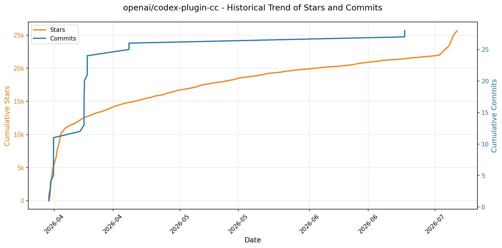

> *蓝色：累计 Stars｜橙色：累计 Commits（次 Y 轴）*

<b>📄 README 摘要</b>

1. **该项目的作用**  
该插件为 Claude Code 用户提供对 OpenAI Codex 的原生集成支持，使其无需离开当前开发环境即可调用 Codex 的高级代码分析与自动化能力。核心用途包括：对本地代码变更或分支差异执行静态代码审查（含常规审查与可引导的对抗式审查）、将调试/修复/重构等开发任务委托给 Codex 后台执行、在 Claude Code 与 Codex CLI/TUI 之间双向同步会话上下文（如转移对话、恢复会话），以及实时监控和管理后台 Codex 任务的生命周期（状态查询、结果获取、任务取消）。

2. **关键功能**  
- **多模式代码审查**：提供 `/codex:review`（标准只读审查）和 `/codex:adversarial-review`（可指定焦点的对抗式审查，用于压力测试设计假设、权衡取舍与风险点）；均支持 `--base`（对比分支）、`--background`（后台异步执行）、`--wait`（阻塞等待）等选项。  
- **任务委托与协同**：通过 `/codex:rescue` 将问题诊断、补丁生成、重试等任务交由 Codex 处理，支持模型选择（如 `spark`/`gpt-5.4-mini`）、努力程度控制（`--effort`）、断点续跑（`--resume`）及轻量模式（`--fresh`）。  
- **会话迁移与持久化**：`/codex:transfer` 可将当前 Claude Code 对话导出为 Codex 可识别的持久化会话，生成 `codex resume <id>` 命令，实现跨工具上下文无缝衔接。  
- **全生命周期任务管理**：`/codex:status` 实时查看运行中/历史任务；`/codex:result` 获取最终输出并附带会话 ID 以供复用；`/codex:cancel` 终止活跃后台任务。  
- **智能审查门控（可选）**：`/codex:setup --enable-review-gate` 可启用自动审查门控——Claude 输出前触发针对性 Codex 审查，发现问题则阻断流程，强制人工介入，防止低质量响应直接提交。  

3. **技术栈**  
- **运行时依赖**：Node.js ≥18.18（用于插件自身运行）；全局安装的 `@openai/codex` CLI（v0.6+，含 Codex App Server）；本地已配置的 ChatGPT 订阅账户或 OpenAI API Key（认证与计费归属 Codex 配额）。  
- **集成机制**：基于 Codex 官方 CLI 工具链，复用其本地认证态（`codex login`）、配置系统（`~/.codex/config.toml` 或项目级 `.codex/config.toml`）、模型路由与服务端通信逻辑；不引入独立服务或远程代理。  
- **扩展协议**：深度适配 Claude Code 的插件市场协议（`/plugin marketplace add` / `/plugin install`），利用其 Slash Command 框架、Subagent 机制（如 `codex:codex-rescue` 子智能体）及 Session Hook（如 `SessionStart` 自动注入对话路径），实现与宿主 IDE 的深度耦合。

---

### 19. [alibaba/page-agent](https://github.com/alibaba/page-agent)
- 📅 **创建日期**：2025-09-23  
- 🔄 **最近更新**：2026-07-13  
- ⭐ **Stars**：26,419（日 +165｜周 +2186｜月 +7862）  
- 📝 **描述**：JavaScript in-page GUI agent. Control web interfaces with natural language.  

<b>📈 Star 与 Commit 历史趋势</b>

> *蓝色：累计 Stars｜橙色：累计 Commits（次 Y 轴）*

<b>📄 README 摘要</b>

1. **项目功能**  
Page Agent 是一个轻量级、纯前端的网页端 AI 智能体（GUI Agent），仅通过一行 JavaScript 脚本即可为任意现有网页注入自主运行的 AI 代理能力。该代理完全在浏览器中运行，无需后端服务、Python 环境、无头浏览器或浏览器扩展（基础场景下），可直接理解用户自然语言指令（如“点击登录按钮”），并基于 DOM 结构精准执行页面操作（如点击、输入、导航等），实现网页交互的自动化与智能化。

2. **核心特性**  
- **零依赖集成**：支持单行 `<script>` 标签嵌入，开箱即用；无需安装插件、部署服务或修改网页源码。  
- **纯文本 DOM 操作**：不依赖截图或视觉模型，仅解析 HTML 结构与语义，规避多模态 LLM 和敏感权限（如屏幕捕获）。  
- **模型自由适配（BYO-LLM）**：兼容主流大语言模型（如 Qwen、Llama、Claude、GPT 等），支持自托管 API（如 DashScope、Ollama、LocalAI）及免费测试接口。  
- **可扩展架构**：提供可选的 Chrome 扩展以支持跨标签页任务协同；内置 MCP（Model Control Protocol）Beta 服务，支持外部系统远程控制浏览器代理。  
- **场景化落地能力**：原生适配 SaaS 产品 AI 助手、ERP/CRM 表单智能填充、无障碍访问（语音/自然语言交互）、多页自动化流程等高频需求。

3. **技术栈**  
- **核心语言**：TypeScript（强类型、模块化开发）  
- **运行环境**：纯客户端（Browser Environment），基于现代 Web API（DOM、MutationObserver、Fetch、Web Workers）  
- **构建与分发**：Vite 构建工具、ESM/IIFE 多格式打包、npm 发布、CDN（jsDelivr / npmmirror）分发  
- **依赖生态**：深度复用并增强 [`browser-use`](https://github.com/browser-use/browser-use) 的 DOM 解析与操作核心（MIT 协议），自研指令理解、状态管理与模型通信层  
- **协议标准**：遵循 MCP（Model Control Protocol）规范，支持标准化 Agent 控制接口  
- **基础设施**：GitHub Actions CI/CD、BundlePhobia 体积监控、Chrome Web Store 发布、文档站点（Docusaurus 或 VitePress）

---

### 20. [Zackriya-Solutions/meetily](https://github.com/Zackriya-Solutions/meetily)
- 📅 **创建日期**：2024-12-26  
- 🔄 **最近更新**：2026-07-13  
- ⭐ **Stars**：23,638（日 +365｜周 +6174｜月 +10996）  
- 📝 **描述**：Privacy first, AI meeting assistant with 4x faster Parakeet/Whisper live transcription, speaker diarization, and Ollama summarization built on Rust. 100% local processing. no cloud required. Meetily (Meetly Ai - https://meetily.ai) is the #1 Self-hosted, Open-source Ai meeting note taker for macOS & Windows. Understand How to write meeting minutes  

<b>📈 Star 与 Commit 历史趋势</b>

> *蓝色：累计 Stars｜橙色：累计 Commits（次 Y 轴）*

<b>📄 README 摘要</b>

1. **项目功能**  
Meetily 是一款隐私优先的本地化 AI 会议助手，专为保障数据主权而设计。它在用户本地设备（macOS、Windows、Linux）上完整运行，**不依赖云端服务**：实时捕获系统音频与麦克风输入、进行端侧语音转录（支持 Whisper 和 Parakeet 模型）、生成会议摘要，并支持导入已有音频文件进行本地重处理。所有原始录音、转录文本、摘要及模型均保留在用户设备上，不上传任何数据，满足 GDPR、HIPAA 等合规要求，适用于法律、医疗、金融、国防等高敏感行业。

2. **核心特性**  
- ✅ **全链路本地处理**：音频采集、语音识别、AI 总结全程离线执行，零数据出设备；  
- ✅ **多模型/多后端 AI 支持**：默认集成 Ollama（本地大模型），同时兼容 Claude、Groq、OpenRouter 及任意 OpenAI 兼容接口（如自建 vLLM 或 LM Studio）；  
- ✅ **专业级音频处理**：支持麦克风+系统音双路混录，内置智能压音（ducking）与防削波机制；  
- ✅ **GPU 硬件加速**：macOS（Metal/CoreML）、Windows/Linux（CUDA/Vulkan）自动启用，无需手动配置；  
- ✅ **灵活工作流**：支持音频导入增强转录、多语言切换、摘要模板预设、本地存储管理；  
- ✅ **企业就绪能力**：PRO 版提供发言人分离（即将上线）、会议聊天式查询、日历集成、PDF/DOCX/Markdown 高级导出、自托管部署及 GDPR 审计追踪。

3. **技术栈**  
- **整体架构**：基于 [Tauri](https://tauri.app/) 构建的单体桌面应用（Rust 后端 + Next.js 前端）；  
- **核心语言与工具链**：Rust（高性能音频处理、模型推理调度）、TypeScript/React（Next.js 前端）、PNPM（包管理）；  
- **AI 模型层**：Whisper.cpp（轻量级本地 ASR）、Parakeet（ONNX 格式高效语音识别模型）、Ollama（本地 LLM 运行时），支持 ONNX Runtime / Metal / CUDA 加速；  
- **构建与部署**：跨平台打包（`.dmg`/`.exe`/源码构建），Linux 需手动编译；  
- **扩展生态**：开源协议（MIT），代码复用自 Whisper.cpp、Screenpipe、transcribe-rs 等知名开源项目。

---

### 21. [PrefectHQ/prefect](https://github.com/PrefectHQ/prefect)
- 📅 **创建日期**：2018-06-29  
- 🔄 **最近更新**：2026-07-13  
- ⭐ **Stars**：23,150（日 +170｜周 +388｜月 +581）  
- 📝 **描述**：Prefect is a workflow orchestration framework for building resilient data pipelines in Python.  

<b>📈 Star 与 Commit 历史趋势</b>

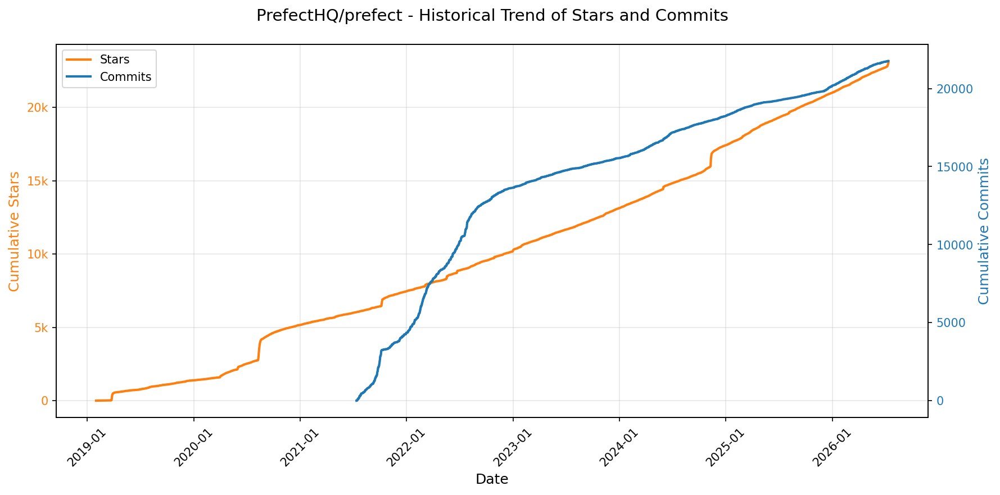

> *蓝色：累计 Stars｜橙色：累计 Commits（次 Y 轴）*

<b>📄 README 摘要</b>

1. **项目功能**  
Prefect 是一个面向 Python 的工作流编排框架，专为构建、部署和监控生产级数据管道而设计。它将简单脚本升级为具备弹性、可观测性与自动恢复能力的可靠数据工作流，支持本地执行、定时调度、事件驱动触发及跨环境（开发/测试/生产）的一致性部署。用户可通过自托管 Prefect Server 或托管式 Prefect Cloud 统一管理任务执行状态、日志、重试历史与依赖关系。

2. **核心特性**  
- ✅ **声明式编程模型**：通过 `@flow` 和 `@task` 装饰器轻量定义工作流逻辑，无需复杂配置；  
- ✅ **弹性容错机制**：内置自动重试（含指数退避）、任务缓存、失败回滚与超时控制；  
- ✅ **动态调度与触发**：支持 Cron 表达式定时、手动触发、API 调用及基于外部事件（如文件到达、API 响应、消息队列）的自动化执行；  
- ✅ **全栈可观测性**：提供 Web UI（本地 Server 或 Cloud）实时追踪任务状态、日志、输入输出、执行时长与依赖拓扑；  
- ✅ **灵活部署模式**：支持本地运行、容器化部署（Docker/Kubernetes）、云服务集成（AWS/GCP/Azure），并可一键发布为可调度的 Deployment；  
- ✅ **企业级协作能力**：Prefect Cloud 提供多团队权限管理、审计日志、SSO 集成、告警通知与用量分析，满足合规与规模化需求。

3. **技术栈**  
- **语言与运行时**：Python 3.10+（核心 SDK 完全基于 Python 构建）；  
- **后端服务**：Prefect Server 基于 FastAPI（API 层） + PostgreSQL（默认元数据存储） + SQLite（轻量级默认选项）；  
- **前端界面**：React + TypeScript 构建的交互式 Web UI；  
- **基础设施适配**：原生支持 Docker、Kubernetes、AWS ECS/Fargate、GCP Cloud Run 等运行时；  
- **生态集成**：官方维护超 200+ 开箱即用的集成（如 AWS S3、Snowflake、Databricks、Slack、GitHub、HTTPX 等），并通过 `prefect-client` 提供轻量级 API 客户端；  
- **开发工具链**：兼容 `pip` / `uv` 安装，支持 Pydantic v2 数据验证、AsyncIO 异步任务、结构化日志（`log_prints`）及 OpenTelemetry 可观测性扩展。

---

### 22. [alirezarezvani/claude-skills](https://github.com/alirezarezvani/claude-skills)
- 📅 **创建日期**：2025-10-19  
- 🔄 **最近更新**：2026-07-13  
- ⭐ **Stars**：22,592（日 +161｜周 +1709｜月 +4523）  
- 📝 **描述**：345 Claude Code skills & agent skills & plugins (30+ Agents, 70+ custom commands, 330+ skills, customizable references, scripts)for Claude Code, Codex, Gemini CLI, Cursor, and 8 more coding agents — engineering, marketing, product, compliance, C-level advisory, research, business operations, commercial & finance, and your daily productivity skills.  

<b>📈 Star 与 Commit 历史趋势</b>

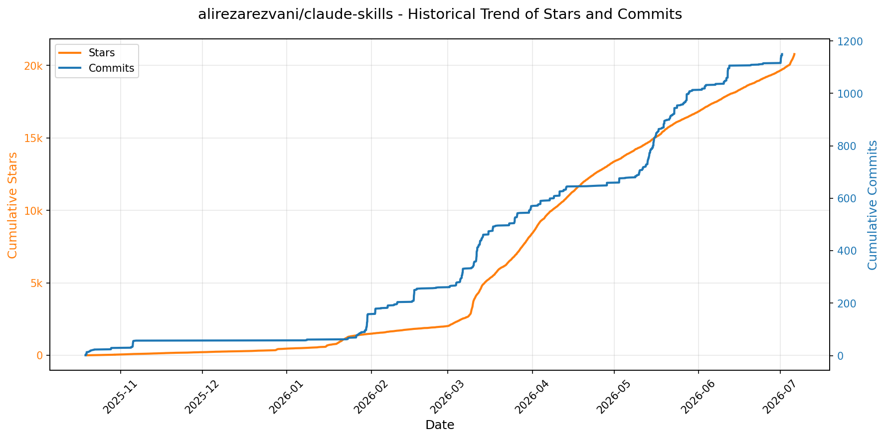

> *蓝色：累计 Stars｜橙色：累计 Commits（次 Y 轴）*

<b>📄 README 摘要</b>

1. **该项目做什么？**  
该项目是一个面向AI编程代理（AI coding agents）的开源技能库，提供355个开箱即用、生产就绪的“Claude Code技能”（亦称代理技能或插件），覆盖工程、DevOps、营销（含AEO——大模型引用优化）、安全（含PreToolUse钩子）、合规、C级高管咨询（支持13类C-suite角色及21个`/cs:*`指令）、生产力、学术研究（文献综述/基金申请/专利分析/课程设计等）、企业级研运（临床/市场/产品/研发金融等）等18大领域。其核心价值是将人类专家知识封装为结构化、可复用的模块（SKILL.md + Python CLI工具 + 参考模板），赋能各类AI编码代理在特定领域执行专业任务，无需从零训练模型。

2. **关键特性**  
- **跨平台兼容性**：原生支持Claude Code、OpenAI Codex、Gemini CLI、Cursor、Aider、Kilo Code、Windsurf、OpenCode、Augment、Antigravity、Hermes Agent、Mistral Vibe、OpenClaw共13种AI编程工具，通过`./scripts/convert.sh`一键转换全部技能格式；  
- **三层能力抽象**：明确区分“技能”（How to do）、“代理”（What to do）、“角色”（Who thinks），支持灵活组合（如Startup CTO角色+Security Auditor技能+Multi-Agent Handoff编排）；  
- **企业级安全与合规**：内置`skill-security-auditor`工具（扫描命令注入、数据泄露等风险），支持ISO/FDA/GDPR/SOC2等监管框架，生成带数字签名的决策凭证（agent-decision-receipts）；  
- **高级能力套件（POWERFUL Tier）**：25个深度技能，涵盖Agent设计、RAG架构、数据库建模、CI/CD流水线生成、MCP服务构建、API测试套件生成、技术债追踪、事故指挥等工程实践；  
- **研究增强栈**：集成学术研究全链路（`litreview`/`grants`/`deep-research`）与企业研运（`clinical-research`/`research-finance`），支持动态加载外部知识源（如`loop-library`实时读取信号库）；  
- **零依赖CLI工具集**：602个纯Python标准库实现的CLI脚本（无pip依赖），覆盖SaaS指标计算、品牌声调分析、技术债评分、RICE优先级排序、落地页生成等场景；  
- **智能编排协议（Orchestration）**：定义Solo Sprint、Domain Deep-Dive、Multi-Agent Handoff、Skill Chain四类协作模式，支持跨领域复杂工作流（如6周产品发布计划）。

3. **技术栈**  
- **核心格式**：基于`agentskills.io`标准的`SKILL.md`元描述文件（结构化指令+工作流+决策框架）；  
- **运行时**：Python 3.x（所有CLI工具仅依赖标准库，零第三方包）；  
- **工具链**：Shell脚本（`install.sh`/`convert.sh`/`gemini-install.sh`等）、Python自动化脚本（同步Hermes/Mistral技能树）、模板引擎（Markdown→HTML转换器含WCAG-AA合规设计系统）；  
- **基础设施**：Git版本控制、GitHub Actions CI/CD、MIT许可证；  
- **扩展生态**：兼容MCP（Model Context Protocol）规范、OpenAPI驱动的MCP服务器生成、Conventional Commits规范的变更日志生成、TSX+Tailwind落地页 scaffolder。

---

### 23. [pbakaus/impeccable](https://github.com/pbakaus/impeccable)
- 📅 **创建日期**：2025-11-16  
- 🔄 **最近更新**：2026-07-13  
- ⭐ **Stars**：20,646（日 +323｜周 +2368｜月 +8302）  
- 📝 **描述**：The design language that makes your AI harness better at design.  

<b>📈 Star 与 Commit 历史趋势</b>

> *蓝色：累计 Stars｜橙色：累计 Commits（次 Y 轴）*

<b>📄 README 摘要</b>

1. **该项目做什么？**  
Impeccable 是一个面向 AI 编程代理（AI coding agents）的前端设计规范与自动化治理工具。它不生成代码，而是为 AI 提供结构化、可执行的设计指导体系：通过统一的设计上下文初始化（`/impeccable init`）、23 个语义明确的命令式指令（如 `polish`、`critique`、`animate`），以及在浏览器中实时可视化的迭代能力，系统性地提升 AI 生成的前端界面在品牌一致性、用户体验、可访问性、性能和视觉品质等方面的水准。其核心目标是打破当前 AI 设计中普遍存在的“模板化陷阱”（如滥用 Inter 字体、紫蓝渐变、嵌套卡片、灰字配色背景等），推动 AI 产出真正专业、差异化、符合产品定位的 UI。

2. **关键特性**  
- **单点初始化设计上下文**：运行 `/impeccable init` 自动生成 `PRODUCT.md` 和 `DESIGN.md`，明确项目类型（品牌页/产品界面）、目标用户、品牌调性、禁用参考、色彩系统、排版规范与组件库，为所有后续命令提供依据；  
- **23 个原子化设计命令**：覆盖全设计生命周期——从前期规划（`shape`）、技术审查（`audit`）、UX 批判（`critique`）、视觉提纯（`distill`、`quieter`/`bolder`）、动效增强（`animate`）、国际化加固（`harden`）、首屏引导（`onboard`）到最终交付准备（`polish`），支持按模块聚焦（如 `/impeccable audit blog`）及快捷别名绑定（`pin audit` → `/audit`）；  
- **46 条确定性检测规则 + LLM 辅助审查**：CLI 与浏览器扩展可在**无 LLM、无 API 密钥、零网络依赖**条件下，离线执行全部 46 条硬性规则检查（如检测过用字体、错误对比度、弹性缓动、嵌套卡片、纯黑/灰使用等），同时支持结合 LLM 进行更深层的“情感共鸣”“层级清晰度”等主观评估；  
- **Live Browser 迭代模式**：`/impeccable live` 命令启用浏览器内可视化变体编辑，直接在真实渲染环境中调整元素样式并实时预览，实现“所见即所得”的设计闭环；  
- **多平台原生集成与智能 Hook**：自动为 Cursor、Claude Code、Codex、GitHub Copilot 等主流 AI 编程工具安装深度集成钩子（hook），在代码编辑时实时拦截并反馈设计问题（Cursor 甚至可阻断违规代码写入）；  
- **灵活部署与跨团队协作支持**：提供 CLI 安装、Git 子模块、插件市场、手动复制五种接入方式，并内置 `.gitignore` 智能模板，区分持久化设计资产（如 `design.json`）与临时文件（截图、会话状态），保障团队协作一致性。

3. **技术栈**  
- **核心运行时**：Node.js（CLI 基于 `npx` 分发，支持跨平台）；  
- **检测引擎**：纯 JavaScript 实现的静态分析器（HTML/CSS 解析 + 规则匹配），依赖 Puppeteer 实现远程 URL 扫描；  
- **前端交互层**：浏览器扩展与 Live Mode 基于现代 Web 技术（推测含 Svelte/Vite 构建，因文档提及 `deferred-svelte-component-accepts.json`）；  
- **AI 工具适配层**：针对各平台定制技能包（Skill Pack）——包括 Cursor 的 `.cursor/skills/`、Claude Code 的 `.claude/skills/`、Codex 的 `.agents/skills/`、GitHub Copilot 的 `.github/skills/` 等，通过 provider-native hook manifest（JSON 配置）与脚本（`.mjs`）实现深度集成；  
- **配置与状态管理**：JSON 配置驱动（`.impeccable/config.json` 全局共享，`.impeccable/config.local.json` 本地覆盖），支持 inline 注释忽略（`<!-- impeccable-disable ... -->`）；  
- **构建与分发**：基于 npm 发布（`impeccable` 包），采用多目标构建输出（`dist/cursor/`, `dist/claude-code/`, `dist/gemini/` 等），兼容 monorepo 路径（`.gitignore` 使用非锚定通配符）。

---

### 24. [HKUDS/Vibe-Trading](https://github.com/HKUDS/Vibe-Trading)
- 📅 **创建日期**：2026-04-01  
- 🔄 **最近更新**：2026-07-13  
- ⭐ **Stars**：20,598（日 +742｜周 +2586｜月 +8670）  
- 📝 **描述**："Vibe-Trading: Your Personal Trading Agent"  

<b>📈 Star 与 Commit 历史趋势</b>

> *蓝色：累计 Stars｜橙色：累计 Commits（次 Y 轴）*

<b>📄 README 摘要</b>

1. **项目功能**  
Vibe-Trading 是一个开源的个人化智能交易代理（Trading Agent）系统，旨在将前沿量化研究、多源金融数据与大语言模型（LLM）能力深度融合，为用户提供端到端的自动化交易支持。它并非直接执行高频交易，而是作为“智能协作者”：可理解自然语言指令（如“分析苹果公司近期技术面并生成择时信号”），自动调用数据源、因子计算引擎、回测框架、风险控制模块及券商API，生成可验证、可审计、带完整溯源的交易建议或模拟指令；支持实盘前的影子账户（Shadow Account）模拟、多市场（美股、A股、印度股市NSE/BSE、加密货币等）统一建模，并通过16种即时通讯渠道（Telegram/微信/钉钉/Feishu等）实现研究结果与决策流的实时分发。

2. **核心特性**  
- **策略开发全生命周期管理**：内置 Strategy Development Manager（SDM），支持从学术论文/券商研报中自动提取因子与策略逻辑，注册至持久化知识库（`~/.vibe-trading/`），并持续监控信息系数（IC）、夏普比率衰减，自动触发“活跃→监控→衰退→停用”状态流转。  
- **跨市场统一交易基础设施**：原生支持美股（含Binance USD-M永续合约）、A股（上交所/深交所，含T+1、熔断、税费栈）、印度股市（NSE/BSE）、港股及加密货币；符号路由（如 `AAPL`, `BTC-USDT-PERP`, `.NS`）与数据加载器（yfinance/Tushare/Shoonya/Dhan）深度集成。  
- **安全可控的实盘交互机制**：提供“影子账户”（Shadow Account）用于无风险信号生成与验证；实盘交易需双重确认弹窗 + 审计日志 + 可配置预交易顾问接口（PreTradeAdvisoryInterface）；严格隔离敏感环境变量（Pydantic EnvConfig）、子进程沙箱环境及SSRF防护（拒绝内网/CNGAT地址）。  
- **多模态AI协同工作流**：支持文本、图像（`analyze_image`工具）、结构化数据（Alpha Zoo 460+因子库）、实时行情与基本面（SEC/PIT-safe财报）融合分析；兼容OpenAI、GLM（Zhipu）、Kimi、Qwen等主流LLM，并提供Requesty等OpenAI兼容网关。  
- **企业级可扩展架构**：模块化FastAPI后端（按功能切分路由：system/channels/settings等）、React 19前端、16通道IM运行时（WebSocket/Telegram/微信/Feishu等）、MCP（Model Context Protocol）标准化插件体系，支持通过`extras`按需安装渠道适配器（如 `vibe-trading-ai[telegram]`）。

3. **技术栈**  
- **后端**：Python 3.11+，核心框架为 FastAPI；数据处理依赖 NumPy、Pandas、bottleneck（加速因子计算）；量化引擎集成 Qlib/Alpha101/qlib158；LLM交互层支持 LangChain/LangGraph；OAuth 与 MCP 协议深度集成；Docker 容器化部署。  
- **前端**：React 19（Vite 构建），支持多语言（中/英/日/韩/阿文），Web UI 提供策略管理、影子账户看板、相关性分析、设置中心等交互界面。  
- **基础设施与生态**：PyPI 发布包 `vibe-trading-ai`；CI/CD 基于 GitHub Actions；代码规范与安全由 Pydantic 配置校验、AST 驱动 CI 门禁、UTC 时区统一、沙箱文件读写控制保障；社区协作通过 Discord/Feishu/微信多渠道支持。

---

### 25. [vxcontrol/pentagi](https://github.com/vxcontrol/pentagi)
- 📅 **创建日期**：2025-01-06  
- 🔄 **最近更新**：2026-07-13  
- ⭐ **Stars**：20,416（日 +220｜周 +2101｜月 +2580）  
- 📝 **描述**：Fully autonomous AI Agents system capable of performing complex penetration testing tasks  

<b>📈 Star 与 Commit 历史趋势</b>

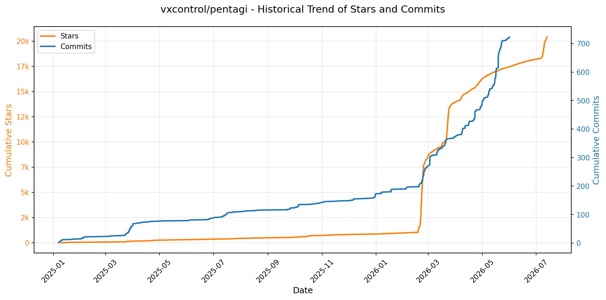

> *蓝色：累计 Stars｜橙色：累计 Commits（次 Y 轴）*

<b>📄 README 摘要</b>

1. **项目功能**  
PentAGI 是一个面向网络安全领域的**自主式渗透测试人工智能平台**，专为安全研究员、红队人员及AI安全从业者设计。它不依赖预定义攻击剧本（如CALDERA），而是通过多智能体协同，在完全隔离的沙箱环境中，自动完成目标侦察、漏洞识别、利用尝试、结果分析与报告生成的全链路渗透测试流程。系统以“AI代理驱动”为核心，将传统安全工具链（如nmap、Metasploit、sqlmap）与大语言模型（LLM）深度集成，实现从信息收集、威胁建模到实战利用的端到端自动化。

2. **核心特性**  
- **强隔离执行环境**：所有渗透操作均在按需启动的Docker容器中运行，保障宿主机与网络环境绝对安全；  
- **多角色AI代理协同**：内置研究员（Researcher）、开发者（Developer）、执行者（Executor）三类专业化智能体，支持任务分解、动态规划与失败回退；  
- **专业安全工具集**：原生集成20+主流渗透测试工具，并支持智能容器调度（自动匹配最适镜像）；  
- **长时记忆与知识图谱**：基于pgvector的向量数据库持久化存储命令历史与成功模式；结合Neo4j驱动的Graphiti知识图谱，实现漏洞、工具、靶标间的语义关联与上下文推理；  
- **多源情报融合**：无缝对接Tavily、Perplexity、Google Custom Search等10+外部搜索API，以及内置无头浏览器（scraper）进行实时Web情报采集；  
- **企业级可观测性**：深度集成Langfuse（LLM追踪）、Grafana/Prometheus（系统监控）、Jaeger（分布式追踪）、Loki（日志聚合）；  
- **全栈可扩展架构**：微服务设计，支持水平扩展；提供REST/GraphQL双API接口，支持Bearer Token认证与OAuth（GitHub/Google）；  
- **多LLM厂商灵活接入**：开箱支持OpenAI、Anthropic、Gemini、AWS Bedrock、Ollama、DeepSeek、GLM、Kimi、Qwen等10+厂商，兼容OpenAI API标准及自定义端点，含vLLM本地部署优化指南。

3. **技术栈**  
- **后端**：Go（高性能API服务与任务编排）、Python（AI代理逻辑、工具调用封装）；  
- **前端**：React + TypeScript（现代化Web管理界面）；  
- **数据库**：PostgreSQL + pgvector（结构化数据与向量检索）、Neo4j（知识图谱存储）；  
- **消息与队列**：异步任务队列（支撑Agent调度与Pipeline执行）；  
- **观测与分析**：Langfuse（LLM可观测性）、ClickHouse（分析存储）、Redis（缓存与限流）、MinIO（S3对象存储）、VictoriaMetrics/Jaeger/Loki（Prometheus生态监控栈）；  
- **基础设施**：Docker Compose一键部署、Docker容器化沙箱、OpenTelemetry统一遥测；  
- **AI能力层**：多LLM Provider抽象层、ChainAST对话状态管理、智能上下文压缩（QA式摘要算法）、Embedding模型（用于记忆检索）。

---

### 26. [topoteretes/cognee](https://github.com/topoteretes/cognee)
- 📅 **创建日期**：2023-08-16  
- 🔄 **最近更新**：2026-07-13  
- ⭐ **Stars**：20,302（日 +106｜周 +627｜月 +10066）  
- 📝 **描述**：Cognee is the open-source AI memory platform for agents. Give your AI agents persistent long-term memory across sessions with a self-hosted knowledge graph engine.  

<b>📈 Star 与 Commit 历史趋势</b>

> *蓝色：累计 Stars｜橙色：累计 Commits（次 Y 轴）*

<b>📄 README 摘要</b>

1. **项目功能**  
Cognee 是一个开源的 AI 记忆平台，专为 AI 智能体（Agents）设计，提供跨会话的**持久化长期记忆能力**。它支持从任意格式（文本、PDF、网页、数据库等）摄入数据，自动构建并维护一个**自托管的知识图谱**，使智能体能够基于语义与关系进行回忆（recall）、关联（connect）和决策（act），并在持续交互中实现知识演化与反馈学习。

2. **核心特性**  
- **多模态统一记忆层**：融合向量嵌入（语义搜索）、图结构推理（关系检索）与认知科学驱动的本体生成（ontology grounding），实现“按意义搜索 + 按关系连接”。  
- **双层记忆架构**：支持高速会话内存（session memory）与持久化知识图谱（long-term graph memory），自动同步与回写。  
- **全栈 Postgres 部署**：默认将图关系、向量（pgvector）、会话缓存、元数据全部运行于单个 PostgreSQL 实例，消除多数据库运维复杂性，且性能优于传统分离架构（CI 基准快约 10%）。  
- **开箱即用的智能体集成**：提供官方插件支持 Claude Code（记忆插件）、OpenClaw；支持 MCP（Model Context Protocol）标准；兼容多种部署形态（本地、Docker、云托管 Cognee Cloud、Modal/Fly.io/Railway 等一键部署）。  
- **可审计与可隔离的企业级能力**：支持租户/用户级隔离、OTEL 追踪、操作审计日志、上下文溯源，满足可信 AI 应用需求。  
- **跨语言 SDK 支持**：提供 Python（主客户端）、Rust（`cognee-rs`）、TypeScript（`@cognee/cognee-ts`）三套官方客户端，覆盖主流开发场景。

3. **技术栈**  
- **后端核心**：Python（3.10–3.14），基于异步框架（asyncio），模块化设计（`remember`/`recall`/`forget`/`improve` 四大原语）。  
- **存储层**：默认 PostgreSQL（含 pgvector 扩展 + 自研图后端），同时支持 Neo4j、Amazon Neptune（图）、Redis（会话缓存）、Qdrant/ChromaDB/Weaviate/Milvus/LanceDB（向量）、SQLite/KuzuDB（本地开发）。  
- **基础设施**：Docker 容器化部署（`cognee/cognee` 和 `cognee/cognee-mcp` 镜像），支持 Docker Compose 多服务编排（含 UI、MCP、Postgres、Neo4j 等可选 profile）。  
- **AI 依赖**：LLM 驱动的认知处理（支持 OpenAI 及其他 LLM 提供商），用于文档理解、本体抽取、关系推理与上下文优化。  
- **前端与工具链**：内置 CLI（`cognee-cli`）、本地 Web UI（基于 Docker 的 React 前端）、Colab 快速体验环境；配套 MCP 服务器（HTTP/SSE/stdio 协议）。

---

### 27. [simplex-chat/simplex-chat](https://github.com/simplex-chat/simplex-chat)
- 📅 **创建日期**：2019-12-21  
- 🔄 **最近更新**：2026-07-13  
- ⭐ **Stars**：18,596（日 +84｜周 +622｜月 +7383）  
- 📝 **描述**：SimpleX - the first messaging network operating without user identifiers of any kind - 100% private by design! iOS, Android and desktop apps 📱!  

<b>📈 Star 与 Commit 历史趋势</b>

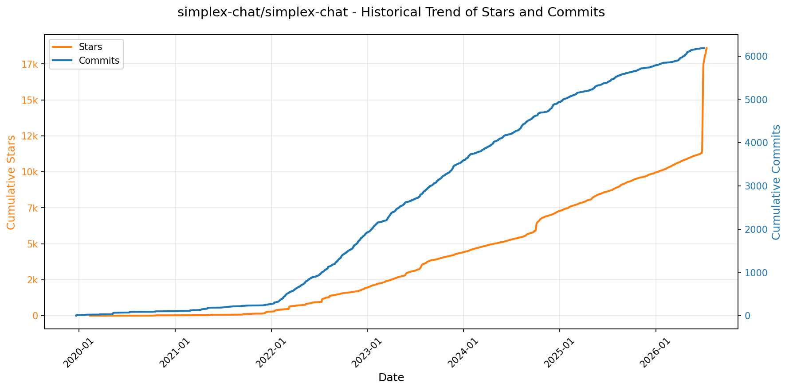

> *蓝色：累计 Stars｜橙色：累计 Commits（次 Y 轴）*

<b>📄 README 摘要</b>

1. **项目功能**  
SimpleX 是一个完全去标识化的即时通讯平台，核心目标是实现“设计即隐私”（privacy by design）。它不依赖任何用户身份标识（如手机号、邮箱、用户名或公钥地址），通过一次性、匿名的连接链接（含 QR 码）建立端到端加密通信。用户无需注册账户，不存储联系人列表、社交图谱或通信元数据（如谁与谁何时通信），从根本上消除中心化身份追踪和关联分析风险。支持一对一私聊、群组通信、语音/视频通话，并提供命令行终端客户端（Zap），适用于注重隐私与抗审查的个人及技术用户。

2. **关键特性**  
- ✅ **零用户标识架构**：无账号体系，连接基于一次性共享链接，会话身份动态生成且不可关联；  
- ✅ **强加密保障**：采用双棘轮协议（Double Ratchet）实现前向保密与后向保密，并叠加额外加密层；  
- ✅ **元数据保护**：不收集、不传输、不存储通信对象、时间、频率、设备信息等任何元数据；  
- ✅ **去中心化网络模型**：用户自主运行服务器或使用公共中继节点，网络由用户共同拥有与维护；  
- ✅ **跨平台全端支持**：原生 Android（Google Play / F-Droid / APK）、iOS（App Store / TestFlight）、Linux/macOS/Windows 终端 CLI；  
- ✅ **安全连接验证**：支持手动比对连接安全码（Security Code）以防范中间人攻击；  
- ✅ **开源可审计**：代码完全公开，已通过 Trail of Bits 等第三方安全审计，协议处于公共领域；  
- ✅ **多语言与社区驱动**：依托 Weblate 实现超 20 种语言本地化（含简体中文、法语、捷克语、波兰语等），文档与应用界面全面翻译。

3. **技术栈**  
- **前端/客户端**：Kotlin（Android）、Swift（iOS）、Rust（跨平台核心逻辑与 CLI 客户端 Zap）；  
- **加密协议**：基于 Signal 协议改进的双棘轮算法，结合自研元数据保护机制与匿名信令协议；  
- **网络层**：基于 SMP（SimpleX Messaging Protocol）的轻量级、无状态消息中继协议，支持 Tor 和 IPv6；  
- **构建与发布**：GitHub Actions 自动化 CI/CD（build.yml），APK / IPA / CLI 二进制包分发；  
- **国际化**：Weblate 平台管理多语言翻译，支持 Android/iOS 应用、网站及 GitHub 文档同步；  
- **基础设施**：静态网站托管（simplex.chat）、分布式目录服务（SimpleX Directory）、Bot 辅助发现；  
- **安全合规**：遵循 GDPR 原则，无数据留存策略，所有审计报告与设计文档公开可查。

---

### 28. [abseil/abseil-cpp](https://github.com/abseil/abseil-cpp)
- 📅 **创建日期**：2017-09-20  
- 🔄 **最近更新**：2026-07-13  
- ⭐ **Stars**：17,945（日 +102｜周 +587｜月 +649）  
- 📝 **描述**：Abseil Common Libraries (C++)  

<b>📈 Star 与 Commit 历史趋势</b>

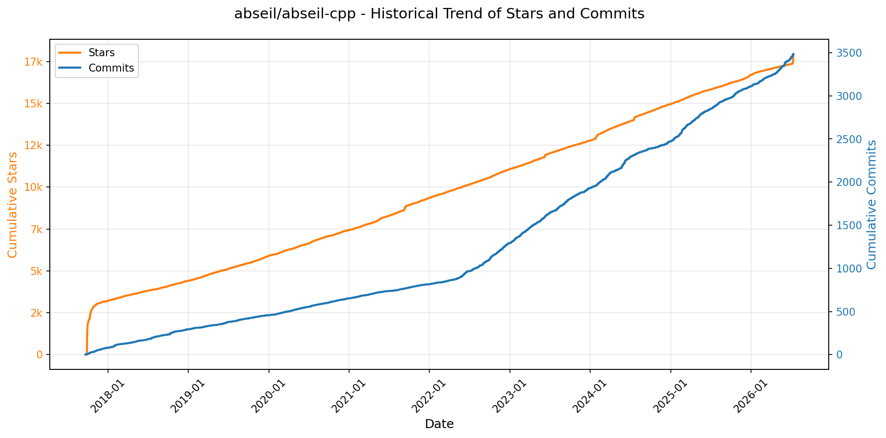

> *蓝色：累计 Stars｜橙色：累计 Commits（次 Y 轴）*

<b>📄 README 摘要</b>

1. **项目功能**  
Abseil 是一个开源的 C++ 辅助库集合，旨在补充和增强 C++ 标准库（兼容 C++17），并非替代标准库。它源自 Google 内部广泛使用并经生产环境长期验证的 C++ 基础代码，提供在标准库缺失、不足或不满足实际工程需求（如性能、线程安全、易用性、调试支持等）场景下的高质量替代实现与扩展工具。

2. **核心特性**  
- 提供模块化、细粒度的 C++ 实用组件，涵盖算法（`algorithm`）、容器（含高性能 Swiss Table 哈希表）、字符串处理（`strings`）、时间计算与时区支持（`time`）、内存管理（`memory`）、并发同步原语（如 `absl::Mutex`）、日志与断言（`log`）、错误状态抽象（`status`）、命令行参数解析（`flags`）、随机数生成（`random`）、哈希框架（`hash`）、CRC 校验（`crc`）、清理机制（`cleanup`）、类型元编程（`meta`）、128 位整数与位运算（`numeric`）、调试与性能剖析（`debugging`/`profiling`）等；  
- 强调生产就绪：所有组件均通过 Google 大规模代码库验证，具备高稳定性、可移植性与严格的质量保障；  
- 支持“活在主干”（live-at-head）开发模式，并提供长期支持（LTS）版本以满足不同项目对稳定性的要求；  
- 明确标注与标准库的关系（补充/替代），并遵循严格的兼容性承诺与 C++ 支持策略。

3. **技术栈**  
- **语言标准**：C++17（最低要求），部分组件前瞻性支持 C++20 特性（如位运算函数）；  
- **构建系统**：官方支持 [Bazel](https://bazel.build) 和 [CMake](https://cmake.org/)；  
- **平台与编译器**：遵循 Google 的《Foundational C++ Support Policy》，支持主流编译器（GCC、Clang、MSVC）、操作系统（Linux、macOS、Windows）及架构；  
- **许可证**：Apache License 2.0；  
- **依赖关系**：各模块高度解耦，`base` 模块为最小依赖核心，其余模块仅依赖 `base` 和标准库，无外部第三方依赖。

---

### 29. [stablyai/orca](https://github.com/stablyai/orca)
- 📅 **创建日期**：2026-03-17  
- 🔄 **最近更新**：2026-07-13  
- ⭐ **Stars**：17,389（日 +847｜周 +4869｜月 +12684）  
- 📝 **描述**：Orca is the ADE for working with a fleet of parallel agents. Run any coding agent with your own subscription. Available on desktop and mobile.  

<b>📈 Star 与 Commit 历史趋势</b>

> *蓝色：累计 Stars｜橙色：累计 Commits（次 Y 轴）*

<b>📄 README 摘要</b>

1. **项目功能**  
Orca 是一款面向开发者的 AI 编程协作者（AI Orchestrator），核心目标是统一管理和并行调度多种命令行 AI 编程代理（如 Claude Code、Codex、OpenCode、Pi 等），支持在单个桌面应用中同时运行多个隔离的 AI 工作流。它将每个 AI 任务封装为独立的 Git 工作树（worktree），实现结果对比、合并与版本化追踪；同时提供跨平台桌面客户端（macOS/Windows/Linux）与配套移动应用，形成“桌面+移动端”协同闭环，使开发者能随时随地监控、干预和推进 AI 编程任务。

2. **关键特性**  
- **移动伴侣（Mobile Companion）**：iOS/Android 应用实时推送代理完成通知，支持远程下发新指令与上下文跟进；  
- **并行工作树（Parallel Worktrees）**：同一提示词可分发至多个 AI 代理，各自运行于隔离 Git 工作树，支持结果比对与一键合并；  
- **WebGL 终端分屏（Terminal Splits）**：基于 Ghostty 架构的高性能终端，支持无限嵌套分屏、持久化滚动历史（重启不丢失）；  
- **设计模式（Design Mode）**：在内嵌 Chromium 浏览器中点击任意 UI 元素，自动提取 HTML/CSS + 截图并注入代理提示词；  
- **原生 GitHub & Linear 集成**：内置 PR/Issue/项目看板浏览，直接从任务创建工作树，免上下文切换；  
- **SSH 远程工作树**：连接远程服务器执行 AI 任务，支持文件编辑、Git 操作、终端交互及自动重连/端口转发；  
- **AI 差异批注（Annotate AI Diffs）**：在代码差异视图中逐行添加评论，直接回传给 AI 代理迭代优化，全程无需退出 Orca；  
- **文件拖拽输入**：支持拖拽文件、图片至代理对话框，配合 VS Code 风格编辑器实现自动保存；  
- **Orca CLI**：提供 `orca worktree create`、`snapshot`、`click` 等命令，支持全链路自动化脚本编排；  
- **扩展能力**：快速搜索（Quick Open）、多账号热切换与用量监控、富媒体仓库预览（Markdown/PDF/图片）、计算机操作（Computer Use）让 AI 控制桌面应用、智能通知与未读状态管理等。

3. **技术栈**  
- **客户端框架**：基于 Electron 或类似跨平台桌面框架（隐含于 macOS/Windows/Linux 多平台打包及 AppImage 支持）；  
- **前端渲染**：终端使用 WebGL 加速（Ghostty-class），UI 集成 Chromium 内核（支持 Design Mode 及浏览器功能）；  
- **后端/协议层**：深度依赖标准 CLI 接口，兼容任意可通过终端调用的 AI 代理（无特定模型绑定，强调 CLI 协议通用性）；  
- **基础设施**：Git 作为底层工作树管理引擎；SSH 协议实现远程工作树；HTTP/WebSocket 支持桌面与移动 App 实时同步；  
- **构建与分发**：支持 Homebrew（macOS）、AUR（Arch Linux）等包管理器；发布格式涵盖 DMG、EXE、AppImage、iOS App Store、Android APK；  
- **开发运维**：采用 MIT 开源协议；CI/CD 日更发布（changelog 为权威功能清单）；隐私数据匿名采集并支持完全禁用。

---

### 30. [diegosouzapw/OmniRoute](https://github.com/diegosouzapw/OmniRoute)
- 📅 **创建日期**：2026-02-13  
- 🔄 **最近更新**：2026-07-13  
- ⭐ **Stars**：16,324（日 +517｜周 +4333｜月 +10289）  
- 📝 **描述**：Never stop coding. Free AI gateway: one endpoint, 231+ providers (50+ free), connect Claude Code, Codex, Cursor, Cline & Copilot to FREE Claude/GPT/Gemini. RTK+Caveman stacked compression saves 15-95% tokens, smart auto-fallback, MCP/A2A, multimodal APIs, Desktop/PWA.  

<b>📈 Star 与 Commit 历史趋势</b>

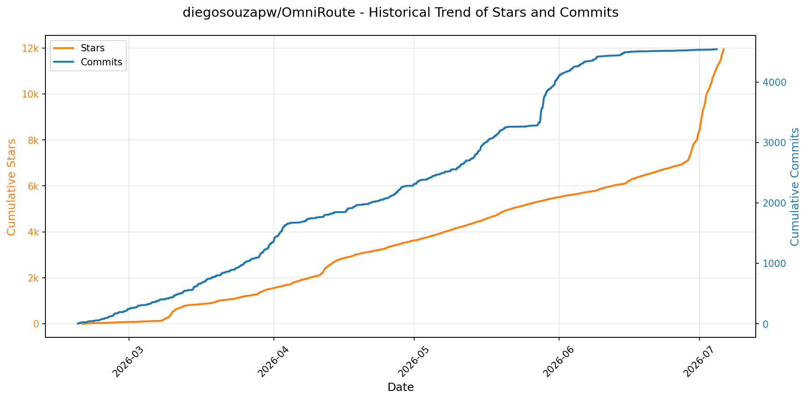

> *蓝色：累计 Stars｜橙色：累计 Commits（次 Y 轴）*

<b>📄 README 摘要</b>

1. **项目功能**  
OmniRoute 是一个开源的 AI 请求智能网关（AI Gateway），核心作用是将用户请求统一接入并智能路由至 237 个 AI 服务提供商（含 Claude、GPT、Gemini、GLM、Kiro 等），无需修改客户端代码。它通过单一 OpenAI 兼容端点（`/v1`）抽象所有底层 API 差异，支持任意兼容 OpenAI 的开发工具（如 Cursor、Claude Code、Copilot、Cline 等）无缝对接，并在后台自动实现跨供应商的故障转移、成本优化与配额协同，确保服务永续可用。

2. **关键特性**  
- **超大规模免费接入能力**：聚合 90+ 提供商的明确免费额度（含 11 个永久免费无上限服务），月均提供约 16 亿免费 token，首月可达 21 亿；  
- **智能动态路由引擎**：支持 `auto` 系列零配置模式（如 `auto/coding`、`auto/cheap`）及 17 种可组合路由策略（优先级、加权、成本最优、上下文接力、模型融合等），支持多维度实时评分（健康度、延迟、成功率、剩余配额等）；  
- **深度令牌压缩技术**：集成 RTK 与 Caveman 双层压缩算法，对日志、diff、代码片段等结构化输出实现 15–95% 的 token 节省（平均约 89%）；  
- **企业级韧性架构**：三层独立熔断机制（全提供商级电路断路器、单密钥连接冷却、单模型隔离锁）、4 层自动降级（订阅 → API → 低价 → 免费）、配额共享（Quota-Share）支持团队共用同一上游账户配额并公平分配；  
- **开箱即用的 AI 基础设施能力**：内置 MCP（Model Context Protocol）服务器（支持 95 个工具）、A2A（Agent-to-Agent）协议、本地向量+全文检索内存、PII/注入/多模态内容安全守门员（Guardrails）、TLS 指纹隐身代理，适配全球网络受限环境；  
- **全栈可观测性与治理**：实时仪表盘（`/dashboard/free-tiers`）展示各提供商配额使用率、术语合规标识、模型级用量明细，并采用池去重（pool-deduped）方式避免虚高统计。

3. **技术栈**  
- **核心语言与运行时**：TypeScript（主逻辑）、Node.js（服务端）、Electron（桌面客户端）、Docker（容器化部署）；  
- **协议与兼容性**：OpenAI REST API v1 协议兼容层、MCP v0.5 规范实现、JSON-RPC 2.0（A2A 通信）、HTTP/HTTPS + TLS；  
- **存储与索引**：SQLite（含 FTS5 全文搜索 + 向量扩展）、内存缓存（LRU / prompt-cache 会话粘性）；  
- **基础设施能力**：自研 RTK/Caveman 压缩算法、基于权重/成本/上下文的动态路由调度器、配额共享引擎（支持时间窗口与维度策略）、多层熔断与恢复机制；  
- **部署形态**：支持本地运行（CLI / Electron）、Docker 容器、npm 包集成（`omniroute`），强调“本地优先”（Local-first）与隐私保护，全部数据默认不外传。

---

### 31. [ogulcancelik/herdr](https://github.com/ogulcancelik/herdr)
- 📅 **创建日期**：2026-03-27  
- 🔄 **最近更新**：2026-07-13  
- ⭐ **Stars**：15,927（日 +300｜周 +3662｜月 +10427）  
- 📝 **描述**：agent multiplexer that lives in your terminal.  

<b>📈 Star 与 Commit 历史趋势</b>

> *蓝色：累计 Stars｜橙色：累计 Commits（次 Y 轴）*

<b>📄 README 摘要</b>

1. **项目功能**  
herdr 是一个运行于终端内的轻量级代理（agent）多路复用器（multiplexer），专为 AI 代理协同工作场景设计。它提供统一的终端界面，用于启动、监控、管理多个长期运行的 AI 代理进程（如 LLM 驱动的自动化任务），支持实时可视化各代理状态（阻塞中 / 运行中 / 已完成），并确保代理在用户脱离会话（如关闭终端、断开 SSH）后持续后台执行，且可随时重新连接恢复交互。

2. **核心特性**  
- **原生终端视图**：直接渲染真实终端输出，不通过抽象层封装，保留原始格式、颜色与交互能力；  
- **会话持久化与跨终端重连**：支持 `Ctrl+B Q` 安全分离（detach），任意终端或远程 SSH 均可重新附加（reattach），会话状态在系统重启后仍可恢复；  
- **代理内嵌协作能力**：通过纯 Socket API，允许代理自身创建新窗格（pane）、读取其他代理输出、等待依赖代理完成，实现复杂工作流编排（即“agent calling agent”）；  
- **全模态输入支持**：同时原生支持键盘快捷键（类 tmux 前缀键 `Ctrl+B`）和鼠标操作（点击、拖拽分割、选中窗格等），无需切换工具即可按需选择交互方式；  
- **插件扩展生态**：提供官方插件市场，支持开发者扩展窗格行为、集成外部工具或定制工作流；  
- **零依赖单二进制**：使用 Rust 编译为单一静态可执行文件，无 Electron 或 Web 运行时，兼容任意标准终端（如 kitty、alacritty、iTerm2 等）。

3. **技术栈**  
- **主语言与构建**：Rust（利用其内存安全、高性能及优秀 CLI 生态）；  
- **终端渲染与交互**：基于 `crossterm`（跨平台终端控制）与 `tui-rs`（文本用户界面框架）构建原生 TUI；  
- **会话管理与 IPC**：自研基于 Unix Domain Socket（Linux/macOS）或 Named Pipe（Windows）的进程间通信协议，支撑代理间协调与主控端通信；  
- **构建与分发**：Cargo 构建系统，支持 Homebrew（macOS/Linux）、Mise 版本管理器、Shell 脚本一键安装及 Windows PowerShell 安装；  
- **许可证**：AGPL-3.0 开源许可（强制衍生作品开源），同时提供商业授权选项。

---

### 32. [alibaba/zvec](https://github.com/alibaba/zvec)
- 📅 **创建日期**：2025-12-05  
- 🔄 **最近更新**：2026-07-13  
- ⭐ **Stars**：14,940（日 +61｜周 +1790｜月 +5085）  
- 📝 **描述**：A lightweight, lightning-fast, in-process vector database  

<b>📈 Star 与 Commit 历史趋势</b>

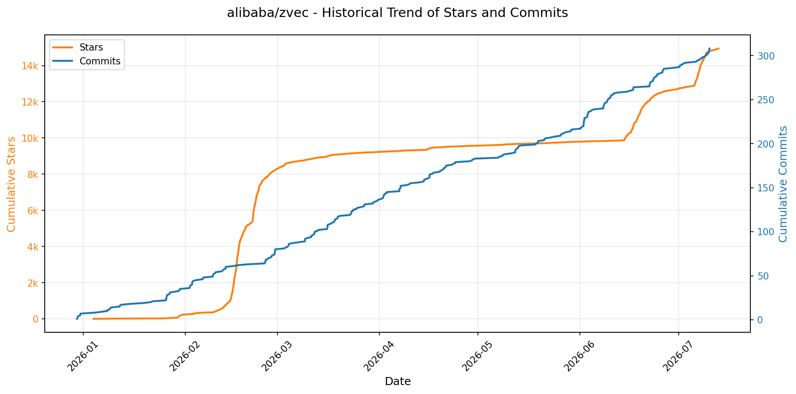

> *蓝色：累计 Stars｜橙色：累计 Commits（次 Y 轴）*

<b>📄 README 摘要</b>

1. **该项目做什么？**  
Zvec 是一个开源的、嵌入式（in-process）向量数据库，专为轻量级、低延迟、高吞吐的相似性搜索场景设计。它无需独立服务进程或复杂部署，直接以库形式集成到应用程序中（如 Python/Node.js/Go/Rust 等），在本地完成向量存储、索引构建与实时检索。已在阿里巴巴集团内部大规模生产环境验证，支持亿级向量毫秒级响应，并保障数据持久性（通过 WAL 写前日志）和多进程并发读取能力。

2. **核心特性**  
- **极致性能**：支持十亿级向量毫秒级相似搜索；  
- **混合检索（Hybrid Search）**：统一查询接口同时融合稠密向量、稀疏向量、全文检索（FTS）及标量过滤条件；  
- **原生全文搜索（FTS）**：无需外部搜索引擎，可为任意字符串字段自动构建 FTS 索引，支持自然语言与结构化查询表达式；  
- **内存-磁盘协同索引**：新增 DiskANN 磁盘驻留索引，大幅降低大模型向量集的内存占用；  
- **多语言 SDK 支持**：官方提供 Python、Node.js、Go、Rust、Dart/Flutter 全平台绑定；  
- **跨平台与边缘兼容**：支持 Linux（x86_64/ARM64）、macOS（ARM64）、Windows（x86_64）及 RISC-V 架构；  
- **强一致性与可靠性**：基于 WAL 实现崩溃安全的数据持久化；读操作支持多进程并发，写操作线程/进程安全；  
- **开箱即用**：零配置启动，单文件部署，适用于 Jupyter Notebook、CLI 工具、服务端及边缘设备。

3. **技术栈**  
- **核心实现语言**：Rust（高性能底层引擎，兼顾安全性与执行效率）；  
- **主流 SDK 语言**：Python（CPython C API + PyO3 绑定）、TypeScript/JavaScript（Node.js）、Go（cgo / CGO 封装）、Rust（原生 crate）、Dart（FFI 调用）；  
- **索引算法**：支持多种向量索引类型（如 HNSW、IVF-PQ、DiskANN 等），适配内存与磁盘混合存储场景；  
- **全文检索引擎**：内置轻量级倒排索引与 BM25 排序，完全自研，不依赖 Lucene/Elasticsearch 等外部组件；  
- **构建与分发**：CI/CD 基于 GitHub Actions；二进制包发布至 PyPI、npm、crates.io、pub.dev 等官方生态仓库；  
- **基础设施**：CI 测试覆盖、Codecov 代码覆盖率监控、Apache 2.0 开源协议。

---

### 33. [pingdotgg/t3code](https://github.com/pingdotgg/t3code)
- 📅 **创建日期**：2026-02-08  
- 🔄 **最近更新**：2026-07-13  
- ⭐ **Stars**：13,986（日 +177｜周 +529｜月 +1306）  
- 📝 **描述**：暂无描述  

<b>📈 Star 与 Commit 历史趋势</b>

> *蓝色：累计 Stars｜橙色：累计 Commits（次 Y 轴）*

<b>📄 README 摘要</b>

1. **项目功能**  
T3 Code 是一个极简的 Web 图形用户界面（GUI），专为编程智能体（coding agents）设计，当前支持 Codex、Claude、Cursor 和 OpenCode 四大代码生成/辅助平台，并计划持续扩展更多服务商。它提供统一入口，让用户通过浏览器或桌面应用与多个 AI 编程助手交互，无需直接调用各平台 CLI 工具，简化多代理协同开发流程。

2. **核心特性**  
- **多代理统一接入**：原生集成 Codex（OpenAI）、Claude（Anthropic）、Cursor 和 OpenCode，支持一键切换与协同使用；  
- **零安装快速启动**：通过 `npx t3@latest` 即可即时运行，无需本地构建或依赖安装；  
- **跨平台桌面应用**：提供 Windows（winget）、macOS（Homebrew Cask）、Arch Linux（AUR）官方打包版本，开箱即用；  
- **CLI 增强支持**：内置完整命令行接口（如 `--help`），支持高级配置与调试；  
- **面向开发者的设计**：包含详尽的架构文档、各服务商接入指南（Provider Guides）、CI/CD 运维说明及术语百科参考（Encyclopedia）；  
- **早期但高可扩展性**：采用模块化架构（见 `docs/architecture/overview.md`），为后续新增代理和插件预留清晰扩展路径。

3. **技术栈**  
- **前端框架**：基于 Vite+（Vite Plus，非标准 Vite），使用其专属 CLI 工具 `vp` 进行项目初始化与依赖管理（`vp i`）；  
- **构建与部署**：依赖 `npx` 实现免安装快速分发，桌面版通过 GitHub Releases 打包发布；  
- **开发工具链**：采用 Markdown 驱动的文档体系（存于 `/docs` 目录），结合 Discord 社区支持；  
- **运行环境**：纯前端 Web 应用（支持 PWA 或 Electron 类封装），无后端服务依赖，所有 AI 交互通过已认证的本地 CLI 工具代理完成（即依赖用户预先安装并登录对应 provider 的官方 CLI）。

---

### 34. [NVIDIA/SkillSpector](https://github.com/NVIDIA/SkillSpector)
- 📅 **创建日期**：2026-03-21  
- 🔄 **最近更新**：2026-07-13  
- ⭐ **Stars**：13,059（日 +110｜周 +1006｜月 +9444）  
- 📝 **描述**：Security scanner for AI agent skills. Detect vulnerabilities, malicious patterns, and security risks.  

<b>📈 Star 与 Commit 历史趋势</b>

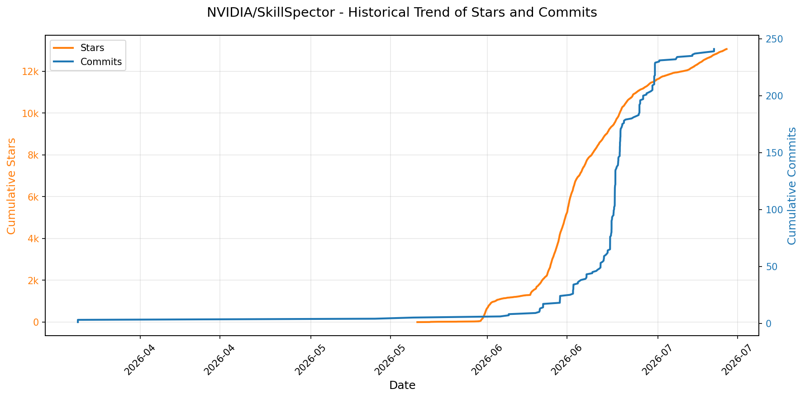

> *蓝色：累计 Stars｜橙色：累计 Commits（次 Y 轴）*

<b>📄 README 摘要</b>

1. **项目功能**  
SkillSpector 是一个专为 AI 智能体（Agent）技能设计的安全扫描器，用于在安装前主动识别技能代码/配置中的安全风险。它针对 AI 技能（如 Claude Code、Codex CLI、Gemini CLI 等所用的技能包）执行深度静态与语义分析，判断其是否可信——核心目标是回答：“这个技能是否安全可安装？” 项目直击当前 AI 技能生态中普遍存在的隐式信任问题，实证检测出 26.1% 的技能存在漏洞、5.2% 具有潜在恶意意图，并提供可操作的风险决策依据。

2. **关键特性**  
- **多源输入支持**：可扫描 Git 仓库、HTTP(S) URL、ZIP 包、本地目录或单个文件（如 `SKILL.md`）；  
- **覆盖广泛的漏洞模式**：精准识别 **68 种** 已定义漏洞模式，涵盖 17 类高危场景，包括 Prompt 注入、数据外泄、提权、供应链攻击、过度自主性、系统提示泄露、内存污染、工具滥用、恶意代理行为、触发词滥用、危险 AST 行为（如 `exec`/`eval`）、污点传播、YARA 恶意特征匹配、MCP 最小权限违规等；  
- **双阶段分析引擎**：默认启用快速静态分析（基于 AST 解析、正则、YARA、依赖检查等），并可选集成 LLM 进行语义级深度评估（支持 OpenAI、Anthropic、AWS Bedrock、NVIDIA Build、Claude/Codex CLI 及本地 Ollama/vLLM 等 10+ 供应商）；  
- **实时漏洞情报联动**：通过 SC4 查询 OSV.dev 获取 CVE 数据，支持自动离线降级；  
- **多格式输出与集成能力**：支持终端美化输出、JSON（机器可读）、Markdown（文档化）、SARIF（CI/CD 与 IDE 集成）；  
- **量化风险评分与分级建议**：输出 0–100 风险分，附带严重性标签（CRITICAL/HIGH/MEDIUM/LOW）及明确处置建议；  
- **基线化误报抑制机制**：支持通过 `.skillspector-baseline.yaml` 文件对已知/可接受问题建立指纹或通配符规则，确保后续扫描仅报告新增风险；  
- **MCP 协议服务化部署**：可作为 Model Context Protocol（MCP）服务器运行，使 AI Agent 在运行时直接调用 `scan_skill()` 工具，实现“安装前动态拦截”，将安全检查从离线审计升级为实时运行时防护；  
- **批量扫描与多语言支持**：提供 `contrib/batch_scan` 模块，支持并发扫描多个技能、多语言（中/日/韩）检测及分布式 API 密钥池管理。

3. **技术栈**  
- **主语言与运行时**：Python 3.12+（严格版本要求）；  
- **核心分析引擎**：AST 解析（`ast` 模块）、正则表达式、YARA 规则引擎（`yara-python`）、依赖解析（`pipdeptree`/`requirements-parser`）、OSV.dev API 客户端；  
- **LLM 集成层**：抽象化 Provider 接口，适配 OpenAI 兼容协议（含 Ollama/vLLM）、Anthropic 原生 API、AWS Bedrock（SigV4）、NVIDIA Build、Claude/Codex CLI 本地认证等；  
- **构建与分发**：`uv`（首选包管理器）、`pip`、Docker（基于 `python:3.12-slim-bookworm`）、Makefile 自动化；  
- **服务框架**：MCP 服务器基于 `fastmcp` 实现 stdio 与 HTTP/SSE 两种传输协议；  
- **安全与工程实践**：Apache 2.0 开源许可、SARIF 标准兼容、环境变量驱动配置（`.env`）、基线 YAML 配置、结构化日志与错误处理。

---

### 35. [n0-computer/iroh](https://github.com/n0-computer/iroh)
- 📅 **创建日期**：2022-03-14  
- 🔄 **最近更新**：2026-07-13  
- ⭐ **Stars**：11,620（日 +76｜周 +472｜月 +2929）  
- 📝 **描述**：IP addresses break, dial keys instead. A library that adds QUIC + NAT Traversal to your apps.  

<b>📈 Star 与 Commit 历史趋势</b>

> *蓝色：累计 Stars｜橙色：累计 Commits（次 Y 轴）*

<b>📄 README 摘要</b>

1. **项目功能**  
Iroh 是一个面向去中心化网络的底层通信框架，核心能力是通过公钥（而非 IP 地址或域名）直接建立并维护端到端连接。它自动选择最优传输路径：优先尝试 NAT 穿透（hole-punching）实现直连；若失败，则无缝回退至去中心化、可扩展的公共中继服务器网络。其设计目标是“为网络减少网络开销”（less net work for networks），即抽象掉传统网络寻址与连接管理的复杂性，使开发者只需关注应用逻辑，无需处理底层连接发现、保活、路径优化等问题。

2. **关键特性**  
- **公钥寻址与自适应连接路由**：支持基于公钥（`EndpointId`）的端点标识与连接建立，自动探测并维持最快可用路径（直连 > 中继）。  
- **内置 NAT 穿透与中继回退机制**：集成成熟的 hole-punching 策略，并依托开源、可自托管的 `iroh-relay` 服务提供高可用中继能力；所有中继性能经持续监控（[iroh-perf](https://perf.iroh.computer)）。  
- **QUIC 协议栈原生支持**：基于自研 QUIC 实现 `noq`，提供认证加密、多路复用流、流优先级、无队头阻塞、可靠/不可靠混合传输等现代传输层能力。  
- **模块化协议生态**：提供可组合、可插拔的高层协议套件：  
  - `iroh-blobs`：基于 BLAKE3 内容寻址的大规模二进制数据（KB–TB 级）高效分发；  
  - `iroh-gossip`：轻量级、手机级资源消耗的 P2P 发布-订阅（pub-sub）覆盖网络；  
  - `iroh-docs`：最终一致性、基于 blob 的键值存储，支持离线协作与同步。  
- **跨语言支持**：提供 Rust 原生 API 及 `iroh-ffi` 绑定，便于集成到其他语言（如 Python、Go、JS 等）环境。  
- **去中心化地址解析**：通过 `iroh-dns-server` 实现基于 DNS/PKARR 的公钥地址发现（运行于 `dns.iroh.link`）。

3. **技术栈**  
- **编程语言**：Rust（全栈实现，强调内存安全、零成本抽象与并发性能）。  
- **核心网络协议**：QUIC（自研实现 `noq`），替代 TCP/UDP，提供安全、低延迟、多路复用传输。  
- **密码学基础**：BLAKE3 哈希算法（用于内容寻址与完整性校验）、Ed25519 公钥加密（用于身份认证与密钥交换）。  
- **基础设施组件**：  
  - `iroh-relay`：Rust 编写的中继客户端与服务端（生产级部署）；  
  - `iroh-dns-server`：DNS 服务器，支持 PKARR 记录以实现去中心化公钥解析；  
  - `iroh-base`：共享基础类型（如 `EndpointId`、`RelayUrl`）与工具库。  
- **构建与生态**：Cargo 工作区管理多 crate 项目；CI/CD 基于 GitHub Actions；文档托管于 docs.rs 与自建 Docs Site；社区协作通过 Discord 和 YouTube 技术频道支撑。

---

### 36. [mauriceboe/TREK](https://github.com/mauriceboe/TREK)
- 📅 **创建日期**：2026-03-19  
- 🔄 **最近更新**：2026-07-13  
- ⭐ **Stars**：10,212（日 +119｜周 +946｜月 +4603）  
- 📝 **描述**：A self-hosted travel/trip planner with real-time collaboration, interactive maps, PWA support, SSO, budgets, packing lists, and more.  

<b>📈 Star 与 Commit 历史趋势</b>

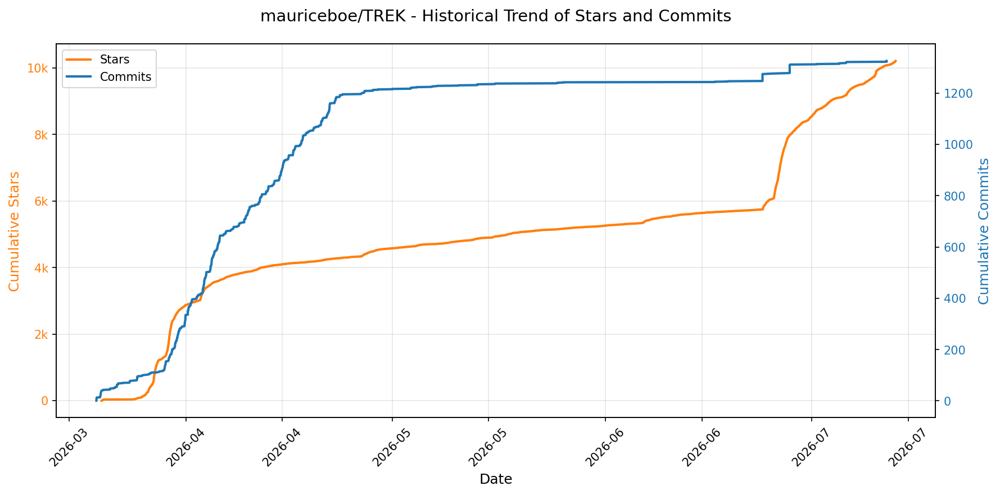

> *蓝色：累计 Stars｜橙色：累计 Commits（次 Y 轴）*

<b>📄 README 摘要</b>

1. **项目功能**  
TREK 是一款自托管的实时协同旅行规划工具，面向个人及多人旅行团队提供端到端行程管理能力。它允许用户创建、共享并同步完整的旅行计划，涵盖地图路线规划、预算与费用分摊、智能打包清单、旅行日记、证件/票据文档管理、天气预报、航班住宿预订集成（支持邮件/PDF自动解析）、多语言支持（20种）及全球旅行统计（如“已访国家”Atlas）。所有数据本地存储于用户自控服务器，支持完全离线使用（PWA），且默认不依赖外部商业API（如地图可选免密OpenStreetMap或Google Places）。

2. **核心特性**  
- **实时协作**：基于WebSocket的毫秒级同步，支持多角色成员邀请（含一次性链接、SSO/OIDC单点登录、TOTP双因素认证、WebAuthn无密码登录）；内置群聊、共享笔记、每日打卡、投票等功能。  
- **智能行程规划**：拖拽式日程编排、交互式3D地图（Leaflet/Mapbox GL）、自动路线优化与导出、多源地点导入（Google Maps/Naver Maps/GPX/KML/GeoJSON）、带图标的日志记录、16天无密天气预报（Open-Meteo）。  
- **全栈旅行管理**：机票酒店预订集成（KDE Itinerary解析）、多币种费用分摊与结算（Splitwise风格）、可分配/模板化的打包清单（支持行李重量追踪）、50MB内PDF/图片附件管理、一键生成含封面与图文的PDF行程册。  
- **AI增强能力**：内置符合MCP（Model Context Protocol）标准的OAuth 2.1 AI服务端，提供150+工具与27个细粒度权限范围，支持AI自动生成行程、打包清单、预算摘要等，并动态适配启用的插件（如Atlas、Journey、Vacay）。  
- **企业级运维与定制**：管理员面板（用户/权限/备份/API密钥管理）、自动化定时备份、SMTP/Webhook/ntfy多通道通知、RTL语言支持（阿拉伯语）、iOS/Android PWA原生体验、Docker/Helm/Kubernetes一键部署、反向代理（Nginx/Caddy）完整配置指南。

3. **技术栈**  
- **后端**：Node.js 22 + NestJS 11（模块化架构），SQLite（默认嵌入式数据库，支持扩展至PostgreSQL），WebSocket实现实时通信，JWT + OAuth 2.1 + OIDC + WebAuthn + TOTP多重认证体系。  
- **前端**：React 19 + Vite构建，TypeScript强类型开发，Tailwind CSS原子化样式，Zustand状态管理，Leaflet与Mapbox GL地图渲染引擎。  
- **基础设施**：Docker容器化交付（官方镜像 `mauriceboe/trek`），支持Docker Compose生产部署与Helm Kubernetes编排；PWA Service Worker实现离线缓存与上传；环境变量驱动的灵活配置（加密密钥、时区、HTTPS策略、OIDC集成等）；反向代理需显式支持WebSocket升级（`/ws`路径）。  
- **第三方集成**：Open-Meteo（天气）、Unsplash（图片搜索）、Immich/Synology（照片库接入）、AirTrail（航班数据同步）、KDE Itinerary（行程PDF解析）。

---

### 37. [TencentCloud/CubeSandbox](https://github.com/TencentCloud/CubeSandbox)
- 📅 **创建日期**：2026-04-10  
- 🔄 **最近更新**：2026-07-13  
- ⭐ **Stars**：9,814（日 +108｜周 +2456｜月 +3520）  
- 📝 **描述**：Instant, Concurrent, Secure & Lightweight Sandbox for AI Agents.  

<b>📈 Star 与 Commit 历史趋势</b>

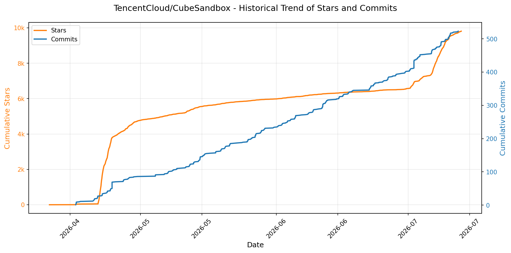

> *蓝色：累计 Stars｜橙色：累计 Commits（次 Y 轴）*

<b>📄 README 摘要</b>

1. **项目功能**  
CubeSandbox 是一个面向 AI 代理（AI Agents）的高性能、开箱即用的安全沙箱服务，专为代码执行场景设计。它提供瞬时启动、硬件级隔离、多租户并发运行能力，支持在单节点快速部署或横向扩展至多节点集群。核心用途是安全、高效地执行由大语言模型（LLM）动态生成的不可信代码（如工具调用、脚本执行、浏览器自动化、强化学习训练等），同时杜绝容器共享内核带来的逃逸风险，满足生产级 AI 应用对安全性、延迟与资源密度的严苛要求。

2. **关键特性**  
- **极致性能**：冷启动平均 <60ms，P99 延迟 <150ms；单实例内存开销 <5MB，支持单节点数千沙箱高密度部署；支持 AutoPause/AutoResume 实现空闲自动挂起与按需唤醒，显著优化资源成本。  
- **强隔离与安全**：基于 KVM + RustVMM 构建轻量级 MicroVM，每个沙箱拥有独立 Guest OS 内核（非共享宿主内核）；集成 eBPF 虚拟交换机（CubeVS）实现内核级网络隔离；配备 CubeEgress 安全网关，提供 L7 域名白名单、实时阻断未授权出向流量、凭证注入（Credential Vault）及完整审计日志。  
- **开发者友好与生态兼容**：原生兼容 E2B SDK，仅需替换 API URL 即可无缝迁移；内置 Web 控制台（端口 `:12088`），支持模板管理、沙箱生命周期操作、实时日志流与健康监控；提供 CubeCoW 快照引擎，支持百毫秒粒度的运行中快照、即时克隆与任意状态回滚；支持 OCI 镜像一键转模板、跨节点自动分发、官方模板商店集成；内置 AgentHub，支持 OpenClaw 等数字助理的一键部署与模板发布。

3. **技术栈**  
- **底层虚拟化**：KVM（Linux 内核模块）、RustVMM 生态组件（定制化 Cloud Hypervisor、virtiofsd、containerd-shim-rs）；自研 CubeHypervisor（MicroVM 管理）与 CubeShim（兼容 containerd Shim v2 API）。  
- **网络与安全**：eBPF-based CubeVS（内核态虚拟交换与策略执行）、OpenResty 驱动的 CubeEgress（L7 安全代理与凭证管理）。  
- **控制平面**：Rust 编写的高并发 CubeAPI（REST 网关，E2B 兼容）、CubeMaster（集群调度器）、CubeProxy（协议路由）、Cubelet（节点本地沙箱生命周期管理）。  
- **部署与运维**：支持裸金属、云厂商虚拟机（PVM，无需嵌套虚拟化）、Terraform 一键集群部署；ARM64 全栈原生支持；WebUI 基于前端框架（未明示，但含实时日志流与可视化控制）；后端服务均以 Rust 实现，强调内存安全与高性能。

---

### 38. [facebook/astryx](https://github.com/facebook/astryx)
- 📅 **创建日期**：2026-01-09  
- 🔄 **最近更新**：2026-07-13  
- ⭐ **Stars**：8,252（日 +280｜周 +2226｜月 +8251）  
- 📝 **描述**：An open source design system that's fully customizable and agent ready  

<b>📈 Star 与 Commit 历史趋势</b>

> *蓝色：累计 Stars｜橙色：累计 Commits（次 Y 轴）*

<b>📄 README 摘要</b>

1. **该项目做什么？**  
Astryx 是一个开源设计系统，源自 Meta 内部八年演进，已支撑公司内超 13,000 个应用。它提供一套开箱即用、端到端集成的 UI 解决方案，涵盖 150+ 符合无障碍标准（WCAG）的 React 组件、品牌级主题系统（含深色模式）、可直接交付的页面模板，以及配套 CLI 工具。其核心目标是统一人类开发者与 AI 助手的构建体验——通过一致的 API、文档和工具链，使两者能使用完全相同的接口和约定进行开发，无需适配差异工具或流程。

2. **关键特性**  
- **开放可组合的内部结构**：所有组件层级（包括底层构建块）均直接导出；支持 `swizzle` 命令将任意组件完整源码“弹出”至项目中自主定制，无黑盒封装。  
- **零样式绑定**：底层使用 StyleX 编写样式，但对使用者完全透明；允许自由通过 `className` 集成 Tailwind、CSS Modules 或原生 CSS，无需迁移现有样式体系。  
- **免封装式主题定制**：主题仅由一组 CSS 自定义属性（CSS Custom Properties）定义，设计师可通过覆盖变量实现品牌化，无需 fork 源码或包装组件。  
- **人机协同优先设计**：API 设计、文档组织、CLI 命令结构均以“人类与 AI 助手可同等理解与调用”为准则；所有提升 AI 可用性的改进同步增强人类开发者体验。  
- **强约定与弱约束**：强调清晰命名、统一 Props 规范和完备 TypeScript 类型；不强制校验或拦截非法输入，而是通过文档和示例引导，赋予开发者最大灵活性。

3. **技术栈**  
- **前端框架**：React（v18+）  
- **样式方案**：StyleX（用于内部样式编写，对外不可见）  
- **语言与类型**：TypeScript（全量类型支持）  
- **构建与工具链**：  
  - CLI 工具（`@astryxdesign/cli`）提供组件文档生成、模板脚手架、主题管理及代码转换（codemods）；  
  - 构建插件（`@astryxdesign/build`）支持 StyleX 源码编译；  
  - 支持主流现代构建工具（Next.js、Vite、CDN 直接引入），无需额外 PostCSS/Babel 配置；  
- **包管理**：pnpm（官方指定，v11+），兼容 Node.js 22+ LTS；  
- **主题与扩展**：7 种预置可定制主题（neutral/butter/chocolate/matcha/stone/gothic/y2k）；实验性图表包（`@astryxdesign/vega`、`@astryxdesign/charts`）暂仅发布于 `@canary` 标签。

---

### 39. [wonderwhy-er/DesktopCommanderMCP](https://github.com/wonderwhy-er/DesktopCommanderMCP)
- 📅 **创建日期**：2024-12-04  
- 🔄 **最近更新**：2026-07-13  
- ⭐ **Stars**：8,038（日 +227｜周 +1797｜月 +1901）  
- 📝 **描述**：This is MCP server for Claude that gives it terminal control, file system search and diff file editing capabilities  

<b>📈 Star 与 Commit 历史趋势</b>

> *蓝色：累计 Stars｜橙色：累计 Commits（次 Y 轴）*

<b>📄 README 摘要</b>

1. **项目功能**  
Desktop Commander MCP 是一个基于 Model Context Protocol（MCP）标准的本地智能代理服务器，旨在将大语言模型（LLM）与用户本地桌面环境深度集成。它使 AI 工具（如 Claude Desktop、ChatGPT Web、Cursor、VS Code 等 MCP 兼容客户端）能够安全、可控地执行真实操作系统级操作：直接搜索、读写、编辑、分析和管理本地文件（含 Excel、PDF、DOCX 等多格式），运行并监控终端命令（支持后台执行、超时控制、分页输出、进程管理），执行内存中代码（Python/Node.js/R），以及与 SSH、数据库、开发服务器等运行中服务交互——所有操作均在用户本机完成，无需上传敏感数据，不依赖外部 API 令牌计费。

2. **核心特性**  
- ✅ **全格式文档原生支持**：零依赖读写 `.xlsx`/`.xls`/`.xlsm`（Excel）、`.pdf`（文本提取/生成/修改）、`.docx`（结构化编辑/Markdown 转换/内容搜索）；  
- ✅ **智能文件系统能力**：递归目录遍历（防爆栈深度限制）、负偏移读取（类 `tail`）、内容/文件名双向搜索（含 Excel 单元格内搜索）、手术式文本替换（正则/多文件/模式匹配）；  
- ✅ **增强型终端与进程控制**：流式输出、会话持久化、后台执行、进程列表/终止、超时熔断、输出分页（避免上下文溢出）；  
- ✅ **可视化协作体验**（App 专属）：Claude Desktop 中实时渲染 Markdown/图片/可展开内容、内建 Markdown 编辑器、“一键打开所在文件夹”；  
- ✅ **企业级安全与审计**：符号链接路径遍历防护、危险命令黑名单+绕过防护、Docker 沙箱隔离（可选）、全自动审计日志（带时间戳/参数/10MB 自动轮转）；  
- ✅ **灵活部署与自动更新**：支持 Node.js（npx/bash/Smithery/手动配置）、Docker（免 Node、持久化卷）、远程 MCP（Web 端调用本地设备）等多种安装方式，多数方案支持重启客户端即自动升级；  
- ✅ **跨平台与多客户端兼容**：开箱支持 Claude Desktop、Cursor、Windsurf、VS Code/Copilot、JetBrains、Gemini CLI、Qwen Code 等全部主流 MCP 客户端。

3. **技术栈**  
- **协议层**：完全遵循 [Model Context Protocol (MCP)](https://modelcontextprotocol.dev/) 标准，作为 MCP Server 与各类 AI 客户端通信；  
- **运行时**：主服务基于 **Node.js**（TypeScript 编写），底层复用并大幅扩展 [MCP Filesystem Server](https://github.com/modelcontextprotocol/servers)；  
- **文件处理**：  
  - Excel：`xlsx`（纯 JS，无 Python 依赖）；  
  - PDF：`pdf-lib`（生成/修改）、`pdf-parse`（文本提取）；  
  - DOCX：`mammoth`（读取）、`docx-templates` + `xml-js`（结构化编辑与 Markdown 转换）；  
- **安全与隔离**：Docker 容器化部署（`mcp/desktop-commander:latest` 镜像）、OAuth 安全认证（Remote MCP）、沙箱化命令执行；  
- **部署与运维**：提供 Bash/PowerShell 自动化安装脚本、Docker Compose 兼容配置、JSON/TOML 多格式 MCP 配置支持；  
- **前端能力（Desktop App）**：独立桌面应用（macOS/Windows）集成 Electron 或原生框架（未明示但功能指向），提供可视化文件预览与编辑 UI。

---

### 40. [bradautomates/claude-video](https://github.com/bradautomates/claude-video)
- 📅 **创建日期**：2026-04-24  
- 🔄 **最近更新**：2026-07-13  
- ⭐ **Stars**：7,864（日 +250｜周 +4273｜月 +5905）  
- 📝 **描述**：Give Claude the ability to watch any video. /watch downloads, extracts frames, transcribes, hands it all to Claude.  

<b>📈 Star 与 Commit 历史趋势</b>

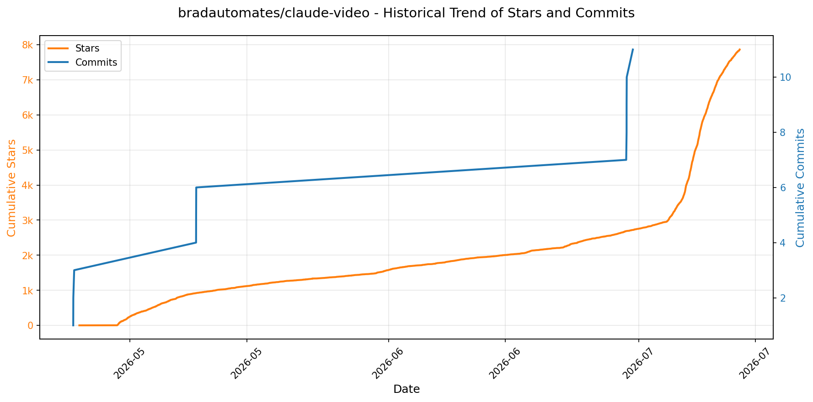

> *蓝色：累计 Stars｜橙色：累计 Commits（次 Y 轴）*

<b>📄 README 摘要</b>

1. **项目功能**  
该项目为 Claude（及其他支持 Agent Skills 的 AI 编程助手）赋予“观看视频”的能力，使其能真正理解视频内容——不仅读取字幕/音频转录文本，还能通过提取并分析关键帧图像，实现多模态（视觉+听觉）的深度理解。用户只需输入视频 URL 或本地路径及自然语言问题（如 `/watch https://... 30秒时发生了什么？`），系统即自动完成：检测并获取字幕（优先免费）、按需下载视频片段、智能抽取代表性帧（支持多种策略）、调用 Whisper API 补充无字幕音频转录，并将帧图像与带时间戳的文本一并送入 Claude 的 `Read` 工具进行上下文感知推理，最终给出基于实际画面与声音的精准回答。

2. **核心特性**  
- **多源视频支持**：兼容 YouTube、TikTok、Instagram、Vimeo、Loom 等数百个平台（依托 `yt-dlp`），以及任意本地视频文件（`.mp4`, `.mov`, `.mkv`, `.webm`）。  
- **智能帧提取与去重**：提供三种细节模式（`efficient`/`balanced`/`token-burner`），分别基于关键帧、场景变化或无上限采样；内置纯 Python 实现的帧间亮度差去重算法，自动剔除静态画面中的冗余帧，确保帧预算用于真正有信息量的内容。  
- **自适应帧预算控制**：根据视频时长动态分配帧数（≤30s 约30帧，>10min 限100帧），避免 token 浪费；支持 `--start`/`--end` 聚焦时段，提升局部密度与性价比。  
- **双轨语音转录**：优先使用平台原生字幕（免费、即时）；缺失时自动调用 Groq（推荐）或 OpenAI 的 Whisper API 进行音频转录，支持全局配置 API 密钥。  
- **零配置快速启动**：首次运行自动检测并安装 `ffmpeg` 和 `yt-dlp`（macOS 自动 `brew`，Linux/Windows 提供精确命令），仅需设置 Whisper API Key 即可启用完整功能。  
- **跨平台技能集成**：支持 Claude Code（插件市场）、Codex/Cursor/Gemini CLI 等 50+ Agent Skills 主机，亦兼容 claude.ai 网页版手动安装，所有安装方式均保持技能自包含性与一致性。

3. **技术栈**  
- **核心工具链**：`yt-dlp`（视频下载与字幕提取）、`ffmpeg`（音视频处理与帧提取）、Anthropic Claude 多模态 `Read` 工具（图像理解）。  
- **语音识别后端**：Groq API（`whisper-large-v3`，推荐，更便宜更快）或 OpenAI API（`whisper-1`）。  
- **开发与部署**：Python 3（纯标准库实现帧去重与配置管理）、Shell 脚本（构建 `.skill` 包）、GitHub Actions（自动化发布）。  
- **技能框架**：Agent Skills 规范（统一 `SKILL.md` 合约），适配多主机（Claude Code、Codex、Cursor 等），通过符号链接或复制实现跨环境部署。  
- **基础设施依赖**：本地运行（无需服务器），依赖系统级 `ffmpeg`/`yt-dlp` 及用户级 API Key 配置（`~/.config/watch/.env`）。

---

### 41. [gabime/spdlog](https://github.com/gabime/spdlog)
- 📅 **创建日期**：2014-11-01  
- 🔄 **最近更新**：2026-07-13  
- ⭐ **Stars**：7,700（日 +16｜周 +165｜月 +310）  
- 📝 **描述**：Fast C++ logging library.  

<b>📈 Star 与 Commit 历史趋势</b>

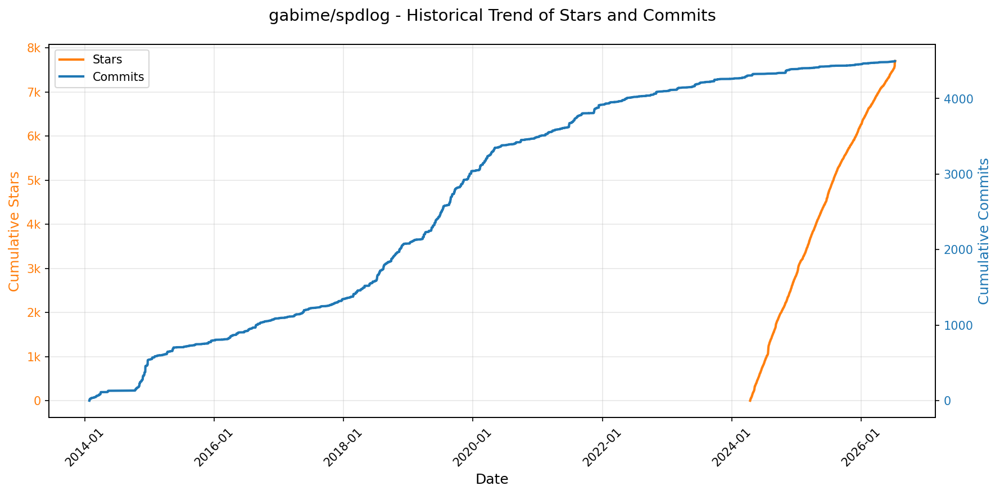

> *蓝色：累计 Stars｜橙色：累计 Commits（次 Y 轴）*

<b>📄 README 摘要</b>

1. **项目功能**  
spdlog 是一个高性能、开源的 C++ 日志库，专注于提供极快的日志记录能力。它支持同步与异步日志写入，允许将日志输出到多种目标（如控制台、文件、系统日志、Windows 事件日志、Android Logcat、Qt 文本控件等），并具备运行时动态调级、多线程安全、格式化输出、回溯缓冲（backtrace）、二进制数据十六进制转储、自定义 sink 和格式器等完整日志功能，适用于从嵌入式到大型服务端的各种 C++ 应用场景。

2. **核心特性**  
- **极致性能**：基准测试显示其同步模式吞吐量达数百万条/秒，异步模式在溢出策略为 `overrun` 时可达约 260 万条/秒；  
- **灵活部署**：支持头文件直连（header-only）和编译链接两种集成方式；  
- **丰富输出目标**：控制台（带 ANSI/Windows 颜色）、旋转日志文件、每日日志、syslog、Windows Event Log、Android log、Qt widget、自定义 sink；  
- **高级日志控制**：运行时/编译时日志级别调节、环境变量/命令行参数加载日志级别、MDC（线程局部上下文）、文件打开/关闭事件回调；  
- **强大格式化能力**：基于 `fmt` 库实现类型安全、高性能的格式化（含 positional args、对齐、进制转换、浮点精度等），支持自定义格式标志与用户类型格式器；  
- **异步日志**：内置线程池与队列机制，支持阻塞（block）或覆盖（overrun）溢出策略；  
- **调试增强功能**：回溯缓冲（backtrace ring buffer）、秒表计时（stopwatch）、二进制数据 hex dump、错误处理器定制；  
- **扩展性设计**：所有组件（sink、formatter、flag、logger）均支持继承与重载，便于深度定制。

3. **技术栈**  
- **语言与标准**：C++11 及以上（核心依赖 C++11 特性，部分高级功能需 C++14/17）；  
- **关键依赖**：底层格式化引擎为 [`fmt`](https://github.com/fmtlib/fmt) 库（v8+ 兼容）；  
- **构建系统**：原生支持 CMake（推荐编译方式），兼容主流包管理器（vcpkg、conan、conda、Homebrew、apt、pacman 等）；  
- **平台支持**：跨平台——Linux（含各发行版）、Windows（MSVC 2013+ / Cygwin）、macOS（Clang 3.5+）、FreeBSD/OpenBSD/Solaris/AIX/Android；  
- **并发模型**：提供 `_mt`（multi-threaded）和 `_st`（single-threaded）两类 logger，异步模式基于独立线程池实现；  
- **可选模块**：通过条件编译启用 syslog、Android、Qt、Windows 专用 sink，以及 MDC、backtrace 等高级特性。

---

### 42. [k1tbyte/Wand-Enhancer](https://github.com/k1tbyte/Wand-Enhancer)
- 📅 **创建日期**：2024-11-17  
- 🔄 **最近更新**：2026-07-13  
- ⭐ **Stars**：7,011（日 +618｜周 +3494｜月 +5158）  
- 📝 **描述**：Advanced UX and interoperability extension for Wand (WeMod) app  

<b>📈 Star 与 Commit 历史趋势</b>

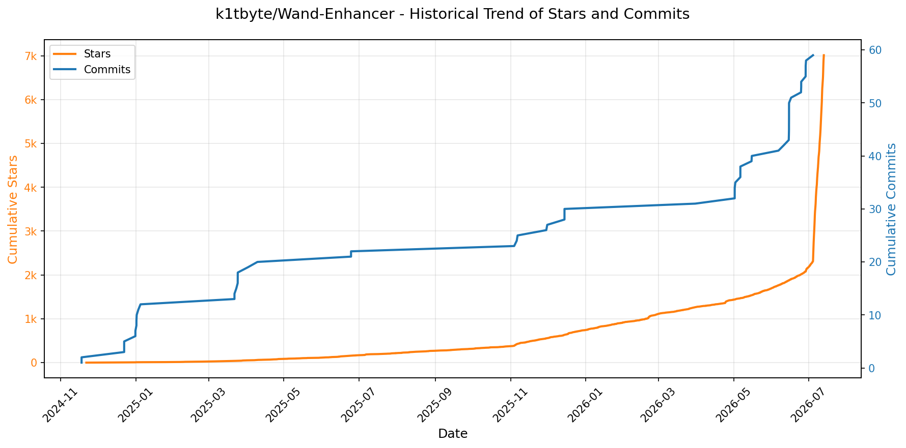

> *蓝色：累计 Stars｜橙色：累计 Commits（次 Y 轴）*

<b>📄 README 摘要</b>

1. **该项目的作用**  
WandEnhancer 是一个开源的本地客户端互操作性增强工具，专为 Wand 应用设计，用于扩展和优化其本地客户端配置与用户体验。它不修改 Wand 的核心服务逻辑或绕过服务器验证，所有操作均在用户本地设备上完成：通过打补丁方式调整 Wand 客户端的本地设置、注入自定义脚本、启用高级 UI 自定义及 AI 功能，并提供基于本地网络的远程控制能力（如手机扫码管理桌面端 Wand）。

2. **核心功能**  
- ✅ 本地环境配置自动化管理（如适配新版本客户端的兼容性参数）  
- ✅ 客户端侧高级布局与主题定制（纯前端渲染层调整）  
- ✅ 内置 AI 相关功能支持（具体能力未详述，但属原生集成范畴）  
- ✅ 内置远程 Web 控制面板（Remote Web Panel），支持手机扫码直连控制（需同局域网，可配合 Tailscale 实现跨网访问）  
- ✅ 可扩展的 JavaScript 自定义脚本注入机制：支持将 `.js` 文件注入 Wand 渲染进程，具备完整 DOM 访问权与 Node.js `require` 能力；脚本受错误隔离保护，支持全局状态守卫与生命周期感知（如 MutationObserver 监听弹窗）  
- ✅ 全离线运行：无需联网，不发起任何网络请求，无数据外传  

3. **技术栈**  
- **桌面端主程序**：基于 .NET Framework 4.8 的 WPF 应用（Windows 平台专用）  
- **构建系统**：CMake + MSBuild（依赖 Visual Studio 2022 或 Build Tools）  
- **前端资源**：Web Panel 前端使用现代 Web 技术（未明确框架，但含构建流程）  
- **依赖管理**：pnpm（替代 npm/yarn）  
- **原生扩展**：集成 C++ 编写的本地辅助模块（通过 CMake 编译）  
- **脚本执行环境**：利用 Electron/Chromium 渲染器进程注入机制（复用 Remote Web Panel 的注入通道），支持 CommonJS 模块与全局 Node API  
- **CI/CD**：GitHub Actions 自动化构建（生成 Windows 可执行文件 `.exe`）  
- **网络通信**：Remote Web Panel 基于本地 HTTP 服务（默认监听 TCP 端口 `3223`），仅限局域网内访问

---

### 43. [kunchenguid/no-mistakes](https://github.com/kunchenguid/no-mistakes)
- 📅 **创建日期**：2026-04-05  
- 🔄 **最近更新**：2026-07-13  
- ⭐ **Stars**：6,055（日 +100｜周 +724｜月 +4775）  
- 📝 **描述**：git push no-mistakes  

<b>📈 Star 与 Commit 历史趋势</b>

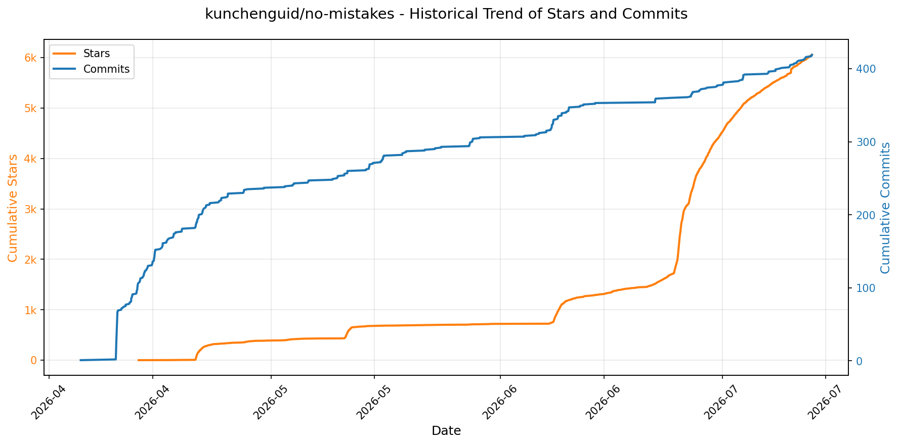

> *蓝色：累计 Stars｜橙色：累计 Commits（次 Y 轴）*

<b>📄 README 摘要</b>

1. **项目功能**  
`no-mistakes` 是一个本地 Git 推送代理工具，它在用户真实远程仓库（如 `origin`）前建立一层“智能闸门”（gate）。用户不再直接 `git push origin`，而是 `git push no-mistakes`；工具随即创建隔离的临时工作树（disposable worktree），自动执行 AI 驱动的多阶段验证流水线（含代码审查、测试、文档检查、Lint 等），仅当所有检查通过后，才将分支转发至配置的目标远程仓库，并自动生成格式规范、内容完整的 Pull Request（PR）。整个过程不干扰开发者主工作区，确保每次推送均产出可合并的“干净 PR”。

2. **核心特性**  
- **非阻塞性设计**：所有验证在独立 worktree 中运行，不影响当前开发环境；  
- **AI 代理无关性与弹性回退**：支持 Claude、Codex、Rovodev、OpenCode、Pi、Copilot 及通过 `acpx` 接入的任意 `acp:<target>` 代理，支持按优先级顺序配置多级 fallback；  
- **原生代理集成**：提供 `/no-mistakes` 技能指令，使 AI 编程代理可直接触发完整流水线——对新任务自动执行 + 修复 + 闸门校验，或对已提交代码进行门控审查；  
- **人机协同控制权明确**：自动应用安全、机械性修复（如格式化、简单 lint 修正）；涉及逻辑意图、业务语义等关键决策项则强制提请人工确认（批准/手动修复/跳过）；  
- **开箱即用的清洁 PR 流程**：一次推送即完成验证、修复、推送到远端、创建 PR 全流程，无需手写 PR 描述、手动 `git push origin` 或反复修正 CI 失败。

3. **技术栈**  
- **主语言**：Go（构建 CLI 工具 `no-mistakes`，含 `make build/test/e2e` 等标准化构建流程）；  
- **前端交互**：TUI（基于终端的文本用户界面），支持交互式审批流；  
- **AI 集成层**：通过标准 CLI 接口调用各类大模型代理（如 `claude`, `codex`），并抽象为统一的 `acpx` 协议适配器；  
- **文档系统**：Astro 框架构建静态文档网站（`docs/dist`）；  
- **自动化与演示**：使用 `vhs`（terminal recorder）和 `ffmpeg` 生成 GIF/MP4 演示；CI/CD 基于 GitHub Actions；  
- **跨平台支持**：原生兼容 macOS、Linux 和 Windows。

---

### 44. [interviewstreet/hiring-agent](https://github.com/interviewstreet/hiring-agent)
- 📅 **创建日期**：2025-07-29  
- 🔄 **最近更新**：2026-07-13  
- ⭐ **Stars**：5,676（日 +77｜周 +815｜月 +4580）  
- 📝 **描述**：AI agent to evaluate and score resumes.  

<b>📈 Star 与 Commit 历史趋势</b>

> *蓝色：累计 Stars｜橙色：累计 Commits（次 Y 轴）*

<b>📄 README 摘要</b>

1. **项目功能**  
该项目是一个面向招聘场景的自动化简历评估系统（“Hiring Agent”），实现从PDF格式简历到结构化评分报告的端到端流水线（Resume-to-Score pipeline）。它首先将PDF简历解析为Markdown样式的文本，再通过大语言模型（LLM）按预定义章节（如基本信息、工作经历、教育背景、技能、项目、奖项等）提取结构化JSON数据；随后自动识别并抓取候选人GitHub个人资料及仓库信息，结合启发式规则与LLM筛选出最具代表性的7个技术项目；最终依据预设的公平性约束和多维评分标准（如开源贡献、个人项目、生产环境经验、技术能力等），生成带证据支撑、可解释、含加分/扣分项的客观综合评分，并支持开发模式下的CSV结果导出与中间结果缓存。

2. **核心特性**  
- ✅ **全本地/混合部署支持**：默认使用Ollama运行轻量级开源模型（如Gemma3系列），亦可无缝切换至Google Gemini云API；  
- ✅ **结构化数据提取**：基于Jinja模板驱动的分节提示工程（per-section LLM prompting），确保输出符合JSON Resume规范；  
- ✅ **GitHub智能增强**：自动从简历中提取GitHub用户名，调用API获取profile与repos，利用LLM进行项目分类与质量筛选（要求作者提交数达标、去重、优先有意义贡献）；  
- ✅ **公平可解释评估**：`evaluator.py` 实现规则驱动的严格评分逻辑，涵盖四大核心维度（`open_source`, `self_projects`, `production`, `technical_skills`），明确标注每项得分的依据、加分项与扣分项；  
- ✅ **开发友好设计**：启用`DEVELOPMENT_MODE`后自动缓存PDF解析、GitHub数据及中间JSON结果，并生成结构化CSV评估记录，便于调试与批量分析；  
- ✅ **模块化高内聚架构**：各环节职责清晰（PDF处理、LLM编排、GitHub集成、评分引擎、配置管理），所有提示模板集中管理且保持Provider无关性。

3. **技术栈**  
- **编程语言**：Python 3.11+（严格版本约束）；  
- **核心依赖**：  
  - `PyMuPDF`（`fitz`）：高性能PDF文本与布局解析；  
  - `Ollama`（本地LLM运行时）或 `google-generativeai`（Gemini API客户端）；  
  - `Pydantic v2`：定义强类型数据模型（`models.py`）与LLM响应Schema；  
  - `Jinja2`：驱动提示工程，实现可复用、可测试的模板化LLM交互；  
- **关键工具与规范**：  
  - 代码风格强制采用 `Black` 格式化；  
  - 配置管理基于`.env`环境变量 + `config.py`标志位；  
  - CLI入口为`score.py`，支持单命令完成全流程评估；  
- **架构模式**：模块化设计，含专用模块如`llm_utils.py`（统一LLM接口封装）、`transform.py`（非标LLM输出→标准JSON Resume归一化）、`github.py`（GitHub信号采集与过滤）、`prompts/templates/`（全部提示模板目录）。

---

### 45. [Nutlope/hallmark](https://github.com/Nutlope/hallmark)
- 📅 **创建日期**：2026-04-27  
- 🔄 **最近更新**：2026-07-13  
- ⭐ **Stars**：4,289（日 +404｜周 +752｜月 +1243）  
- 📝 **描述**：Anti-AI-slop design skill for Claude Code, Cursor, and Codex.  

<b>📈 Star 与 Commit 历史趋势</b>

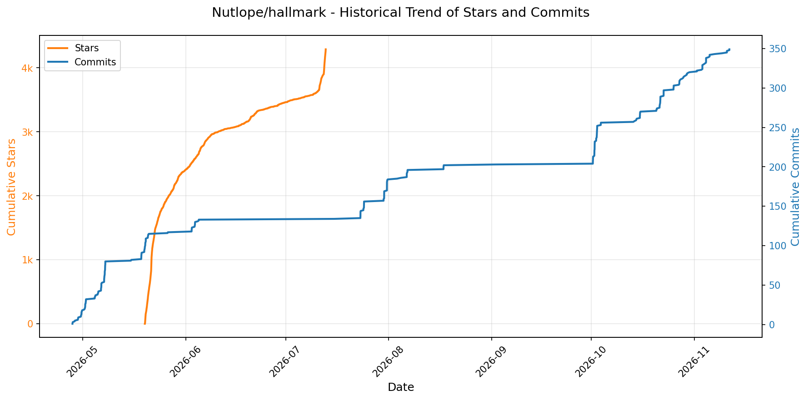

> *蓝色：累计 Stars｜橙色：累计 Commits（次 Y 轴）*

<b>📄 README 摘要</b>

1. **项目功能**  
Hallmark 是一个专为 Claude Code、Cursor 和 Codex 等 AI 编程助手设计的「设计技能」（design skill），核心目标是生成**高度差异化、非模板化、拒绝“AI感”** 的前端 UI 代码。它不依赖固定页面结构或配色方案，而是根据用户输入的设计简报（brief），动态选择宏观结构（macrostructure）、匹配二十种预设主题之一（或启用全新定制模式），并通过 57 道“slop-test”质量门禁与预提交自检机制，主动规避大语言模型常见的同质化输出倾向（如千篇一律的卡片布局、过度圆角、伪微交互等）。最终输出为完全自包含的 HTML + CSS 文件，并在 CSS 注释中标注所用宏观结构，确保每份产出在视觉逻辑、排版节奏与色彩语义上都具备真实设计师的手工特质。

2. **关键特性**  
- **四类设计动词指令**：支持 `hallmark`（默认新建）、`hallmark audit`（代码反模式审计，仅评分不修改）、`hallmark redesign`（保留文案、信息架构与品牌要素，彻底重构结构与风格）、`hallmark study`（从截图或 URL 中逆向提取设计 DNA，包括宏观结构、字体组合、主色锚点，并可导出标准化 `design.md` 用于跨工具协同）；  
- **主题驱动的多样性引擎**：内置 20 种风格化主题（如 Hum、Cobalt、Carnival、Lumen、Riso、Custom 等），每种对应独特的视觉语法与设计约束；  
- **定制模式（Custom）**：当简报超出预设主题范畴时，自动启用零模板定制流程，从头生成专属调色板、字体系统与布局逻辑，仍严格通过全部 57 项 slop-test 校验；  
- **强一致性与强差异性并存**：同一工具下不同简报生成的页面，彼此间呈现本质性差异（非简单换色/换图），真正实现“不同 brief → 不同形状”；  
- **开箱即用集成**：提供一键安装命令（`npx skills add nutlope/hallmark`），并明确适配 Claude Code、Cursor、Codex 三类主流 AI 开发环境的文件路径与格式规范。

3. **技术栈**  
- **运行载体**：作为 LLM 原生技能（skill），深度集成于 Claude Code / Cursor / Codex 等 AI 编程代理平台，不独立运行服务端；  
- **核心规则系统**：基于 Markdown 技能定义文件 [`SKILL.md`](skills/hallmark/SKILL.md) 与配套参考资源目录 [`references/`](skills/hallmark/references/) 构建，含设计原则、结构模板、反模式清单、定制协议（`custom-theme.md`）等；  
- **验证机制**：内置 57 项 slop-test 检查门禁（覆盖布局冗余、色彩滥用、字体失衡、响应式断裂、语义缺失等维度）及预提交自批判（pre-emit self-critique）逻辑；  
- **交付产物**：纯静态前端代码（HTML + CSS），无 JS 依赖，CSS 中嵌入结构标识注释，便于溯源与调试；  
- **辅助生态**：提供实操指南（`docs/recipes.md`）、设计分析案例（`docs/study-examples.md`）、测试集（`site/_tests/`）及可视化示例库（`usehallmark.com`）。

---

### 46. [tt-a1i/archify](https://github.com/tt-a1i/archify)
- 📅 **创建日期**：2026-04-15  
- 🔄 **最近更新**：2026-07-13  
- ⭐ **Stars**：3,971（日 +229｜周 +1249｜月 +3334）  
- 📝 **描述**：Any agent Skill: generate beautiful architecture diagrams with dark/light theme toggle and PNG/JPEG/WebP/SVG export  

<b>📈 Star 与 Commit 历史趋势</b>

> *蓝色：累计 Stars｜橙色：累计 Commits（次 Y 轴）*

<b>📄 README 摘要</b>

1. **项目功能**  
Archify 是一个面向 AI 编程代理（Claude、Codex CLI、opencode）的轻量级技能（Agent Skill），可将自然语言描述（如“React 前端调用 Node.js API，后端连接 PostgreSQL 和 Redis，部署于 AWS CloudFront 之后”）**实时生成高质量、自包含的技术图表 HTML 文件**。它不依赖设计经验，支持五类专业图表：**架构图（Architecture）、工作流图（Workflow）、时序图（Sequence）、数据流图（Data Flow）和生命周期图（Lifecycle）**，输出为单个无依赖 HTML 文件，开箱即用，适用于技术文档、协作沟通与知识沉淀。

2. **核心特性**  
- ✅ **多图表类型语义化支持**：自动识别并渲染架构、审批流程、API 调用链、数据管道、状态机等场景，内置泳道、相位头、异常路径、主路径校验等专业表达能力；  
- ✅ **双主题无缝切换**：深色/浅色模式一键切换（<kbd>T</kbd>快捷键），偏好设置持久化，并通过 CSS 变量 + `@media (prefers-color-scheme)` 实现 SVG 导出文件自动适配读者系统主题；  
- ✅ **超清导出能力**：PNG/JPEG/WebP 支持**原生 4× 分辨率渲染**（非插值放大），杜绝模糊；SVG 为双主题自包含矢量文件，兼容 GitHub README 等场景；  
- ✅ **零依赖自包含输出**：生成的 HTML 内联所有样式与 SVG，无需网络、CDN 或外部资源，可直接邮件发送或嵌入文档；  
- ✅ **强健验证与质量保障**：采用 JSON 中间表示（IR）→ Schema 校验 → 渲染 → HTML/SVG 后置检查（坐标合法性、箭头方向、图例交叉等）的闭环流程，确保图表语义准确、布局合规；  
- ✅ **语义化组件识别**：支持 `aws.lambda`、`postgres`、`redis`、`github-actions` 等技术标签，自动映射至对应视觉类别与配色，无需手动指定图标；  
- ✅ **高效迭代体验**：支持自然语言指令微调（如“添加 Redis”“将认证模块左移”“用翡翠色高亮 API”），仅修改 IR 即可精准重绘，无需重写全部描述；  
- ✅ **无障碍与跨平台优化**：支持键盘导航（<kbd>E</kbd>呼出导出菜单）、ARIA 标签、打印样式、CJK 字体回退、本地字体（JetBrains Mono）支持及 `prefers-reduced-motion` 动画控制。

3. **技术栈**  
- **前端渲染层**：纯客户端 HTML/CSS/JavaScript，基于 CSS 自定义属性（CSS Variables）实现主题系统，SVG 内联渲染，Canvas API 执行高清栅格化导出；  
- **架构核心**：JSON 中间表示（IR）驱动的**类型化渲染器（Typed Renderers）**，为每类图表（architecture/workflow/sequence/dataflow/lifecycle）提供独立、可验证的 Schema 与布局逻辑；  
- **验证体系**：内置**零依赖 Schema 校验器**（无需 npm install），支持 JSON Schema 验证、布局规则检查、HTML/SVG 结构完整性校验；  
- **CLI 工具链**：Node.js 实现的统一命令行工具（`bin/archify.mjs`），支持 `render`/`validate`/`check`/`inspect`/`demo` 等操作，集成 CI 黄金测试（golden tests）；  
- **部署与集成**：作为标准 Agent Skill 目录分发（含 `SKILL.md`），兼容 Claude.ai（ZIP 上传）、Claude Code CLI、Codex CLI、opencode 等多平台，支持全局/项目级安装；  
- **字体与样式**：默认使用系统等宽字体（`ui-monospace`/Menlo/Consolas），导出时自动降级保障一致性；配色体系基于协调的深/浅双色板（Cyan/Emerald/Violet/Amber/Rose/Orange/Slate）。

---

### 47. [Dicklesworthstone/destructive_command_guard](https://github.com/Dicklesworthstone/destructive_command_guard)
- 📅 **创建日期**：2026-01-07  
- 🔄 **最近更新**：2026-07-13  
- ⭐ **Stars**：2,916（日 +709｜周 +1773｜月 +1812）  
- 📝 **描述**：The Destructive Command Guard (dcg) is for blocking dangerous git and shell commands from being executed by agents.  

<b>📈 Star 与 Commit 历史趋势</b>

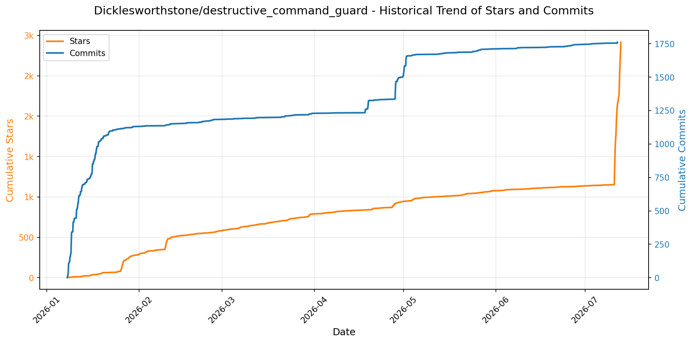

> *蓝色：累计 Stars｜橙色：累计 Commits（次 Y 轴）*

<b>📄 README 摘要</b>

1. **项目功能**  
dcg（Destructive Command Guard）是一个面向AI编程代理（如Claude Code、Codex CLI、Gemini CLI、GitHub Copilot CLI、Cursor、Hermes Agent、Grok等）的高性能安全钩子（hook）工具，核心功能是在**危险命令实际执行前实时拦截并阻止其运行**，防止因AI误生成而导致的灾难性操作（如 `rm -rf ./src`、`git reset --hard`、`DROP TABLE users`、`kubectl delete namespace`、`aws ec2 terminate-instances` 等），从而保护未提交代码、生产数据、基础设施及系统完整性。它不依赖沙箱或权限降级，而是通过深度命令解析与上下文感知实现零信任式防护。

2. **关键特性**  
- ✅ **开箱即用的核心防护**：默认启用 `core.filesystem`（阻断跨临时目录的 `rm -rf`）、`core.git`（阻断丢失未提交更改的git操作）和 `system.disk`（阻断磁盘格式化/分区破坏），Windows平台额外默认启用 `windows.filesystem` 与 `windows.system`（覆盖 `del /s`、`vssadmin delete shadows` 等原生命令）。  
- ✅ **50+ 模块化安全规则包（Packs）**：按领域细粒度组织（数据库、K8s、云厂商、容器、Terraform、CDN、DNS、CI/CD、密钥管理等），支持按需启用/禁用，如 `database.postgresql`、`cloud.aws`、`kubernetes.kubectl`。  
- ✅ **亚毫秒级性能**：基于Rust实现，采用SIMD加速正则匹配与惰性编译，拦截延迟低于1ms，对开发体验无感。  
- ✅ **深度命令语义分析**：支持解析内联脚本（如 `python -c "import os; os.remove(...)"`）、here-document、嵌套shell调用；智能区分“数据内容”（如 `grep "rm -rf"`）与“执行意图”，避免误拦。  
- ✅ **多代理智能适配**：自动识别调用方（Claude/Codex/Grok等），支持代理专属配置（如不同 `trust_level`、动态启停规则包、自定义白名单），Codex CLI获原生一级支持（严格遵循其JSON hook协议）。  
- ✅ **安全友好的I/O设计**：人类可读的丰富拒绝提示输出到 `stderr`，机器可解析的结构化结果（JSON）保留在 `stdout`，兼容CI管道与自动化流程。  
- ✅ **Fail-Open高可用架构**：解析失败、超时或配置错误时自动放行，绝不阻塞开发者工作流。  
- ✅ **全场景覆盖能力**：支持终端交互、CI预检（`dcg scan`）、IDE集成（VS Code Copilot Chat、Cursor）、CLI钩子（`.copilot/hooks/`、`~/.grok/hooks/`）、社区插件（Aider、Continue、OpenCode、Pi）及手动扫描模式。  
- ✅ **灵活绕过机制**：提供环境变量（`DCG_BYPASS=1`）、一次性授权码（`dcg allow-once`）、永久白名单（`dcg allowlist add`）及卸载钩子等多种应急方案。

3. **技术栈**  
- **核心语言**：Rust（主打高性能、内存安全、零成本抽象）  
- **关键库/技术**：  
  - SIMD加速：使用 `regex-automata` 或类似crate实现向量化正则匹配  
  - 配置管理：TOML格式配置文件（`~/.config/dcg/config.toml`）  
  - 跨平台支持：原生Linux/macOS二进制 + Windows原生`dcg.exe`（PowerShell安装器）+ WSL兼容  
  - 安全验证：SHA256校验 + Sigstore/cosign签名（Windows PowerShell安装器）  
  - 构建与分发：GitHub Actions CI/CD，预编译多平台二进制发布  
- **集成协议**：严格遵循各AI代理定义的Hook规范（Claude Code JSON Schema、Codex CLI `PreToolUse` Hook、Copilot CLI Hooks API、Grok `~/.grok/hooks/` 标准等）  
- **扩展生态**：支持通过社区插件/脚本接入Aider、Continue、OpenCode、Pi等非原生支持工具

---

### 48. [malisper/pgrust](https://github.com/malisper/pgrust)
- 📅 **创建日期**：2026-04-20  
- 🔄 **最近更新**：2026-07-13  
- ⭐ **Stars**：2,549（日 +404｜周 +2393｜月 +2424）  
- 📝 **描述**：Postgres rewritten in Rust, now passing 100% of the Postgres regression tests  

<b>📈 Star 与 Commit 历史趋势</b>

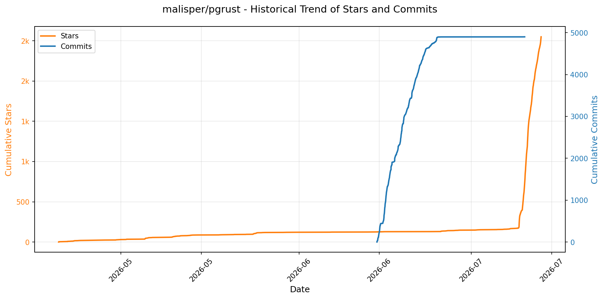

> *蓝色：累计 Stars｜橙色：累计 Commits（次 Y 轴）*

<b>📄 README 摘要</b>

1. **该项目做什么？**  
pgrust 是一个用 Rust 重写的 PostgreSQL 数据库系统，目标是完全兼容 PostgreSQL 18.3 的行为与磁盘格式。它能直接加载并启动现有 PostgreSQL 18.3 的数据目录，通过运行超过 46,000 个官方回归测试（regression queries）验证语义一致性。其核心使命不是另起炉灶，而是以 Rust 重构 PostgreSQL 内核，在保持“Postgres 形态”（Postgres-shaped behavior）的前提下，提升可维护性、可扩展性与性能，并探索传统 C 实现难以推进的深度架构改进（如无 vacuum 存储设计、AI 辅助 SQL 安全防护等）。

2. **关键特性**  
- ✅ **完全磁盘兼容**：可直接复用 PostgreSQL 18.3 的现有数据目录，无需迁移。  
- ✅ **高保真回归测试通过率**：已通过 >46,000 个 PostgreSQL 官方回归测试；最新未发布版本宣称 100% 通过全部回归套件。  
- ⚡ **显著性能提升**：新版本在事务型负载下比原生 PostgreSQL 快 50%，在分析型负载下快约 300 倍（ClickBench 测试中已达 ClickHouse 的 50%，且仍有优化空间）。  
- 🧵 **现代并发模型**：从 PostgreSQL 的“进程每连接”（process-per-connection）改为“线程每连接”（thread-per-connection），降低开销并提升资源利用率。  
- 🛠️ **面向未来的核心改进路线图**：内置连接池、强化 JSON 处理能力、支持快速 fork/branch 工作流、实验无 vacuum 存储引擎、运行时拦截危险查询与 AI 生成的低效/错误 SQL、减少执行计划突变（sudden bad plan switches）。  
- 🌐 **多平台可用**：提供 WebAssembly 浏览器演示、Docker 镜像、源码构建支持（macOS/Linux）。

3. **技术栈**  
- **主语言**：Rust（强调内存安全、零成本抽象、并发模型优势）  
- **兼容基础**：深度依赖 PostgreSQL 18.3 的共享文件（`pgshare`）、测试套件与客户端工具（如 `psql`）  
- **构建与依赖管理**：Cargo（Rust 构建系统）、`--locked` 确保可重现构建  
- **系统级依赖**：ICU（国际化/Unicode 支持）、OpenSSL（SSL/TLS）、libpq（客户端协议支持）、LDAP/PAM（认证扩展）  
- **部署与运行时**：Docker、WebAssembly（WASI）、Linux/macOS 原生二进制  
- **许可协议**：AGPL-3.0（强调对衍生修改的开源回馈要求）

---

### 49. [ColeMurray/background-agents](https://github.com/ColeMurray/background-agents)
- 📅 **创建日期**：2026-01-25  
- 🔄 **最近更新**：2026-07-13  
- ⭐ **Stars**：2,262（日 +126｜周 +165｜月 +330）  
- 📝 **描述**：An open-source background agents coding system  

<b>📈 Star 与 Commit 历史趋势</b>

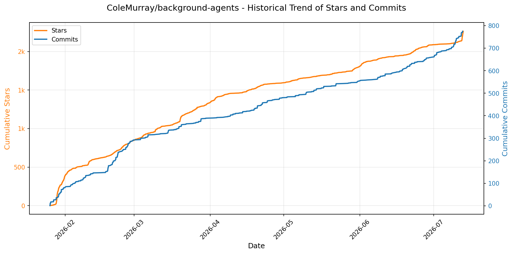

> *蓝色：累计 Stars｜橙色：累计 Commits（次 Y 轴）*

<b>📄 README 摘要</b>

1. **项目功能**  
Open-Inspect 是一个开源的后台编码智能体（Background Coding Agent）系统，旨在让开发者将重复性、耗时的编程任务（如代码修复、重构、测试生成、CI/CD 配置更新等）交由 AI 代理在后台全自动执行。它支持用户在专注其他工作的同时，让 AI 在隔离沙箱中完成端到端开发任务：从克隆仓库、编写/修改代码、运行测试、调试、到最终创建带正确作者归属的 GitHub Pull Request。系统可被多种入口触发（Web UI、Slack 消息、GitHub PR 评论、Linear 工单、Webhook），支持定时任务（Cron）、异常响应（Sentry）、多仓库协同及多人实时协作会话。

2. **核心特性**  
- **极速启动**：通过文件系统快照恢复、预构建镜像（按仓库/环境配置）、输入时预热沙箱实现毫秒级会话初始化；  
- **多仓库与环境管理**：单一会话可并行操作最多 10 个仓库，支持自定义“环境”（含专属密钥域与预构建镜像）；  
- **实时多人协作**：多人加入同一会话，共享终端、代码编辑与流式输出，提交记录自动绑定各成员 Git 身份；  
- **精准提交归属**：PR 由用户 OAuth Token 创建（确保权限与署名），无 SCM Token 用户则回退至共享 GitHub App Bot；  
- **多模型支持**：无缝切换 Anthropic Claude、OpenAI（复用 ChatGPT 订阅）、OpenCode Zen 及 Z.AI 等模型，支持细粒度推理资源控制；  
- **全栈沙箱环境**：内置 Node.js 22、Python 3.12、git、GitHub CLI、headless Chromium（agent-browser）、code-server（VS Code Web）、ttyd 终端及端口隧道；  
- **自动化编排能力**：支持 Cron 定时、Sentry 错误告警触发、Webhook 条件过滤、跨仓库扇出（fan-out）及失败自动暂停；  
- **子任务并行化**：主任务可 `spawn-task` 派生独立沙箱子任务，支持状态查询与取消，具备深度限制与仓库级安全护栏；  
- **可编程仓库生命周期**：通过 `.openinspect/setup.sh`（构建/初始化）和 `.openinspect/start.sh`（每次启动）实现定制化环境准备与服务拉起。

3. **技术栈**  
- **控制平面（Control Plane）**：Cloudflare Workers + Durable Objects（会话状态管理）、D1 数据库（存储仓库作用域密钥）、WebSocket Hub、事件流与 GitHub 集成；  
- **数据平面（Data Plane / Sandbox）**：基于 Modal、Daytona、Vercel Sandbox 或 OpenComputer 构建的云沙箱基础设施，运行 `sandbox-runtime`（OpenCode 驱动的智能体运行时）；  
- **前端与集成层**：Next.js（Web UI）、Slack Bot、GitHub Bot、Linear Bot（均通过独立包实现）；  
- **核心依赖**：OpenCode（AI 编码运行时）、agent-browser（浏览器自动化 CLI）、code-server（Web VS Code）、ttyd（Web 终端）；  
- **安全与身份**：GitHub App（全局仓库访问）、用户 OAuth Token（PR 署名）、AES-256-GCM 加密密钥管理、SSO/VPN 网络准入控制；  
- **部署架构**：单租户设计，强制组织内信任模型，依赖 Cloudflare 边缘计算与第三方云沙箱服务协同调度。

---

### 50. [par274/sharpemu](https://github.com/par274/sharpemu)
- 📅 **创建日期**：2026-03-11  
- 🔄 **最近更新**：2026-07-13  
- ⭐ **Stars**：1,346（日 +444｜周 +1303｜月 +1327）  
- 📝 **描述**：An experimental PlayStation 5 emulator project.  

<b>📈 Star 与 Commit 历史趋势</b>

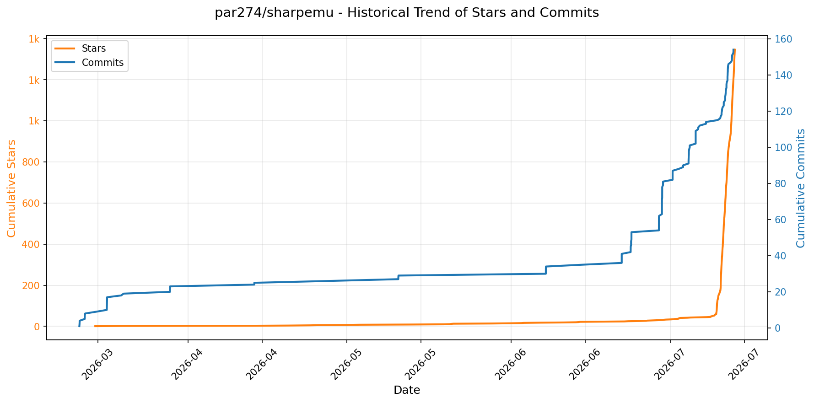

> *蓝色：累计 Stars｜橙色：累计 Commits（次 Y 轴）*

<b>📄 README 摘要</b>

1. **项目功能**  
SharpEmu 是一个从零开始用 C# 编写的实验性 PlayStation 5（PS5）跨平台模拟器，目前支持 Windows、Linux 和 macOS（但开发重心集中于 Windows）。其核心目标是准确模拟 PS5 硬件架构与系统行为，而非实现游戏兼容性优先；现阶段仅能加载真实游戏的 `eboot.bin` 启动文件，执行原生 CPU 指令，解析基础元数据，并部分实现内核功能（如 `Fiber`、`AMPR` 导出函数）、系统模块（`.prx`/`sys_module`）加载、PlayGo 内容调度、着色器/资源提交及初步 AGC（AMD Graphics Core）和 `sceVideoOut` 视频输出——部分游戏（如《Dreaming Sarah》《Demon's Souls Remake》）已可呈现初始画面或纹理渲染，但尚无法完整运行。

2. **关键特性**  
- ✅ 原生支持 `eboot.bin` 与 `.elf` 可执行文件加载；  
- ✅ 基于 C# 实现的 CPU 指令级执行（非 JIT 或翻译层）；  
- ✅ 游戏元数据读取（标题、版本等）；  
- ✅ PS5 系统模块（`prx`）动态加载与基础内核服务模拟；  
- ✅ 初步实现 PlayGo 内容分发机制与游戏文件加载流程；  
- ✅ 图形管线前端支持：Shader 提交、AGC 初始化、Vulkan/SPIR-V 着色器转换准备；  
- ✅ 视频输出基础能力（`sceVideoOut` 阶段），已在多款游戏中验证首帧渲染；  
- ✅ 跨平台设计（代码层面支持 Linux/macOS），当前构建与调试聚焦 Windows；  
- ❌ 明确不支持 PS4 游戏（由 ShadPS4 专精覆盖）；  
- ❌ 不包含任何官方固件、游戏资产或闭源代码，纯研究导向。

3. **技术栈**  
- **主语言**：C#（.NET 生态）；  
- **运行时/SDK**：.NET SDK（要求最新稳定版）；  
- **开发工具**：VS Code（推荐，使用 `.slnx` 解决方案文件）；  
- **构建系统**：`dotnet build` / `dotnet publish`；  
- **图形后端**：面向 Vulkan 的 SPIR-V 着色器管线（AGC 相关），视频输出基于 `sceVideoOut` 抽象层；  
- **依赖参考项目**：ShadPS4（PS4 架构理解）、Kyty（PS5 原生执行逻辑）、Ryujinx（文件系统与低层 C# 实践模式）；  
- **许可证**：GPL-2.0-or-later（开源且强调教育/研究用途，禁止商用）。

---

### 51. [iOfficeAI/OfficeCLI](https://github.com/iOfficeAI/OfficeCLI)
- 📅 **创建日期**：2026-03-15  
- 🔄 **最近更新**：2026-07-13  
- ⭐ **Stars**：0（日 +0｜周 +0｜月 +0）  
- 📝 **描述**：OfficeCLI is the first and best Office suite  purpose-built for AI agents to read, edit, and automate Word, Excel, and PowerPoint files. Free, open-source, single binary, no Office installation required.  

<b>📄 README 摘要</b>

1. **该项目的功能**  
OfficeCLI 是一个专为 AI 代理（AI agents）设计的开源、跨平台命令行工具，旨在赋予 AI 完全自主操控 Microsoft Office 三大核心格式（`.docx`、`.xlsx`、`.pptx`）的能力。它无需安装 Microsoft Office、不依赖外部运行时（如 .NET Framework 或 Python 库），仅通过单个静态二进制文件即可实现文档的**创建、读取、分析、修改、重排与渲染**。其核心价值在于闭环支持 AI 的“**渲染 → 观察 → 修正**”工作流：内置高保真 HTML/PNG 渲染引擎使 AI 能“看见”文档实际呈现效果，从而实现精准、可验证的内容生成与编辑。

2. **关键特性**  
- **全格式原生支持**：对 Word、Excel、PowerPoint 实现深度、无损的读写能力，覆盖全部主流功能（如 Word 的 RTL/i18n、公式/图表/修订；Excel 的动态数组函数、透视表、条件格式、Sparklines；PowerPoint 的动画/过渡/3D 模型/SmartArt/连接线等）。  
- **内置高保真渲染引擎**：自研 HTML 渲染器，支持形状、图表（含瀑布图/烛台图/误差线）、LaTeX 公式（KaTeX）、3D `.glb` 模型（Three.js）、Morph 过渡等，并可导出 HTML 页面或每页 PNG 截图，供多模态 AI 识别。`watch` 命令提供实时浏览器预览，编辑即刷新。  
- **智能公式与透视表引擎**：Excel 支持 350+ 内置函数自动计算（含 `FILTER`/`XLOOKUP`/`LAMBDA` 等动态数组及金融统计函数），无需 Excel 引擎；一键生成完整 OOXML 透视表（支持多字段、日期分组、计算字段、Top-N 过滤等）。  
- **模板合并（Template Merge）**：通过 `{{key}}` 占位符将 JSON 数据批量注入任意 Office 文档的文本、表格、形状、图表标题等位置，确保输出一致性与零 Token 成本复用。  
- **结构化转储与回放（Round-trip Dump）**：`dump` 将文档任意部分（如单张幻灯片、某段文字、样式集）导出为可读 JSON 批处理脚本，`batch` 可精确重放，便于 AI 学习并复现用户范例。  
- **AI 代理即插即用**：提供标准化技能文件（`SKILL.md`），一行命令即可让 Claude Code、Cursor、GitHub Copilot 等 AI 编程助手自动安装并掌握全部 Office 操作指令。  

3. **技术栈**  
- **核心语言与运行时**：使用 C# 开发，**嵌入 .NET 运行时**（.NET 6+），构建为完全自包含（self-contained）、无需系统预装 .NET 的单文件二进制（Single Binary），支持 macOS（ARM64/x64）、Linux（x64/ARM64）、Windows（x64/ARM64）。  
- **渲染层**：自研 HTML 渲染引擎（非基于 WebKit/Chromium），集成 KaTeX（公式）、Three.js（3D 模型）、Canvas/SVG（图表与图形效果）；PNG 截图通过内置轻量级无头浏览器管道生成。  
- **文档解析与生成**：直接操作 OOXML 标准（Open Packaging Conventions + WordprocessingML/SpreadsheetML/PresentationML），不依赖第三方库（如 python-docx、openpyxl、python-pptx），所有解析、序列化、样式映射逻辑均在二进制内实现。  
- **部署与分发**：提供 Shell/PowerShell 一键安装脚本、Homebrew/Scoop/npm 包管理器支持，配置文件存储于 `~/.officecli/config.json`，支持自动后台更新。

---

