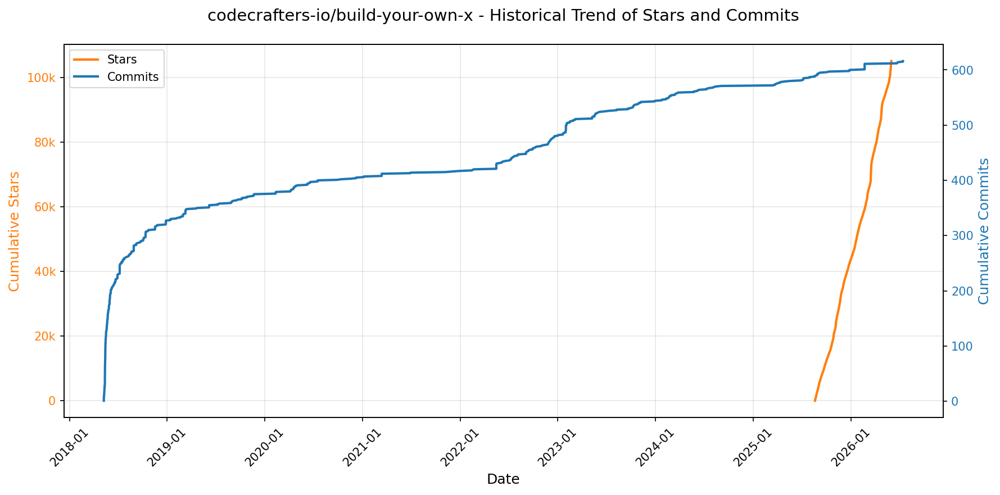
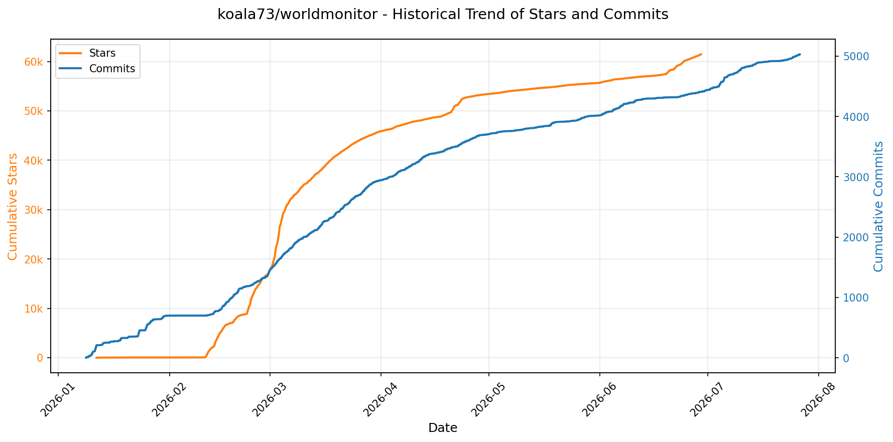
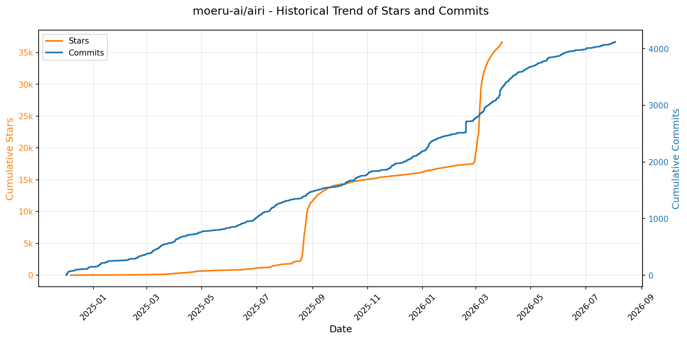
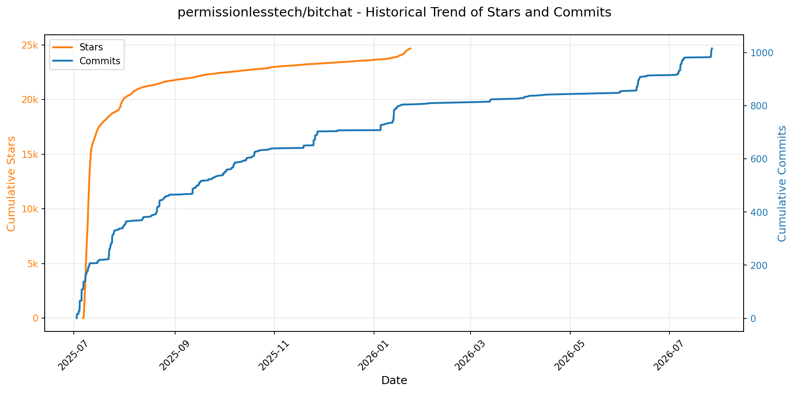
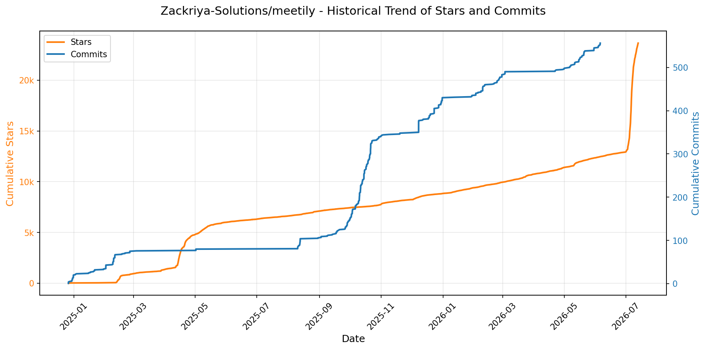
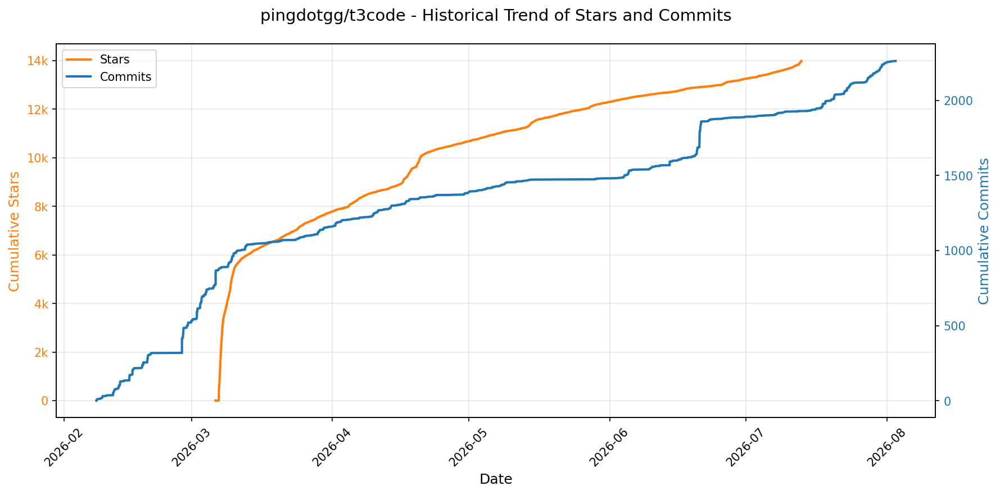
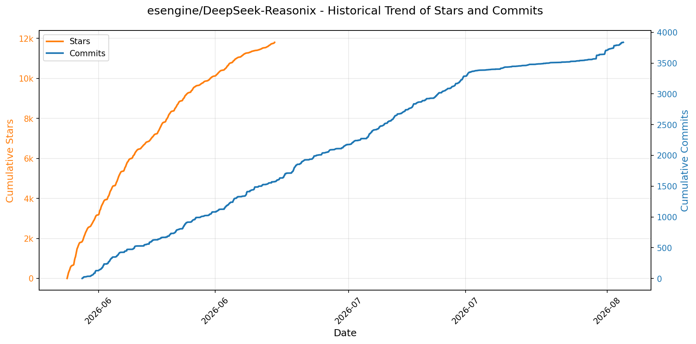
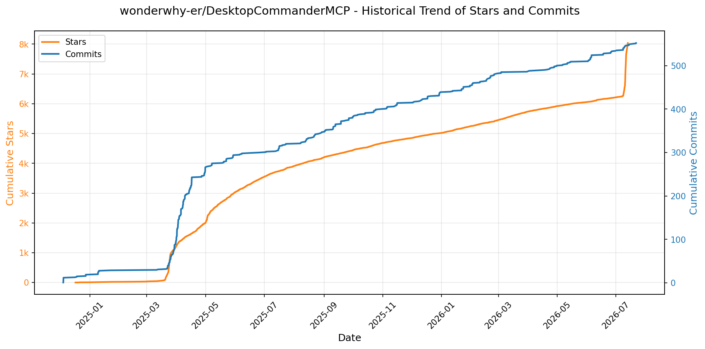
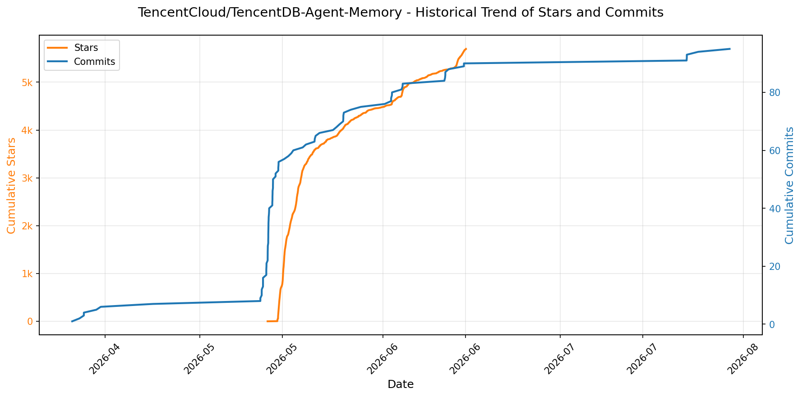
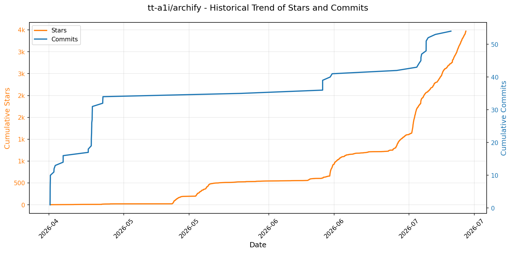

# 🌟 GitHub Trending 概览

> 数据更新于：2026-08-03

---

## 🔍 项目详情

### 1. [Shubhamsaboo/awesome-llm-apps](https://github.com/Shubhamsaboo/awesome-llm-apps)
- 📅 **创建日期**：2024-04-29  
- 🔄 **最近更新**：2026-08-03  
- ⭐ **Stars**：119,860（日 +0｜周 +0｜月 +2339）  
- 📝 **描述**：100+ AI Agents, Agent Skills and RAG Apps - Free and Open Source.  

<b>📈 Star 与 Commit 历史趋势</b>

> *蓝色：累计 Stars｜橙色：累计 Commits（次 Y 轴）*

<b>📄 README 摘要</b>

1. **项目做什么**  
该项目是一个开源集合，包含100多个手工构建、端到端测试的AI代理、代理技能和检索增强生成（RAG）应用。所有代码均采用Apache-2.0许可证，可自由克隆、部署甚至商业化。它提供了从简单单文件代理到复杂多代理团队的完整模板，覆盖旅行、金融、医疗、语音、游戏、RAG等多种场景，旨在让开发者快速集成并运行AI应用。

2. **关键特性**  
- **丰富的模板类型**：包括代理技能（如项目墓地、范围蔓延检测）、初级AI代理（单文件，仅需API密钥）、高级AI代理（多步骤推理与工具）、始终在线代理（定时/事件驱动）、多代理团队、语音代理、生成式UI代理、自主游戏代理、MCP代理、RAG教程、带记忆的应用、任意数据源的聊天接口等。  
- **快速启动**：支持通过 `npx skills add` 为编码代理添加技能，或通过 `git clone` 在30秒内运行任何代理。  
- **多模型兼容**：支持Claude、Gemini、GPT、DeepSeek、Llama、Qwen等开源与商业模型。  
- **开源与商业化友好**：所有应用均以Apache-2.0许可证发布，可免费使用、修改和销售。  
- **持续更新**：每周发布新模板，并提供逐步教程（Unwind AI网站）。  
- **生产级设计**：许多应用具备工具调用、记忆、多步骤推理、安全审计等特性。

3. **技术栈**  
- **核心语言**：Python（大部分应用基于Python编写）。  
- **UI框架**：Streamlit（用于快速构建交互式界面）。  
- **LLM SDK**：OpenAI Agents SDK、Anthropic SDK、Google Generative AI SDK、DeepSeek API、Llama API、Qwen API等。  
- **代理框架**：LangGraph、CrewAI、AG2、Pydantic AI、OpenAI Agents SDK等。  
- **检索与向量**：Qdrant、Firecrawl、Embedding Gemma、Cohere等。  
- **语音与多模态**：Gemini Live、OpenAI语音API、浏览器自动化（如Openwork）。  
- **其他工具**：Yahoo Finance API、GitHub API、Notion API、MCP（Model Context Protocol）等。

---

### 2. [codecrafters-io/build-your-own-x](https://github.com/codecrafters-io/build-your-own-x)
- 📅 **创建日期**：2018-05-09  
- 🔄 **最近更新**：2026-08-03  
- ⭐ **Stars**：105,006（日 +0｜周 +0｜月 +0）  
- 📝 **描述**：Master programming by recreating your favorite technologies from scratch.  

<b>📈 Star 与 Commit 历史趋势</b>

> *蓝色：累计 Stars｜橙色：累计 Commits（次 Y 轴）*

<b>📄 README 摘要</b>

### 1. 项目是做什么的？
该项目是一个精心整理的教程集合，旨在引导开发者**从零开始重建各种经典或现代的技术**（如3D渲染器、数据库、区块链、操作系统、Web服务器等）。其核心理念是“只有亲手创建，才能真正理解”，通过动手实践来深入学习底层原理。

### 2. 主要特点
- **覆盖领域极广**：包含30多个技术类别，从底层系统（操作系统、网络栈）到上层应用（前端框架、游戏、AI模型），几乎涵盖计算机科学的主要分支。
- **多语言实现**：每个技术类别下通常提供多种编程语言的教程（如C、C++、Go、Python、JavaScript、Rust等），满足不同学习者的偏好。
- **资源类型丰富**：链接包括博客文章、视频教程、开源项目代码、电子书等，既有文字讲解也有实操演示。
- **强调“从零开始”**：教程大多不依赖现有框架，而是手把手教你用最基础的方式构建核心功能，适合想深入理解技术本质的开发者。

### 3. 技术栈
教程中使用的编程语言包括：**C、C++、C#、Go、Java、JavaScript、TypeScript、Python、Rust、Ruby、Nim、Crystal、Kotlin、Scala、Haskell、R、Zig** 等，以及部分特定工具如 **OpenGL、Unity、Phaser、LWJGL、Node.js** 等。项目本身只是一个README索引，不涉及自有技术栈。

---

### 3. [koala73/worldmonitor](https://github.com/koala73/worldmonitor)
- 📅 **创建日期**：2026-01-08  
- 🔄 **最近更新**：2026-08-03  
- ⭐ **Stars**：61,441（日 +0｜周 +0｜月 +0）  
- 📝 **描述**：Real-time global intelligence dashboard. AI-powered news aggregation, geopolitical monitoring, and infrastructure tracking in a unified situational awareness interface  

<b>📈 Star 与 Commit 历史趋势</b>

> *蓝色：累计 Stars｜橙色：累计 Commits（次 Y 轴）*

<b>📄 README 摘要</b>

1. 项目功能  
World Monitor 是一个实时全球情报仪表板，通过 AI 技术聚合新闻、监控地缘政治事件并追踪基础设施动态，提供统一的态势感知界面。它整合了 500 多个精选新闻源，支持双地图引擎（3D 地球与平面地图），能够进行跨流关联分析（军事、经济、灾害等信号融合），并内置国家不稳定指数（CII）和金融雷达（覆盖 29 个交易所、商品、加密货币等）。项目同时提供 6 种站点变体（世界、科技、金融、商品、快乐、能源）以及原生桌面应用（Windows/macOS/Linux），并支持 26 种语言和从右至左（RTL）排版。

2. 关键特性  
- **AI 新闻聚合**：500+ 精选新闻源，AI 合成简报。  
- **双地图引擎**：3D 地球（globe.gl + Three.js）和 WebGL 平面地图（deck.gl + MapLibre GL），共 56 种地图图层。  
- **跨流关联**：军事、经济、灾害、升级信号汇聚分析。  
- **国家不稳定指数（CII v8）**：对 31 个一级国家进行服务器端压力评分。  
- **金融雷达**：29 个股票交易所、商品、加密货币及 7 信号市场综合指数。  
- **本地 AI 支持**：通过 Ollama 完全本地运行，无需 API 密钥。  
- **多站点变体**：单代码库构建 6 个不同主题的站点。  
- **原生桌面应用**：基于 Tauri 2 构建，支持 Windows、macOS、Linux。  
- **多语言与 RTL**：26 种语言，包含母语新闻源和从右至左布局。  
- **程序化访问**：提供 MCP 服务器、REST API、CLI（npm 包）和多语言 SDK（Python、Ruby、Go）。

3. 技术栈  
- **前端**：Vanilla TypeScript、Vite、globe.gl + Three.js、deck.gl + MapLibre GL。  
- **桌面**：Tauri 2（Rust）配合 Node.js sidecar。  
- **AI/ML**：Ollama / Groq / OpenRouter、Transformers.js（浏览器端）。  
- **API 契约**：Protocol Buffers（290 个 proto、35 个服务）、sebuf HTTP 注解。  
- **部署**：Vercel Edge Functions（60+）、Railway relay、Tauri、PWA。  
- **缓存**：Redis（Upstash）、三层缓存、CDN、Service Worker。

---

### 4. [asgeirtj/system_prompts_leaks](https://github.com/asgeirtj/system_prompts_leaks)
- 📅 **创建日期**：2025-05-03  
- 🔄 **最近更新**：2026-08-03  
- ⭐ **Stars**：57,313（日 +0｜周 +0｜月 +8668）  
- 📝 **描述**：Extracted system prompts from Anthropic - Claude Fable 5, Opus 5, Claude Design, Claude Code. OpenAI - ChatGPT GPT-5.6-Sol, Codex. Google - Gemini 3.5 Flash, 3.1 Pro, Antigravity. xAI - Grok, Cursor, Copilot, VS Code, Perplexity, and more. Updated regularly.  

<b>📈 Star 与 Commit 历史趋势</b>

> *蓝色：累计 Stars｜橙色：累计 Commits（次 Y 轴）*

<b>📄 README 摘要</b>

1. **项目做什么**  
该项目收集并公开了各大主流 AI 聊天机器人（如 ChatGPT、Claude、Gemini、Grok 等）在用户发送第一条消息前所接收到的隐藏系统提示（system prompts），即模型内部设定的规则、指令和行为约束。这些提示通过“泄露”方式获得，并以原始文本形式整理在仓库中，供研究、分析或参考。

2. **关键特性**  
- 覆盖广泛：包含 Anthropic、OpenAI、Google、xAI、Perplexity、Microsoft、Meta、Mistral、Moonshot（Kimi）、DeepSeek、GLM、OpenCode、Pi、Notion AI、Qwen 等数十家厂商的模型及产品。  
- 版本齐全：不仅收录最新模型（如 Claude Opus 5、ChatGPT 5.6 Sol、Grok 4.5 等），还保留旧版本和已废弃的提示，便于对比演变。  
- 结构清晰：按公司分类，每个模型/产品有独立的 Markdown 文件，并附有“最近更新”表格、子目录（如 Claude Code 的子组件）和折叠区（旧模型、工具、政策等）。  
- 外部引用：已被《华盛顿邮报》和 CEPS’ AI World 等媒体用于制作互动报道和数据看板。  
- 社区驱动：欢迎 PR 贡献，并显示 Star 历史图表，体现项目活跃度。

3. **技术栈**  
该项目本质上是一个文档型仓库，主要采用 **Markdown** 格式存储所有系统提示文本，依托 **GitHub** 进行版本管理和协作。此外，可能借助自动化脚本或社区贡献来定期抓取/更新提示，但仓库本身未明确说明具体爬虫或后端技术栈。因此，其核心技术栈可概括为 **GitHub + Markdown + 社区协作流程**。

---

### 5. [Panniantong/Agent-Reach](https://github.com/Panniantong/Agent-Reach)
- 📅 **创建日期**：2026-02-24  
- 🔄 **最近更新**：2026-08-03  
- ⭐ **Stars**：55,552（日 +0｜周 +0｜月 +5630）  
- 📝 **描述**：Give your AI agent eyes to see the entire internet. Read & search Twitter, Reddit, YouTube, GitHub, Bilibili, XiaoHongShu — one CLI, zero API fees.  

<b>📈 Star 与 Commit 历史趋势</b>

> *蓝色：累计 Stars｜橙色：累计 Commits（次 Y 轴）*

<b>📄 README 摘要</b>

### 1. 项目做什么

Agent Reach 是一个为 AI Agent 一键集成互联网能力的开源能力层。它自动为 Agent 选型、安装、体检并路由多个互联网平台的接入方式（如网页、YouTube、Twitter、Reddit、B站、小红书、GitHub、RSS 等），让 Agent 无需手动配置即可读取网页、搜索内容、提取字幕、访问社交平台等。用户只需一条命令（如“帮我安装 Agent Reach”）即可完成部署，后续平台接入方式变更时自动切换，无需用户操心。

### 2. 关键特性

- **一键安装/更新**：复制一句话给 Agent，自动完成所有安装和配置（支持安全模式、dry-run 预览）。
- **零配置即用**：网页、YouTube、RSS、GitHub、B站搜索、V2EX 等平台无需任何配置即可使用。
- **简单配置解锁**：Twitter、小红书、Reddit、Facebook、Instagram 等需登录态的平台，只需告诉 Agent“帮我配 XXX”，即可通过 Cookie 或浏览器会话配置。
- **多后端自动路由**：每个平台维护“首选 + 备选”有序后端列表，`agent-reach doctor` 实时检测可用性并自动切换（如 B站从 yt-dlp 切换为 bili-cli）。
- **自带诊断**：`agent-reach doctor` 一条命令检查所有渠道状态并给出修复建议。
- **完全免费 & 开源**：所有工具和 API 免费（服务器代理约 $1/月），代码完全开源可审查。
- **隐私安全**：Cookie/Token 仅存储在本地 `~/.agent-reach/config.yaml`（权限 600），不上传不外传。
- **兼容所有 Agent**：支持 Claude Code、OpenClaw、Cursor、Windsurf 等任何能执行命令行的 Agent。
- **持续维护**：项目作者每天使用，持续追踪平台变化，更新接入方式。

### 3. 技术栈

- **语言**：Python 3.10+
- **包管理**：pip
- **系统依赖**：Node.js、gh CLI（GitHub 官方）、mcporter（MCP 网关）
- **核心工具**：
  - 网页读取：Jina Reader（r.jina.ai）
  - YouTube 字幕/搜索：yt-dlp
  - RSS 解析：feedparser
  - 全网搜索：Exa（通过 mcporter 的 MCP 接入，免费无需 Key）
  - GitHub：gh CLI
  - Twitter：twitter-cli（首选）、OpenCLI（备选）
  - Reddit：OpenCLI（桌面）、rdt-cli（备选）
  - Facebook / Instagram：OpenCLI（复用 Chrome 登录态）
  - B站：bili-cli（首选）、OpenCLI / 搜索 API（备选）
  - 小红书：OpenCLI（桌面）、xiaohongshu-mcp（服务器）、xhs-cli
  - LinkedIn：linkedin-scraper-mcp（首选）、Jina Reader（备选）
  - 雪球、小宇宙播客等：各自对应的 CLI 或 MCP 工具
- **配置存储**：`~/.agent-reach/config.yaml`（权限 600）
- **诊断命令**：`agent-reach doctor`（检测各渠道后端可用性）

---

### 6. [mvanhorn/last30days-skill](https://github.com/mvanhorn/last30days-skill)
- 📅 **创建日期**：2026-01-23  
- 🔄 **最近更新**：2026-08-03  
- ⭐ **Stars**：49,649（日 +0｜周 +0｜月 +522）  
- 📝 **描述**：AI agent skill that researches any topic across Reddit, X, YouTube, HN, Polymarket, and the web - then synthesizes a grounded summary  

<b>📈 Star 与 Commit 历史趋势</b>

> *蓝色：累计 Stars｜橙色：累计 Commits（次 Y 轴）*

<b>📄 README 摘要</b>

### 1. 项目做什么

**/last30days** 是一个由 AI 智能体驱动的搜索引擎，它并行搜索多个社交平台和内容源（Reddit、X/Twitter、YouTube、TikTok、GitHub、Hacker News、Polymarket、arXiv、Techmeme、LinkedIn 等），根据真实用户的参与度（点赞、投票、金钱赌注）进行评分，并由 AI 裁判综合生成一份关于人物、话题或事件的“过去 30 天”简报。其核心理念是“搜索人，而不是编辑”——获取传统搜索引擎（如 Google）无法覆盖的社区真实声音和实时动态。

### 2. 关键特性

- **多源并行搜索**：同时检索 20+ 个平台，包括 Reddit、X、YouTube、TikTok、GitHub、HN、Polymarket、LinkedIn、StockTwits 等，无需逐个切换。
- **真实参与度评分**：结果按 Reddit 点赞、X 喜欢、Polymarket 真实资金赔率等真实指标排序，而非 SEO 或编辑推荐。
- **AI 合成简报**：AI 裁判将跨源结果聚类、去重，生成一份可读的摘要，包含关键引用、数据对比和趋势判断。
- **零配置启动**：Reddit、HN、Polymarket、GitHub 开箱即用；运行一次设置向导即可解锁 X、YouTube、TikTok 等需要认证的源。
- **发现模式**：通过 `/last30days what's exploding in AI agents?` 自动识别当前热门话题，输出排名列表。
- **比较模式**：支持工具或人物对比（如 `/last30days OpenClaw vs Hermes`），生成并排表格。
- **招聘信号分析**：`--hiring-signals` 读取公司招聘页面，推断其战略重心。
- **历史回看**：`--as-of` 参数可回溯到过去任意时间点。
- **健康检查**：`doctor` 命令检测所有源的状态并给出修复建议。
- **社区贡献**：超过 122 个 PR 来自 52 位贡献者，包括安全加固（XSS 修复、供应链安全）、多语言支持（希伯来语、中文等）、Windows 兼容、浏览器 Cookie 提取（Chrome、Edge、Brave 等）。
- **多平台安装**：支持 Claude Code、Grok、Codex、Cursor、Copilot、Gemini CLI、Claude Desktop、OpenClaw 等 50+ 智能体宿主，通过 Agent Skills 协议或原生插件市场安装。

### 3. 技术栈

- **AI 智能体核心**：基于 Claude（或其他 LLM）作为裁判和合成引擎，通过 Claude Code 插件或 Agent Skills 协议运行。
- **后端/脚本**：Python（核心脚本 `scripts/last30days.py`），使用 `uv` 自动配置 Python 3.12 环境。
- **CLI 工具链**：多种独立 CLI（`digg-pp-cli`、`arxiv-pp-cli`、`techmeme-pp-cli`）用于免费源；`npx skills` 管理智能体技能安装。
- **API 集成**：直接调用 Reddit（RSS + scraping）、GitHub API、Polymarket API、YouTube 转录、TikTok 数据、X API（需认证）等。
- **浏览器集成**：通过 Cookie 提取（Chromium 系列浏览器）实现 X、YouTube 等需要登录的源。
- **MCP 协议**：支持 MCP 服务器（如 `xiaohongshu-mcp`）扩展中国源。
- **安全与质量**：Semgrep、OSV-Scanner、OpenSSF Scorecard 扫描；测试覆盖率≥84%；依赖审查门禁。
- **CI/CD**：GitHub Actions 自动化构建、测试、发布，含构建来源证明（provenance attestation）。
- **跨平台**：Windows、macOS、Linux 全兼容；支持非拉丁语系（希伯来语、中文等）和 CJK 分词。

---

### 7. [usestrix/strix](https://github.com/usestrix/strix)
- 📅 **创建日期**：2025-08-05  
- 🔄 **最近更新**：2026-08-03  
- ⭐ **Stars**：40,991（日 +0｜周 +0｜月 +6347）  
- 📝 **描述**：Open-source AI penetration testing tool to find and fix your app’s vulnerabilities.  

<b>📈 Star 与 Commit 历史趋势</b>

> *蓝色：累计 Stars｜橙色：累计 Commits（次 Y 轴）*

<b>📄 README 摘要</b>

### 1. 项目做什么

Strix 是一个开源的 AI 渗透测试工具，通过自主 AI 智能体模拟真实黑客行为，动态运行目标应用的代码，自动发现、验证漏洞并生成可利用的概念验证（PoC），同时提供修复建议和合规性渗透测试报告，帮助开发者和安全团队快速、准确地进行安全测试。

### 2. 关键特性

- **完整渗透测试工具包**：内置侦察、漏洞利用、验证等全套工具，支持 HTTP 拦截代理、浏览器自动化、Shell 执行、自定义 PoC 运行环境、OSINT 侦查、静态与动态代码分析。
- **多智能体编排**：支持分布式、协作的 AI 智能体团队，可并行扫描多个目标，动态协调攻击链。
- **真实漏洞验证**：生成可运行的 PoC 和复现步骤，避免误报。
- **开发者优先 CLI**：提供可操作的漏洞发现与修复指导，支持无头模式（Headless）用于 CI/CD。
- **自动修复与报告**：可一键生成 AI 修复补丁（PR 形式）和合规报告（SOC 2、ISO 27001、PCI DSS 等）。
- **广泛漏洞覆盖**：涵盖 OWASP Top 10（访问控制、注入、SSRF、XSS、业务逻辑缺陷等）及 API、云安全等问题。
- **CI/CD 集成**：原生支持 GitHub Actions 等流水线，在 PR 阶段自动扫描变更代码。
- **本地 Web 仪表板**：扫描结果实时写入磁盘，可通过本地命令启动仪表板查看漏洞、智能体图谱、历史记录并生成报告。
- **多种测试模式**：支持白盒（源码）、黑盒（URL）、灰盒（认证测试）、多目标、自定义指令等。

### 3. 技术栈

- **核心语言**：Python（PyPI 包 `strix-agent`）
- **运行环境**：Docker（沙箱隔离）
- **AI 模型**：通过 LiteLLM 集成多种 LLM API（OpenAI、Anthropic、Google Vertex AI、Bedrock、Azure 等）及 ChatGPT 订阅
- **关键开源组件**：
  - **Caido**：HTTP 拦截代理
  - **Nuclei**：漏洞模板引擎
  - **Playwright**：浏览器自动化
  - **Textual**：终端 UI 框架
- **其他**：GitHub Actions（CI/CD 集成）、本地文件系统存储结果

---

### 8. [moeru-ai/airi](https://github.com/moeru-ai/airi)
- 📅 **创建日期**：2024-12-01  
- 🔄 **最近更新**：2026-08-03  
- ⭐ **Stars**：36,645（日 +0｜周 +0｜月 +0）  
- 📝 **描述**：💖🧸 Self hosted, you-owned Grok Companion, a container of souls of waifu, cyber livings to bring them into our worlds, wishing to achieve Neuro-sama's altitude. Capable of realtime voice chat, Minecraft, Factorio playing. Web / macOS / Windows supported.  

<b>📈 Star 与 Commit 历史趋势</b>

> *蓝色：累计 Stars｜橙色：累计 Commits（次 Y 轴）*

<b>📄 README 摘要</b>

1. **项目功能**  
Project AIRI（アイリ）是一个开源项目，旨在复现类似 Neuro-sama 的 AI 虚拟角色（赛博生命/数字伴侣），让用户能够拥有、互动并扩展自己的 AI 虚拟形象。它整合了聊天、游戏、视觉、语音等多模态能力，支持在浏览器、桌面端（Windows/macOS/Linux）和移动设备上运行，实现“随时随地拥有数字生命”的目标。

2. **关键特性**  
- **游戏能力**：可玩 Minecraft、Factorio、Kerbal Space Program 等游戏（部分仍在开发中）。  
- **多平台聊天**：集成 Telegram、Discord 等即时通讯平台。  
- **视觉与语音**：客户端语音识别、说话检测；多提供商语音合成（ElevenLabs、Azure、OpenAI TTS、Kokoro 等）。  
- **模型与动画**：支持 VRM 和 Live2D 模型，具备自动眨眼、注视追踪、空闲眼球运动等动画。  
- **记忆系统**：纯浏览器数据库（DuckDB WASM/pglite）和 Memory Alaya（开发中）。  
- **本地推理**：纯浏览器端 WebGPU 推理（开发中）。  
- **跨平台**：桌面版利用 CUDA/Metal 加速，移动版通过 PWA 和 Capacitor 支持。  
- **丰富的 LLM 提供商**：兼容 OpenAI、Anthropic、DeepSeek、Qwen、Gemini、xAI、Groq 等数十种 API。  
- **插件与子项目**：提供 RAG、记忆系统、嵌入式数据库、Live2D 工具等独立子项目。

3. **技术栈**  
- **Web 技术**：WebGPU、WebAudio、Web Workers、WebAssembly、WebSocket。  
- **前端框架**：Vue.js、TypeScript。  
- **桌面端**：Electron（含 Nix 包支持）。  
- **移动端**：Capacitor。  
- **文档与构建**：VitePress、pnpm。  
- **AI 推理**：candle（HuggingFace），支持 NVIDIA CUDA 和 Apple Metal。  
- **数据库**：DuckDB WASM、pglite。  
- **语音合成**：Kokoro TTS 等。  
- **3D/2D 模型**：VRM、Live2D，配合 Three.js、WebXR 探索。  
- **其他**：Crowdin 本地化、xsai（LLM 统一接口）。

---

### 9. [openai/codex-plugin-cc](https://github.com/openai/codex-plugin-cc)
- 📅 **创建日期**：2026-03-30  
- 🔄 **最近更新**：2026-08-03  
- ⭐ **Stars**：28,165（日 +0｜周 +0｜月 +4955）  
- 📝 **描述**：Use Codex from Claude Code to review code or delegate tasks.  

<b>📈 Star 与 Commit 历史趋势</b>

> *蓝色：累计 Stars｜橙色：累计 Commits（次 Y 轴）*

<b>📄 README 摘要</b>

1. **项目做什么**  
   该项目是一个 Claude Code 插件，允许用户在 Claude Code 工作流中直接调用 Codex 进行代码审查、委托任务或转移会话，从而将 Codex 的能力无缝集成到现有开发流程中。

2. **关键特性**  
   - 提供多个斜杠命令：`/codex:review`（只读代码审查）、`/codex:adversarial-review`（可引导的对抗性审查）、`/codex:rescue`（委托任务给 Codex）、`/codex:transfer`（转移会话到 Codex）、`/codex:status`（查看任务状态）、`/codex:result`（获取完成结果）、`/codex:cancel`（取消后台任务）、`/codex:setup`（安装与认证检查）。  
   - 支持后台运行（`--background`）和等待模式（`--wait`）。  
   - 审查门（review gate）功能：在 Claude 响应后自动触发 Codex 审查，若发现问题时阻止继续执行。  
   - 可配置默认模型和推理努力程度（通过 `.codex/config.toml`）。  
   - 支持分支审查（`--base <ref>`）和自定义焦点文本。  
   - 任务可恢复（`--resume`）或新建（`--fresh`），并支持指定模型（如 `gpt-5.4-mini`）和努力程度。

3. **技术栈**  
   - 运行环境：Node.js 18.18 或更高版本。  
   - 依赖：本地安装的 Codex CLI（`@openai/codex`）和 Codex App Server。  
   - 认证：需要 ChatGPT 订阅（含免费版）或 OpenAI API 密钥。  
   - 配置：使用 TOML 格式的配置文件（用户级 `~/.codex/config.toml` 和项目级 `.codex/config.toml`）。  
   - 插件通过本地 `codex` 二进制文件与 OpenAI 服务通信，复用已有的认证状态和配置。

---

### 10. [permissionlesstech/bitchat](https://github.com/permissionlesstech/bitchat)
- 📅 **创建日期**：2025-07-04  
- 🔄 **最近更新**：2026-08-03  
- ⭐ **Stars**：24,675（日 +0｜周 +0｜月 +0）  
- 📝 **描述**：bluetooth mesh chat, IRC vibes  

<b>📈 Star 与 Commit 历史趋势</b>

> *蓝色：累计 Stars｜橙色：累计 Commits（次 Y 轴）*

<b>📄 README 摘要</b>

1. **项目功能**  
   bitchat 是一个去中心化的点对点消息应用，采用双传输架构：通过蓝牙网状网络实现本地离线通信，并利用 Nostr 协议实现全球互联网覆盖。无需账户、电话号码或中央服务器，旨在成为“侧群组聊天”。

2. **关键特性**  
   - **双传输架构**：蓝牙网状网络（离线）与 Nostr 协议（互联网）自动切换  
   - **基于位置的频道**：使用地理哈希坐标创建区域聊天室（街区、社区、城市等）  
   - **智能消息路由**：优先选择蓝牙，不可用时回退到 Nostr，并支持消息队列  
   - **去中心化网状网络**：自动发现对等节点，支持最多 7 跳中继  
   - **隐私优先**：无账户、无电话、无服务器；设备标识基于身份密钥，附近设备可观察有限元数据  
   - **端到端加密**：蓝牙使用 Noise 协议（前向保密），Nostr 使用 BitChat 私有信封（XChaCha20-Poly1305）  
   - **IRC 风格命令**：支持 `/slap`、`/msg`、`/who` 等  
   - **通用应用**：原生支持 iOS 和 macOS  
   - **紧急擦除**：三击快速清除所有数据  
   - **性能优化**：LZ4 消息压缩、自适应电池模式、优化网络

3. **技术栈**  
   - **编程语言**：Swift  
   - **传输协议**：Bluetooth Low Energy（BLE）网状网络、Nostr 协议  
   - **加密**：Noise Protocol（蓝牙）、XChaCha20-Poly1305（Nostr 私有信封）  
   - **压缩**：LZ4  
   - **位置编码**：Geohash  
   - **构建工具**：Xcode、just（自动化）  
   - **平台**：iOS、macOS

---

### 11. [Zackriya-Solutions/meetily](https://github.com/Zackriya-Solutions/meetily)
- 📅 **创建日期**：2024-12-26  
- 🔄 **最近更新**：2026-08-03  
- ⭐ **Stars**：23,638（日 +0｜周 +0｜月 +9543）  
- 📝 **描述**：Privacy first, AI meeting assistant with 4x faster Parakeet/Whisper live transcription, speaker diarization, and Ollama summarization built on Rust. 100% local processing. no cloud required. Meetily (Meetly Ai - https://meetily.ai) is the #1 Self-hosted, Open-source Ai meeting note taker for macOS & Windows. Understand How to write meeting minutes  

<b>📈 Star 与 Commit 历史趋势</b>

> *蓝色：累计 Stars｜橙色：累计 Commits（次 Y 轴）*

<b>📄 README 摘要</b>

1. **项目功能**  
   Meetily 是一款隐私优先的 AI 会议助手，完全在用户本地设备上运行，能够实时捕获、转录并生成会议摘要，数据不离开本机，支持离线使用，适用于需要数据主权和合规性的个人及企业。

2. **关键特性**  
   - 完全本地处理，无需云端传输数据。  
   - 实时转录（支持 Whisper 或 Parakeet 模型）。  
   - AI 驱动的摘要生成（可选用 Ollama、Claude、Groq、OpenRouter 或自定义 OpenAI 端点）。  
   - 跨平台支持（macOS、Windows、Linux）。  
   - 开源且免费使用。  
   - 支持导入已有音频文件进行转录或重新转录。  
   - 专业音频混合（同时捕获麦克风与系统音频，智能闪避与防削波）。  
   - GPU 加速（Apple Silicon Metal/CoreML、NVIDIA CUDA、AMD/Intel Vulkan）。  
   - 隐私优先设计，所有数据本地存储。  
   - 另有 PRO 版本提供更高精度、自定义摘要模板、高级导出、自动检测会议等功能。

3. **技术栈**  
   - 框架：Tauri（Rust 后端 + Next.js 前端）。  
   - 转录模型：Whisper（本地）或 Parakeet（ONNX）。  
   - AI 摘要：支持 Ollama、Claude、Groq、OpenRouter 或任何 OpenAI 兼容端点。  
   - 构建工具：pnpm、Rust、Node.js。  
   - 硬件加速：macOS 使用 Metal/CoreML，Windows/Linux 使用 CUDA 或 Vulkan。

---

### 12. [HKUDS/DeepTutor](https://github.com/HKUDS/DeepTutor)
- 📅 **创建日期**：2025-12-28  
- 🔄 **最近更新**：2026-08-03  
- ⭐ **Stars**：23,173（日 +0｜周 +0｜月 +0）  
- 📝 **描述**：DeepTutor: Lifelong Personalized Tutoring. https://deeptutor.info/.  

<b>📈 Star 与 Commit 历史趋势</b>

> *蓝色：累计 Stars｜橙色：累计 Commits（次 Y 轴）*

<b>📄 README 摘要</b>

1. **项目做什么**  
   DeepTutor 是一个终身个性化辅导系统，也是一个以智能体（Agent）为核心的学习工作空间。它将辅导、问题求解、测验生成、研究、可视化与掌握练习整合在同一个可扩展的系统中，支持聊天、测验、研究、可视化、解题和掌握路径等多种模式，所有模式共享相同的智能体循环和上下文，实现学习目标的无缝切换。

2. **关键特性**  
   - **统一运行时**：聊天、测验、研究、可视化、解题和掌握路径均运行在同一个智能体循环上，切换目标无需更换引擎，学习上下文随学习者移动。  
   - **连接的学习上下文**：知识库、书籍、协作写作草稿、笔记本等资源相互关联，形成统一的学习环境。  
   - **多模式交互**：支持对话式辅导、自动出题、深度研究、可视化图表、数学动画、解题推理等。  
   - **智能体生态系统**：内置 TutorBot、Partners（可连接外部 AI 助手）、CLI 应用、MCP 服务，支持自定义技能（Skills）和插件。  
   - **知识管理**：支持 GraphRAG、LightRAG、PageIndex 等多种检索增强生成（RAG）引擎，可管理知识库、书籍和文档。  
   - **记忆系统**：三层记忆（L1/L2/L3）实现持久化学习记录。  
   - **多用户与安全**：支持多用户隔离、管理员授权、沙箱限制、OAuth 登录（如 OpenAI Codex）。  
   - **国际化**：提供简体中文、英文、日文、西班牙文等多语言界面。  
   - **社区与扩展**：可通过 ClawHub 安装社区技能，拥有 Discord、微信等社区渠道，并持续发布更新（v0.2.0 至 v1.5.8）。

3. **技术栈**  
   - **后端**：Python 3.11+，基于智能体架构（Agent-native），集成 LlamaIndex、FAISS、LightRAG、GraphRAG 等 RAG 框架，使用 PocketBase 作为数据库。  
   - **前端**：Next.js 16（React 19），支持 WebSocket 实时通信。  
   - **部署**：Docker 容器化，支持 rootless Podman，提供预构建镜像。  
   - **AI 模型**：兼容 OpenAI、Anthropic、Gemini、NVIDIA NIM、本地模型（如 LM Studio、llama.cpp）等多种 LLM 提供商。  
   - **其他**：MCP（Model Context Protocol）服务、MinerU 文档解析、PyMuPDF4LLM、Chart.js/SVG 可视化、LaTeX 支持等。

---

### 13. [pbakaus/impeccable](https://github.com/pbakaus/impeccable)
- 📅 **创建日期**：2025-11-16  
- 🔄 **最近更新**：2026-08-03  
- ⭐ **Stars**：20,646（日 +0｜周 +0｜月 +2801）  
- 📝 **描述**：The design language that makes your AI harness better at design.  

<b>📈 Star 与 Commit 历史趋势</b>

> *蓝色：累计 Stars｜橙色：累计 Commits（次 Y 轴）*

<b>📄 README 摘要</b>

1. **项目做什么？**  
Impeccable 是一套为 AI 编码代理（如 Claude、Cursor、GitHub Copilot 等）提供的前端设计指南与工具。它通过一个统一的技能入口、23 个设计命令、59 条确定性检测规则以及实时浏览器迭代能力，帮助 AI 避免常见的前端设计反模式（如过度使用 Inter 字体、紫蓝渐变、卡片嵌套、灰色文本等），从而生成更高质量、更符合品牌与产品语境的设计。

2. **关键特性**  
- **单一技能入口**：通过 `/impeccable <command>` 调用所有功能。  
- **23 个设计命令**：覆盖初始化（`init`）、完整设计流程（`craft`）、UX 评审（`critique`）、技术审计（`audit`）、打磨（`polish`）、强化（`harden`）、动画（`animate`）、色彩（`colorize`）、排版（`typeset`）、布局（`layout`）等。  
- **59 条确定性检测规则**：无需 LLM 或 API 密钥即可自动检测 AI 生成的常见设计问题（如字体滥用、对比度不足、间距错误等）。  
- **设计上下文文件**：`init` 命令自动生成 `PRODUCT.md` 和 `DESIGN.md`，为后续命令提供品牌、受众、色调、组件等上下文。  
- **实时浏览器迭代**：`/impeccable live` 命令支持在浏览器中直接预览和调整元素。  
- **设计钩子（Hook）**：在 Claude Code、Cursor、Codex、GitHub Copilot、Grok Build 等工具中自动运行检测，在编辑时或编辑后发现问题并反馈。  
- **独立 CLI 检测**：`npx impeccable detect` 可扫描目录、HTML 文件或 URL（通过 Puppeteer），输出 JSON 格式结果，适合 CI 集成。  
- **多工具支持**：提供针对 Cursor、Claude Code、GitHub Copilot、Gemini CLI、Codex CLI、Grok Build、OpenCode、Pi、Trae、Rovo Dev、Qoder、Mistral Vibe 等 14 种 AI 编码工具的安装方式。  
- **反模式指南**：明确列出应避免的设计模式（如纯黑/灰、卡片嵌套、弹性缓动等）。  
- **命令别名与快捷方式**：可通过 `/impeccable pin <command>` 创建独立快捷命令。

3. **技术栈**  
- **运行时环境**：Node.js（CLI 工具通过 `npx` 运行）。  
- **开发语言**：TypeScript（项目主要使用 TypeScript 编写，提供类型安全）。  
- **核心依赖**：Puppeteer（用于通过 URL 进行网页级检测，捕获截图和 DOM 分析）。  
- **分发方式**：npm 包（`impeccable`），支持全局或项目本地安装。  
- **集成技术**：针对各 AI 编码工具的技能/钩子配置文件（如 `.claude/skills`、`.cursor/hooks.json` 等），通过文件复制或插件市场安装。  
- **其他**：使用 NDJSON 格式记录钩子审计日志，支持 `--json` 输出用于 CI 流水线。

---

### 14. [stablyai/orca](https://github.com/stablyai/orca)
- 📅 **创建日期**：2026-03-17  
- 🔄 **最近更新**：2026-08-03  
- ⭐ **Stars**：17,389（日 +0｜周 +0｜月 +5664）  
- 📝 **描述**：Orca is the ADE for working with a fleet of parallel agents. Run any coding agent with your own subscription. Available on desktop, mobile and VPS.  

<b>📈 Star 与 Commit 历史趋势</b>

> *蓝色：累计 Stars｜橙色：累计 Commits（次 Y 轴）*

<b>📄 README 摘要</b>

1. **项目功能**  
   Orca 是一个 AI 编排器（AI Orchestrator），专为追求极致效率的开发者设计。它允许用户同时并行运行多个 AI 编码代理（如 Codex、Claude Code、OpenCode、Pi 等），每个代理在独立的 Git 工作树（worktree）中执行任务，并将所有代理的运行状态统一管理。用户可以通过桌面应用发起任务、对比不同代理的输出结果，并合并最优方案；同时提供移动端伴侣应用，方便从手机监控代理进度、接收完成通知并发送后续指令。

2. **关键特性**  
   - **移动伴侣**：iOS/Android 应用，可远程监控和引导代理。  
   - **并行工作树**：将同一提示分发给多个代理，各自在隔离的 Git 工作树中运行，便于比较和合并。  
   - **终端分割**：基于 Ghostty 风格、WebGL 渲染的终端，支持无限分割和重启后保留滚动历史。  
   - **设计模式**：在嵌入式 Chromium 窗口中点击 UI 元素，自动将其 HTML、CSS 和截图发送给代理。  
   - **GitHub & Linear 原生集成**：在应用内浏览 PR、Issue 和项目面板，从任务直接创建工作树。  
   - **SSH 工作树**：在远程服务器上运行代理，自动重连和端口转发。  
   - **AI 差异注释**：对 AI 生成的代码差异（diff）添加评论并反馈给代理。  
   - **文件拖放**：将文件或图片直接拖入代理提示框（基于 VS Code 编辑器，支持自动保存）。  
   - **Orca CLI**：通过命令行脚本化工作流（如创建工作树、快照、点击、填充等）。  
   - **其他**：快速打开搜索、账户切换与用量追踪、富仓库预览（Markdown/图片/PDF）、计算机使用（代理操作桌面应用）、通知与未读状态等。

3. **技术栈**  
   - **桌面端**：跨平台（macOS / Windows / Linux），基于 Electron 或类似 Web 技术，使用 WebGL 加速终端渲染，内置 Monaco Editor（VS Code 风格编辑器），嵌入式 Chromium 浏览器（用于设计模式）。  
   - **移动端**：iOS（Swift/SwiftUI）和 Android（Kotlin/Jetpack Compose）原生应用。  
   - **CLI**：Orca 命令行工具（未明确语言，可能为 Go/Rust）。  
   - **协议与集成**：Git 工作树、SSH 远程连接、WebGL、Chromium、Monaco Editor，并支持多种 AI 代理的 CLI 接口。

---

### 15. [diegosouzapw/OmniRoute](https://github.com/diegosouzapw/OmniRoute)
- 📅 **创建日期**：2026-02-13  
- 🔄 **最近更新**：2026-08-03  
- ⭐ **Stars**：16,324（日 +0｜周 +0｜月 +5486）  
- 📝 **描述**：Never stop coding. Free MIT AI gateway: one endpoint, 290+ providers (90+ free), 500+ models — Kimi, Claude, GPT, OpenAI, Gemini, GLM, DeepSeek, MiniMax. Works with Claude Code, Codex, Cursor, OpenCode, Cline & Copilot. Quota-aware auto-fallback, RTK+Caveman compression saves 15-95% tokens, MCP/A2A, Desktop/PWA. Built by 500+ contributors  

<b>📈 Star 与 Commit 历史趋势</b>

> *蓝色：累计 Stars｜橙色：累计 Commits（次 Y 轴）*

<b>📄 README 摘要</b>

1. **项目做什么**  
OmniRoute 是一个免费的 AI 网关，聚合了 290 个 AI 提供商（其中 90+ 提供免费层），通过单一 OpenAI 兼容端点（`/v1`）为 Claude Code、Cursor、Cline、Copilot 等主流编码工具提供统一路由、自动回退、压缩和负载均衡。它让开发者无需管理多个 API 密钥、配额和 SDK，即可零成本或低成本使用多种前沿模型，并实时监控免费令牌用量。

2. **关键特性**  
- **零配置开箱即用**：安装后无需任何 API 密钥或配置，`auto` 模型即可直接调用预置的免费提供商（如 OpenCode Free、Felo）。  
- **自动回退与路由**：4 层回退（订阅 → API 密钥 → 廉价 → 免费），19 种路由策略，毫秒级切换，永不中断。  
- **智能压缩**：RTK + Caveman 堆叠压缩，节省 15–95% 令牌（工具密集型会话平均约 89%）。  
- **免费套餐聚合**：实时仪表盘显示约 1.53B 免费令牌/月（43 个提供商池 / 516 个模型），按池去重计算，并跟踪已用/剩余量。  
- **生产级能力**：电路断路器、TLS 隐身、MCP（104 工具）、A2A、内存、护栏、评估、密钥池与公平配额、本地优先 AES-256-GCM 加密。  
- **广泛兼容**：支持 33 种编码代理、43 种语言界面、Docker / npm / Electron 多种部署方式。

3. **技术栈**  
- **运行时**：Node.js / TypeScript  
- **分发**：npm 包（`omniroute`）、Docker 镜像（`diegosouzapw/omniroute`）、Electron 桌面应用  
- **协议**：OpenAI 兼容 API（Chat Completions、Responses API）、MCP、A2A  
- **压缩**：自定义 RTK 与 Caveman 算法  
- **前端**：仪表盘（React / Vite 等，基于截图推断）  
- **存储**：轻量级本地存储（如 SQLite 或内存，用于配额与配置）  
- **测试**：25,000+ 自动化测试

---

### 16. [andrewyng/aisuite](https://github.com/andrewyng/aisuite)
- 📅 **创建日期**：2024-06-30  
- 🔄 **最近更新**：2026-08-03  
- ⭐ **Stars**：14,395（日 +0｜周 +0｜月 +0）  
- 📝 **描述**：Simple, unified interface to multiple Generative AI providers   

<b>📈 Star 与 Commit 历史趋势</b>

> *蓝色：累计 Stars｜橙色：累计 Commits（次 Y 轴）*

<b>📄 README 摘要</b>

### 1. 项目功能

该项目包含两个层次：

- **aisuite**：一个轻量级 Python 库，用于构建基于大语言模型（LLM）的应用。它提供两层 API：统一的 **Chat Completions API**（跨多个 LLM 提供商）和 **Agents API**（支持工具调用、工具包和 MCP 协议）。开发者可通过简单字符串切换提供商，并让模型执行实际任务。
- **OpenWorker**：基于 aisuite 构建的桌面 AI 同事应用。它能与用户聊天、进行深度研究，并在用户电脑上执行真实任务（如读取文件、连接 Slack/邮件、生成 PDF/文档/电子表格、运行定时自动化）。用户可自带 API 密钥或通过 Ollama 完全本地运行，数据保留在本地机器上。

### 2. 关键特性

- **统一的 Chat Completions API**：以 OpenAI 风格接口支持 OpenAI、Anthropic、Google、Mistral、Hugging Face、AWS、Cohere、Ollama、OpenRouter、Requesty 等主流提供商；只需修改模型名字符串即可切换；支持所有核心参数（temperature、max_tokens、tools 等）和流式输出。
- **Agents API 与工具系统**：支持将普通 Python 函数作为工具自动生成 schema、执行并反馈结果；提供 `max_turns` 自动循环工具调用；更高层提供 Agent、Runner 架构，附带预构建工具包（文件、git、shell）和 MCP 原生支持；可配置工具策略（如审批策略）、状态存储（内存、文件、Postgres）及工件/追踪功能。
- **流式与异步**：支持流式聊天补全（包括工具调用流）及异步 API（`acreate`）。
- **可扩展性**：通过实现轻量适配器即可添加新的 LLM 提供商（遵循命名约定）。
- **OpenWorker 桌面应用**：提供 macOS（Apple Silicon）和 Windows（x64）原生安装包，自带图形界面，数据本地化，可连接外部服务并执行自动化任务。

### 3. 技术栈

- **核心语言与库**：Python 库，通过 pip 安装；可选安装各提供商 SDK（如 `aisuite[anthropic]`、`aisuite[all]`）。
- **支持的大模型提供商**：OpenAI、Anthropic、Google、Mistral、Hugging Face、AWS、Cohere、Ollama、OpenRouter、Requesty 等，通过统一接口调用。
- **MCP 协议支持**：原生集成 Model Context Protocol，可无缝使用任何 MCP 服务器的工具（需安装 `aisuite[mcp]`）。
- **状态存储**：支持内存、文件系统、Postgres 数据库，用于持久化代理运行状态。
- **OpenWorker 桌面应用**：基于 aisuite 构建，分发为 macOS DMG 和 Windows EXE 安装包，具体桌面框架未在文档中说明，但依托操作系统原生能力运行。

---

### 17. [pingdotgg/t3code](https://github.com/pingdotgg/t3code)
- 📅 **创建日期**：2026-02-08  
- 🔄 **最近更新**：2026-08-03  
- ⭐ **Stars**：13,986（日 +0｜周 +0｜月 +612）  
- 📝 **描述**：暂无描述  

<b>📈 Star 与 Commit 历史趋势</b>

> *蓝色：累计 Stars｜橙色：累计 Commits（次 Y 轴）*

<b>📄 README 摘要</b>

### 1. 项目功能

T3 Code 是一个“代理（Agent）控制面板”，用于统一管理本地计算机上安装的多种 AI 编程代理。它通过移动端 App（iOS/Android）、Web 应用和 Electron 桌面应用，让用户能够远程操控 Claude Code、Codex、Cursor、Grok Build、OpenCode 等代理工具，实现跨设备的开发控制。

### 2. 主要特性

- **多代理支持**：兼容 Claude Code、Codex、Cursor、Grok Build、OpenCode，只要在本地配置好即可统一控制。
- **多端控制**：提供最佳体验的移动端 App、Web 端和桌面端（Electron），支持远程操控。
- **远程访问**：允许从手机或其他机器远程连接和控制本地代理，实现移动开发。
- **权限管理**：提供多种权限模式（见文档），精细控制代理操作。
- **键盘快捷键**：支持自定义快捷键，提升操作效率。
- **源码控制集成**：与 Git 等版本控制系统集成，便于管理项目。
- **开放可 Fork**：项目完全开源，用户可自由 fork 和定制。
- **简单部署**：通过 `npx t3@latest` 即可在终端启动后端和本地 Web 应用，无需安装；也提供桌面版安装包（winget、Homebrew、AUR）。
- **多账户支持**：可配置多个 Codex 或 Claude 账户。

### 3. 技术栈

- **后端/运行环境**：Node.js（要求 22.16+ / 23.11+ / 24.10+）
- **桌面应用**：Electron
- **构建工具**：Vite+（通过 `vp` 命令行工具管理依赖和构建）
- **移动端**：iOS 和 Android 原生 App（具体框架未说明）
- **Web 应用**：内置于本地服务器，通过浏览器访问
- **包管理**：使用 `vp i` 安装依赖（Vite+ 内置包管理器）

---

### 18. [esengine/DeepSeek-Reasonix](https://github.com/esengine/DeepSeek-Reasonix)
- 📅 **创建日期**：2026-04-21  
- 🔄 **最近更新**：2026-08-03  
- ⭐ **Stars**：11,800（日 +0｜周 +0｜月 +0）  
- 📝 **描述**：DeepSeek-native AI coding agent for your terminal. Engineered around prefix-cache stability — leave it running.  

<b>📈 Star 与 Commit 历史趋势</b>

> *蓝色：累计 Stars｜橙色：累计 Commits（次 Y 轴）*

<b>📄 README 摘要</b>

1. **项目做什么**  
   Reasonix 是一个面向终端的 AI 编码助手，原生适配 DeepSeek 模型。它通过配置和插件驱动，利用 DeepSeek 的前缀缓存机制在长时间会话中保持低令牌成本。提供 CLI/TUI、桌面应用和 VS Code 扩展三种使用方式，核心引擎为单个静态 Go 二进制文件。

2. **关键特性**  
   - **配置驱动**：所有设置（提供商、代理、工具、插件）通过 `reasonix.toml` 声明，无需硬编码模型。  
   - **多模型与可组合**：内置 DeepSeek 预设，同时支持任何 OpenAI 兼容端点；可让两个模型（执行器 + 规划器）在独立缓存稳定的会话中协同工作。  
   - **插件驱动**：外部工具通过 stdio JSON‑RPC（MCP 兼容）作为子进程运行；内置工具在编译时自注册。  
   - **缓存感知上下文维护**：启动时注入稳定环境摘要，修剪陈旧工具输出后压缩摘要，并文档化内置工具模式合同。  
   - **零摩擦分发**：`CGO_ENABLED=0` 单二进制，交叉编译到 6 个目标平台，仅依赖 TOML 解析器。  
   - **多种安装方式**：npm 全局安装、Homebrew（macOS）、桌面安装程序（macOS/Windows/Linux）、VS Code 扩展、源码构建。  
   - **额外能力**：子代理配置文件、上下文引擎 v2、检查点与回滚、任务暂停策略等。

3. **技术栈**  
   - **核心语言**：Go（单静态二进制，禁用 CGO）。  
   - **配置格式**：TOML。  
   - **插件协议**：MCP（Model Context Protocol）兼容的 JSON‑RPC over stdio。  
   - **AI 模型**：DeepSeek（预设）及任何 OpenAI 兼容接口。  
   - **分发与集成**：npm（预构建二进制）、Homebrew、GitHub Releases（含 SHA256SUMS）、桌面安装程序（.dmg/.exe/.deb/.tar.gz）、VS Code 扩展（TypeScript）。  
   - **构建与 CI**：Makefile 交叉编译、GitHub Actions。  
   - **其他**：原子 Git 镜像、Star History 图表、Discord 社区支持。

---

### 19. [facebook/astryx](https://github.com/facebook/astryx)
- 📅 **创建日期**：2026-01-09  
- 🔄 **最近更新**：2026-08-03  
- ⭐ **Stars**：8,252（日 +0｜周 +0｜月 +3589）  
- 📝 **描述**：An open source design system that's fully customizable and agent ready  

<b>📈 Star 与 Commit 历史趋势</b>

> *蓝色：累计 Stars｜橙色：累计 Commits（次 Y 轴）*

<b>📄 README 摘要</b>

1. 项目做什么  
Astryx 是一个由 Meta 开源的完整设计系统，经过八年内部验证，已成为 Meta 最大、使用最广的设计系统，支撑超过 13,000 个应用。它提供 150 多个可访问组件、品牌级主题、暗黑模式、即用模板和 CLI 工具，作为一个统一系统交付。开发者只需导入预构建 CSS 并使用类型化 React 组件，无需额外的构建插件或样式库。该系统同时面向人类开发者和 AI 助手，确保双方使用相同的工具和参考进行构建。

2. 关键特性  
- **开放内部结构**：组件可在任意层级组合，关键构建块直接导出，并支持“swizzle”将组件完整源码弹出到项目中。  
- **无样式锁定**：内部使用 StyleX 编写样式，但对消费者透明；可通过 `className` 覆盖（如 Tailwind、CSS Modules 或纯 CSS）。  
- **自定义无需封装**：主题仅为一组 CSS 自定义属性覆盖，设计师无需 fork 或包装组件即可打造独特外观。  
- **人与 AI 统一**：API、文档和 CLI 协同设计，使人和 AI 助手以相同方式构建，参考同一份资料。  
- **强约定与文档**：所有组件遵循统一的命名、属性和组合规则，且均有详尽文档，便于学习和预测。  
- **指导而非强制**：组件提供能力而非限制，设计意见仅存在于文档和示例中。  
- **经过测量验证**：通过测试检验约定而非主观断言，并根据新情况灵活调整。

3. 技术栈  
- **前端框架**：React（TypeScript 支持）  
- **样式方案**：StyleX（对消费者透明，支持任意 CSS 覆盖）  
- **主题系统**：CSS 自定义属性（CSS Custom Properties）  
- **CLI 工具**：Node.js（基于 pnpm 管理）  
- **构建与开发**：Node 22+（LTS）、pnpm 11、Corepack  
- **文档与演示**：Storybook、Sandbox  
- **包结构**：核心包 `@astryxdesign/core`，CLI `@astryxdesign/cli`，构建插件 `@astryxdesign/build`，主题包 `@astryxdesign/theme-*` 等

---

### 20. [wonderwhy-er/DesktopCommanderMCP](https://github.com/wonderwhy-er/DesktopCommanderMCP)
- 📅 **创建日期**：2024-12-04  
- 🔄 **最近更新**：2026-08-03  
- ⭐ **Stars**：8,038（日 +0｜周 +0｜月 +1807）  
- 📝 **描述**：This is MCP server for Claude that gives it terminal control, file system search and diff file editing capabilities  

<b>📈 Star 与 Commit 历史趋势</b>

> *蓝色：累计 Stars｜橙色：累计 Commits（次 Y 轴）*

<b>📄 README 摘要</b>

1. **项目功能**  
Desktop Commander MCP 是一个基于 Model Context Protocol（MCP）的服务器，让 AI 助手（如 Claude、ChatGPT 等）能够直接与用户桌面交互。它允许 AI 执行终端命令、管理文件与目录、编辑代码、处理多种文档格式（Excel、PDF、DOCX）、在内存中运行代码片段（Python、Node.js、R），并支持远程控制（通过 Remote MCP）。本质上，它为 AI 提供了操作本地计算机的“双手”，实现自动化开发与任务处理。

2. **关键特性**  
- **远程 AI 控制**：通过 Remote MCP 从 ChatGPT、Claude Web 等远程服务操控桌面。  
- **文件预览 UI**：在 Claude Desktop 中提供渲染的 Markdown、内嵌图像、可展开内容及内置编辑器。  
- **增强终端命令**：支持超时、后台执行、进程管理（列出/杀死）、会话管理、输出分页（offset/length 控制）。  
- **内存代码执行**：直接运行 Python、Node.js、R 代码，无需保存文件。  
- **原生文档支持**：读写编辑 Excel（.xlsx/.xls/.xlsm）、PDF（文本提取与创建）、DOCX（读取、创建、编辑及 Markdown 转换）。  
- **代码编辑**：手术式文本替换、全文件重写、模式替换、基于 vscode-ripgrep 的递归搜索。  
- **文件系统操作**：读/写文件、递归目录列表（深度可控）、移动、搜索、获取元数据、负偏移读取（类似 tail）。  
- **安全护栏**：Symlink 遍历防护、命令黑名单、Docker 隔离选项。  
- **审计日志**：自动记录所有工具调用，日志轮转（10MB 限制）。  
- **自动更新**：多数安装方式（npx、bash 脚本、Smithery、Docker）在重启客户端时自动更新。

3. **技术栈**  
- **核心**：Node.js，基于 MCP（Model Context Protocol）协议。  
- **部署**：通过 npx 或 Docker 运行，支持自动更新。  
- **搜索**：集成 vscode-ripgrep 实现代码/文本搜索。  
- **文档处理**：原生支持 Excel（xlsx 库）、PDF（pdf-lib 等）、DOCX（docx 库）。  
- **客户端兼容**：Claude Desktop、Cursor、Windsurf、VS Code/GitHub Copilot、Cline、Roo Code、Claude Code、Trae、Kiro、Codex（OpenAI）、JetBrains、Gemini CLI、Augment Code、Qwen Code 等。  
- **远程控制**：Remote MCP 服务（云+本地设备，OAuth 加密通信）。  
- **Docker 隔离**：基于 Docker 容器运行，持久化工作区与缓存。

---

### 21. [bradautomates/claude-video](https://github.com/bradautomates/claude-video)
- 📅 **创建日期**：2026-04-24  
- 🔄 **最近更新**：2026-08-03  
- ⭐ **Stars**：7,864（日 +0｜周 +0｜月 +4922）  
- 📝 **描述**：Give Claude the ability to watch any video. /watch downloads, extracts frames, transcribes, hands it all to Claude.  

<b>📈 Star 与 Commit 历史趋势</b>

> *蓝色：累计 Stars｜橙色：累计 Commits（次 Y 轴）*

<b>📄 README 摘要</b>

### 1. 这个项目是做什么的？
`/watch` 是一个让 Claude（或其他兼容的 AI 助手）能够真正“观看”视频的工具。用户只需提供视频 URL（支持 YouTube、Loom、TikTok、X、Instagram 等数百个平台）或本地文件路径，并附上问题，Claude 就会自动提取字幕、下载必要内容、抽取关键帧、生成带时间戳的转录文本，然后基于实际画面和音频内容回答问题，而不是仅凭标题或描述猜测。

### 2. 主要特点
- **多平台支持**：通过 `yt-dlp` 支持数百个视频网站及本地文件（.mp4、.mov、.mkv、.webm）。
- **自动字幕获取**：优先从视频源抓取免费字幕（手动或自动生成）；无字幕时自动回退到 Whisper 语音识别（支持 Groq 或 OpenAI）。
- **智能帧提取**：提供多种细节模式（`transcript`（仅文本）、`efficient`（关键帧，快速）、`balanced`（场景感知，默认）、`token-burner`（场景感知，无上限）），自动控制帧预算以平衡 token 成本。
- **帧去重**：自动去除视觉上几乎相同的帧（如静止幻灯片），确保帧预算用于有实质内容的变化。
- **时间戳聚焦**：可通过 `--start`/`--end` 指定时间段，获得更密集的帧采样；也支持 `--timestamps` 在特定时刻抓取画面。
- **零配置起步**：首次运行自动检查依赖（`ffmpeg`、`yt-dlp`），macOS 自动通过 `brew` 安装，Linux/Windows 打印精确命令。
- **多宿主兼容**：支持 Claude Code、Codex、Cursor、Copilot、Gemini CLI 等 50+ 种 AI 助手，安装方式统一（通过 `npx skills add` 或 `/plugin` 命令）。
- **灵活配置**：提供 `--detail`、`--max-frames`、`--resolution`、`--fps`、`--whisper`、`--no-dedup` 等参数，适应不同场景和 token 预算。

### 3. 技术栈
- **核心工具**：`yt-dlp`（视频下载和信息提取）、`ffmpeg`（帧提取、音频处理、缩略图生成）。
- **语音识别**：Whisper 模型（首选 Groq 的 `whisper-large-v3`，备选 OpenAI 的 `whisper-1`）。
- **AI 能力**：Claude 的多模态 `Read` 工具（直接读取图像帧）。
- **语言与框架**：Python（标准库为主，含 `watch.py`、`download.py`、`frames.py`、`transcribe.py` 等模块）；通过 Agent Skills 框架分发（`SKILL.md` + 脚本目录）；测试使用 `pytest`。
- **安装与依赖管理**：macOS 使用 `brew`，Linux 使用 `apt`/`dnf`/`pipx`，Windows 使用 `winget`/`pip`；环境变量通过 `~/.config/watch/.env` 配置。

---

### 22. [TencentCloud/TencentDB-Agent-Memory](https://github.com/TencentCloud/TencentDB-Agent-Memory)
- 📅 **创建日期**：2026-04-07  
- 🔄 **最近更新**：2026-08-03  
- ⭐ **Stars**：5,696（日 +0｜周 +0｜月 +0）  
- 📝 **描述**：TencentDB Agent Memory is a team-level memory hub for AI Agents — turning conversations, docs, and code into four reusable memory assets (Chat Memory, Skill, LLM-Wiki, Code-Graph) that are governed, shared, and equipped across agents and frameworks.  

<b>📈 Star 与 Commit 历史趋势</b>

> *蓝色：累计 Stars｜橙色：累计 Commits（次 Y 轴）*

<b>📄 README 摘要</b>

1. **项目功能**  
   TencentDB Agent Memory 是一个为 AI Agent 团队设计的记忆系统，核心目标是减少重复工作。它通过自动从对话、文档和代码中提取并结构化记忆资产（Chat Memory、Skill、Wiki、CodeGraph），让经验在团队中积累、流通和传承，使新 Agent 能够继承已有成果，避免每次从头学习，从而提升效率和稳定性。

2. **关键特性**  
   - **分层记忆**：将原始对话逐层精炼为 L0（原始对话）、L1（原子事实）、L2（场景知识）和 L3（核心角色），支持分层检索。  
   - **技能库**：从对话和工具调用中自动提取可复用技能，支持版本、触发条件、执行步骤和验证规则，可私有或共享给团队。  
   - **Wiki 知识图谱**：将文档转化为结构化页面和链接图，支持搜索和深入阅读。  
   - **CodeGraph 代码图谱**：索引代码符号、文件、调用关系和影响路径，支持代码修改前的 impact 分析。  
   - **团队记忆面板**：创建团队和 Agent，管理记忆资产的权限（私有/团队/ACL）、版本、状态和绑定关系。  
   - **冷启动支持**：导入现有代码库、文档和对话会话，自动处理生成对应资产。  
   - **多 Agent 兼容**：记忆资产与框架解耦，可跨框架迁移和共享。  
   - **按需调用**：Agent 通过工具列表和调用接口按需获取知识，避免上下文膨胀。

3. **技术栈**  
   - **核心语言**：Node.js（>=22.16）  
   - **包管理**：npm（@tencentdb-agent-memory/memory-tencentdb）  
   - **框架集成**：OpenClaw、Hermes Agent  
   - **部署组件**：memory-core、memory-hub、proxy 三个服务  
   - **检索技术**：BM25 + 向量检索 + RRF（倒数排序融合）  
   - **数据存储**：基于腾讯云数据库（TencentDB）  
   - **借鉴开源**：CodeGraph（代码图）、Hermes Agent（技能管理）、Karpathy 的 LLM Wiki 思想  
   - **许可**：MIT

---

### 23. [1jehuang/jcode](https://github.com/1jehuang/jcode)
- 📅 **创建日期**：2026-01-05  
- 🔄 **最近更新**：2026-08-03  
- ⭐ **Stars**：5,566（日 +0｜周 +0｜月 +0）  
- 📝 **描述**：The most RAM efficient harness  

<b>📈 Star 与 Commit 历史趋势</b>

> *蓝色：累计 Stars｜橙色：累计 Commits（次 Y 轴）*

<b>📄 README 摘要</b>

1. **项目做什么**  
jcode 是一个面向 AI 编码代理的高性能 CLI 工具（harness），专注于极致的内存效率和智能交互。它提供统一接口来调用多种大语言模型（如 Claude、OpenAI、Gemini、本地模型等），支持多会话并行、持久化记忆、多代理协作（Swarm），并内置丰富的终端 UI，旨在成为最轻量、最快速的 AI 编程助手。

2. **主要功能**  
- **极低内存占用**：单会话最低 27.8 MB（关闭本地嵌入），多会话扩展成本仅约 10 MB/会话，远低于同类工具（如 Claude Code、Cursor Agent）。  
- **超快启动**：首次渲染仅 14 ms，首次输入响应 48.7 ms，比竞品快数十倍。  
- **智能记忆系统**：基于语义向量嵌入每轮对话，通过余弦相似度自动检索相关记忆；支持显式记忆工具、自动提取/存储/合并，无需手动调用。  
- **丰富终端 UI**：侧面板（实时更新文件、差异对比）、内联 Mermaid 图表渲染（自研 Rust 库，快 1800 倍）、信息小部件（利用负空间）、超 1000 fps 渲染、自定义滚动（配合自研终端 Handterm）。  
- **Swarm 多代理协作**：同一仓库可 spawn 多个代理，自动管理文件冲突（文件变更通知、差异检查）；代理可自主 spawn 子代理形成工作组。  
- **广泛模型提供商支持**：内置 OAuth 登录（Claude、OpenAI、Gemini、GitHub Copilot、Azure、阿里云等），支持 Ollama、LM Studio、vLLM 等本地/自托管端点，以及任意 OpenAI 兼容 API。  
- **配置文件与 MCP 支持**：通过 `config.toml` 自定义提供商、模型、超时等，支持 MCP 协议集成。  
- **跨平台**：支持 Linux、macOS、Windows（PowerShell 安装）。

3. **技术栈**  
- **核心语言**：Rust（从自研 `mermaid-rs-renderer`、`handterm` 终端推断）。  
- **异步运行时**：tokio（高性能 CLI 常见选择）。  
- **终端 UI**：自定义 TUI 实现（可能基于 crossterm/ratatui），支持高速渲染和自定义滚动。  
- **嵌入与记忆**：语义向量嵌入（本地或远程模型），余弦相似度检索，图结构记忆存储。  
- **API 兼容**：原生 OpenAI `/v1/chat/completions` 协议，支持 streaming、function calling、vision。  
- **配置格式**：TOML（`~/.jcode/config.toml`）。  
- **安装与分发**：Shell/PowerShell 脚本，二进制发布（GitHub Releases）。  
- **其他**：Mermaid 图表渲染（Rust 库）、PTY 交互（跨平台终端模拟）。

---

### 24. [Nutlope/hallmark](https://github.com/Nutlope/hallmark)
- 📅 **创建日期**：2026-04-27  
- 🔄 **最近更新**：2026-08-03  
- ⭐ **Stars**：4,289（日 +0｜周 +0｜月 +780）  
- 📝 **描述**：Anti-AI-slop design skill for Claude Code, Cursor, and Codex.  

<b>📈 Star 与 Commit 历史趋势</b>

> *蓝色：累计 Stars｜橙色：累计 Commits（次 Y 轴）*

<b>📄 README 摘要</b>

1. **项目做什么**  
Hallmark 是一个专为 Claude Code、Cursor 和 Codex 等 AI 编码工具设计的设计技能（skill），其核心目标是根据用户需求生成看起来不像是 AI 产出的 UI 界面。它通过为每个需求选择独特的宏观结构（macrostructure）、搭配 20 种主题之一、运行 57 道“反模式检测门控”（slop-test gates）以及输出前的自我批评，确保不同需求生成的页面具有截然不同的视觉风格，而非同一模板的简单换色。

2. **关键特性**  
- 提供四个核心动词：默认（构建新 UI）、`audit`（审计现有代码的反模式）、`redesign`（保留文案与信息架构，更换整体结构）、`study`（从截图或 URL 提取设计 DNA，生成可移植的 `design.md`）。  
- 内置 20 个主题，并支持 **Custom** 模式：当需求具有独特创意意图时，从零设计调色板、字体和布局，不依赖任何主题模板。  
- 包含 57 道反模式检测门控和预输出自我批评机制，主动拒绝 AI 模型训练中常见的“默认分布”风格。  
- 每个生成页面均为自包含的 HTML + CSS，并在 CSS 注释中标记其宏观结构。  
- 支持多平台安装（Claude Code、Cursor、Codex），可通过 `npx skills add nutlope/hallmark` 快速部署。

3. **技术栈**  
- 运行环境：依赖 AI 编码助手平台（Claude Code、Cursor、Codex）及其技能系统。  
- 部署方式：通过 Node.js 的 npx 命令安装（`npx skills add`）。  
- 规则定义：技能逻辑以 Markdown 文件形式组织（`SKILL.md` 及 `references/` 目录下的参考文件）。  
- 输出格式：生成结果为自包含的 HTML + CSS 页面，不依赖外部框架。  
- 辅助工具：可能涉及截图/URL 分析（`study` 命令）及设计 DNA 提取，但未明确列出具体库。

---

### 25. [tt-a1i/archify](https://github.com/tt-a1i/archify)
- 📅 **创建日期**：2026-04-15  
- 🔄 **最近更新**：2026-08-03  
- ⭐ **Stars**：3,971（日 +0｜周 +0｜月 +1505）  
- 📝 **描述**：Agent skill for beautiful, verifiable architecture, workflow, sequence, data-flow, and lifecycle diagrams—self-contained HTML with motion and crisp export.  

<b>📈 Star 与 Commit 历史趋势</b>

> *蓝色：累计 Stars｜橙色：累计 Commits（次 Y 轴）*

<b>📄 README 摘要</b>

1. **项目做什么**  
   Archify 是一个智能体技能（Agent Skill），可将代码库或系统描述直接转化为可交互、可分享的技术架构图。它集成在 Raven、Cursor、Claude Code、Codex CLI、OpenCode 等平台中，用户给出文字描述或仓库地址即可获得一张经过验证的交互式系统地图。

2. **关键特性**  
   - **五种图表类型**：架构图、工作流图、时序图、数据流图、生命周期图，每种针对不同场景优化。  
   - **四种视觉预设**：经典、信号流、蓝图、编辑风格，支持暗/亮主题切换和可选有限动画。  
   - **架构变更审查**：通过 Before / Delta / After 快照对比，精确显示新增、移除、修改、移动和重路由的组件，适用于 PR 审核。  
   - **交互探索**：搜索节点、追踪上下游关系、探测指定路径、比较语义角色、播放引导故事，所有交互基于作者定义的拓扑结构，不虚构运行时行为。  
   - **验证与修复**：生成前经过模式、布局、HTML/SVG 等多层原子检查，失败时返回机器可读的修复建议，确保交付可靠。  
   - **导出与分享**：输出单个自包含 HTML 文件，支持导出 PNG、SVG、WebM 以及 1200×630 的分享卡片，可保持稳定链接恢复视图状态。  
   - **证据溯源**：可选“证据支持”模式，节点标记 `SRC n`，点击可打开 Git 验证的源文件和行范围。  
   - **命令行工具**：提供 `validate`、`preview`、`deliver`、`guide`、`demo`、`doctor` 等命令，支持零依赖的交互式模式选择。  
   - **桌面预览**：可选本地文件监控模式，仅在验证通过后刷新预览，失败时保留上一正确版本。

3. **技术栈**  
   - **语言与运行时**：JavaScript（Node.js）  
   - **数据格式**：类型化 JSON 中间表示（Typed JSON IR），具有完整模式定义  
   - **输出格式**：HTML（含内联交互查看器）、SVG、PNG、WebM  
   - **验证与构建**：内置自定义验证器（模式、布局、渲染等），无外部绘图引擎依赖  
   - **平台集成**：作为 Agent Skill 运行于 Raven、Cursor、Claude Code、Codex CLI、OpenCode 等环境

---

