# 🌟 GitHub Trending 概览

> 数据更新于：2026-07-27

---

## 🔍 项目详情

### 1. [mattpocock/skills](https://github.com/mattpocock/skills)
- 📅 **创建日期**：2026-02-03  
- 🔄 **最近更新**：2026-07-27  
- ⭐ **Stars**：140,666（日 +0｜周 +0｜月 +0）  
- 📝 **描述**：Skills for Real Engineers. Straight from my .agents directory.  

<b>📈 Star 与 Commit 历史趋势</b>

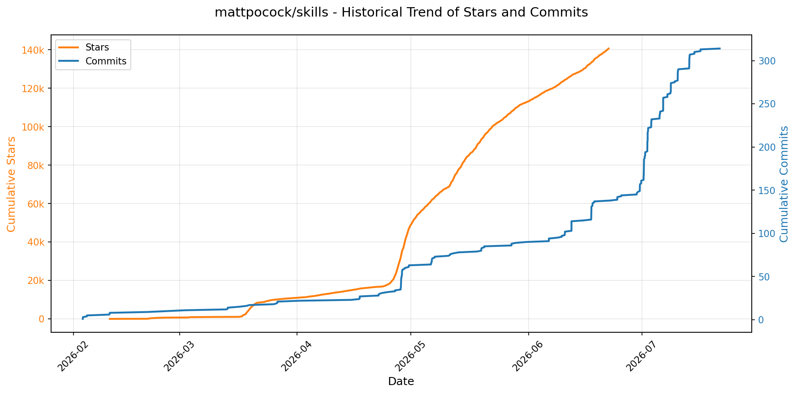

> *蓝色：累计 Stars｜橙色：累计 Commits（次 Y 轴）*

<b>📄 README 摘要</b>

1. **项目做什么？**  
该项目是一套为 AI 编码代理（如 Claude Code、Codex）设计的工程技能集，旨在解决使用代理时常见的失败模式——需求对齐不清、输出冗长、缺乏反馈循环、代码结构恶化。它提供了一系列小型、可组合、易修改的技能，帮助开发者以真正的软件工程实践（而非随意“vibe coding”）驱动代理工作，包括需求梳理、共享语言构建、测试驱动开发、代码架构改进、调试、代码审查等。

2. **主要特性**  
- **快速安装与配置**：通过 `npx skills@latest add mattpocock/skills` 一键安装，运行 `/setup-matt-pocock-skills` 即可配置问题追踪器（GitHub / Linear / 本地文件）等。  
- **两种安装模式**：skills.sh 将技能复制到项目中，可自由修改；Claude Code 插件以只读、自动更新的方式安装，适合直接订阅使用。  
- **核心技能**：`/grill-me` 和 `/grill-with-docs`（需求对齐与领域建模）、`/tdd`（红-绿-重构循环）、`/improve-codebase-architecture`（架构改进）、`/triage`（问题分类）、`/to-spec` 和 `/to-tickets`（生成规格与任务）、`/implement`（驱动实现与代码审查）、`/diagnosing-bugs`（调试循环）、`/code-review`（双轴审查）等。  
- **技能分类**：Engineering（工程）和 Productivity（生产力）两大类，分别由用户主动调用或由模型自动触发。  
- **强调工程基础**：通过共享语言文档（CONTEXT.md）、反馈循环、模块设计等原则，提升代理协作质量。

3. **技术栈**  
- **安装与分发**：基于 Node.js 生态，使用 `npx` 和 skills.sh 平台。  
- **代理集成**：支持作为 Claude Code 原生插件安装，同时兼容其他遵循 Agent-Skills-standard 的编码代理（如 Codex）。  
- **技能定义**：技能以 Markdown 文件（SKILL.md）编写，遵循标准接口规范。  
- **问题追踪**：集成 GitHub、Linear 或本地文件系统作为工单管理后端。

---

### 2. [ocornut/imgui](https://github.com/ocornut/imgui)
- 📅 **创建日期**：2014-07-21  
- 🔄 **最近更新**：2026-07-27  
- ⭐ **Stars**：74,544（日 +0｜周 +0｜月 +467）  
- 📝 **描述**：Dear ImGui: Bloat-free Graphical User interface for C++ with minimal dependencies  

<b>📈 Star 与 Commit 历史趋势</b>

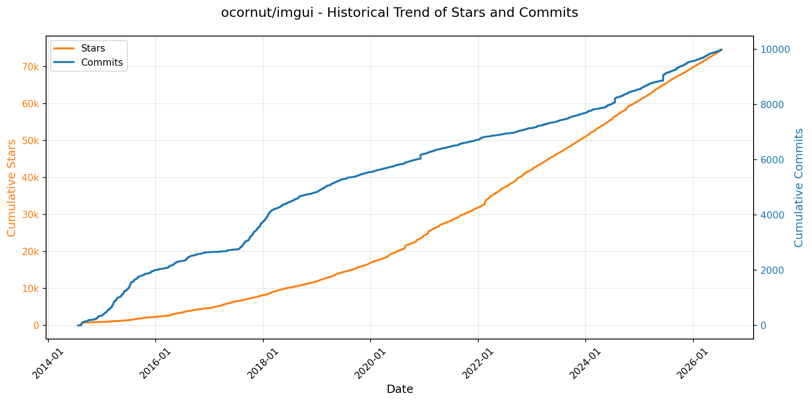

> *蓝色：累计 Stars｜橙色：累计 Commits（次 Y 轴）*

---

### 3. [ruvnet/RuView](https://github.com/ruvnet/RuView)
- 📅 **创建日期**：2025-06-07  
- 🔄 **最近更新**：2026-07-27  
- ⭐ **Stars**：67,359（日 +0｜周 +0｜月 +4929）  
- 📝 **描述**：π RuView turns commodity WiFi signals into real-time spatial intelligence, vital sign monitoring, and presence detection — all without a single pixel of video.  

<b>📈 Star 与 Commit 历史趋势</b>

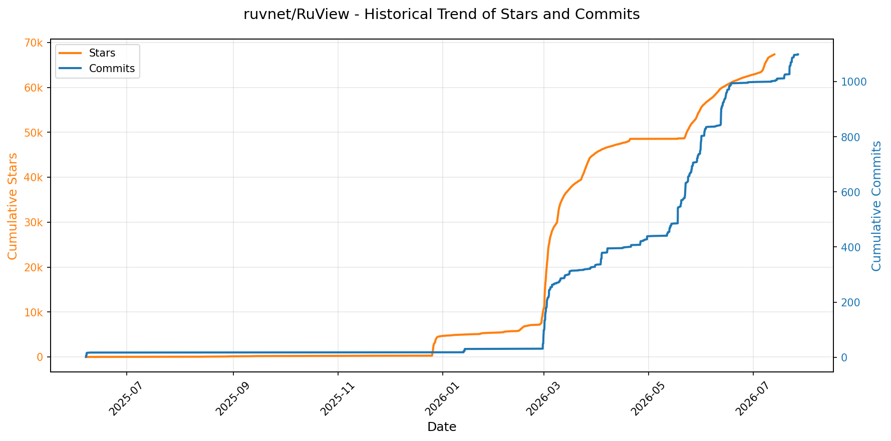

> *蓝色：累计 Stars｜橙色：累计 Commits（次 Y 轴）*

<b>📄 README 摘要</b>

### 1. 项目做什么

π RuView 是一个 WiFi 传感平台，利用普通 WiFi 信号（通过信道状态信息 CSI）实现空间智能感知。它能够穿墙检测人员存在、测量呼吸和心率、跟踪运动、识别活动（如行走、坐姿、跌倒），并支持多人计数、环境射频指纹识别和睡眠质量监测。系统完全运行在边缘硬件上，无需摄像头、可穿戴设备或云端连接，仅依靠物理无线电波即可感知空间状态。

### 2. 关键特性

- **存在与占用检测**：穿墙感知人员存在，计数并跟踪进出。
- **生命体征监测**：无接触测量呼吸率（6–30 BPM）和心率（40–120 BPM），支持睡眠阶段分类和呼吸暂停筛查。
- **活动与姿态识别**：识别行走、坐姿、手势、跌倒（<200 ms 响应），并提供 17 关键点姿态估计（当前为初步模型，准确率正在优化中）。
- **环境映射**：通过射频指纹识别房间，检测家具移动和新物体。
- **多模态融合**：支持 WiFi CSI + 摄像头深度 + 毫米波雷达的 3D 点云融合（22 ms 管线，19K+ 点/帧）。
- **智能家居集成**：原生支持 Home Assistant（通过 MQTT）、Apple Home（HAP-1.1 桥接）、Google Home、Amazon Alexa 和 Matter，提供 21 个实体（11 个原始信号 + 10 个推断语义状态，如有人睡觉、可能遇险、房间活跃等），并附带 3 个 HA 蓝图。
- **边缘智能**：105 个边缘模块（Cog）目录，涵盖健康、安防、建筑、零售、工业、研究、AI、群组等类别；可选 Cognitum Seed 提供持久向量存储、kNN 搜索和密码学见证链。
- **低功耗与低成本**：使用 ESP32-S3（约 $9/节点）或 ESP32-C6（$6–10），完整系统 BOM 约 $140；支持多频率网格扫描（6 个信道）和 TDM 时隙调度，利用邻居路由器作为免费雷达发射器。
- **预训练模型**：Hugging Face 发布对比学习 CSI 编码器（128 维嵌入，164,183 emb/s on M4 Pro），4 位量化后仅 8 KB；模型在 MM-Fi 基准上达到 82.69% 躯干 PCK@20（姿态估计），超越现有方案。
- **穿墙能力**：基于菲涅耳区几何和多径建模，典型穿墙距离约 5 米。
- **自校准与快速适应**：脉冲神经网络（SNN）可在 30 秒内适应环境，无需重新训练。

### 3. 技术栈

- **硬件**：
  - 主要传感器：ESP32-S3（CSI 流）、ESP32-C6（Wi-Fi 6 + 802.15.4，带 LP-core 运动门控和 TWT 响应器）。
  - 可选协处理器：Cognitum Seed（持久存储、见证链、MCP 代理）。
  - 其他硬件选项：Intel 5300 / Atheros AR9580 研究 NIC、Qualcomm QCA9300（实验性）。
- **软件与语言**：
  - 核心推理与边缘模块：Rust（1.85+），提供 PyO3 Python 绑定（`ruview` / `wifi-densepose` 包）。
  - 训练与评估：Python（PyTorch、Candle、Hugging Face Transformers）。
  - 固件：ESP-IDF（C/C++），支持 ESP32-S3 和 ESP32-C6 双目标。
  - 可视化与演示：JavaScript（three.js、MediaPipe）。
- **机器学习与模型**：
  - 对比学习 CSI 编码器（自监督预训练 + 摄像头监督微调）。
  - 脉冲神经网络（SNN）用于实时环境适应。
  - 姿态估计：Cog 二进制（Candle 加载 `pose_v1.safetensors`），MM-Fi 基准上 SOTA。
  - 世界模型预测：OccWorld TransVQVAE（15 帧未来占用预测）。
- **集成与通信**：
  - MQTT（Home Assistant）、HAP（Apple Home）、Matter（智能家居桥接）。
  - WebSocket、REST API（`/api/v1/config/`）。
  - 多频率网格：TDM 时隙调度，支持 ESP-NOW 跨板同步。
- **部署与工具**：
  - Docker 镜像（amd64 + arm64），支持模拟数据运行。
  - PyPI 发布（`ruview` / `wifi-densepose`），含 asyncio WebSocket 和 paho-mqtt 客户端。
  - 固件刷写与配置工具（`esptool`、`provision.py`）。
- **测试与验证**：1463 个测试通过，提供确定性参考信号验证管线。

---

### 4. [koala73/worldmonitor](https://github.com/koala73/worldmonitor)
- 📅 **创建日期**：2026-01-08  
- 🔄 **最近更新**：2026-07-27  
- ⭐ **Stars**：61,441（日 +0｜周 +0｜月 +601）  
- 📝 **描述**：Real-time global intelligence dashboard. AI-powered news aggregation, geopolitical monitoring, and infrastructure tracking in a unified situational awareness interface  

<b>📈 Star 与 Commit 历史趋势</b>

> *蓝色：累计 Stars｜橙色：累计 Commits（次 Y 轴）*

<b>📄 README 摘要</b>

1. 项目做什么：
World Monitor 是一个实时全球情报仪表盘，通过 AI 驱动的新闻聚合、地缘政治监控和基础设施追踪，提供统一的态势感知界面。

2. 主要特点：
- 整合 500+ 精选新闻源（15 个类别），AI 合成简报
- 双地图引擎（3D 地球 globe.gl 和 WebGL 平面地图 deck.gl），支持 56 种地图图层
- 跨流关联分析（军事、经济、灾害、升级信号汇聚）
- 国家不稳定指数（CII v8）对 31 个一级国家进行压力评分
- 金融雷达覆盖 29 个证券交易所、大宗商品、加密货币及 7 信号市场复合指标
- 本地 AI 推理（Ollama），无需 API 密钥
- 单一代码库生成 6 个站点变体（world、tech、finance、commodity、happy、energy）
- 原生桌面应用（Tauri 2）支持 macOS、Windows、Linux
- 支持 25 种语言，含本地语言新闻源和 RTL 布局
- 提供 MCP 服务器、REST API、CLI 及多语言 SDK（Python、Ruby、Go）等程序化访问接口
- 聚合 65+ 外部数据源，覆盖地缘政治、金融、能源、气候、航空、网络安全等领域

3. 技术栈：
- 前端：Vanilla TypeScript、Vite、globe.gl + Three.js、deck.gl + MapLibre GL
- 桌面：Tauri 2（Rust）搭配 Node.js sidecar
- AI/ML：Ollama / Groq / OpenRouter、Transformers.js（浏览器端）
- API 契约：Protocol Buffers（284 个 proto、35 个服务）、sebuf HTTP 注解
- 部署：Vercel Edge Functions（60+）、Railway relay、Tauri、PWA
- 缓存：Redis（Upstash）、三层缓存、CDN、Service Worker

---

### 5. [asgeirtj/system_prompts_leaks](https://github.com/asgeirtj/system_prompts_leaks)
- 📅 **创建日期**：2025-05-03  
- 🔄 **最近更新**：2026-07-27  
- ⭐ **Stars**：57,313（日 +0｜周 +0｜月 +10571）  
- 📝 **描述**：Extracted system prompts from Anthropic - Claude Fable 5, Opus 5, Claude Design, Claude Code. OpenAI - ChatGPT GPT-5.6-Sol, Codex. Google - Gemini 3.5 Flash, 3.1 Pro, Antigravity. xAI - Grok, Cursor, Copilot, VS Code, Perplexity, and more. Updated regularly.  

<b>📈 Star 与 Commit 历史趋势</b>

> *蓝色：累计 Stars｜橙色：累计 Commits（次 Y 轴）*

<b>📄 README 摘要</b>

1.  **项目做什么？**
    本项目系统性地收集、整理并公开了来自各大AI公司（如OpenAI、Anthropic、Google、xAI等）的聊天机器人和编程助手的“系统提示词”（System Prompts）。这些提示词是模型在响应用户之前被赋予的隐藏指令，定义了模型的行为模式、角色定位和规则限制。该项目将这些泄露的原始文本进行归档，旨在为AI透明度研究、新闻报道和开发者社区提供一份宝贵的公开资料。

2.  **主要特点**
    *   **覆盖面极广**：几乎囊括了所有主流AI模型，如ChatGPT、Claude、Gemini、Grok、Perplexity、Copilot、DeepSeek、Kimi等，并持续追踪最新版本。
    *   **内容深度**：不仅收录基础模型的提示词，还包含了丰富的变体，例如编程模式（Codex、Claude Code）、设计模式（Claude Design）、语音模式、API注入提示词、安全规则、个性化技能等，非常详尽。
    *   **版本历史清晰**：通过文件夹和文件结构清晰展示了不同版本（如Claude Opus 4.6、4.7、4.8、5等）的迭代变化，便于研究提示词的演变。
    *   **社区驱动与引用**：项目欢迎Pull Request，已被《华盛顿邮报》和CEPS的AI World等权威机构用于深度报道和数据可视化项目，证明了其资料的真实性和影响力。
    *   **组织良好**：以README作为总索引，按公司、产品和模型分类，配有最近更新列表，导航方便。

3.  **技术栈**
    该项目并非一个传统意义上的软件应用，而是一个文本资料库，因此技术栈非常简单，主要依赖：
    *   **文档格式**：Markdown (.md) 文件，用于存储所有提示词内容。
    *   **版本控制**：Git，用于管理历史版本和协作贡献。
    *   **托管平台**：GitHub，提供仓库管理和社区功能。
    *   **辅助工具**：使用 Shields.io 生成状态徽章，使用 HTML 的 `<picture>` 标签实现响应式图片展示。
    整个项目不涉及后端服务、数据库或前端框架，纯粹依靠静态文档和GitHub平台来运作。

---

### 6. [ComposioHQ/awesome-claude-skills](https://github.com/ComposioHQ/awesome-claude-skills)
- 📅 **创建日期**：2025-10-17  
- 🔄 **最近更新**：2026-07-27  
- ⭐ **Stars**：54,837（日 +0｜周 +0｜月 +0）  
- 📝 **描述**：A curated list of awesome Claude Skills, resources, and tools for customizing Claude AI workflows  

<b>📈 Star 与 Commit 历史趋势</b>

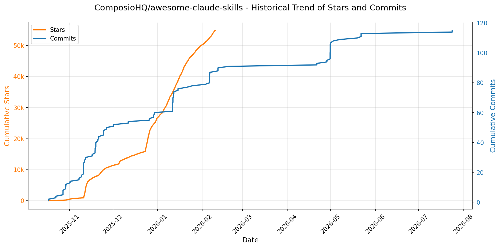

> *蓝色：累计 Stars｜橙色：累计 Commits（次 Y 轴）*

<b>📄 README 摘要</b>

### 1. 项目功能

本项目是一个精心策划的 **Claude Skills 与插件资源列表**，收录了 1000 多个生产就绪、实用的技能包，旨在提升用户在 **Claude.ai、Claude Code 以及 Codex、Cursor、Gemini CLI、Antigravity 等编码代理**中的生产力。同时，它通过 **Composio MCP Gateway** 为这些技能提供真实世界的操作能力，使代理能安全地连接 1000+ 应用并执行实际动作（如发送邮件、创建 Issue、发布 Slack 消息等）。

### 2. 关键特性

- **海量技能覆盖**：提供 1000+ 个技能，涵盖文档处理、开发工具、数据分析、业务营销、通信写作、创意媒体、生产力组织、协作项目管理和安全系统等十余个类别。
- **多代理兼容**：不仅支持 Claude 系列产品，还兼容 OpenAI Codex、Cursor、Gemini CLI、Antigravity、Windsurf 等主流 AI 编码代理。
- **开放标准格式**：基于 Anthropic 推出的 Skills 开放标准（YAML 前置元数据 + Markdown 指令），支持**渐进加载**——会话启动时仅加载约 100 tokens 的元数据，完整内容按需加载，使单个代理可托管数百个技能而不膨胀上下文。
- **真实世界操作**：通过内置的 `connect-apps` 插件和 Composio MCP Gateway，让 Claude 能直接操作 1000+ 应用（Gmail、Slack、GitHub、Notion 等），并内置认证、团队访问控制、审计日志和生产级可靠性。
- **社区驱动**：大量技能由社区贡献者创建，并欢迎通过 PR 贡献新技能，列表持续更新。

### 3. 技术栈

- **技能格式**：基于 **Skills 开放标准**，使用 `SKILL.md` 文件（YAML frontmatter + Markdown），可选包含 `scripts/` 和 `references/` 目录（支持 Python、TypeScript、Shell 等脚本）。
- **连接协议**：**MCP（Model Context Protocol）**，用于代理与外部系统的安全连接、认证和工具发现。
- **集成平台**：**Composio**，提供统一的 MCP 端点，支持 1000+ 应用集成，内置认证、访问控制、审计日志。
- **支持的代理**：Claude Code、Claude.ai、Claude API、OpenAI Codex、Cursor、Gemini CLI、Antigravity、Windsurf。
- **基础工具**：列表中的技能广泛使用 Playwright、D3.js、FFUF、PostgreSQL、Next.js、Sanity 等工具，但项目本身以 Markdown 文档和 YAML 配置为主。

---

### 7. [earendil-works/pi](https://github.com/earendil-works/pi)
- 📅 **创建日期**：2025-08-09  
- 🔄 **最近更新**：2026-07-27  
- ⭐ **Stars**：54,345（日 +0｜周 +0｜月 +0）  
- 📝 **描述**：AI agent toolkit: unified LLM API, agent loop, TUI, coding agent CLI  

<b>📈 Star 与 Commit 历史趋势</b>

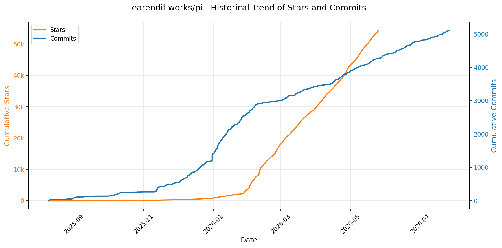

> *蓝色：累计 Stars｜橙色：累计 Commits（次 Y 轴）*

<b>📄 README 摘要</b>

以下是对该内容的总结，涵盖三个方面：

1. **项目做什么**  
   Pi Agent Harness 是一个自扩展的编码代理工具包，提供交互式编码代理 CLI，以及统一的 LLM 多提供商 API（支持 OpenAI、Anthropic、Google 等）和代理运行时（含工具调用与状态管理）。项目旨在帮助开发者通过命令行与 AI 代理协作完成编码任务，并支持将代理会话数据公开分享以改进模型。

2. **关键特性**  
   - **自扩展编码代理**：能够通过自身机制扩展功能。  
   - **统一多提供商 LLM API**：集成多种主流大模型，切换灵活。  
   - **交互式 CLI**：提供终端用户界面（含差分渲染库 pi-tui），支持实时交互。  
   - **工具调用与状态管理**：代理运行时内置工具调用和对话状态管理。  
   - **容器化与沙盒支持**：提供三种隔离模式（Gondolin 微虚拟机、Docker、OpenShell 策略沙盒），增强安全边界。  
   - **供应链安全**：依赖锁定、shrinkwrap 生成、CI 审计等机制确保依赖安全。  
   - **会话分享**：支持将编码代理会话数据发布到 Hugging Face，用于真实世界任务研究。

3. **技术栈**  
   - **语言与运行时**：TypeScript / JavaScript，基于 Node.js 和 Bun 构建。  
   - **包管理**：npm（含 shrinkwrap 锁定）。  
   - **LLM 支持**：通过 pi-ai 统一封装 OpenAI、Anthropic、Google 等 API。  
   - **终端 UI**：pi-tui 实现差分渲染的终端界面。  
   - **构建与测试**：npm scripts、Bun 编译、本地测试脚本（test.sh、pi-test.sh）。  
   - **容器化**：Docker、微虚拟机、OpenShell 等隔离技术。

---

### 8. [anthropics/claude-cookbooks](https://github.com/anthropics/claude-cookbooks)
- 📅 **创建日期**：2023-08-15  
- 🔄 **最近更新**：2026-07-27  
- ⭐ **Stars**：48,463（日 +0｜周 +0｜月 +2518）  
- 📝 **描述**：A collection of notebooks/recipes showcasing some fun and effective ways of using Claude.  

<b>📈 Star 与 Commit 历史趋势</b>

> *蓝色：累计 Stars｜橙色：累计 Commits（次 Y 轴）*

<b>📄 README 摘要</b>

1. **项目做什么**  
该项目提供一系列代码示例和操作指南，帮助开发者利用 Claude API 构建应用，包含可直接复制并集成到自有项目中的代码片段。

2. **关键特性**  
- **核心能力**：分类、检索增强生成（RAG）、文本摘要。  
- **工具使用与集成**：客户服务代理、计算器工具、SQL 查询等外部工具调用。  
- **第三方集成**：支持 Pinecone 向量数据库、Wikipedia、网页内容检索，以及 Voyage AI 嵌入。  
- **多模态能力**：图像识别与处理（图表、表单）、结合 Stable Diffusion 生成图像。  
- **高级技术**：子代理（Haiku + Opus）、PDF 文本解析、自动评估、JSON 模式输出、内容审核过滤器、提示缓存。  
- **社区贡献**：鼓励开发者提交新示例、修复问题或改进现有内容。

3. **技术栈**  
- **主要语言**：Python（示例代码），概念可适配其他支持 Claude API 的语言。  
- **核心依赖**：Claude API（需 API 密钥）。  
- **第三方工具**：Pinecone（向量数据库）、Voyage AI（嵌入）、Stable Diffusion（图像生成）、AWS 基础设施（可选）。

---

### 9. [usestrix/strix](https://github.com/usestrix/strix)
- 📅 **创建日期**：2025-08-05  
- 🔄 **最近更新**：2026-07-27  
- ⭐ **Stars**：40,991（日 +0｜周 +0｜月 +14824）  
- 📝 **描述**：Open-source AI penetration testing tool to find and fix your app’s vulnerabilities.  

<b>📈 Star 与 Commit 历史趋势</b>

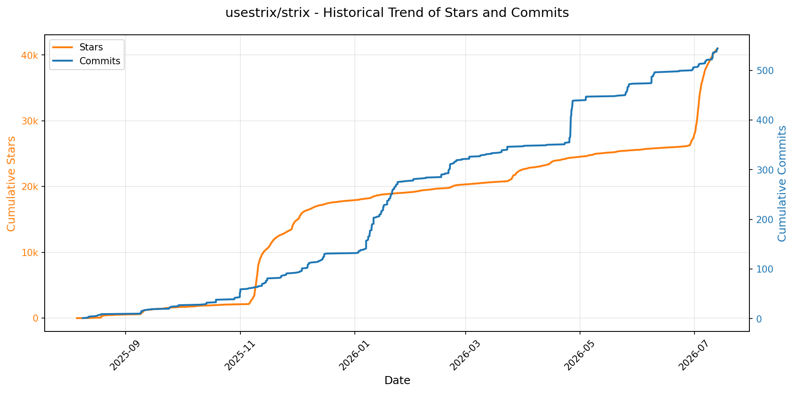

> *蓝色：累计 Stars｜橙色：累计 Commits（次 Y 轴）*

<b>📄 README 摘要</b>

1. **项目功能**  
   Strix 是一款开源的 AI 渗透测试工具，通过自主 AI 代理模拟真实黑客行为，动态运行代码、发现并验证漏洞，生成实际可利用的概念验证（PoC）并提供修复建议。它面向开发者和安全团队，旨在替代传统手动渗透测试，减少误报，加速安全检测流程。

2. **主要特点**  
   - 完整的渗透测试工具包：包括 HTTP 拦截代理（Caido）、浏览器自动化（Playwright）、Shell 执行、自定义 PoC 运行环境、侦察与 OSINT、静态/动态代码分析（SAST+DAST）、漏洞知识库（CVSS 评分、OWASP 分类）。  
   - 多代理编排：支持分布式、可扩展的 AI 代理团队，实现侦察、利用、后利用的协同工作，动态协调漏洞链利用。  
   - 真实漏洞验证：每个发现都附带可复现的 PoC，杜绝误报。  
   - 开发者优先的 CLI：提供清晰的操作指令、实时结果输出、自动修复建议及合规性渗透测试报告生成。  
   - 全面漏洞覆盖：涵盖 OWASP Top 10 及更多（访问控制、注入、SSRF、XSS、业务逻辑缺陷、API 安全等）。  
   - CI/CD 集成：原生支持 GitHub Actions，可在 PR 阶段自动扫描并阻断不安全代码。  
   - 本地 Web 查看器：无需上传，通过 `strix view` 启动本地仪表盘，展示运行状态、漏洞详情、代理协作图、历史记录及报告导出。  
   - 多种使用模式：支持本地代码扫描、GitHub 仓库分析、黑盒/白盒测试、自定义指令、多目标并行扫描、头模式（非交互）等。  
   - 企业级扩展：提供 SSO、定制合规报告（SOC 2、ISO 27001、PCI DSS）、VPC 部署、BYOK 模型支持等。

3. **技术栈**  
   - **运行环境**：Docker（沙箱隔离）、Python（CLI 及核心运行时）。  
   - **AI 模型**：集成多种 LLM 提供商（OpenAI、Anthropic、Google Vertex AI、AWS Bedrock、Azure、本地模型等），通过 LiteLLM 统一调用。  
   - **核心依赖**：Caido（HTTP 代理）、Nuclei（漏洞模板扫描）、Playwright（浏览器自动化）、Textual（终端 UI）。  
   - **安装方式**：curl 脚本安装或 PyPI 包（`strix-agent`）。  
   - **CI/CD 集成**：GitHub Actions（通过 `actions/checkout` 和 `strix` 命令）。  
   - **配置存储**：本地 JSON 配置文件（`~/.strix/cli-config.json`）。  
   - **前端**：Web 查看器为预构建 UI，无需额外构建步骤。

---

### 10. [rohitg00/ai-engineering-from-scratch](https://github.com/rohitg00/ai-engineering-from-scratch)
- 📅 **创建日期**：2026-03-18  
- 🔄 **最近更新**：2026-07-27  
- ⭐ **Stars**：35,513（日 +0｜周 +0｜月 +0）  
- 📝 **描述**：Learn it. Build it. Ship it for others.  

<b>📈 Star 与 Commit 历史趋势</b>

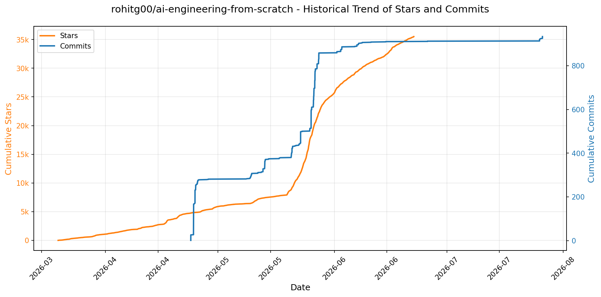

> *蓝色：累计 Stars｜橙色：累计 Commits（次 Y 轴）*

<b>📄 README 摘要</b>

1. 项目功能  
   提供一个从零开始的 AI 工程综合课程，包含 503 课、20 个阶段（约 320 小时），覆盖数学基础、经典机器学习、深度学习核心、计算机视觉、自然语言处理、语音、强化学习、Transformer、生成式 AI、大语言模型、多模态、工具与协议、智能体工程、自主系统、多智能体与群体、基础设施与生产、伦理对齐以及顶点项目。课程强调从原始数学推导手工实现每个算法，再使用生产框架，最终每课产出可重用的工件（prompt、skill、agent、MCP server），旨在帮助学生真正理解 AI 原理而不仅仅是调用 API。

2. 关键特性  
   - **完整螺旋式体系**：20 个阶段从环境搭建到数学、ML、深度学习、高级主题（LLM、智能体、生产）循序渐进。  
   - **构建‑使用‑交付模式**：每课遵循“MOTTO → PROBLEM → CONCEPT → BUILD IT（手工实现）→ USE IT（PyTorch/sklearn）→ SHIP IT（产出可重用工件）”。  
   - **可重用工件**：每课产出 prompt、skill、agent 或 MCP 服务器，可直接用于日常 AI 工作流。  
   - **多语言代码**：课程代码使用 Python、TypeScript、Rust、Julia 四种语言。  
   - **内置 Agent 技能**：提供 `/find-your-level`（定位起点）和 `/check-understanding`（阶段测验）技能，可集成到 Claude、Cursor、Codex 等 IDE。  
   - **书籍化发布**：课程编译为六卷 EPUB/PDF 电子书，随 GitHub Release 自动生成，可离线阅读。  
   - **免费开源**：MIT 许可，所有材料可在 GitHub 获取并在本地运行。  
   - **活跃社区**：截至 2026‑06‑07，30 天内超过 15 万读者、24 万页面浏览。

3. 技术栈  
   - **编程语言**：Python（主要）、TypeScript、Rust、Julia。  
   - **深度学习框架**：PyTorch（“USE IT”环节）。  
   - **机器学习库**：scikit‑learn（“USE IT”环节）。  
   - **开发与部署工具**：Docker、Git、Jupyter Notebook、GPU 云设置、Linux、终端、调试与性能分析工具。  
   - **协议与标准**：MCP（Model Context Protocol）服务器（Phase 13 构建）。  
   - **课程内手工实现技术**：自动微分、注意力机制、Tokenizer、ReAct 智能体循环、强化学习算法等（均从零构建，不依赖高层框架）。

---

### 11. [DeusData/codebase-memory-mcp](https://github.com/DeusData/codebase-memory-mcp)
- 📅 **创建日期**：2026-02-24  
- 🔄 **最近更新**：2026-07-27  
- ⭐ **Stars**：30,716（日 +0｜周 +0｜月 +14978）  
- 📝 **描述**：High-performance code intelligence MCP server. Indexes codebases into a persistent knowledge graph — average repo in milliseconds. 158 languages, sub-ms queries, 99% fewer tokens. Single static binary, zero dependencies.  

<b>📈 Star 与 Commit 历史趋势</b>

> *蓝色：累计 Stars｜橙色：累计 Commits（次 Y 轴）*

<b>📄 README 摘要</b>

1. **项目功能**  
为AI编码代理（如Claude Code等MCP客户端）提供超高速代码库索引与智能查询引擎。通过tree-sitter构建持久化知识图谱，将代码结构（函数、类、调用链、HTTP路由、跨服务链接等）转化为可查询的图数据，并通过15个MCP工具实现搜索、追踪、架构分析、影响分析、死代码检测等功能。所有处理均在本地完成，代码不离开机器。

2. **关键特性**  
- **极速索引**：Linux内核（28M LOC, 75K文件）3分钟全索引，RAM优先管线（LZ4压缩、内存SQLite、Aho-Corasick模式匹配）。  
- **零依赖单二进制**：纯C实现，无需Docker、运行时依赖或API密钥，支持macOS/Linux/Windows。  
- **158种语言**：内置tree-sitter语法，混合LSP语义类型解析（Python, TypeScript, C++, Rust等12种语言）。  
- **15个MCP工具**：包括架构概览、调用图追踪、Cypher查询、语义搜索、死代码检测、ADR管理、跨服务HTTP/gRPC链接等。  
- **内置3D图可视化**：可选UI变体，在localhost:9749提供交互式知识图谱浏览。  
- **跨仓库与团队协作**：支持多仓库图合并，可提交压缩图制品（`.codebase-memory/graph.db.zst`）到仓库，队友免重索引。  
- **自动索引与监控**：自动检测项目变更并增量更新，支持会话协调守护进程。  
- **43种客户端表面**：自动检测并配置主流编码代理，支持条件激活。

3. **技术栈**  
- **核心语言**：纯C（零依赖，静态编译）。  
- **解析引擎**：tree-sitter（158种语言AST分析）。  
- **语义解析**：自研轻量级混合LSP（C实现，兼容主流语言服务器算法）。  
- **存储与索引**：SQLite（持久化图存储）、FTS5全文搜索（BM25）、LZ4（内存压缩）、zstd（图制品压缩）。  
- **搜索与匹配**：Aho-Corasick（模式匹配）、Nomic nomic-embed-code（语义嵌入，768d int8）、MinHash+LSH（近克隆检测）。  
- **图算法**：Louvain社区检测、BFS/DFS遍历、Cypher风格查询。  
- **协议**：MCP（Model Context Protocol）服务器接口。  
- **平台**：macOS (arm64/amd64)、Linux (arm64/amd64)、Windows (amd64)。

---

### 12. [shiyu-coder/Kronos](https://github.com/shiyu-coder/Kronos)
- 📅 **创建日期**：2025-07-01  
- 🔄 **最近更新**：2026-07-27  
- ⭐ **Stars**：30,165（日 +0｜周 +0｜月 +0）  
- 📝 **描述**：Kronos: A Foundation Model for the Language of Financial Markets  

<b>📈 Star 与 Commit 历史趋势</b>

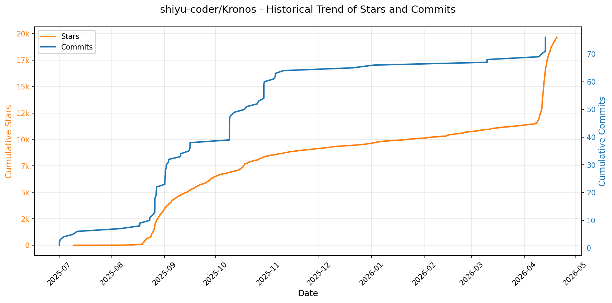

> *蓝色：累计 Stars｜橙色：累计 Commits（次 Y 轴）*

<b>📄 README 摘要</b>

### 1. 项目做什么
Kronos 是一个**首个开源的金融 K 线基础模型**，专门为金融市场“语言”（即 OHLCV 序列）设计。它采用两阶段框架：先通过专用分词器将连续多维 K 线数据量化为分层离散 token，再用自回归 Transformer 进行预训练，从而统一服务于价格预测、量化交易等多种任务。

### 2. 关键特性
- **首个开源金融 K 线基础模型**，训练数据覆盖全球 45+ 交易所。
- **两阶段架构**：分层 tokenizer + 自回归 Transformer，针对金融数据高噪声特性优化。
- **多尺寸预训练模型**：提供 mini (4.1M)、small (24.7M)、base (102.3M) 和 large (499.2M) 参数版本，除 large 外均开源在 Hugging Face。
- **易用预测接口**：`KronosPredictor` 类支持单条和批量预测，自动处理归一化/反归一化。
- **完整微调流程**：提供基于 Qlib 的 A 股市场示例，包含 tokenizer 微调、预测器微调及回测评估。
- **在线演示**：展示 BTC/USDT 未来 24 小时预测结果。
- **学术认可**：论文已被 AAAI 2026 接收。

### 3. 技术栈
- **语言与框架**：Python 3.10+，依赖 PyTorch、Transformers 等（见 requirements.txt）。
- **模型架构**：Decoder-only Transformer，支持多 GPU 训练（torchrun）。
- **分词器**：专用 KronosTokenizer，对 OHLCV 数据进行分层离散量化。
- **数据与回测**：支持 Qlib 金融数据接口，提供基于 Qlib 的简单回测脚本。
- **推理设备**：支持 GPU（CUDA）。
- **模型托管**：Hugging Face Hub。
- **论文与许可**：arXiv 论文，MIT 开源协议。

---

### 13. [alibaba/page-agent](https://github.com/alibaba/page-agent)
- 📅 **创建日期**：2025-09-23  
- 🔄 **最近更新**：2026-07-27  
- ⭐ **Stars**：26,419（日 +0｜周 +0｜月 +6116）  
- 📝 **描述**：JavaScript in-page GUI agent. Control web interfaces with natural language.  

<b>📈 Star 与 Commit 历史趋势</b>

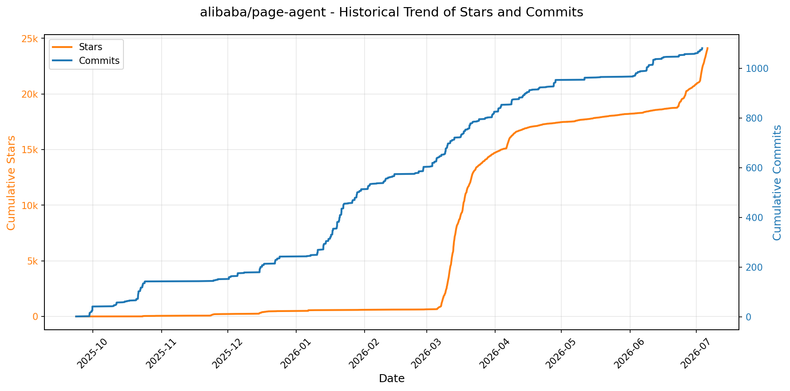

> *蓝色：累计 Stars｜橙色：累计 Commits（次 Y 轴）*

<b>📄 README 摘要</b>

### 1. 项目做什么

Page Agent 是一个内嵌在网页中的 GUI 代理（GUI Agent）。只需在页面中引入一行 JavaScript 脚本，就能让任意网页拥有自己的 AI 代理。用户可以通过自然语言指令直接操控网页（如点击按钮、填写表单），无需安装浏览器扩展、Python 环境或无头浏览器，所有操作都在客户端页面内完成。

### 2. 关键特性

- **轻松集成**：只需在 HTML 中引入一个 `<script>` 标签即可，无需任何后端改造或额外工具。
- **基于文本的 DOM 操作**：通过文本指令直接操作 DOM 元素，不需要截图或多模态大模型，也无需特殊权限。
- **自带 LLM**：支持大多数主流大模型（包括本地部署的模型），用户可自由选择。
- **可选 Chrome 扩展**：支持跨多标签页的任务执行。
- **MCP 服务器（Beta）**：允许外部代理客户端控制浏览器。

### 3. 技术栈

- **语言**：TypeScript / JavaScript（前端库，运行于浏览器环境）。
- **包管理**：npm 分发（包名 `page-agent`），也支持 CDN 直接引入。
- **依赖**：依赖 LLM API（如阿里云 DashScope、OpenAI 兼容接口等），但本身不依赖任何后端服务。
- **基础**：DOM 处理组件和提示词模式借鉴了开源项目 `browser-use`（Python 项目），但 Page Agent 是完全基于客户端 JavaScript 的实现。

---

### 14. [permissionlesstech/bitchat](https://github.com/permissionlesstech/bitchat)
- 📅 **创建日期**：2025-07-04  
- 🔄 **最近更新**：2026-07-27  
- ⭐ **Stars**：24,675（日 +0｜周 +0｜月 +0）  
- 📝 **描述**：bluetooth mesh chat, IRC vibes  

<b>📈 Star 与 Commit 历史趋势</b>

> *蓝色：累计 Stars｜橙色：累计 Commits（次 Y 轴）*

<b>📄 README 摘要</b>

## 项目功能
bitchat 是一个去中心化的点对点消息应用，采用双传输架构：本地蓝牙 Mesh 网络用于离线通信，基于互联网的 Nostr 协议用于全球覆盖。无需账户、手机号或中央服务器，支持侧群聊。

## 关键特性
- **双传输架构**：蓝牙 Mesh（离线）与 Nostr 协议（互联网）并行，自动选择最佳传输层
- **基于位置的频道**：通过 geohash 坐标创建地理聊天室（街区、社区、城市、省份、区域）
- **智能消息路由**：优先使用蓝牙，不可用时回退到 Nostr，均不可用则排队等待
- **去中心化 Mesh 网络**：自动发现对等节点，支持多跳消息中继（最多 7 跳）
- **隐私优先**：无账户、手机号或服务器；使用基于身份密钥的持久设备标识（详见白皮书）
- **端到端加密**：Mesh 使用 Noise Protocol，Nostr 回退使用 BitChat 私有信封（XChaCha20-Poly1305）
- **IRC 风格命令**：支持 `/slap`、`/msg`、`/who` 等命令
- **通用应用**：原生支持 iOS 和 macOS
- **紧急擦除**：三击即可清除所有数据
- **性能优化**：LZ4 消息压缩、自适应电池模式、优化网络

## 技术栈
- **编程语言**：Swift
- **蓝牙传输**：CoreBluetooth（BLE Mesh 网络）
- **互联网传输**：Nostr 协议（基于中继的全局网络）
- **加密**：Noise Protocol（Mesh）、XChaCha20-Poly1305（BitChat 私有信封）
- **位置编码**：Geohash 坐标（用于基于位置的频道）
- **压缩**：LZ4 消息压缩
- **构建与测试**：Xcode、Swift Package Manager、just 自动化工具
- **平台**：iOS / macOS 原生应用（SwiftUI / AppKit）

---

### 15. [Zackriya-Solutions/meetily](https://github.com/Zackriya-Solutions/meetily)
- 📅 **创建日期**：2024-12-26  
- 🔄 **最近更新**：2026-07-27  
- ⭐ **Stars**：23,638（日 +0｜周 +0｜月 +10761）  
- 📝 **描述**：Privacy first, AI meeting assistant with 4x faster Parakeet/Whisper live transcription, speaker diarization, and Ollama summarization built on Rust. 100% local processing. no cloud required. Meetily (Meetly Ai - https://meetily.ai) is the #1 Self-hosted, Open-source Ai meeting note taker for macOS & Windows. Understand How to write meeting minutes  

<b>📈 Star 与 Commit 历史趋势</b>

> *蓝色：累计 Stars｜橙色：累计 Commits（次 Y 轴）*

<b>📄 README 摘要</b>

1. **项目做什么**  
   Meetily 是一款隐私优先的 AI 会议助手，完全在用户本地设备上运行，用于实时捕获、转录和总结会议，确保所有数据不离开本地，适合对隐私、合规和数据主权有严格要求的个人及企业。

2. **关键特性**  
   - **本地处理**：所有转录和摘要均在本地完成，无需云端传输。  
   - **实时转录**：支持 Whisper 或 Parakeet 模型进行实时语音转文字。  
   - **AI 摘要**：可选用 Ollama（本地）、Claude、Groq、OpenRouter 或自定义 OpenAI 兼容端点生成会议摘要。  
   - **多平台支持**：macOS、Windows、Linux。  
   - **导入与增强**（Beta）：导入已有音频文件并重新转录或更换模型/语言。  
   - **专业音频混合**：同时捕获麦克风和系统音频，具备智能闪避和防削波功能。  
   - **GPU 加速**：支持 Apple Silicon（Metal+CoreML）、NVIDIA CUDA、AMD/Intel Vulkan。  
   - **隐私设计**：所有录音、转录和模型数据均本地存储。  
   - **开源免费**：MIT 许可，社区版永久免费。

3. **技术栈**  
   - **框架**：Tauri（Rust 后端 + 前端容器）  
   - **前端**：Next.js（React）  
   - **转录模型**：Whisper.cpp、Parakeet（ONNX 转换）  
   - **AI 摘要提供商**：Ollama（本地）、Claude、Groq、OpenRouter、OpenAI 兼容端点  
   - **GPU 加速**：Metal、CoreML、CUDA、Vulkan  
   - **音频处理**：系统音频捕获与混合（底层 Rust 实现）

---

### 16. [HKUDS/DeepTutor](https://github.com/HKUDS/DeepTutor)
- 📅 **创建日期**：2025-12-28  
- 🔄 **最近更新**：2026-07-27  
- ⭐ **Stars**：23,173（日 +0｜周 +0｜月 +0）  
- 📝 **描述**：DeepTutor: Lifelong Personalized Tutoring. https://deeptutor.info/.  

<b>📈 Star 与 Commit 历史趋势</b>

> *蓝色：累计 Stars｜橙色：累计 Commits（次 Y 轴）*

<b>📄 README 摘要</b>

### 1. 项目做什么？
DeepTutor 是一个以智能体（agent）为核心的学习工作空间，致力于实现终身个性化辅导。它将辅导、问题求解、测验生成、研究、可视化、掌握练习等多种学习模式整合到一个可扩展的统一系统中，让学习者的上下文（知识库、书籍、笔记、记忆等）在所有工作流中无缝流动，从而实现真正的个性化智能辅导。

### 2. 关键特性
- **统一运行时**：聊天、测验、研究、可视化、求解、掌握路径等所有模式运行在同一个智能体循环上，切换目标无需更换引擎，学习上下文随学习者移动。
- **连接的学习上下文**：知识库、书籍、协作写作草稿、笔记本、题库、角色、记忆等在所有工作流中保持可用，不再孤立。
- **子智能体与伙伴**：可实时调用编码 CLI（如 Claude Code、Codex、Gemini、Kimi 等）或伙伴（Partner）参与对话，伙伴拥有独立记忆和角色，支持持续 IM 陪伴。
- **多引擎知识**：支持版本化的 RAG 库（LlamaIndex、PageIndex、GraphRAG、LightRAG）以及链接的 Obsidian 仓库，文档解析引擎可插拔。
- **可扩展工具与技能**：内置工具、MCP 服务器、图像/视频/语音生成模型，以及可从 EduHub 安装的社区技能。
- **可检查记忆**：三层记忆（L1 痕迹、L2 表面摘要、L3 综合）使个性化透明且可追溯。
- **丰富集成**：支持多种 LLM 提供商（OpenAI、Anthropic、Gemini 等）、多种文档格式解析、多语言界面、Docker 部署等。

### 3. 技术栈
- **编程语言**：Python 3.11+（后端）、Next.js 16（前端）
- **AI/ML**：OpenAI / Anthropic SDK（原生，弃用 litellm）、LlamaIndex、GraphRAG、LightRAG、FAISS、MCP 协议
- **文档解析**：MinerU、PyMuPDF4LLM、Docling 等
- **数据库/存储**：PocketBase（用户隔离会话）、向量数据库（FAISS 等）
- **部署**：Docker（支持 rootless Podman）、GitHub Actions CI/CD、预构建镜像（GHCR）
- **通信**：WebSocket（心跳、自动重连）、Mattermost / Zulip / Matrix 等 IM 通道
- **其他**：Chart.js、Mermaid、SVG（可视化）、LaTeX（数学）、多语言 i18n（中文、英文、日文等）

---

### 17. [pbakaus/impeccable](https://github.com/pbakaus/impeccable)
- 📅 **创建日期**：2025-11-16  
- 🔄 **最近更新**：2026-07-27  
- ⭐ **Stars**：20,646（日 +0｜周 +0｜月 +4461）  
- 📝 **描述**：The design language that makes your AI harness better at design.  

<b>📈 Star 与 Commit 历史趋势</b>

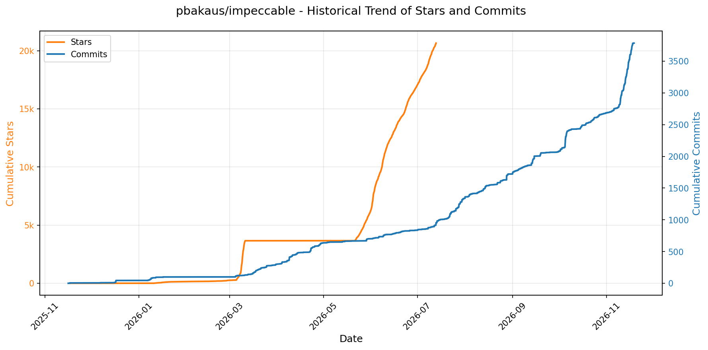

> *蓝色：累计 Stars｜橙色：累计 Commits（次 Y 轴）*

<b>📄 README 摘要</b>

### 1. 项目功能
Impeccable 是一个为 AI 编码代理提供前端设计指导的工具。它通过一套统一的技能、23 个设计命令和 60 条确定性检测规则，帮助 AI 生成更高质量、更少模式化问题（如过度使用特定字体、灰色文本、嵌套卡片等）的前端界面。项目扩展了 Anthropic 的 frontend-design 技能，提供了从初始化到迭代的完整设计工作流，并支持在多种 AI 编码工具中自动检测设计问题。

### 2. 关键特性
- **统一初始化**：`/impeccable init` 生成 `PRODUCT.md` 和 `DESIGN.md`，为后续命令提供品牌、受众、颜色、字体等上下文。
- **23 个设计命令**：涵盖构思（craft）、批评（critique）、审计（audit）、润色（polish）、动画（animate）、适配（adapt）等，形成共享的设计词汇。
- **60 条确定性检测规则**：无需 LLM 或 API 密钥即可运行，可检测 AI 生成设计中的常见反模式（如紫色渐变、弹跳缓动、卡片嵌套等）。
- **设计钩子（Hook）**：在 Claude Code、Cursor、GitHub Copilot 等工具中自动检测 UI 文件编辑时的设计问题，并反馈给代理。
- **反模式指导**：明确列出应避免的设计模式（如纯黑/灰色、系统默认字体、灰色文本等）。
- **多工具支持**：兼容 Cursor、Claude Code、GitHub Copilot、Gemini CLI、Codex CLI、Grok Build、OpenCode、Pi、Trae 等十余种 AI 编码工具。
- **多种安装方式**：支持 CLI 安装（推荐）、Git 子模块、插件安装、网站下载、手动复制。
- **独立 CLI**：`npx impeccable detect` 可扫描目录、文件或 URL，输出 JSON 格式结果，适用于 CI 流程。
- **灵活的忽略机制**：可通过配置文件或内联注释忽略特定规则或文件。
- **社区与生态**：提供 GitHub Discussions、npm 包、Twitter 更新，Apache 2.0 许可。

### 3. 技术栈
- **运行时**：Node.js（基于 npm 包 `impeccable`，CLI 通过 `npx` 调用）。
- **脚本语言**：JavaScript/TypeScript（.mjs 钩子脚本、CLI 核心）。
- **浏览器扩展**：用于实时运行检测规则（无需 LLM）。
- **依赖工具**：Puppeteer（用于扫描 URL 进行检测）。
- **集成方式**：通过 JSON 配置文件、shell 脚本、钩子 manifest 与多种 AI 工具集成（如 `.claude/settings.local.json`、`.cursor/hooks.json`）。
- **检测引擎**：确定性规则基于 HTML/CSS 解析和模式匹配（无 AI 依赖）。
- **构建与分发**：Git 子模块、npm 发布、ZIP 下载。

---

### 18. [HKUDS/Vibe-Trading](https://github.com/HKUDS/Vibe-Trading)
- 📅 **创建日期**：2026-04-01  
- 🔄 **最近更新**：2026-07-27  
- ⭐ **Stars**：20,598（日 +0｜周 +0｜月 +7198）  
- 📝 **描述**："Vibe-Trading: Your Personal Trading Agent"  

<b>📈 Star 与 Commit 历史趋势</b>

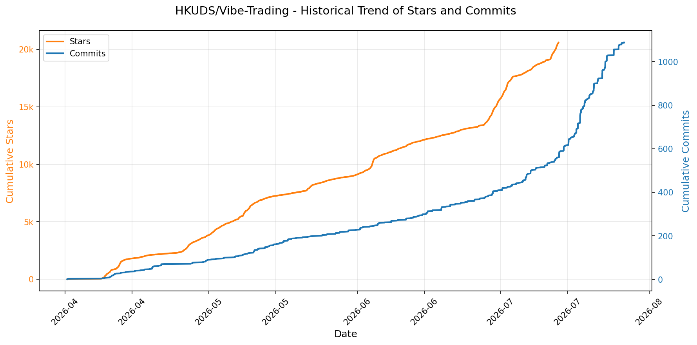

> *蓝色：累计 Stars｜橙色：累计 Commits（次 Y 轴）*

<b>📄 README 摘要</b>

### 1. 项目做什么？
Vibe-Trading 是一个开源的个人交易代理，通过单条命令即可部署具备全面交易能力的 AI 代理。它整合了市场数据获取、策略回测、因子分析、实时交易执行、投资组合管理等功能，支持股票、加密货币、期货等多种资产类别，旨在为个人交易者提供一站式量化交易与智能分析平台。

### 2. 关键特性
- **多市场/多资产支持**：连接股票、加密货币、期货等市场，覆盖美股、A股、港股等。
- **丰富的数据源与经纪商连接器**：内置 Yahoo Finance、Binance、IBKR、MetaTrader 5、Alpaca、Longbridge 等 12+ 数据源与经纪商接口。
- **强大的回测与优化引擎**：支持历史回测、组合约束优化、因子分析、相关性制度检测等，提供严格的 OOS 验证与生存偏差披露。
- **AI 驱动与多提供商支持**：原生集成 Anthropic、SiliconFlow、Kimi、NVIDIA NIM 等 88+ 技能，支持 LLM 视觉 OCR、记忆系统（质量评分与艾宾浩斯衰减）、Swarm MCP 发现。
- **影子账户与实时交易安全**：提供影子账户模拟交易，实时交易具备签名暴露上限、原子日订单限制、权限优先提交等安全机制。
- **全栈可扩展性**：提供 REST API 与 MCP 服务器，支持 Streamable HTTP 传输、自定义 Swarm 预设，前端基于 React 19，后端 FastAPI。
- **企业级安全与可靠性**：通过外部安全审计，实现 Docker 多阶段构建、依赖哈希锁定、AST 沙箱、短期 SSE 认证票据、安全头等。

### 3. 技术栈
- **后端**：Python 3.11+，FastAPI
- **前端**：React 19
- **数据与连接**：支持多种数据源（CCXT、Yahoo、Binance、IBKR、MT5 等）和 MCP 协议
- **部署**：Docker（多阶段构建、哈希锁定依赖）、PyPI 发布（`vibe-trading-ai`）
- **其他**：MIT 许可证，持续集成（CI 锁检查），社区支持（飞书、微信、Discord）

---

### 19. [stablyai/orca](https://github.com/stablyai/orca)
- 📅 **创建日期**：2026-03-17  
- 🔄 **最近更新**：2026-07-27  
- ⭐ **Stars**：17,389（日 +0｜周 +0｜月 +9427）  
- 📝 **描述**：Orca is the ADE for working with a fleet of parallel agents. Run any coding agent with your own subscription. Available on desktop, mobile and VPS.  

<b>📈 Star 与 Commit 历史趋势</b>

> *蓝色：累计 Stars｜橙色：累计 Commits（次 Y 轴）*

<b>📄 README 摘要</b>

### 1. 项目功能
Orca 是一个 AI 编排器（AI Orchestrator），旨在让开发者同时并行运行多种 AI 编程助手（如 Claude Code、Codex、OpenCode 等），每个助手运行在独立的 Git 工作树中，并通过统一的界面进行监控、管理和结果对比。它集成了移动端伴侣应用、增强终端、浏览器设计模式、GitHub/Linear 原生协作、SSH 远程工作树、AI 差异注释等功能，帮助开发者大幅提升编码和审查效率。

### 2. 关键特性
- **移动伴侣**：从手机监控和向 agent 发送后续指令，支持 iOS 和 Android。
- **并行工作树**：将一个提示同时派发给多个 agent，每个 agent 在独立的 Git 工作树中运行，可比较结果并合并最优方案。
- **终端分屏**：使用 WebGL 渲染的 Ghostty 级别终端，支持无限分屏、重启后保留滚动回退。
- **设计模式**：在真实 Chromium 窗口中点击任意 UI 元素，自动将其 HTML、CSS 和截图注入 agent 提示。
- **GitHub & Linear 原生集成**：在应用内浏览 PR、issue 和项目面板，从任务直接创建工作树，无需切换上下文。
- **SSH 工作树**：在远程高性能服务器上运行 agent，支持完整文件编辑、git 和终端，自动重连和端口转发。
- **注释 AI 差异**：在 AI 生成的 diff 行上添加评论并回传给 agent，实现审查、编辑和提交闭环。
- **拖放文件到 agent**：集成 VS Code 编辑器（自动保存），支持拖放文件或图片到 agent 提示中。
- **Orca CLI**：通过命令行脚本化工作流，如 `orca worktree create`、`snapshot`、`click`、`fill` 等。
- **其他**：快速打开、账户切换与使用跟踪、丰富预览（Markdown/图片/PDF）、计算机使用、通知与未读状态等。

### 3. 技术栈
- **桌面应用**：基于 Electron 框架构建（跨平台 macOS/Windows/Linux）。
- **终端**：使用 WebGL 渲染的 Ghostty 级别终端模拟器。
- **嵌入式浏览器**：集成真实 Chromium 窗口，用于设计模式。
- **代码编辑器**：采用 VS Code 核心编辑器（Monaco Editor），支持自动保存和文件拖放。
- **版本控制**：原生支持 Git 工作树和 SSH 远程连接。
- **移动端**：iOS 原生（Swift/SwiftUI）、Android 原生（Kotlin/Jetpack Compose）。
- **后台服务**：Node.js 驱动的 CLI 工具和 agent 编排逻辑。
- **协议**：支持 SSH、Git、HTTP/WebSocket（用于移动端与桌面通信）。

---

### 20. [diegosouzapw/OmniRoute](https://github.com/diegosouzapw/OmniRoute)
- 📅 **创建日期**：2026-02-13  
- 🔄 **最近更新**：2026-07-27  
- ⭐ **Stars**：16,324（日 +0｜周 +0｜月 +9396）  
- 📝 **描述**：Never stop coding. Free MIT AI gateway: one endpoint, 290+ providers (90+ free), 500+ models — Kimi, Claude, GPT, OpenAI, Gemini, GLM, DeepSeek, MiniMax. Works with Claude Code, Codex, Cursor, OpenCode, Cline & Copilot. Quota-aware auto-fallback, RTK+Caveman compression saves 15-95% tokens, MCP/A2A, Desktop/PWA. Built by 500+ contributors  

<b>📈 Star 与 Commit 历史趋势</b>

> *蓝色：累计 Stars｜橙色：累计 Commits（次 Y 轴）*

<b>📄 README 摘要</b>

1. **项目做什么**  
OmniRoute 是一个免费的 AI 网关，通过单一端点聚合 **290+ 个 AI 提供商**（其中 90+ 个提供免费层），自动路由请求并实现故障转移。用户无需管理多个 SDK、API 密钥或额度，即可使用包括 Claude、GPT、Gemini 等在内的各类模型，并实时监控用量与节省情况。

2. **关键特性**  
- **零配置启动**：安装后无需任何密钥或配置即可使用（预置免费提供商如 OpenCode Free、Felo）。  
- **19 种路由策略**：支持 priority、fill-first、weighted、round-robin、auto 等，可自由组合，实现成本、延迟、质量等多维度优化。  
- **智能压缩**：RTK + Caveman 堆叠压缩，平均节省约 89% token（15–95%）。  
- **自动故障转移**：四层回退（订阅 → API 密钥 → 廉价 → 免费），保证永不中断。  
- **广泛兼容**：兼容所有 OpenAI 兼容工具（Claude Code、Cursor、Cline、Copilot 等），同时支持 MCP、A2A、记忆、护栏、评估等生产级功能。  
- **隐私与本地优先**：AES-256-GCM 加密密钥，支持本地部署，数据不经过第三方云。  
- **实时仪表板**：显示用量、配额、节省、延迟等指标，并提供免费额度监控。  
- **多语言支持**：43 种语言的 README 翻译。

3. **技术栈**  
- **核心运行时**：Node.js（npm 包 `omniroute`）  
- **容器化**：Docker（docker pull diegosouzapw/omniroute）  
- **桌面客户端**：Electron（提供桌面应用下载）  
- **压缩算法**：RTK + Caveman 堆叠压缩  
- **加密与安全**：AES-256-GCM、TLS stealth  
- **API 协议**：OpenAI 兼容 API（/v1/chat/completions），同时支持 Claude、Gemini、Responses API 格式  
- **扩展协议**：MCP（104 个工具）、A2A（Agent-to-Agent）  
- **测试**：25,000+ 自动化测试

---

### 21. [ogulcancelik/herdr](https://github.com/ogulcancelik/herdr)
- 📅 **创建日期**：2026-03-27  
- 🔄 **最近更新**：2026-07-27  
- ⭐ **Stars**：15,927（日 +0｜周 +0｜月 +8395）  
- 📝 **描述**：agent multiplexer that lives in your terminal.  

<b>📈 Star 与 Commit 历史趋势</b>

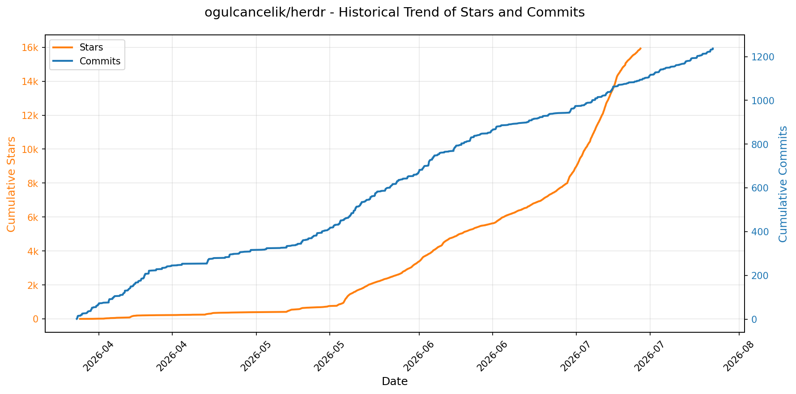

> *蓝色：累计 Stars｜橙色：累计 Commits（次 Y 轴）*

<b>📄 README 摘要</b>

**1. 项目功能**  
herdr 是一个运行在终端中的 **代理复用器（agent multiplexer）**，专为管理多个 AI 代理设计。它允许用户在一个终端窗口中同时查看所有代理的状态（阻塞、运行、完成），支持分离会话后代理继续运行，并可从任意终端或 SSH 重新连接。代理之间可通过纯 socket API 互相通信、生成窗格、读取输出并等待协作。

**2. 关键特性**  
- **实时视图**：以原生终端界面展示每个代理的即时状态，而非抽象封装。  
- **持久化会话**：分离后代理继续运行，会话在终端重启后依然存在，支持跨终端或 SSH 重连。  
- **代理互操作**：提供纯 socket API，代理可创建新窗格、读取输出、相互等待，形成协作工作流。  
- **键盘与鼠标双优先**：同时支持 tmux 风格的前缀键操作和鼠标点击、拖拽、分屏，用户可自由切换。  
- **插件生态**：支持扩展窗格和工作流，拥有官方插件市场。  
- **轻量单二进制**：使用 Rust 编写，无 Electron 依赖，直接在任何终端中运行。

**3. 技术栈**  
- **开发语言**：Rust  
- **构建工具**：Cargo（`cargo build --release`）  
- **辅助工具**：`just`（用于运行测试和检查）  
- **平台支持**：Linux、macOS（Homebrew）、Windows（beta 版），无其他外部运行时依赖。

---

### 22. [andrewyng/aisuite](https://github.com/andrewyng/aisuite)
- 📅 **创建日期**：2024-06-30  
- 🔄 **最近更新**：2026-07-27  
- ⭐ **Stars**：14,395（日 +0｜周 +0｜月 +0）  
- 📝 **描述**：Simple, unified interface to multiple Generative AI providers   

<b>📈 Star 与 Commit 历史趋势</b>

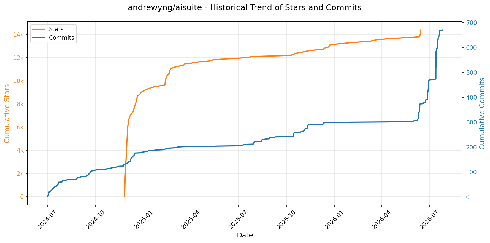

> *蓝色：累计 Stars｜橙色：累计 Commits（次 Y 轴）*

<b>📄 README 摘要</b>

### 1. 项目做什么
aisuite 是一个轻量级 Python 库，用于构建基于大语言模型（LLM）的应用。它提供两层 API：统一的 **Chat Completions API**（跨多个提供商）和 **Agents API**（支持工具调用、工具包和 MCP 协议）。在此基础上，还衍生出桌面 AI 同事 **OpenWorker**（独立仓库），可执行聊天、深度研究、文件读写、连接 Slack/邮件、生成文档等日常任务，并支持本地或云端模型。

### 2. 关键特性
- **统一 Chat Completions API**：使用 OpenAI 风格接口，通过 `<provider>:<model-name>` 格式切换 OpenAI、Anthropic、Google、Ollama 等十余个提供商，支持流式传输和工具调用。
- **Agents API 与工具系统**：将普通 Python 函数作为工具自动生成 schema，支持 `max_turns` 多轮工具调用；提供预置工具包（文件、Git、Shell）以及原生 MCP 协议支持，可附加任意 MCP 服务器。
- **生产级能力**：工具策略（批准/拒绝列表）、状态存储（内存/文件/Postgres）、工件与追踪记录，方便构建长期运行的任务。
- **OpenWorker 桌面应用**：基于 aisuite 构建的独立桌面程序，可下载 macOS 和 Windows 版本，自带 API 密钥或本地 Ollama 运行，数据保留在本地。

### 3. 技术栈
- **核心库**：Python，依赖各提供商 SDK（OpenAI、Anthropic、Google、Mistral、Hugging Face、AWS、Cohere、Ollama、OpenRouter、Requesty 等），通过适配器模式统一接入。
- **本地模型支持**：通过 Ollama 提供完全本地运行能力。
- **MCP 协议**：原生集成 Model Context Protocol，可调用任何 MCP 服务器的工具（需安装 `aisuite[mcp]`）。
- **桌面应用**：OpenWorker 使用 aisuite 构建，打包为 macOS（Apple Silicon）和 Windows（x64）原生应用。
- **扩展机制**：遵循命名约定实现新提供商适配器（`<provider>_provider.py` 与 `<Provider>Provider` 类），自动发现加载。

---

### 23. [pingdotgg/t3code](https://github.com/pingdotgg/t3code)
- 📅 **创建日期**：2026-02-08  
- 🔄 **最近更新**：2026-07-27  
- ⭐ **Stars**：13,986（日 +0｜周 +0｜月 +863）  
- 📝 **描述**：暂无描述  

<b>📈 Star 与 Commit 历史趋势</b>

> *蓝色：累计 Stars｜橙色：累计 Commits（次 Y 轴）*

<b>📄 README 摘要</b>

1. **项目功能**  
   T3 Code 是一个轻量级的 Web 图形界面，用于与多个 AI 编码代理（目前支持 Codex、Claude、Cursor 和 OpenCode）交互，方便用户通过统一的前端界面调用这些代理进行代码生成、编辑等任务。

2. **关键特性**  
   - 提供极简的 Web GUI，减少使用编码代理的复杂度。  
   - 支持多个主流编码代理（Codex、Claude、Cursor、OpenCode），并计划扩展更多。  
   - 可快速通过 `npx t3@latest` 运行，无需安装；也提供桌面应用（支持 Windows、macOS、Arch Linux）。  
   - 内置远程访问、服务端同步更新等实用功能（参见文档）。  
   - 使用 Vite+ 构建工具，开发效率高。

3. **技术栈**  
   - 构建工具：Vite+（通过 `vp` 命令行工具管理依赖和构建）。  
   - 运行环境：Node.js（通过 `npx` 直接运行）。  
   - 桌面应用：支持 Windows（winget）、macOS（Homebrew）和 Arch Linux（AUR），底层可能使用 Electron 或类似技术。  
   - 文档中提及 TypeScript（推断，从项目结构和 Vite+ 生态常见）。

---

### 24. [Robbyant/lingbot-map](https://github.com/Robbyant/lingbot-map)
- 📅 **创建日期**：2026-04-15  
- 🔄 **最近更新**：2026-07-27  
- ⭐ **Stars**：9,914（日 +0｜周 +0｜月 +2469）  
- 📝 **描述**：A feed-forward 3D foundation model for reconstructing scenes from streaming data  

<b>📈 Star 与 Commit 历史趋势</b>

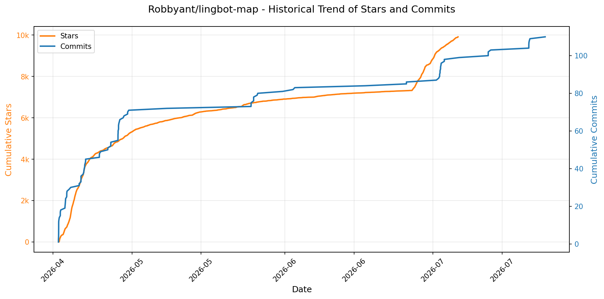

> *蓝色：累计 Stars｜橙色：累计 Commits（次 Y 轴）*

<b>📄 README 摘要</b>

### 1. 项目做什么
LingBot-Map 是一个前馈式 3D 基础模型，专门用于流式（streaming）3D 重建。它能够从视频或图像序列中实时重建出稠密的 3D 点云和相机轨迹，无需迭代优化，支持超长序列（>10,000 帧）的高效在线推理。

### 2. 关键特性
- **几何上下文 Transformer**：通过锚点上下文、姿态参考窗口和轨迹记忆，在单一流式框架中统一坐标定位、密集几何线索和长程漂移校正。
- **高效流式推理**：采用分页 KV 缓存注意力机制，在 518×378 分辨率下以约 20 FPS 稳定处理长序列，支持超过 10,000 帧。
- **SOTA 重建质量**：在多个公开基准上（KITTI、Oxford Spires 等）超越现有流式方法和迭代优化方法。
- **交互式演示**：提供基于 Viser 的浏览器可视化工具（`demo.py`），支持实时查看点云和轨迹。
- **离线渲染管线**：针对超长序列提供批处理渲染脚本（`batch_demo.py`），可生成 MP4 飞越视频。
- **窗口式推理**：支持滑动窗口模式，解决长序列超出训练 RoPE 范围时的性能退化问题。
- **天空遮罩**：利用 ONNX 天空分割模型过滤室外场景的天空点，提升可视化效果。
- **关键帧策略**：通过 `--keyframe_interval` 减少 KV 缓存内存占用，支持更长序列。
- **多种模型变体**：提供长序列专用版（lingbot-map-long）、平衡版（lingbot-map）和阶段一训练版（lingbot-map-stage1）。

### 3. 技术栈
- **框架与语言**：Python 3.10，PyTorch 2.8.0（CUDA 12.8），Conda 环境管理。
- **核心模型**：基于 Transformer 的几何上下文模型，使用 FlashInfer（分页 KV 缓存注意力）实现高效推理，回退方案为 PyTorch SDPA。
- **渲染与可视化**：NVIDIA Kaolin（GPU 体素化与视锥剔除）、Open3D、Viser（交互式浏览器查看器）、ffmpeg（视频编码）。
- **天空分割**：ONNX Runtime（CPU/GPU），预训练 ONNX 模型（skyseg.onnx）。
- **其他依赖**：NumPy、PyYAML、CUDA 扩展（`voxel_morton_ext`、`frustum_cull_ext`）等。

---

### 25. [bradautomates/claude-video](https://github.com/bradautomates/claude-video)
- 📅 **创建日期**：2026-04-24  
- 🔄 **最近更新**：2026-07-27  
- ⭐ **Stars**：7,864（日 +0｜周 +0｜月 +5320）  
- 📝 **描述**：Give Claude the ability to watch any video. /watch downloads, extracts frames, transcribes, hands it all to Claude.  

<b>📈 Star 与 Commit 历史趋势</b>

> *蓝色：累计 Stars｜橙色：累计 Commits（次 Y 轴）*

<b>📄 README 摘要</b>

以下是基于所提供内容的全面总结，涵盖三个方面：

### 1. 项目功能

该项目赋予 AI 助手（如 Claude）直接“观看”视频的能力。用户粘贴视频链接或本地文件路径并提问，系统自动获取字幕、下载必要片段、提取关键帧（基于场景或关键帧）、生成带时间戳的转录文本，并将帧作为图像读入，使 AI 能够基于视频的视觉和音频内容给出回答，而非仅凭标题或描述猜测。

### 2. 关键特性

- **多源支持**：兼容 YouTube、Loom、TikTok、X、Instagram 等数百种在线视频平台，以及本地 `.mp4`、`.mov`、`.mkv`、`.webm` 文件。
- **智能字幕获取**：优先使用视频自带的免费字幕（手动或自动生成）；无字幕时自动调用 Whisper API（首选 Groq 的 `whisper-large-v3`，备选 OpenAI `whisper-1`）进行转录。
- **灵活的帧提取**：提供四种细节模式（`transcript` 纯字幕、`efficient` 关键帧、`balanced` 场景感知、`token-burner` 无上限场景感知），自动帧预算控制（根据视频时长动态调整），并内置帧去重机制，避免重复图像浪费 token。
- **时间聚焦**：通过 `--start`/`--end` 参数指定时间范围，在特定段落获得更密集的帧采样，降低 token 消耗。
- **零配置上手**：首次运行自动检测并安装依赖（macOS 通过 Homebrew 自动安装 `ffmpeg` 和 `yt-dlp`；Linux/Windows 给出精确命令），无需手动配置即可使用。
- **多种安装方式**：支持 Claude Code 插件市场、`npx skills add`（兼容 Codex、Cursor、Copilot、Gemini CLI 等 50+ 宿主）、claude.ai 网页端手动上传 `.skill` 文件、以及开发者手动克隆/符号链接。
- **高度可定制**：支持自定义分辨率（`--resolution`）、帧率（`--fps`）、最大帧数（`--max-frames`）、强制指定 Whisper 后端、禁用 Whisper 或去重等。
- **开源许可**：采用 MIT 许可证发布。

### 3. 技术栈

- **核心 AI 能力**：Anthropic Claude 的多模态 `Read` 工具（用于读取图像帧）。
- **视频下载**：`yt-dlp`（支持数百种视频平台）。
- **视频/图像处理**：`ffmpeg`（帧提取、缩放、音频提取）。
- **语音转录**：Whisper 模型（Groq 的 `whisper-large-v3` 或 OpenAI 的 `whisper-1`）。
- **脚本语言与运行时**：Python（核心脚本 `watch.py`、`download.py`、`frames.py`、`transcribe.py` 等）；Node.js（用于 `npx` 分发和 Agent Skills CLI）。
- **插件/技能系统**：Claude Code 插件机制、Agent Skills 框架（兼容 Codex、Cursor、Copilot、Gemini CLI 等主流 AI 编码助手）。
- **测试与构建**：pytest（测试套件）；Bash 脚本（构建 `.skill` 包）。
- **依赖管理**：首次运行通过系统包管理器（macOS 的 Homebrew）或 pipx 自动安装 `ffmpeg` 和 `yt-dlp`。

---

### 26. [gabime/spdlog](https://github.com/gabime/spdlog)
- 📅 **创建日期**：2014-11-01  
- 🔄 **最近更新**：2026-07-27  
- ⭐ **Stars**：7,700（日 +0｜周 +0｜月 +223）  
- 📝 **描述**：Fast C++ logging library.  

<b>📈 Star 与 Commit 历史趋势</b>

> *蓝色：累计 Stars｜橙色：累计 Commits（次 Y 轴）*

<b>📄 README 摘要</b>

1.  **项目功能**：spdlog 是一个快速、高效的 C++ 日志库，提供同步和异步日志记录功能，支持多种日志输出目标，并允许灵活的日志格式化和运行时级别控制。

2.  **关键特性**：
    *   极高的性能（通过基准测试验证）。
    *   支持仅头文件模式或编译模式。
    *   基于 fmt 库的强大格式化能力。
    *   可选的异步日志记录模式。
    *   多线程/单线程安全日志器。
    *   丰富的日志目标：旋转文件、每日文件、彩色控制台、syslog、Windows 事件日志、Qt 小部件等。
    *   支持自定义日志目标和自定义格式化标志。
    *   运行时和编译时日志级别过滤。
    *   支持从 argv 或环境变量加载日志级别。
    *   回溯支持（环形缓冲区，在需要时转储调试消息）。

3.  **技术栈**：
    *   语言：C++11 及以上。
    *   核心依赖：fmt 库（用于格式化）。
    *   构建系统：CMake。
    *   平台支持：Linux、Windows、macOS、Android、FreeBSD 等。
    *   包管理：提供 Debian、Homebrew、vcpkg、conan、conda 等多种包管理器安装方式。

---

### 27. [MoonshotAI/kimi-cli](https://github.com/MoonshotAI/kimi-cli)
- 📅 **创建日期**：2025-10-15  
- 🔄 **最近更新**：2026-07-27  
- ⭐ **Stars**：6,876（日 +0｜周 +0｜月 +0）  
- 📝 **描述**：Kimi Code CLI is your next CLI agent.  

<b>📈 Star 与 Commit 历史趋势</b>

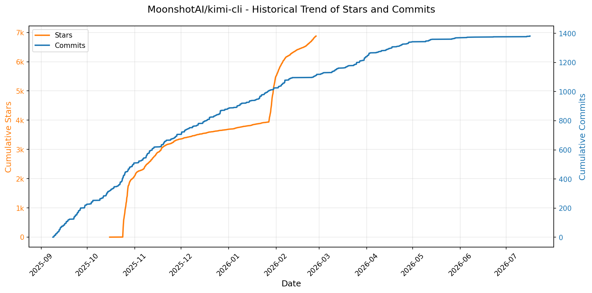

> *蓝色：累计 Stars｜橙色：累计 Commits（次 Y 轴）*

<b>📄 README 摘要</b>

### 1. 项目功能
Kimi CLI 是一个运行在终端中的 AI 代理，能够辅助完成软件开发任务和终端操作。它可以读取和编辑代码、执行 shell 命令、搜索和抓取网页内容，并在执行过程中自主规划和调整行动。

### 2. 关键特性
- **Shell 命令模式**：通过 `Ctrl-X` 切换，可在不退出 Kimi CLI 的情况下直接运行 shell 命令。
- **VS Code 扩展**：通过 Kimi Code VS Code 扩展与 Visual Studio Code 集成。
- **IDE 集成（ACP）**：原生支持 Agent Client Protocol，可与任何兼容 ACP 的编辑器或 IDE（如 Zed、JetBrains）配合使用。
- **Zsh 集成**：通过 zsh-kimi-cli 插件与 Zsh 结合，增强 shell 体验。
- **MCP 支持**：支持管理 MCP 服务器（添加、列出、移除、授权），并可通过 CLI 选项加载 ad-hoc MCP 配置。
- **更多特性**：详见官方文档。

### 3. 技术栈
- **Python**：项目核心语言，以 PyPI 包形式发布。
- **uv**：Python 依赖管理和运行工具（如 `uv run kimi`）。
- **make**：构建和任务自动化（格式化、检查、测试、构建等）。
- **Node.js / npm**：构建内置 Web UI 所需（`make build-web` 依赖）。
- **测试框架**：项目包含 `test-kimi-cli`、`test-kosong`、`test-pykaos` 等测试目标，推测使用 pytest 等 Python 测试框架。

---

### 28. [xbtlin/ai-berkshire](https://github.com/xbtlin/ai-berkshire)
- 📅 **创建日期**：2026-04-07  
- 🔄 **最近更新**：2026-07-27  
- ⭐ **Stars**：5,748（日 +0｜周 +0｜月 +2573）  
- 📝 **描述**：AI 时代的伯克希尔：基于 Claude Code / Codex 的价值投资研究框架。巴菲特·芒格·段永平·李录四大师方法论 + 多Agent并行研究。| AI-era Berkshire: a value investing research framework built for Claude Code / Codex. 4 masters' methodologies + multi-agent adversarial analysis.  

<b>📈 Star 与 Commit 历史趋势</b>

> *蓝色：累计 Stars｜橙色：累计 Commits（次 Y 轴）*

<b>📄 README 摘要</b>

## 1. 这个项目做什么？

**AI Berkshire** 是一套兼容 Claude Code 与 Codex 的投资研究 Skill 合集。它将巴菲特、芒格、段永平、李录四位价值投资大师的方法论系统化、结构化，通过 AI Agent 实现专业级投资研究。用户只需一个人配合 Claude Code 或 Codex，即可完成深度公司分析、财报精读、行业筛选、持仓管理、思维工具等全流程投研工作，输出可直接用于决策的研报，而非普通 AI 的“平衡分析”。

## 2. 关键特性

- **四大师视角对抗**：段永平（商业模式）、巴菲特（护城河与估值）、芒格（逆向思考与风险）、李录（长期文明趋势）四个独立视角并行分析，产生真实矛盾与张力，避免单一视角盲点。
- **强制给结论，不打太极**：输出“通过/不通过/灰色地带”，附带具体价格区间和分层投资建议（激进/稳健/保守），并强制“镜子测试”（5句话说不完整则不买）。
- **结构化反偏见机制**：内置信息丰富度评级（A/B/C）、芒格式逆向检验、快速否决清单（8条红线）、反共识检查、留白原则（数据不足时标注“灰色地带”），防止 AI 给出“看起来很对但经不起推敲”的结论。
- **金融数据精确性**：所有计算使用 Python `decimal.Decimal`（精确十进制），避免浮点误差；关键数据至少2个独立来源交叉验证，市值手算校验（股价×总股本），误差>1%告警。
- **可复现的研究流程**：同一输入产生结构一致、深度一致的输出，支持横向对比（多公司同标准筛选）和纵向追踪（同一公司半年后重新分析直接对比变化）。
- **多Agent并行研究**：`/investment-team` 启动4个独立 Agent 同时研究一家公司，每个 Agent 各自搜索网络、交叉验证数据、独立给出结论，Team Lead 综合研判，相当于4倍搜索量与独立视角。
- **20个 Skill 覆盖全场景**：包括深度研究（四大师分析、团队并行、管理层深挖、未上市公司研究、长篇系列）、财报分析（财报精读、团队解读）、行业筛选（产业链扫描、漏斗筛选、去劣筛选、瓶颈猎手、买入前 Checklist）、持仓管理（收益型分析、组合优化、论文追踪、漂移检测、股价异动归因）以及思维工具（段永平问答、财务数据规范、微信公众号文章）。
- **实盘验证**：2024年收益+69.29%，2025年收益+66.38%，连续两年大幅跑赢全球主要指数（超额收益46-50个百分点），实盘收益超146万元。
- **金融严谨性工具**：`tools/financial_rigor.py` 提供市值验算、估值验算、多源交叉验证、三情景估值、Benford定律检测、精确计算器等功能，确保每份报告数据严谨可验证。

## 3. 技术栈

- **AI 客户端**：Claude Code（`@anthropic-ai/claude-code`）和 Codex（OpenAI Codex），作为运行 Skill 的宿主环境。
- **Skill 定义**：Markdown 文件（`skills/*.md`）作为 Claude Code command 源文件；`codex-skills/*/SKILL.md` 为 Codex skill 包，由 Python 脚本从源文件生成。
- **金融计算与工具**：Python（`tools/financial_rigor.py`），使用 `decimal.Decimal` 进行精确十进制计算，避免浮点误差。
- **安装脚本**：Shell 脚本（`scripts/install-claude-commands.sh`、`scripts/install-codex-skills.sh` 等）和 Windows Batch 脚本，用于自动复制或生成 skill 文件到对应客户端目录。
- **版本控制**：Git + GitHub 仓库托管，包含 Star History 图表（SVG）。
- **文档与展示**：Markdown 格式 README，多语言支持（中文、英文、日文），SVG 架构图（`assets/architecture.svg`、`assets/team-core.svg`）。
- **未来方向**：计划基于 MCP（Model Context Protocol）接入实时数据（Wind/Bloomberg/Yahoo Finance）。

---

### 29. [1jehuang/jcode](https://github.com/1jehuang/jcode)
- 📅 **创建日期**：2026-01-05  
- 🔄 **最近更新**：2026-07-27  
- ⭐ **Stars**：5,566（日 +0｜周 +0｜月 +0）  
- 📝 **描述**：The most RAM effiecent harness  

<b>📈 Star 与 Commit 历史趋势</b>

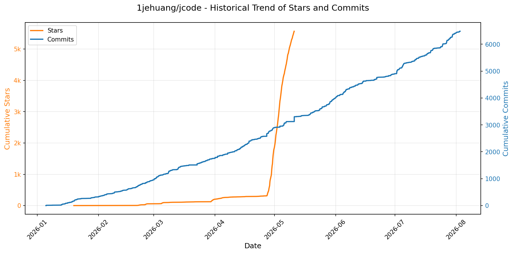

> *蓝色：累计 Stars｜橙色：累计 Commits（次 Y 轴）*

<b>📄 README 摘要</b>

### 1. 项目功能

jcode 是一个下一代 AI 编码代理平台（harness），专为多会话工作流、无限可定制性和高性能而设计。它通过命令行界面运行编码代理，能够执行代码生成、编辑、调试等任务，并具备先进的记忆系统与多代理协作能力，旨在提升开发者的技能上限。

### 2. 关键特性

- **极致性能与资源效率**：单会话 RAM 仅 27.8 MB（本地嵌入关闭），十会话仅 117 MB；启动时间仅 14 ms，远优于 Claude Code、Cursor 等同类工具。
- **智能记忆系统**：基于语义向量嵌入，自动提取、检索和整合记忆；支持显式记忆工具和会话搜索，实现类人记忆能力。
- **丰富 UI**：侧面板、Mermaid 图表内联渲染（使用自研 Rust 渲染器，速度提升 1800 倍）、信息小部件、高帧率渲染（>1000 fps）、自定义滚动（Handterm 终端）、左对齐/居中切换。
- **多代理 Swarm**：原生多代理协作，自动管理文件冲突，代理可自主生成子代理并行完成任务。
- **广泛提供商支持**：内置 Claude、OpenAI、Gemini、GitHub Copilot 等多种 OAuth 登录流，支持自定义 OpenAI 兼容端点及本地模型（Ollama、LM Studio）。
- **高度可定制**：配置文件、热键、emoji 禁用、对齐模式、超时设置等。

### 3. 技术栈

- **语言**：Rust
- **终端**：自定义终端实现 Handterm（Rust）
- **图表渲染**：自研 Mermaid 渲染库 mermaid-rs-renderer（Rust）
- **嵌入模型**：用于记忆系统的语义向量嵌入（未明确具体模型）
- **AI 集成**：通过多种 OAuth 登录流与 OpenAI、Claude、Gemini 等 API 交互，支持 OpenAI 兼容格式
- **交互方式**：伪终端（PTY）

---

### 30. [Nutlope/hallmark](https://github.com/Nutlope/hallmark)
- 📅 **创建日期**：2026-04-27  
- 🔄 **最近更新**：2026-07-27  
- ⭐ **Stars**：4,289（日 +0｜周 +0｜月 +897）  
- 📝 **描述**：Anti-AI-slop design skill for Claude Code, Cursor, and Codex.  

<b>📈 Star 与 Commit 历史趋势</b>

> *蓝色：累计 Stars｜橙色：累计 Commits（次 Y 轴）*

<b>📄 README 摘要</b>

1. **项目功能**  
   Hallmark 是一个专为 Claude Code、Cursor 和 Codex 等 AI 编码工具设计的设计技能，旨在生成不像是 AI 产出的网页 UI。它通过选择宏观结构、应用主题、运行 57 项“反模式检测”以及预输出自我批评，避免常见的 AI 模板化设计，确保不同需求生成不同风格的页面。

2. **关键特性**  
   - **四个核心命令**：默认（构建新 UI）、`audit`（审计现有代码中的反模式）、`redesign`（保留内容与品牌，重构结构）、`study`（提取设计 DNA，生成可移植的 `design.md`）。  
   - **二十个主题 + 自定义模式**：内置二十个预设主题，当需求独特时自动切换到 Custom 模式，从零设计配色、字体和布局。  
   - **反模板化机制**：每个页面自包含 HTML+CSS，带有宏观结构注释；不同需求生成不同外观，而非颜色替换。  
   - **多工具支持**：可通过 `npx skills add` 安装，或手动复制规则文件到 Claude Code、Cursor、Codex 的对应目录。  
   - **开源许可**：MIT 协议，可自由使用、修改和分发。

3. **技术栈**  
   - **核心依赖**：Node.js 生态系统（通过 `npx` 安装和更新）。  
   - **技能框架**：基于 AI 工具的 skills 系统（规则集以 Markdown 文件形式提供）。  
   - **生成输出**：纯 HTML + CSS（自包含页面，无外部依赖）。  
   - **开发工具**：可能包含 JavaScript（用于交互或构建流程，但 README 未明确说明）。  
   - **集成平台**：Claude Code、Cursor、Codex（作为技能插件运行）。

---

### 31. [every-app/open-seo](https://github.com/every-app/open-seo)
- 📅 **创建日期**：2026-02-27  
- 🔄 **最近更新**：2026-07-27  
- ⭐ **Stars**：4,107（日 +0｜周 +0｜月 +1039）  
- 📝 **描述**：Open source alternative to Semrush and Ahrefs  

<b>📈 Star 与 Commit 历史趋势</b>

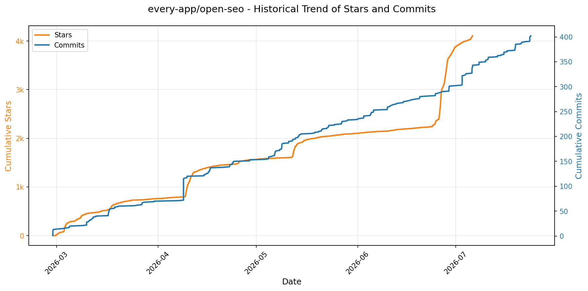

> *蓝色：累计 Stars｜橙色：累计 Commits（次 Y 轴）*

<b>📄 README 摘要</b>

1. **项目功能**  
OpenSEO 是一款开源的全能 SEO 工具，旨在替代 Semrush 和 Ahrefs。它采用按需付费模式，用户可完全控制自己的数据与成本。该工具不仅面向传统用户，还专为 AI 代理（如 Claude Code、OpenClaw、Hermes）设计，通过 MCP 服务器和可复用的 Agent Skills 让 AI 直接调用 SEO 数据，实现关键词研究、排名追踪、竞争对手洞察、反向链接分析、网站审计和 AI 可见性等核心工作流。

2. **关键特性**  
- **最佳 MCP 与 AI 技能**：内置 MCP 服务器，AI 代理可无缝接入；提供预置的 Agent Skills（可重用工作流），并支持用户自定义。  
- **现代简约 UI**：专注工作流而非功能堆砌，界面简洁高效。  
- **无订阅制**：自带 DataForSEO API 密钥，仅按实际查询付费。  
- **自托管选项**：支持 Docker（个人使用）和 Cloudflare（团队/多设备）两种部署方式，均可在免费计划内运行。  
- **托管服务**：官方提供 $10/月的托管版本，支持项目发展。  
- **开源可定制**：允许 Fork 并自由修改，打造专属工具。

3. **技术栈**  
- **MCP（Model Context Protocol）服务器**：作为核心接口，供 AI 代理直接获取 SEO 数据。  
- **Docker**：用于简化本地自托管部署。  
- **Cloudflare**：支持基于 Cloudflare 的互联网级自托管（可能利用 Workers/Pages 等）。  
- **DataForSEO API**：外部 SEO 数据源，所有查询均通过该 API 完成。  
- **现代前端 UI**：采用简洁、响应式的设计（具体框架未公开，推测基于 React/Next.js 等现代方案）。  
- **后端与基础设施**：从部署方式推断，可能使用 Node.js/TypeScript 构建，并依赖容器化或边缘计算平台。

---

