# 🌟 GitHub Trending 概览

> 数据更新于：2026-11-24

---

## 🔍 项目详情

### 1. [obra/superpowers](https://github.com/obra/superpowers)
- 📅 **创建日期**：2025-10-09  
- 🔄 **最近更新**：2026-11-24  
- ⭐ **Stars**：205,477（日 +0｜周 +0｜月 +0）  
- 📝 **描述**：An agentic skills framework & software development methodology that works.  

<details>
<summary><b>📈 Star 与 Commit 历史趋势</b></summary>

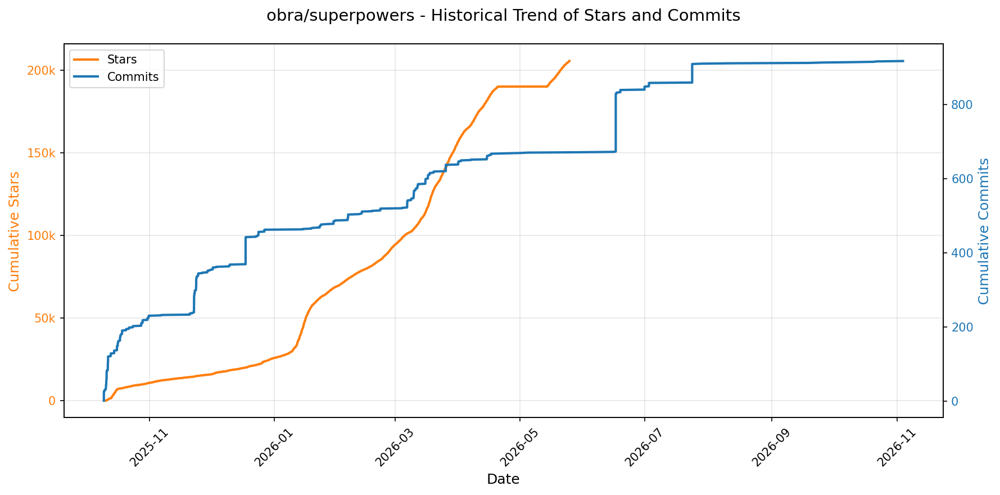

> *橙色：累计 Stars｜蓝色：累计 Commits（次 Y 轴）*

</details>

<details>
<summary><b>📄 README 摘要</b></summary>

## 1. 项目用途

Superpowers 是一套面向 AI 编程代理（coding agents）的完整软件开发方法论。它通过一组可组合的 **Skills（技能）**、会话启动时的引导指令以及各宿主平台的插件机制，让编程代理遵循更稳定、可重复、可审查的软件开发流程。

它并不是一个独立的代码生成器或业务框架，而是作为 Claude Code、Codex、Cursor、Gemini CLI、GitHub Copilot CLI 等多种编程代理的插件或扩展运行。其核心目标是让代理不要在接到开发需求后立即写代码，而是依次完成：

1. **澄清需求与设计**
   - 通过提问理解真正要解决的问题、目标及边界。
   - 将理解分段反馈给用户确认。
   - 小改动直接在对话中达成一致；较大项目形成书面设计文档。

2. **制定实施计划**
   - 把工作拆成约 2～5 分钟即可完成的小任务。
   - 为每个任务给出准确文件路径、具体实现内容和验证步骤。
   - 强调 YAGNI、DRY、测试先行。

3. **按计划实施**
   - 可在当前会话中直接执行，也可为每项任务派发独立子代理。
   - 子代理模式会逐项实施和审查，适合更严格的质量控制。
   - 代理可持续自主工作较长时间，同时保持与已批准计划一致。

4. **测试、审查与交付**
   - 强制执行 RED-GREEN-REFACTOR 测试驱动开发。
   - 在任务之间进行代码审查。
   - 完成后验证测试、决定合并或创建 PR，并清理工作树。

本质上，Superpowers 将“需求澄清 → 设计确认 → 计划 → 实现 → 测试 → 审查 → 交付”标准化为代理必须遵循的强制工作流。

## 2. 关键功能

### 自动触发的技能系统

- 代理在执行任务前会检查相关技能。
- 技能不是仅供参考的建议，而是流程约束。
- `using-superpowers` 作为引导技能，在会话开始或上下文压缩后重新加载技能系统。
- 大多数支持平台通过插件市场、扩展、原生 `SessionStart` Hook 或包管理机制安装。

### 标准化开发工作流

核心工作流包括：

1. **brainstorming**
   - 开发前梳理真实需求和目标。
   - 通过对话逐步形成需求，并由用户确认设计。
   - 对正式项目生成可供后续规划使用的设计文档。

2. **using-git-worktrees**
   - 在新分支上创建隔离工作区。
   - 执行项目初始化，并确认测试基线是干净的。

3. **writing-plans**
   - 将已批准的设计拆成细小、可执行的任务。
   - 明确文件路径、代码变更和验证方式。

4. **subagent-driven-development / executing-plans**
   - 提供两种执行模式：
     - `executing-plans`：在当前会话中逐项执行，最后统一审查，成本较低。
     - `subagent-driven-development`：每项任务交给新的子代理，并进行两阶段审查，更严格。

5. **test-driven-development**
   - 强制执行“先写失败测试 → 确认失败 → 编写最少实现 → 确认通过 → 重构”。
   - 删除先于测试编写的生产代码。

6. **requesting-code-review**
   - 对照计划检查实现。
   - 按严重程度报告问题，关键问题会阻止后续推进。

7. **finishing-a-development-branch**
   - 运行最终测试验证。
   - 提供合并、创建 PR、保留或丢弃分支等选项。
   - 清理 Git worktree。

### 调试与问题诊断

- **systematic-debugging**
  - 提供四阶段根因分析流程。
  - 包含根因追踪、纵深防御和基于条件等待等方法。

- **verification-before-completion**
  - 在宣称问题已经解决前执行实际验证，避免仅凭主观判断结束任务。

- **diagnosing-superpowers**
  - 用于分析某次会话中技能错误触发、未触发、偏离计划、重复工作或过度消耗 token 等问题。
  - 可读取会话记录并给出行级证据。
  - 可导出经过清理的问题报告包，或定位历史会话中的异常。

### 完整技能库

- **测试**
  - `test-driven-development`

- **调试与验证**
  - `systematic-debugging`
  - `verification-before-completion`
  - `diagnosing-superpowers`

- **协作与开发流程**
  - `brainstorming`
  - `writing-plans`
  - `executing-plans`
  - `dispatching-parallel-agents`
  - `requesting-code-review`
  - `receiving-code-review`
  - `using-git-worktrees`
  - `finishing-a-development-branch`
  - `subagent-driven-development`

- **元技能**
  - `writing-skills`
  - `using-superpowers`

### 并行与隔离开发

- `dispatching-parallel-agents` 支持并发子代理工作流。
- `using-git-worktrees` 支持多个开发分支并行推进，减少不同任务或代理之间相互干扰。
- 子代理执行模式可针对每个任务使用新的上下文，降低长会话中的上下文污染。

### 多阶段质量控制

- 子代理开发包含两阶段审查：
  1. 检查是否符合需求和计划；
  2. 检查代码质量。
- 审查结果按严重程度分类，关键缺陷会阻断开发。
- 强调“先验证、后宣称完成”，要求以测试结果和实际证据支持结论。

### 多宿主平台支持

项目支持安装到：

- Claude Code
- Antigravity
- Codex App
- Codex CLI
- Cursor
- Devin CLI
- Factory Droid
- Gemini CLI
- GitHub Copilot CLI
- Grok Build CLI
- Kimi Code
- OpenCode
- Pi
- Qwen Code
- Hermes Agent
- Muse

不同宿主的安装方式不同，包括官方插件市场、第三方市场、CLI 扩展安装、原生包安装及本地插件安装。若在多个宿主中使用，需要分别安装。

### 隐私与可选遥测

- `brainstorming` 的可选视觉伴侣会从 Prime Radiant 网站加载带 Superpowers 版本的 Logo。
- 默认不包含项目内容、提示词、编程代理信息或用户点击数据。
- 可通过设置以下环境变量完全关闭：
  - `SUPERPOWERS_DISABLE_TELEMETRY`
  - `DISABLE_TELEMETRY`
  - `CLAUDE_CODE_DISABLE_NONESSENTIAL_TRAFFIC`

### 核心方法论原则

- 测试驱动开发：始终先写测试。
- 系统化优于临时处理：用流程和证据替代猜测。
- 优先降低复杂度：把简单性作为首要目标。
- 证据优于口头声明：验证后再宣告成功。

## 3. 技术栈

### 核心技术形态

Superpowers 的主体不是传统业务应用，而是由以下内容组成：

- 基于文本指令定义的 **Skills**
- 技能目录及 `SKILL.md` 文档
- 会话启动引导逻辑
- 各编程代理平台的插件、扩展或 Hook
- 自动技能触发规则
- 开发工作流和审查规则

README 没有声明一个统一的运行时语言或后端框架；其运行方式由所使用的编程代理宿主决定。

### 插件与扩展集成

- **Claude Code**：通过官方或第三方插件市场安装。
- **Codex App / Codex CLI**：通过官方 Codex 插件市场安装。
- **Cursor**：通过 `/add-plugin` 或插件市场安装。
- **Devin CLI**：使用 `devin plugins install/update`。
- **Factory Droid**：通过 `droid plugin marketplace add` 和插件安装命令。
- **Gemini CLI**：使用 `gemini extensions install/update`。
- **GitHub Copilot CLI**：通过 `copilot plugin marketplace add` 和插件安装命令。
- **Grok Build CLI**：通过 xAI 官方插件市场安装。
- **Kimi Code**：通过插件管理器或仓库地址安装。
- **OpenCode**：读取专门的安装说明并加载插件。
- **Pi**：作为 Git 包安装，并使用小型扩展注入启动引导。
- **Qwen Code**：直接安装 Claude Code 市场插件。
- **Hermes Agent**：使用 `hermes plugins install --enable`。
- **Muse**：作为原生插件安装，并通过 `SessionStart` Hook 注入引导。
- **Antigravity**：直接以本 GitHub 仓库作为插件源安装。

### 开发与测试工具

- **Shell 脚本**
  - 使用 `scripts/bump-version.sh` 同步版本。
  - 基础设施测试通过相应的 `run-*.sh` 脚本执行。

- **Node.js / npm**
  - 插件基础设施测试可通过 `npm test` 运行。

- **Git / Git worktree**
  - 依赖 Git 分支和隔离工作树支持并行开发及最终分支处理。

- **Skill 行为评测框架**
  - 使用 `superpowers-evals` 项目的 `drill eval` 测试框架验证技能行为。
  - 该评测仓库会克隆到 `evals/` 目录。

- **版本管理**
  - 通过 `.version-bump.json` 跟踪版本信息。

### 文档与工程规范

- 技能行为和修改必须遵循 `writing-skills` 技能。
- 新增或修改的技能需要兼容所有受支持的编程代理。
- 插件基础设施测试与技能行为测试相互独立。
- 项目采用 **MIT License**。

</details>

---

### 2. [anthropics/skills](https://github.com/anthropics/skills)
- 📅 **创建日期**：2025-09-22  
- 🔄 **最近更新**：2026-11-24  
- ⭐ **Stars**：113,853（日 +0｜周 +0｜月 +0）  
- 📝 **描述**：Public repository for Agent Skills  

<details>
<summary><b>📈 Star 与 Commit 历史趋势</b></summary>

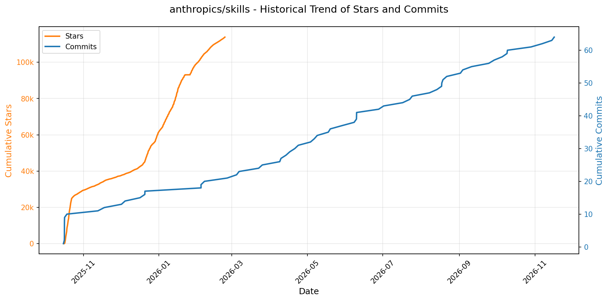

> *橙色：累计 Stars｜蓝色：累计 Commits（次 Y 轴）*

</details>

<details>
<summary><b>📄 README 摘要</b></summary>

## 1. 项目用途

这是 Anthropic 官方维护的 **Claude Skills 示例与实现仓库**，用于展示 Claude 技能系统如何通过动态加载“指令、脚本和资源”，提升其在专业任务上的表现，并让同类任务能够以可重复的方式执行。

项目主要目标包括：

- 提供可直接参考或复用的 Claude Skills 实现。
- 展示技能在创意设计、开发测试、企业流程、品牌规范、文档处理等场景中的应用方式。
- 公开 Claude 文档能力背后的复杂技能实现，包括：
  - `skills/docx`
  - `skills/pdf`
  - `skills/pptx`
  - `skills/xlsx`
- 提供 Agent Skills 规范、技能模板和基础创建指南，帮助开发者构建自定义技能。
- 作为 Claude Code 插件市场、Claude.ai 和 Claude API 中技能生态的示例来源。

每个技能都是一个相对独立的目录，核心文件为 `SKILL.md`，其中包含技能元数据、说明、示例和执行准则。

## 2. 核心功能与特性

- **动态技能加载**：Claude 可按任务需要加载特定技能，为模型补充专业流程、组织规范和操作步骤。
- **标准化技能结构**：技能以文件夹为基本单位，并通过 `SKILL.md` 统一描述：
  - 技能名称
  - 使用场景与触发条件
  - 执行指令
  - 示例
  - 最佳实践或限制
- **最小化元数据要求**：`SKILL.md` 的 YAML Frontmatter 至少包含：
  - `name`：唯一名称，通常使用小写字母和连字符。
  - `description`：完整说明技能功能及适用时机。
- **内容与逻辑可组合**：技能目录不仅可以存放 Markdown 指令，还可以包含脚本和其他资源。
- **多领域示例**：
  - 创意与设计：艺术、音乐、视觉设计等。
  - 开发与技术：Web 应用测试、MCP 服务器生成等。
  - 企业与沟通：企业通信、品牌规范等。
  - 文档处理：Word、PDF、PowerPoint、Excel。
- **生产级文档技能参考**：DOCX、PDF、PPTX、XLSX 技能是 Claude 文档创建与编辑能力的底层实现之一，可作为复杂技能开发范例。
- **规范与模板齐全**：
  - `spec` 目录提供 Agent Skills 规范。
  - `template` 目录提供自定义技能模板。
  - `skills` 目录提供各类完整示例。
- **支持 Claude Code 安装**：可将仓库注册为 Claude Code 插件市场：
  ```text
  /plugin marketplace add anthropics/skills
  ```
  随后安装 `document-skills` 或 `example-skills`，也可直接执行：
  ```text
  /plugin install document-skills@anthropic-agent-skills
  /plugin install example-skills@anthropic-agent-skills
  ```
- **多入口使用**：
  - Claude Code：通过插件市场安装并按指令调用。
  - Claude.ai：付费方案可直接使用仓库中的示例技能，也支持上传自定义技能。
  - Claude API：支持调用预置技能及上传自定义技能。
- **合作伙伴生态**：仓库还收录了 Notion 等合作伙伴提供的技能示例。
- **开放源代码**：仓库中的许多技能采用 Apache 2.0 许可证，文档技能也已开源。
- **演示定位与免责声明**：这些技能主要用于演示和教育。Claude 实际执行结果可能与示例行为不同，关键任务使用前应自行充分测试。

## 3. 技术栈

- **核心平台与标准**
  - Anthropic Claude
  - Agent Skills 标准
  - Claude Skills API
- **技能描述技术**
  - Markdown
  - YAML Frontmatter
  - `SKILL.md` 技能清单文件
- **开发与分发方式**
  - Claude Code 插件市场
  - Claude.ai 技能系统
  - Anthropic Claude API
- **涉及的文件与业务格式**
  - DOCX
  - PDF
  - PPTX
  - XLSX
- **相关技术示例**
  - Web 应用测试
  - MCP（Model Context Protocol）服务器生成
- **许可协议**
  - Apache 2.0，用于仓库中的多数技能及文档技能
- **语言与运行环境**
  - README 未明确给出该仓库统一使用的主编程语言、框架或依赖管理工具；具体技能可以按需携带脚本和资源，实际技术栈取决于各技能目录自身的实现。

</details>

---

### 3. [sherlock-project/sherlock](https://github.com/sherlock-project/sherlock)
- 📅 **创建日期**：2018-12-24  
- 🔄 **最近更新**：2026-11-24  
- ⭐ **Stars**：79,934（日 +0｜周 +0｜月 +0）  
- 📝 **描述**：Hunt down social media accounts by username across social networks  

<details>
<summary><b>📈 Star 与 Commit 历史趋势</b></summary>

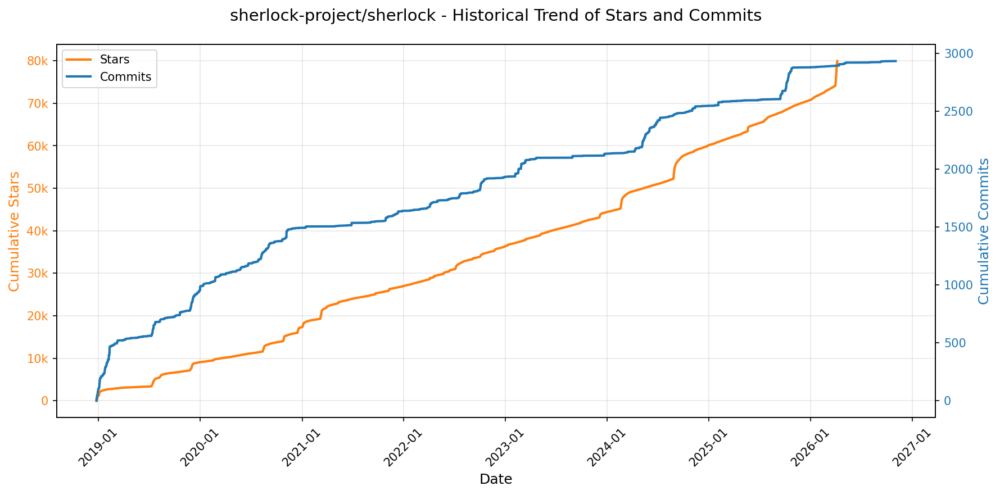

> *橙色：累计 Stars｜蓝色：累计 Commits（次 Y 轴）*

</details>

---

### 4. [thedotmack/claude-mem](https://github.com/thedotmack/claude-mem)
- 📅 **创建日期**：2025-08-31  
- 🔄 **最近更新**：2026-11-24  
- ⭐ **Stars**：75,747（日 +0｜周 +0｜月 +0）  
- 📝 **描述**：Persistent Context Across Sessions for Every Agent –  Captures everything your agent does during sessions, compresses it with AI, and injects relevant context back into future sessions. Works with Claude Code, OpenClaw, Codex, Gemini, Hermes, Copilot, OpenCode + More  

<details>
<summary><b>📈 Star 与 Commit 历史趋势</b></summary>

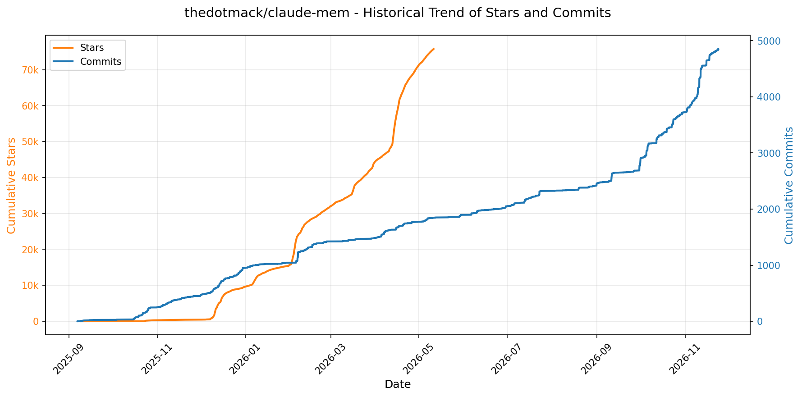

> *橙色：累计 Stars｜蓝色：累计 Commits（次 Y 轴）*

</details>

<details>
<summary><b>📄 README 摘要</b></summary>

## 1. 项目做什么

**Claude-Mem** 是面向 AI 编程代理的持久化记忆系统，用于解决 Claude Code、Codex、Cursor、OpenCode 等代理在每次新会话中都会“失忆”的问题。

它会在主编程代理旁运行一个独立的观察器代理，持续记录代理读取、修改和执行的内容，将其整理为结构化观察记录与会话总结。下一次进入同一项目时，Claude-Mem 会自动注入与当前项目相关的记忆索引；代理只在确实需要时再检索完整历史，从而避免重复阅读文件、重复提问和重复犯错。

典型工作流程是：

1. 用户通过 Claude Code、Codex、Cursor、OpenCode 等代理进行开发。
2. 代理生命周期钩子把工具调用活动发送给本地 Claude-Mem Worker。
3. Observer 代理将活动转化为简短观察记录，并在会话结束时生成总结。
4. 后续会话自动获得相关记忆索引，并可通过 MCP 搜索工具按需获取完整细节。
5. 记忆默认保存在本机 `~/.claude-mem`，云端同步为可选项。

项目当前版本为 **16.1.0**，采用 **Apache 2.0** 许可证。

---

## 2. 核心功能

### 持久记忆与自动上下文注入

- 自动观察主代理的工具调用、文件读取、代码编辑和命令执行。
- 将工作过程转化为结构化观察记录，并在会话结束时生成总结。
- 从同一项目的第二次会话开始自动注入记忆。
- 采用“渐进式披露”机制：新会话先获得紧凑索引，必要时才加载完整记录。
- 可通过 `/learn-codebase` 预先为整个代码库建立记忆。
- 用户可以精细控制新会话需要注入哪些上下文。
- 每条观察记录都有唯一 ID，可通过 Worker API 或 Web Viewer 引用和追溯。

### 三阶段、低 Token 消耗的搜索机制

Claude-Mem 提供三个 MCP 搜索工具：

1. **`search`**：搜索记忆索引，返回紧凑结果，支持全文查询以及按类型、日期、项目过滤。
2. **`timeline`**：获取某条观察记录或查询结果前后的时间线上下文。
3. **`get_observations`**：按 ID 批量获取完整观察详情。

典型用法是先搜索索引，再查看时间线，最后只拉取相关记录。索引结果通常约 **50–100 Token/条**，完整记录约 **500–1,000 Token/条**，从而减少无关历史进入上下文。

Worker 还提供：

- `smart_search`：语义化代码与记忆导航。
- `smart_outline`：查看代码结构。
- `smart_unfold`：展开代码片段。
- `save_memory`：主动保存值得长期保留的信息。

### 本地记忆、隐私与数据控制

- 记忆、会话和设置默认存储在本机。
- 默认数据库位置为 `~/.claude-mem/claude-mem.db`。
- Cloud Sync 为可选功能；启用后才向 `cmem.ai` 上传或同步记忆。
- 使用 `<private>...</private>` 标记的内容不会进入记忆存储。
- 匿名使用分析默认开启，可通过以下命令关闭：

```bash
npx claude-mem telemetry disable
```

- 工具截图默认保留转换后的副本，存放于：

```text
~/.claude-mem/media-v1/
```

- 截图只有在启用 Cloud Sync 时才会上传到 `cmem.ai`；只有单独开启图像推理后，才会发送给观察器模型进行处理。
- 可在设置中关闭截图保留。

### Web Viewer 与工作跟踪

Claude-Mem 提供本地 Web 界面：

- **`/viewer`**：查看和管理记忆、会话及设置。
- **`/`（My Work）**：实时查看请求、执行进度、人工交接和待审核工作队列。
- 支持查看历史观察、相关详情以及保存的截图。
- Worker 启动时会输出访问 Worker UI 的本地 URL。

### 团队协作

- 提供可选的 **TeamBrain** 共享工作区。
- 支持团队工作列表、成员归属和关联发现。
- 用户自行决定共享哪些内容。
- 个人请求和私人审阅笔记与团队空间相互隔离。

### 多代理与 IDE 集成

`npx claude-mem install` 会自动检测本机已安装的代理并引导配置，也可用 `--ide` 指定单个代理，例如：

```bash
npx claude-mem install --ide opencode
npx claude-mem install --ide t3code
npx claude-mem install --ide antigravity
npx claude-mem install --ide omp
npx claude-mem install --ide pi
npx claude-mem install --ide dsh --dsh-profile tui
npx claude-mem install --ide grok-bot
```

支持范围包括：

- Claude Code
- Codex
- Cursor
- OpenCode
- T3 Code
- Antigravity CLI
- Oh My Pi
- Pi
- DeepSeek Harness
- Grok Bot
- 其他可通过 `--ide` 配置的代理

其中 **Copilot CLI、Goose、Roo Code、Warp 和 Zed** 可以搜索已有记忆，但其会话不会被记录和用于生成新记忆。

Claude Code 还支持通过插件市场安装：

```text
/plugin marketplace add thedotmack/claude-mem
/plugin install claude-mem
```

安装后需重启 Claude Code。

> `npm install -g claude-mem` 只安装 SDK/库，不会注册插件钩子或配置 Worker 服务；完整安装应使用 `npx claude-mem install` 或 Claude Code 的 `/plugin` 命令。

### 模型与服务商选择

安装后可以选择不同的记忆观察模型来源：

- Claude-Mem 托管 Observer。
- 自带 OpenRouter API Key。
- 自带 Gemini API Key。
- 使用 Anthropic 套餐。
- 使用本地或其他兼容服务提供方。

也可以通过 `--provider`、`CLAUDE_MEM_ONLINE_OPTIN=false` 或在 CI、非交互式环境中跳过登录流程。

Claude-Mem Observer 提供 30 天试用；试用结束后，如果没有单独订阅，记忆功能会自动回退到 Anthropic 套餐。

### 其他集成能力

- 可从 Claude Desktop 对话中搜索 Claude-Mem 记忆。
- Grok Bot 可通过聊天日志文件捕获活动，并可选择向月度日志追加重要事件通知，如：
  - `decision`
  - `bugfix`
  - `security_alert`
  - `sensitive`
- OpenClaw Gateway 支持一条命令安装，可配置依赖、插件、模型服务、Worker，以及向 Telegram、Discord、Slack 等平台推送实时观察。

---

## 3. 技术栈

### 核心语言与运行时

- **TypeScript**：项目主体代码，CLI、Worker、Observer Provider、上下文构建、搜索、UI 等均位于 `src/`。
- **Node.js**：运行 `claude-mem` CLI 和安装器。
  - 要求 Node.js 20.19+（20.x）或 22.12+。
- **Bun**：
  - 运行本地 Worker HTTP 服务。
  - 承担进程管理。
  - 缺失时可由安装器自动安装。
- **Python 与 uv**：
  - 用于向量搜索相关组件。
  - `uv` 作为 Python 包管理器，缺失时自动安装。
- **Shell 安装脚本**：OpenClaw Gateway 使用 `curl | bash` 方式安装。

### 存储与搜索

- **SQLite 3**：
  - 保存会话、观察记录、摘要和配置。
  - 使用 **FTS5** 实现全文搜索。
  - 数据库默认位于 `~/.claude-mem/claude-mem.db`。
- **Chroma**：
  - 在 SQLite 全文检索之上提供向量语义搜索。
  - 与 SQLite 组成混合搜索架构。
- **MCP（Model Context Protocol）**：
  - 通过 MCP Server 向代理暴露记忆搜索、代码导航和保存记忆等工具。
  - `mem-search` Skill 负责编排三阶段搜索流程。

### 代理集成架构

- **生命周期 Hooks**：
  - 通过各代理的事件钩子捕获会话和工具活动。
  - Claude Code 覆盖 `Setup`、`SessionStart`、`UserPromptSubmit`、`PreToolUse`、`PostToolUse`、`PostToolUseFailure`、`Stop`、`SubagentStop` 和 `SessionEnd`。
  - 每个代理使用独立 Adapter，Hook 命令不依赖额外 Shell 调用。
- **本地 Worker Service**：
  - 基于 HTTP API。
  - 接收 Hook 传来的工具活动。
  - 调用 Observer 生成观察记录。
  - 提供 Viewer、搜索和任务跟踪接口。
- **Observer Provider 抽象**：
  - Claude Provider。
  - OpenRouter Provider。
  - Gemini Provider。
  - 每个 Provider 对接不同模型来源。

### 主要代码模块

- `src/npx-cli/index.ts`：`claude-mem` 命令入口，负责安装、修复、诊断、启动和搜索。
- `src/cli/hook-command.ts`：Hook 命令入口。
- `src/cli/adapters/`：不同代理的 Hook 适配器。
- `src/services/worker-service.ts`：本地 Worker 服务。
- `src/services/worker/http/routes/`：Worker HTTP API 路由。
- `src/sdk/`：Observer 提示词。
- `src/services/worker/`：Observer、模型 Provider 等实现。
- `src/services/sqlite/`：SQLite 数据访问与 Schema。
- `src/services/worker/search/`：全文与语义混合搜索。
- `src/services/context/`：新会话上下文构建。
- `src/servers/mcp-server.ts`：MCP Server。
- `plugin/skills/mem-search/`：记忆搜索 Skill。
- `src/ui/viewer/`：记忆、会话和设置界面。
- `src/ui/my-work/`：实时工作跟踪界面。
- `plugin/`：构建后生成的 Claude Code 插件；开发时应修改 `src/`，而不是直接修改生成文件。

### Web 与云端部分

- 本地 Web Viewer，由 Worker 提供。
- 可选云同步服务：`cmem.ai`。
- 云同步由 Worker 在写入时完成，不需要额外常驻同步守护进程。
- 支持匿名遥测，可关闭。
- 项目通过 npm 发布，CLI 使用 `npx` 分发。

</details>

---

### 5. [toeverything/AFFiNE](https://github.com/toeverything/AFFiNE)
- 📅 **创建日期**：2022-07-31  
- 🔄 **最近更新**：2026-11-24  
- ⭐ **Stars**：65,256（日 +0｜周 +0｜月 +0）  
- 📝 **描述**：There can be more than Notion and Miro. AFFiNE(pronounced [ə‘fain]) is a next-gen knowledge base that brings planning, sorting and creating all together. Privacy first, open-source, customizable and ready to use.   

<details>
<summary><b>📈 Star 与 Commit 历史趋势</b></summary>

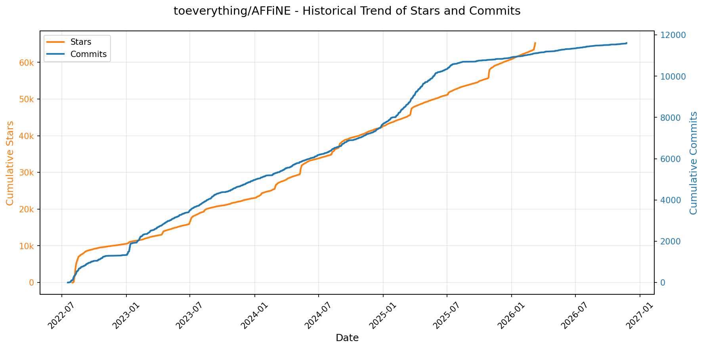

> *橙色：累计 Stars｜蓝色：累计 Commits（次 Y 轴）*

</details>

<details>
<summary><b>📄 README 摘要</b></summary>

## 1. 项目用途

- **AFFiNE** 是一个面向知识工作者与创意团队的**开源一体化工作空间**，将文档写作、白板绘图、任务与项目管理、演示文稿、知识库和数字资产创作整合到同一个平台中。
- 项目定位为 **Notion 与 Miro 的替代品**，强调“所有内容皆为块（block）”：富文本、便签、网页嵌入、数据库、关联页面、图形和幻灯片都可以作为块放入无限画布。
- 产品主张是 **Write, Draw and Plan All at Once**，即在一个环境中同时完成写作、绘图、规划、头脑风暴和协作。
- 强调**隐私、本地优先和开源**。用户可以将数据保存在本地设备上，同时选择使用云端同步，或通过 Docker 自行部署。
- AFFiNE 也被描述为知识库的“操作系统”：除 Wiki 和知识管理外，还可承载演示、项目计划、数字资产等多种内容。

## 2. 核心功能

### 文档与白板融合的无限画布

- 文档编辑器和无边界白板完全融合，可在同一画布中自由组合内容。
- 支持放置多种块元素：
  - 富文本
  - 便签
  - 嵌入式网页
  - 多视图数据库
  - 双向关联页面
  - 图形与形状
  - 幻灯片
- 可将结构化文档转换为视觉化画布，也可从画布中的任意内容继续扩展为正式文档。

### 多模态 AI 助手

- 内置 **AFFiNE AI / Canvas AI**，可通过自然语言指令辅助完成多种工作：
  - 撰写专业工作报告
  - 将大纲转换为演示文稿
  - 总结文章并生成结构化思维导图
  - 整理工作计划、任务和 backlog
  - 绘制原型应用或网页
  - 通过提示词辅助编码和页面设计
  - 在头脑风暴场景中生成思维导图
- AI 能力覆盖文字、视觉组织、演示、总结和原型开发等多种模态。

### 本地优先与实时协作

- **Local-first**：数据首先保存在用户自己的设备上，降低对单一云服务的依赖，并强化数据所有权。
- 支持在 Web 端及跨平台客户端之间进行**实时同步**。
- 支持多人实时协作编辑。
- CRDT 技术用于处理离线编辑、状态合并以及多端同步冲突。

### 自托管与二次开发

- 可使用 Docker 部署功能完整、无平台限制的自托管版本。
- README 提供了 **Render** 和 **Sealos** 的一键部署入口。
- 项目支持自行管理、派生和构建自己的 AFFiNE 版本。
- 官方计划继续建设**插件社区和第三方块扩展生态**；该能力在 README 中标注为“即将推出”。
- 底层编辑器 **BlockSuite** 独立开源，可供开发者研究、复用或扩展。
- GitHub Codespaces 可用于快速创建预配置的开发和构建环境。

### 模板与内容生态

- 官方提供可直接使用的预制模板，包括：
  - 愿景板
  - One Pager
  - 数学及学前教育教案
  - 数字规划器与 ADHD Planner
  - 高亮笔记收集器
  - 阅读记录
  - Cornell Notes
  - 旅行行程、SOP、SWOT 分析等
- 用户也可以向官方模板库提交自己的模板。
- 配套博客提供 AI 辅助学习、思维导图、Canvas AI、任务规划、笔记方法及各类模板教程。

### 社区与版本规划

- 社区可通过 GitHub Issue、Discussion、Discord、贡献指南及 Contributor License Agreement 参与开发。
- **Community Edition（CE）**：当前可用版本，可免费自托管，采用 MIT 许可证。
- **Enterprise Edition（EE）**：计划提供更面向企业的能力，包括品牌定制、SSO、后台管理和审计等。

## 3. 技术栈

| 领域 | 技术与用途 |
|---|---|
| 主要语言 | **TypeScript / JavaScript**；项目提供 TypeScript 版本徽章，核心代码主要以现代 Web 技术实现 |
| 前端 UI | **React**，用于构建 Web 界面及跨平台用户界面 |
| 状态管理 | **Jotai**，提供基于原子的 React 状态管理 |
| 构建工具 | **Vite**，用于前端开发、构建和工程化 |
| 协作编辑器 | **BlockSuite**，AFFiNE 背后的开源协作编辑器与块编辑框架 |
| CRDT 同步 | **YJS**，为 Web 端状态管理和数据同步提供 CRDT 基础；**y-octo** 提供原生、高性能、线程安全的 YJS CRDT 实现 |
| 数据引擎 | **OctoBase**，使用 Rust 编写的轻量级、可扩展、面向本地优先和协作场景的数据库 |
| 桌面应用 | **Electron**，基于 JavaScript、HTML 和 CSS 构建跨平台桌面客户端 |
| 原生桥接 | **napi-rs / Node-API**，通过 Rust 构建编译型 Node.js 原生扩展 |
| 客户端与服务端通信 | **async-call-rpc**，提供轻量级 JSON-RPC 客户端和服务端能力 |
| 组件与主题 | `@affine/component` 组件资源、`@toeverything/theme` 主题包 |
| 部署与开发环境 | **Docker** 自托管；支持 Render、Sealos 部署，以及 GitHub Codespaces 云端开发 |
| 协作与数据模型 | 采用“块”组织内容，结合关系型/对象化标签体系、多视图数据库、CRDT 和实时同步机制 |
| 开源许可 | Community Edition 使用 **MIT License** |

总体技术架构可概括为：**React + TypeScript + Vite 构建界面，BlockSuite 提供块编辑能力，YJS/y-octo 与 OctoBase支撑本地优先数据和实时协作，Electron覆盖桌面端，Rust承担高性能数据与原生能力，并通过 Docker 提供自托管部署。**

</details>

---

### 6. [mvanhorn/last30days-skill](https://github.com/mvanhorn/last30days-skill)
- 📅 **创建日期**：2026-01-23  
- 🔄 **最近更新**：2026-11-24  
- ⭐ **Stars**：49,649（日 +0｜周 +0｜月 +0）  
- 📝 **描述**：AI agent skill that researches any topic across Reddit, X, YouTube, HN, Polymarket, and the web - then synthesizes a grounded summary  

<details>
<summary><b>📈 Star 与 Commit 历史趋势</b></summary>


> *橙色：累计 Stars｜蓝色：累计 Commits（次 Y 轴）*

</details>

<details>
<summary><b>📄 README 摘要</b></summary>

## 1. 项目做什么

`/last30days` 是一个由 AI Agent 驱动的实时研究与搜索技能。它会：

- 搜索过去约 **30 天**内与人物、公司、产品、话题或事件有关的信息。
- 并行访问 Reddit、X、YouTube、TikTok、Hacker News、GitHub、Polymarket、新闻网站、招聘信息、专利等大量来源。
- 不以 SEO 或编辑推荐为主要排序依据，而是优先参考真实用户的互动数据，例如：
  - Reddit 点赞数
  - X 点赞与讨论热度
  - YouTube/TikTok 播放及互动
  - Hacker News 分数和评论数
  - Polymarket 的真实资金赔率及赔率变化
- 由 AI Agent 对跨来源内容进行比较、筛选和综合，最终生成一份可引用、可追溯的研究简报。
- 支持通过用户自己的 API Key、浏览器登录会话或本地工具，跨越各平台之间的数据壁垒。

其核心定位是：

> 搜索引擎聚合“编辑精选”，而 `/last30days` 聚合“真实用户正在关注、讨论和押注的内容”。

典型查询包括：

- `/last30days Peter Steinberger`：了解某个人最近一个月在做什么。
- `/last30days Apple`：分析公司近期动态、招聘、专利、股价和市场预期。
- `/last30days OpenClaw vs Hermes vs Paperclip`：比较多个工具。
- `/last30days what's exploding in AI agents?`：发现近期正在升温的话题。
- `/last30days Iran vs USA`：汇总新闻、社交讨论和预测市场信息。

---

## 2. 关键功能

### 2.1 多来源并行搜索与“用户热度”排序

项目会同时检索多个平台，并将不同来源放在同一套评分框架中比较。高互动、高讨论量或带有真实资金背书的内容通常会获得更高权重。

支持的数据来源包括：

- **社区与社交平台**：Reddit、X、YouTube、TikTok、Instagram Reels、Threads、Pinterest、小红书、Bluesky、Truth Social、Telegram、LinkedIn、Digg、StockTwits。
- **开发者与技术资讯**：Hacker News、GitHub、DEV Community、arXiv、Techmeme、Perplexity、普通 Web 页面。
- **商业与市场信号**：Polymarket、Yahoo Finance、Trustpilot、Amazon、Meta Ads、DripStack。
- **企业动向**：公司招聘页、Career Pages、美国专利申请。
- **本地资料**：本地 Markdown、文本文件，以及通过 `pdftotext` 提取的 PDF 内容。
- **专用数据服务**：XHS MCP、Bright Data、ScrapCreators、Perplexity Agent API、OpenRouter Sonar 等。

不同来源的可用性取决于主题、凭据、已安装工具和用户是否显式启用。

### 2.2 AI Agent 综合判断

搜索结果不是简单拼接链接，而是由 Agent：

- 识别重要内容并过滤噪声。
- 对多个平台的重复信息进行交叉验证。
- 将证据整理成简洁的叙事性简报。
- 提取最有代表性的引语。
- 根据研究目标生成后续查询、播客选题或 X 长文角度。

### 2.3 “发现模式”

当用户询问“AI Agent 最近什么正在爆发”或类似问题时，项目会切换到发现模式：

- 扫描 Reddit 分类页、Hacker News 首页/最佳榜、Digg 和已登录的 X。
- 由 Agent 判断候选话题是否具有名称辨识度、讨论价值和发展潜力。
- 输出约 5～10 个按增长速度排序的话题。
- 每个结果包含跨来源数据、热度标签，以及可直接执行的：
  - `/last30days "<topic>"` 后续查询。

### 2.4 v4 的“Secret Signals”

v4 重点增强了企业早期动向识别：

- **Patent Secret Signals**
  - 读取企业当月提交的美国专利。
  - 默认无需 API Key。
  - 只标记与企业既有行为不一致、或涉及尚未发布功能的专利。
  - 用于判断企业可能正在构建什么。

- **Jobs Page Secret Signals**
  - 自动读取公司的招聘页面。
  - 支持 Workday、Apple、Amazon、Google、Microsoft、Netflix、Oracle 等公司的招聘体系。
  - 识别透露新产品、新团队或未发布能力方向的职位。
  - 也可以通过 `--hiring-signals` 或 `--search jobs` 单独生成招聘信号报告。

### 2.5 可直接引用的证据

生成的报告包含独立证据行：

- Reddit、X、YouTube、TikTok、Instagram 的代表性评论或发言。
- 视频中的口头内容也可提取为引语。
- 非英语引语可自动翻译。
- 每条引语会放在其所支持的故事下方，而不是隐藏在来源列表中。

### 2.6 市场与财务信号

- **Polymarket 赔率行**
  - 显示相关事件的预测概率。
  - 同时显示赔率在时间窗口内发生了多少变化。

- **Yahoo Finance 行**
  - 显示上市公司最近 30 天的股价走势。
  - 美国上市公司可与 S&P 500 同期表现对比。
  - 标出最大单日涨跌。

- **GitHub 实时数据**
  - 查询个人时展示 PR 数量、合并率、热门仓库和 Release Notes。
  - 查询主题时搜索 Issue 和 Discussion。
  - Star 等指标直接从 GitHub API 实时读取，而不是引用可能过时的博客。

### 2.7 人物、公司和主题识别

- “Apple”这样的查询可自动解析为公司、官网和股票代码。
- 人物查询可关联其社交账号、GitHub 活动、播客、视频和社区讨论。
- 工具比较可生成包含定位、架构、内存、安全性和适用场景的并排表格。

### 2.8 登录态与个性化搜索

- 在用户许可下，Reddit 可以使用用户自己的登录账号搜索，以获得更多帖子和实时分数。
- X 也可以接入用户授权的会话或 API。
- 支持通过环境变量、命令行参数和 `INCLUDE_SOURCES` 控制来源。

### 2.9 跨平台安装与更新

项目可安装到多种 AI 编程和 Agent 环境：

- Claude Code
- Grok Build CLI / Grok Bot
- Codex
- Cursor
- GitHub Copilot
- Gemini CLI
- Claude.ai
- Claude Desktop
- OpenClaw
- 以及其他 50 多种 Agent Skills 宿主

安装方式包括：

```bash
/plugin marketplace add mvanhorn/last30days-skill
/plugin install last30days
```

```bash
npx skills add mvanhorn/last30days-skill -g
```

Claude Code 市场支持自动更新；其他宿主通常可使用对应的 `update` 命令。

### 2.10 首次运行与预检

- Reddit、Hacker News、Polymarket、GitHub 等核心来源可零配置立即使用。
- 首次运行向导可快速解锁 X、YouTube、TikTok、arXiv、Techmeme 等来源。
- 可通过预检模式查看将读取的配置、Cookie 计划、写入路径和可选命令，而不真正执行研究：

```bash
python3 skills/last30days/scripts/last30days.py --preflight
```

---

## 3. 技术栈

### 3.1 核心形态

该项目不是一个传统的前端、后端 Web 应用，而是一个可安装的 **AI Agent Skill/插件**：

- **技能规范**：`skills/last30days/SKILL.md`
  - 是命令行为、安装流程和配置方式的权威说明。
- **运行入口**：
  - `skills/last30days/scripts/last30days.py`
- **主要语言**：
  - Python 3，用于编排来源、预处理数据、生成研究计划和输出报告。
- **交互方式**：
  - 通过 `/last30days <查询>` 斜杠命令调用。
- **配置形式**：
  - CLI 参数、环境变量、配置文件、浏览器会话和外部工具共同提供数据访问能力。

README 中没有显示传统的前端框架、数据库或独立服务端；核心能力主要由 Agent 宿主和本地脚本组合完成。

### 3.2 Agent 宿主与分发技术

项目同时提供多种生态适配：

- Claude Code Plugin / Marketplace
- 通用 Agent Skills 规范
- Grok 原生插件及 `.grok-plugin` 清单
- Claude Desktop 的 `.mcpb` 扩展包
- OpenClaw/ClawHub 插件
- `npx skills` 安装工具

其中 `npx skills` 借助 Node.js/npm 生态，但它是安装工具，不代表项目核心运行时是 Node.js。

### 3.3 数据接入技术

项目通过多种适配方式连接外部平台：

- **REST/API**
  - GitHub API
  - Perplexity Agent API、Search API
  - OpenRouter Sonar
  - X API
  - StockTwits、Truth Social、Telegram 等平台接口
- **公开或免 Key 接口**
  - Reddit、Hacker News、arXiv、Polymarket、DEV Community、DripStack 等。
- **命令行适配器**
  - `digg-pp-cli`
  - `arxiv-pp-cli`
  - `techmeme-pp-cli`
  - `yahoo-finance-pp-cli`
  - `trustpilot-pp-cli`
  - `brightdata`
- **浏览器与登录会话**
  - 复用用户浏览器 Cookie。
  - 支持已登录 Reddit、X 等平台的受限内容。
- **MCP 与本地服务**
  - 可连接本地运行的 `xiaohongshu-mcp` 或其他浏览器 MCP 插件。
- **本地文本处理**
  - 通过 `pdftotext` 将 PDF 转换为可检索文本。
  - 扫描本地 Markdown 和纯文本目录。

### 3.4 凭据与安全配置

项目支持通过环境变量或配置文件提供凭据，例如：

- `X_BEARER_TOKEN`
- `TRUTHSOCIAL_TOKEN`
- `SCRAPECREATORS_API_KEY`
- `LAST30DAYS_CORPUS_DIRS`
- `INCLUDE_SOURCES`

预检模式只显示计划，不会读取 Cookie、写入文件或启动研究，体现了对本地敏感数据访问的隔离设计。

### 3.5 质量控制与版本管理

- GitHub Actions 提供 `validate.yml` 验证流程。
- 发布版本通过 GitHub Releases 分发。
- `CHANGELOG.md` 记录版本变化。
- `changelog.d/` 保存尚未发布的变更。
- README 描述当前源码树中的 v4 流程，实际安装版本可能因发布节奏而有所不同。

</details>

---

### 7. [ChromeDevTools/chrome-devtools-mcp](https://github.com/ChromeDevTools/chrome-devtools-mcp)
- 📅 **创建日期**：2025-09-11  
- 🔄 **最近更新**：2026-11-24  
- ⭐ **Stars**：47,274（日 +0｜周 +0｜月 +0）  
- 📝 **描述**：Chrome DevTools for coding agents  

<details>
<summary><b>📈 Star 与 Commit 历史趋势</b></summary>

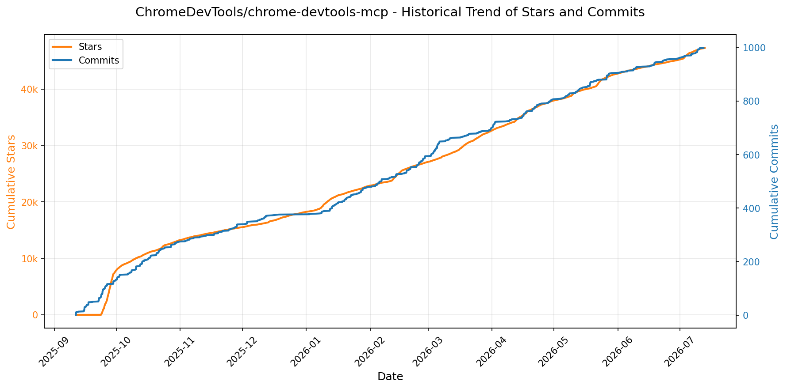

> *橙色：累计 Stars｜蓝色：累计 Commits（次 Y 轴）*

</details>

<details>
<summary><b>📄 README 摘要</b></summary>

## 1. 项目用途

- **Chrome DevTools for agents**（npm 包名：`chrome-devtools-mcp`）是一个供 AI 编程智能体使用的浏览器控制与检查工具。
- 它以两种形式提供能力：
  - **MCP Server**：通过 Model Context Protocol（模型上下文协议）接入 Antigravity、Claude、Cursor、Copilot 等智能体。
  - **CLI**：通过 `chrome-devtools` 命令在终端中直接控制浏览器，便于人工操作或编写 Shell 脚本。
- 核心目标是让智能体能够操作真实的 Chrome 浏览器，并使用 Chrome DevTools 的完整能力完成：
  - 网页自动化
  - 前端问题调试
  - 网络与控制台诊断
  - 性能分析和优化
  - 截图与页面状态检查
  - 可访问性、Cookie、内存泄漏等专项排查
- 浏览器采用**按需启动**机制：仅连接 MCP Server 不会自动打开 Chrome；智能体调用需要浏览器的工具后才会启动。
- 可作为智能体系统中的“浏览器子智能体”基础组件集成到其他代理工具或产品中。
- 工具会向 MCP 客户端开放浏览器实例中的内容，因此调试时可能暴露敏感信息，应避免在浏览器中操作不希望共享给智能体的数据。

## 2. 关键功能

### 浏览器自动化与调试

- 基于 **Puppeteer** 驱动 Chrome 执行页面操作。
- 自动等待操作结果，降低因页面尚未加载完成导致的自动化失败。
- 支持网络请求分析、页面截图以及浏览器控制台消息检查。
- 控制台错误可提供经过 **Source Map 映射**的调用栈，便于定位原始源码。
- 可访问浏览器页面及 DevTools 数据，并对其进行检查、调试和修改。

### 性能分析

- 使用 Chrome DevTools 记录 Performance Trace。
- 从 Trace 中提取可执行的性能洞察和优化建议。
- 可选择调用 Google **Chrome User Experience Report（CrUX）API**，将真实用户数据与实验室数据结合，形成更全面的性能视图。
- 可通过 `--no-performance-crux` 禁用 CrUX 数据查询。

### CLI 与 MCP 双接口

- MCP 配置示例使用 `npx` 启动：
  ```json
  {
    "mcpServers": {
      "chrome-devtools": {
        "command": "npx",
        "args": ["-y", "chrome-devtools-mcp@latest"]
      }
    }
  }
  ```
- CLI 支持全局安装后直接执行，例如：
  ```sh
  chrome-devtools navigate_page 1 --url "https://developers.chrome.com"
  chrome-devtools take_screenshot 1 --filePath screenshot.png
  chrome-devtools stop
  ```
- `--slim` 模式只暴露适合基础浏览器任务的精简工具集。
- 支持无头模式、隔离运行等服务器参数，并可通过 WebSocket 连接远程或已运行的浏览器。

### 高级使用能力

高级使用指南覆盖：

- 并发会话
- 持久化用户数据目录
- 自定义浏览器路径（`--executablePath`）
- 连接已在运行的 Chrome，而非自动创建新实例
- Android 设备调试
- WebSocket 连接配置
- Headless、Isolated、Slim 等运行模式

### 智能体 Skills

项目附带一组可教智能体正确使用工具的 Skills：

- `chrome-devtools`：使用 MCP 工具调试和自动化网页。
- `chrome-devtools-cli`：运行 CLI 并编写 Shell 脚本。
- `a11y-debugging`：审计并修复可访问性问题。
- `cookie-debugging`：排查 Cookie、会话和认证问题。
- `debug-optimize-lcp`：调试并优化 Largest Contentful Paint。
- `memory-leak-debugging`：发现和修复内存泄漏。
- `troubleshooting`：解决 MCP 与 Chrome 之间的连接问题。

Skills 可以通过插件方式安装，也可以从 npm 全局安装包中手动复制到智能体的 Skills 目录。工具参数可能随版本变化，因此升级 MCP Server 或 CLI 后应同步更新 Skills。

### 兼容性、遥测与更新机制

- 官方支持：
  - Google Chrome
  - Chrome for Testing
- 其他基于 Chromium 的浏览器可能可用，但不保证行为完全一致。
- Google 默认收集工具调用成功率、延迟和环境信息等使用统计：
  - 可使用 `--no-usage-statistics` 退出。
  - 设置 `CHROME_DEVTOOLS_MCP_NO_USAGE_STATISTICS` 或 `CI` 环境变量也会禁用。
  - 该统计与 Chrome 浏览器自身的使用统计相互独立。
- 默认定期检查 npm 上的新版本并输出提示。
- 可通过 `CHROME_DEVTOOLS_MCP_NO_UPDATE_CHECKS` 禁用更新检查。

## 3. 技术栈

| 类别 | 技术与说明 |
|---|---|
| 运行环境 | **Node.js LTS** |
| 包管理与分发 | **npm / npx**，包名为 `chrome-devtools-mcp` |
| 核心集成协议 | **Model Context Protocol（MCP）** |
| 浏览器 | 当前稳定版或更新版本的 **Google Chrome**、**Chrome for Testing** |
| 浏览器自动化 | **Puppeteer** |
| 调试与性能分析 | **Chrome DevTools**，包括 Trace、性能洞察、网络分析、截图、控制台与 Source Map 堆栈 |
| 命令行接口 | 项目自带的 `chrome-devtools` CLI |
| 真实用户性能数据 | 可选的 **Google CrUX API** |
| 配置方式 | MCP 客户端 JSON 配置、CLI 参数、环境变量、WebSocket 连接 |
| 智能体生态 | 支持 MCP 客户端、Claude Code 插件、VS Code/Copilot 插件、Gemini CLI 扩展及手动安装的 Skills |
| 隐私与统计 | Google 使用统计默认开启，可通过参数或环境变量关闭；Trace URL 可能被发送至 CrUX API |

</details>

---

### 8. [jingyaogong/minimind](https://github.com/jingyaogong/minimind)
- 📅 **创建日期**：2024-07-27  
- 🔄 **最近更新**：2026-11-24  
- ⭐ **Stars**：44,538（日 +0｜周 +0｜月 +0）  
- 📝 **描述**：🧠 两小时从 0 训出你的 64M 大模型。Train your own 64M LLM from scratch in 2 hours.  

<details>
<summary><b>📈 Star 与 Commit 历史趋势</b></summary>

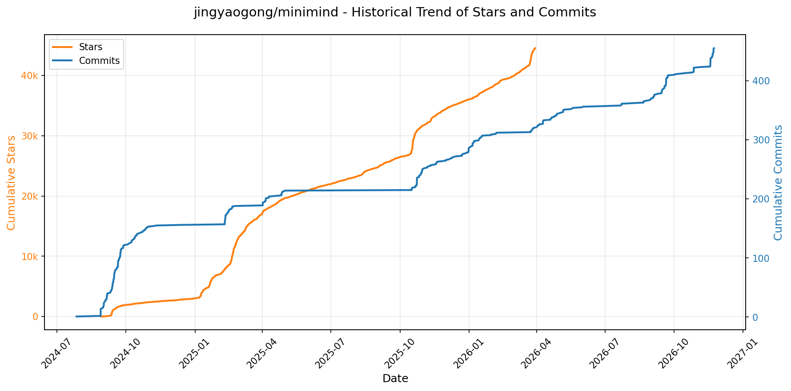

> *橙色：累计 Stars｜蓝色：累计 Commits（次 Y 轴）*

</details>

<details>
<summary><b>📄 README 摘要</b></summary>

## 1. 项目做什么？

MiniMind 是一个面向大语言模型入门与实践的**超小型语言模型开源项目**。它的目标不是简单调用 `transformers`、`peft` 等框架微调现成模型，而是让开发者能够从数据、模型结构到训练和推理，完整理解并亲手复现一次语言模型训练过程。

项目的主要定位包括：

- 从零训练约 **64M 参数**的 MiniMind，模型体积约为 GPT-3 的 **1/2700**，目标是让普通个人 GPU 也能完成训练。
- 宣传中的“**3 块钱、2 小时**”特指：在单张 NVIDIA RTX 3090 上完成 **1 个 epoch 的 SFT 阶段**实测耗时及对应 GPU 租用成本，并非完整预训练成本。
- 开源 MiniMind 的**极简模型结构、Tokenizer、训练代码、训练数据和完整训练链路**。
- 项目既是大语言模型全阶段复现工具，也是一套强调“从零实现”和底层原理理解的教程。
- 采用 **Apache 2.0** 协议，免费且可用于商业或二次开发。

目前主线为 MiniMind-3：

- `minimind-3`：64M 参数的 Dense 模型。
- `minimind-3-moe`：约 198M 总参数、64M 激活参数的 MoE 模型。
- 主线结构与配置参考 `Qwen3 / Qwen3-MoE` 生态，方便后续接入主流 Transformers 和推理生态。

项目还形成了相关模型分支，包括视觉模型 MiniMind-V、多模态 Omni 模型 MiniMind-O，以及实验性的扩散语言模型 MiniMind-dLM 和线性注意力模型 MiniMind-Linear。

---

## 2. 关键功能

### 模型结构

- 提供完整的 **Decoder-Only Transformer** 实现，支持 Dense 和 MoE 两种结构。
- MiniMind-3 Dense 采用：
  - Pre-Norm；
  - RMSNorm；
  - SwiGLU；
  - RoPE 旋转位置编码；
  - YaRN 长文本位置外推；
  - 8 层、隐藏维度 768；
  - 8 个 Query Head、4 个 KV Head；
  - 最大位置长度 32768；
  - `rope_theta=1e6`。
- MiniMind-3 MoE 使用 **4 Experts、Top-1 Routing**，不包含 Shared Expert；总参数量约 198M，每次只激活约 64M。
- 当前纯 PyTorch MoE 实现会因专家分桶和调度产生额外开销，速度约比同规模 Dense 模型慢 50%；README 提到可通过 Triton 自定义 Kernel、DeepSpeed-MoE 或 Megatron-LM 等进一步优化。

### 完整训练链路

项目覆盖从基础语言能力到高级对齐、工具使用的训练流程：

- Tokenizer 与分词器训练；
- 预训练 Pretrain；
- 全参数监督微调 SFT；
- 从零实现 LoRA；
- RLHF-DPO；
- RLAIF：
  - PPO；
  - GRPO；
  - CISPO；
  - SPO；
- Tool Use / Tool Calling；
- 多轮 Agentic RL；
- 自适应思考；
- 模型蒸馏；
- LoRA 权重合并并导出完整模型。

其中 `train_agent.py` 用于多轮 Tool-Use 场景下的 GRPO/CISPO 训练，并将 **Rollout 引擎与训练流程解耦**，方便替换不同的生成后端。

### 自适应思考与工具调用

- 使用 `chat_template` 和 `

</details>

---

### 9. [HKUDS/DeepTutor](https://github.com/HKUDS/DeepTutor)
- 📅 **创建日期**：2025-12-28  
- 🔄 **最近更新**：2026-11-24  
- ⭐ **Stars**：23,173（日 +0｜周 +0｜月 +0）  
- 📝 **描述**：DeepTutor: Lifelong Personalized Tutoring. https://deeptutor.info/.  

<details>
<summary><b>📈 Star 与 Commit 历史趋势</b></summary>

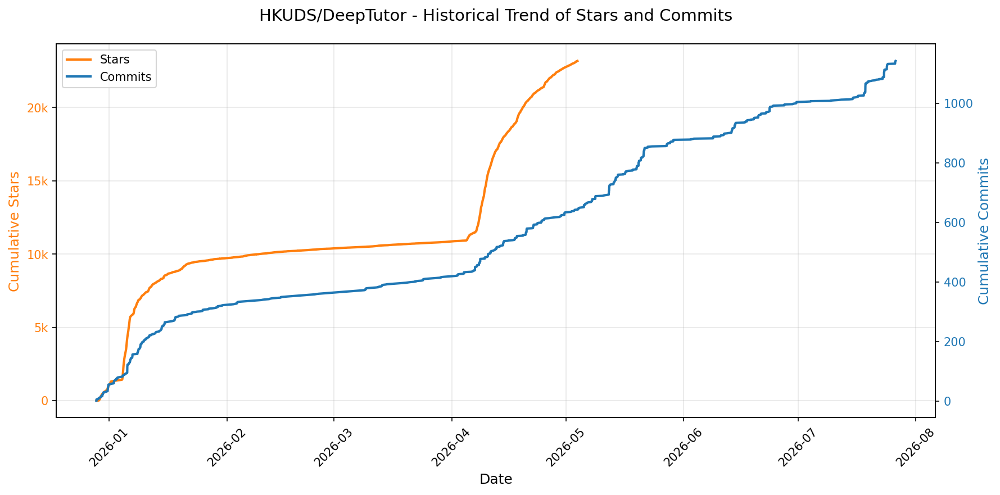

> *橙色：累计 Stars｜蓝色：累计 Commits（次 Y 轴）*

</details>

---

### 10. [pbakaus/impeccable](https://github.com/pbakaus/impeccable)
- 📅 **创建日期**：2025-11-16  
- 🔄 **最近更新**：2026-11-24  
- ⭐ **Stars**：20,646（日 +0｜周 +0｜月 +0）  
- 📝 **描述**：The design vocabulary for your coding agent. Steer with polish and bolder, review with critique and audit, catch AI slop before it ships.  

<details>
<summary><b>📈 Star 与 Commit 历史趋势</b></summary>


> *橙色：累计 Stars｜蓝色：累计 Commits（次 Y 轴）*

</details>

<details>
<summary><b>📄 README 摘要</b></summary>

## 1. 项目做什么

**Impeccable** 是面向 AI 编码代理的设计技能包与质量审查工具，定位是“编码代理的设计词汇表”。它主要解决 AI 生成界面容易出现的同质化问题，例如：

- 什么都使用 Inter 字体；
- 紫蓝渐变泛滥；
- 卡片套卡片；
- 彩色背景搭配低对比度灰色文字；
- 每个标题上方都放圆角图标块；
- 间距过窄、层级不足、标题结构缺失等常见“AI 味”问题。

它本身不是 UI 组件库或独立设计软件，而是通过 **Agent Skills、斜杠命令、设计钩子和检测器**接入 Claude Code、Cursor、Codex CLI、GitHub Copilot、Devin、Gemini CLI、Replit Agent、OpenCode、Grok Build 等编码工具。

基本工作流：

1. 在项目根目录运行 `npx impeccable install` 安装。
2. 重启或重新加载编码工具。
3. 执行 `/impeccable init`。
4. `init` 会读取现有代码，只询问无法推断的产品、用户、目标和约束，并生成 `PRODUCT.md`。
5. 后续命令统一读取 `PRODUCT.md`；执行 `/impeccable document` 还会生成 `DESIGN.md`，记录现有视觉系统。
6. 用户以“命令 + 具体目标”的方式设计或审查界面，例如：
   - `/impeccable critique the pricing cards`
   - `/impeccable quieter the landing page`
   - `/impeccable polish settings`
   - `/impeccable harden checkout`
   - `/impeccable redo this hero section`

项目尤其适合对**已有页面或组件进行迭代和审查**；也能创建新页面，但 README 建议为新页面采用更明确的设计方向。项目通过具体的命令手册替代模糊提示词，例如“让定价卡片更醒目”会被转化为专门针对该设计动作的操作指南。

---

## 2. 关键功能

### 2.1 24 个设计命令

| 类别 | 命令与作用 |
|---|---|
| **引导设计方向** | `bolder` 强化过于保守的设计；`quieter` 降低视觉噪声；`distill` 删除非必要元素；`colorize` 为灰色界面加入色彩；`typeset` 修正字体、层级和字号；`layout` 调整间距与节奏；`animate` 添加过渡和交互反馈；`delight` 增加个性；`overdrive` 使用着色器、弹簧动画和滚动驱动效果 |
| **审查** | `critique` 根据可用性启发式进行评分并排序问题；`audit` 检查可访问性、性能、主题、响应式行为等技术质量 |
| **发布前完善** | `polish` 做发布前最终打磨；`harden` 处理错误、国际化、溢出和边界情况；`clarify` 重写不清晰文案；`adapt` 适配不同屏幕和设备；`optimize` 优化加载与渲染；`onboard` 设计首次使用流程和空状态 |
| **实时迭代** | `live` 在浏览器中选择元素并循环切换设计变体；`generate` 不手动选择，直接为指定元素生成多个变体 |
| **规划与配置** | `shape` 在编码前规划 UX；`init` 生成 `PRODUCT.md`；`document` 生成 `DESIGN.md`；`extract` 将重复模式抽取到设计系统 |

第 24 个命令 `craft` 是普通构建请求的已弃用别名。直接执行 `/impeccable` 可查看当前工具支持的完整命令列表。Codex 中可使用 `/skills` 或 `$impeccable`。

### 2.2 UX 与技术审查

- **`critique`**
  - 依据可用性启发式对设计进行评分；
  - 识别影响体验的问题；
  - 按优先级排列需要修复的项目。

- **`audit`**
  - 检查可访问性、性能、主题一致性和响应式行为；
  - 使用 P0～P3 标记问题严重程度；
  - P0 表示阻塞发布的问题，P3 属于打磨级问题。

### 2.3 确定性的“AI 味”检测器

检测器内置 **62 条确定性规则**，不需要 LLM，也不要求 API Key。它能够发现：

- 过度使用 Inter 等常见字体；
- 紫蓝渐变；
- 嵌套卡片；
- 低对比度文字；
- 字号过小；
- 间距拥挤；
- 标题层级缺失；
- 其他常见视觉模板化问题。

有三种运行方式：

1. **编码代理内自动运行**
   - 设计钩子会扫描代理修改的每个 UI 文件；
   - 在代理宣布任务完成前返回检测结果；
   - 支持 Claude Code、Cursor、Codex、GitHub Copilot、Grok Build 和 Hermes Agent。

2. **CLI 或 CI**
   - 扫描目录：`npx impeccable detect src/`
   - 扫描运行中的页面：`npx impeccable detect http://localhost:5173`
   - 扫描网站：`npx impeccable detect https://example.com`
   - 输出 JSON：`--json`
   - 输出 GitHub Actions 注解：`--github`
   - 输出 SARIF 2.1.0：`--sarif`
   - 查看全部规则：`--list-rules`
   - 检查无效或过期的忽略声明：`--report-unused-ignores`

   CLI 可使用本机安装的 Chrome 或 Edge分析已渲染页面。JSX、TSX 等源文件只能执行模式类规则；低对比度、字号过小等依赖渲染结果的规则，需要扫描 URL 或 HTML 页面。

   退出码：
   - `2`：发现检测项；
   - `1`：目标无法扫描；
   - `0`：扫描通过。

   支持品牌字体放行、单文件规则禁用以及过期豁免检查。

3. **浏览器扩展**
   - Chrome 扩展可以在任意实时页面上叠加同一套检测结果；
   - 便于以可视化方式审查自己的站点或其他网站。

### 2.4 浏览器实时设计模式

`/impeccable live` 会打开正在运行的开发服务器并显示覆盖层，用户可以：

1. 选择页面元素；
2. 选择一个设计方向；
3. 在原位置热切换多个变体；
4. 接受某个方案并写回源代码。

支持：

- Vite
- Next
- SvelteKit
- Astro
- Nuxt
- 普通 HTML

该模式仅用于本地检出项目，不应注入已部署站点，也不应为它放宽生产环境的 CSP。复制文本变更还可能调用项目的 `impeccable:manual-edit-validate` 脚本，因此首次在陌生仓库中使用前应审查该脚本。

“Apply”功能可把暂存的文案修改交给当前聊天代理；若一分钟内没有代理轮询，则会回退到 PATH 中的 `codex` 或 `claude` CLI，并以跳过审批和沙箱的方式运行，因此具有较高权限风险。可通过 `IMPECCABLE_LIVE_COPY_AGENT=chat` 强制留在当前聊天会话，或设置为 `off` 禁用。

### 2.5 两条构建路径

对于新落地页和展示型界面，可选择：

- **高保真设计稿优先**：先生成完整视觉稿，再按设计稿实现，效果更强但更慢；
- **直接编码**：直接在代码中构建，更轻量、更快。

`init` 会将选择保存为 `.impeccable/config.json` 中的 `buildPath`，也可以在单次会话中覆盖。该选项仅在宿主工具支持图片生成时出现。应用界面和文档类内容始终直接使用代码构建。

### 2.6 原生应用支持

在 `PRODUCT.md` 中设置：

```text
## Platform
```

可使用：

- `ios`
- `android`
- `adaptive`，即同一套 Flutter 或 React Native 代码适配各操作系统。

原生模式下，设计命令会参考 Apple HIG 或 Material 3；`audit` 和 `adapt` 也会切换到原生规范，并能直接读取：

- SwiftUI
- Jetpack Compose
- React Native
- Flutter

检测器、Live Mode 及其 `generate` 功能、编辑钩子仍仅支持 Web，因为它们依赖浏览器中的 HTML 和 CSS。

### 2.7 安装、集成与团队分发

项目支持大量编码工具，包括 Claude Code、Cursor、Codex CLI、GitHub Copilot、Devin、Replit Agent、Gemini CLI、Grok Build、OpenCode、Google Antigravity、Kiro、Trae、Rovo Dev、Qoder、Mistral Vibe、Pi、Hermes Agent、DeepSeek Harness 和 Veto。

主要分发方式：

- **标准安装**
  - `npx impeccable install`
  - `npx impeccable update`
  - 可通过 `--providers=claude,codex,cursor` 和 `--scope=project|global` 控制安装目标。

- **插件安装**
  - Claude Code 插件市场；
  - GitHub Copilot 的 VS Code 扩展；
  - Grok Build 插件。

- **Git Submodule**
  - 将固定版本加入 `vendor/impeccable`；
  - 通过 `npx impeccable link` 为团队生成工具集成；
  - 适合统一团队版本，但只安装技能，不安装钩子。

- **手动复制**
  - 可直接复制各工具对应的技能目录；
  - 不要求 Node.js；
  - 但手动复制不会自动安装设计钩子和子代理。

部分工具启用钩子前还需要额外授权：

- Codex：打开 `/hooks` 并批准项目钩子；
- Grok Build：运行 `/hooks-trust` 或使用 `--trust` 启动；
- Hermes Agent：启用 `hermes plugins enable impeccable-design-hook`。

### 2.8 项目文件、诊断与隐私

项目运行文件位于 `.impeccable/`。建议提交到 Git 的共享内容包括：

- `config.json`
- `live/config.json`
- `design.json`
- `surfaces/*.md`
- `critique/ignore.md`
- `PRODUCT.md`
- `DESIGN.md`

截图、缓存、评审结果和运行时状态通常应加入 `.gitignore`。

其他运维能力：

- `/impeccable doctor` 可诊断过期上下文、无效配置和损坏钩子；
- 新设计开始时会从 impeccable.style 获取视觉方向目录；
- 关闭 telemetry 只会停止匿名记录展示和选择了哪些方向，不会阻止视觉目录请求；
- 项目名称、代码、文件内容和 `PRODUCT.md` 不会被发送；
- 可通过 `npx impeccable telemetry off`、`DO_NOT_TRACK=1` 或配置文件中的 `"telemetry": false` 关闭遥测记录。

---

## 3. 技术栈

| 层次 | 技术与格式 | 用途 |
|---|---|---|
| **CLI 与分发** | Node.js、npm、`npx` | Node.js 只用于通过 `npx` 运行安装器和 CLI；技能本身不要求系统长期安装 Node.js |
| **代理技能层** | Agent Skills、Markdown 技能文件、斜杠命令、子代理、工具钩子 | 向不同编码代理提供设计知识、命令手册和上下文文件 |
| **检测引擎** | 自包含引擎二进制 | 二进制随技能分发，或首次使用时下载到 `~/.impeccable/bin/`；负责确定性规则扫描 |
| **规则实现方式** | 静态模式分析、HTML/CSS 分析、浏览器渲染分析 | 源文件执行模式规则；页面 URL 利用 Chrome 或 Edge 执行对比度、字号等渲染规则 |
| **Web 技术** | HTML、CSS、JavaScript/TypeScript、JSX/TSX | 支持普通 HTML 页面及现代前端源代码扫描 |
| **前端框架兼容** | Vite、Next、SvelteKit、Astro、Nuxt | Live Mode 可在这些开发服务器中选取元素、热切换变体并写回代码 |
| **原生技术** | SwiftUI、Jetpack Compose、React Native、Flutter | 原生审计与设计命令读取相应项目源代码，并使用 Apple HIG 或 Material 3 规范 |
| **数据与配置** | Markdown、JSON | `PRODUCT.md`、`DESIGN.md` 和 `surfaces/*.md` 保存产品及设计上下文；`config.json`、`design.json` 等保存结构化配置 |
| **检测结果格式** | JSON、GitHub Actions 注解、SARIF 2.1.0 | 支持机器消费、PR 注解和 GitHub Code Scanning |
| **CI 集成** | GitHub Actions、`actions/checkout@v4`、`github/codeql-action/upload-sarif@v3` | 上传 SARIF，在 PR 中持续展示并关闭已修复告警 |
| **浏览器集成** | Chrome Extension | 在任意实时网页上叠加检测结果 |
| **版本控制集成** | Git、Git Submodule、`.gitignore` | 支持团队固定版本、共享配置及忽略临时产物 |
| **平台集成** | Claude Code、Cursor、Codex、Copilot、Devin、Replit、Gemini CLI、Grok Build、OpenCode、Antigravity、Kiro、Trae、Hermes、DeepSeek Harness 等 | 通过各自的技能目录、插件、扩展或钩子机制安装 |
| **许可证** | Apache License 2.0 | 项目开源许可；源自 Anthropic 的 `frontend-design` 技能 |

README 没有披露检测引擎和 CLI 的核心源码语言、构建系统或前端框架，因此不能仅凭文档确定其具体实现是 TypeScript、Rust、Go 或其他语言。可以明确的是，它对外采用 **Node.js/npx CLI + 自包含二进制引擎 + Markdown/JSON 技能与配置 + 浏览器渲染检测 + GitHub Actions/SARIF** 的组合。

</details>

---

### 11. [pingdotgg/t3code](https://github.com/pingdotgg/t3code)
- 📅 **创建日期**：2026-02-08  
- 🔄 **最近更新**：2026-11-24  
- ⭐ **Stars**：13,986（日 +0｜周 +0｜月 +0）  
- 📝 **描述**：The best way to control Claude Code, Codex and more from any computer or phone  

<details>
<summary><b>📈 Star 与 Commit 历史趋势</b></summary>


> *橙色：累计 Stars｜蓝色：累计 Commits（次 Y 轴）*

</details>

<details>
<summary><b>📄 README 摘要</b></summary>

## 1. 这个项目做什么？

T3 Code 是一个面向 AI 编程智能体的开源“控制平面”，用于统一管理运行在用户电脑上的多种编程 Agent。

它的核心工作方式是：

- 在本机运行已经安装并登录的编程 Agent，如 Claude Code、Codex CLI、Cursor、OpenCode、Grok Build、Antigravity、Kiro、Pi、Muse Code、fx 等。
- 通过一个统一、快速的操作界面管理不同 Agent、模型和任务线程。
- 用户可以在电脑桌面上开始一个任务线程，再通过手机远程查看进度、审批命令或继续操作。
- 不提供或转售模型 Token，而是直接使用用户已经登录的 Agent 账户和现有订阅。
- 支持任何兼容 **ACP（Agent Client Protocol）** 的 Agent，因此第三方 Agent 理论上也可以接入。

整体上，它定位成连接“本机 Agent 执行环境”和“桌面、Web、移动端操作界面”的中心化控制工具，而不是一个新的编程模型或模型服务商。

## 2. 关键特性

- **多 Agent 统一入口**
  - 将不同编程 Agent 集中到同一个界面。
  - 可以在任务线程中途切换模型。
  - 支持 Agent 之间交接任务，例如让 Claude Code 完成一部分工作，再交给 Codex 继续处理。

- **复用现有订阅**
  - 不转售 Token。
  - 直接驱动用户已经安装、登录并有权限使用的编程 Agent。

- **跨设备使用**
  - 提供 macOS、Windows、Linux 桌面端、Web 应用，以及 iOS 和 Android 应用。
  - 采用“一套服务端、多个客户端”的模式，各客户端可以查看相同的任务线程。

- **远程访问**
  - 可在任意一台机器上运行 Agent。
  - 支持局域网、Tailscale，以及 T3 自己的 **T3 Connect** 远程连接方式。
  - 手机端可用于查看任务状态、批准命令和远程推进开发流程。

- **内置 Git 与代码审查流程**
  - 每个任务线程可以使用独立的 Git worktree，降低并行任务之间的代码冲突。
  - 可在界面中查看 diff，并一键完成提交、推送和创建 Pull Request。

- **权限与审批**
  - 支持任务执行过程中的命令审批。
  - 提供专门的权限模式文档，方便根据 Agent 或任务调整授权策略。

- **性能导向**
  - 项目明确将性能视为核心功能。
  - 会持续测量运行表现，并把掉帧等问题视为需要修复的缺陷。

- **开放与可扩展**
  - 使用 MIT 许可证。
  - 允许用户审查、修改和自行 Fork 项目。
  - 支持通过 MCP 连接外部 Agent 或工具。

- **安装与分发方式较完整**
  - 桌面端支持 macOS、Windows、Linux。
  - 可通过 Homebrew、Winget、Scoop、Arch Linux 的 `yay`、Nix，以及 Debian/Ubuntu 的 `.deb` 包安装。
  - 命令行方式可使用：
    - Unix Shell 安装脚本；
    - PowerShell 安装脚本；
    - `npx t3@latest` 临时运行。
  - CLI 启动后可通过 `t3` 命令启动本地服务并打开 Web 应用。
  - 移动端通过 App Store 和 Google Play 下载。

- **使用前提**
  - 至少需要在本机安装并登录一个受支持的编程 Agent，例如执行 `claude auth login` 或 `codex login`。

## 3. 技术栈

这份 README **没有直接披露核心源码所用的编程语言、前端框架、后端框架、数据库或具体构建工具**，因此不能据此确认项目是否使用 TypeScript、React、Rust、Go、Tauri 或 Electron 等技术。

从 README 可以确认的技术与平台组成包括：

- **客户端层**
  - 桌面客户端：macOS、Windows、Linux。
  - Web 客户端。
  - iOS 客户端。
  - Android 客户端。
  - README 未说明移动端和桌面端采用原生还是跨端框架。

- **服务端与 CLI**
  - 通过 `t3` 命令启动本地服务，并打开 Web 应用。
  - 一个服务端可供桌面、Web 和手机等多个客户端连接，共享任务线程。
  - 提供 npm/NPX 分发渠道，但仅凭 `npx t3@latest` 不能断定主体服务本身使用 Node.js。

- **Agent 集成层**
  - 内置或适配 Claude Code、Codex、Cursor、OpenCode 等多个 Agent 提供方。
  - 使用 **ACP** 作为通用 Agent 接入协议。
  - 支持通过 **MCP** 连接外部 Agent 和工具。

- **网络与远程访问层**
  - 局域网访问。
  - Tailscale 集成。
  - T3 Connect 远程连接服务。

- **版本控制集成**
  - Git。
  - Git worktree。
  - Diff 查看、commit、push 和 Pull Request 创建流程。

- **打包与安装体系**
  - Shell 和 PowerShell 安装脚本。
  - npm/NPX。
  - Homebrew、Winget、Scoop、Yay、Nix。
  - `.deb`、AppImage 等桌面分发形式。

- **开源许可**
  - MIT License。

README 将更深入的架构和开发环境信息放在 `docs/internals/01_architecture.md` 与 `docs/operations/00_development.md` 中；真正的源码级技术栈应以这些文档及仓库代码为准。

</details>

---

### 12. [meta/astryx](https://github.com/meta/astryx)
- 📅 **创建日期**：2026-01-09  
- 🔄 **最近更新**：2026-11-24  
- ⭐ **Stars**：8,252（日 +0｜周 +0｜月 +0）  
- 📝 **描述**：An open source design system that's fully customizable and agent ready  

<details>
<summary><b>📈 Star 与 Commit 历史趋势</b></summary>

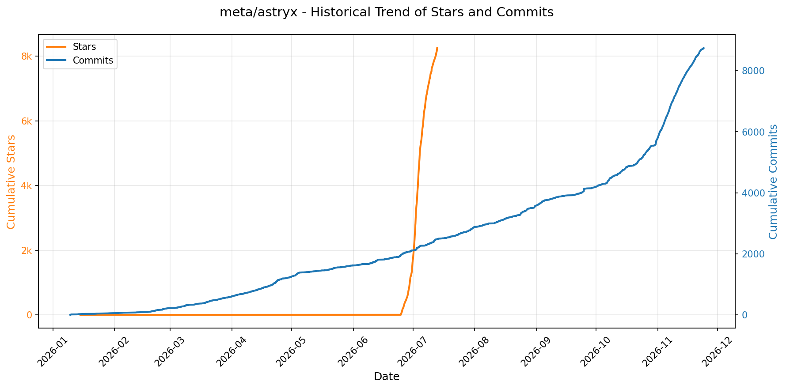

> *橙色：累计 Stars｜蓝色：累计 Commits（次 Y 轴）*

</details>

<details>
<summary><b>📄 README 摘要</b></summary>

## 1. 项目用途

**Astryx** 是 Meta 开源、目前处于 Beta 阶段的设计系统，面向前端开发者、设计师及 AI 编程助手，用于统一构建可访问、可定制且风格一致的用户界面。

它源自 Meta 内部使用约八年的设计系统，曾支撑公司内部 **13,000 多个应用**。Astryx 将以下能力整合为一套完整体系：

- 基础设计规范：排版、颜色、布局和无障碍设计。
- **150+ 个可复用 React 组件**，全部提供 TypeScript 类型支持。
- 面向表格页、详情页、表单向导、导航和数据录入等场景的成熟交互模式。
- 品牌主题、暗色模式、可直接投入项目的页面模板。
- 用于查询文档、生成模板、创建组件脚手架、管理主题和执行代码迁移的 CLI。
- 统一的 API、文档和工具链，使人类开发者与 AI 助手能够按照相同规范构建 UI。

消费者通常只需导入预构建 CSS、主题和类型化 React 组件，无需额外采用构建插件或样式库。

---

## 2. 核心特性

### 开放且可组合的组件实现

- 组件并非只提供封闭的顶层 API，而是允许在任意层级进行组合。
- 常用基础构件可以直接导出。
- 需要更深层定制时，可通过 **swizzle** 将组件完整源码弹出到项目中，由使用方直接维护。
- 组件更强调“提供能力”而非强制限制，允许传入合理的自定义值。

### 无样式技术锁定

- Astryx 内部使用 StyleX 编写样式，但 StyleX 对使用方是透明的。
- 可以通过 `className` 使用：
  - Tailwind CSS
  - CSS Modules
  - 普通 CSS
  - 项目已有的其他样式方案
- 基础接入不需要配置 PostCSS、Babel 或额外构建插件。

### 高度可定制的主题体系

- 主题基于一组 **CSS 自定义属性覆盖项**，设计师可以直接修改颜色、排版等品牌变量。
- 无需 fork 组件源码，也无需再包一层主题组件。
- 官方提供 7 套完整主题：
  - `neutral`
  - `butter`
  - `chocolate`
  - `matcha`
  - `stone`
  - `gothic`
  - `y2k`
- 支持品牌级定制和暗色模式。
- 提供可直接使用的页面模板。

### 面向人类与 AI 的统一工作流

- API、命名规则、组件组合方式和文档专门兼顾 AI 助手的使用场景。
- CLI 的 `init` 命令会：
  - 输出主题、样式等初始化步骤；
  - 将 Astryx 使用指南写入 `AGENTS.md` 或 `CLAUDE.md`；
  - 帮助开发者和 AI 代理按照统一规范工作，而不必自行猜测组件用法。
- CLI 还支持组件文档查询、组件列表、模板、脚手架、主题及 codemod 等任务。
- 推荐通过 `package.json` 脚本调用 CLI，以避免开发者和 AI 直接执行命令时出现路径错误。

### 一致且有文档保障的组件规范

- 所有组件遵循统一的命名、属性和组合规则。
- 每个组件都有完整文档和示例，学习一个组件后即可快速理解其他组件。
- 设计建议主要通过文档和示例表达，而不是通过硬性校验阻止使用方定制。
- 规范通过测试和实际使用效果进行验证，并允许根据新场景持续调整。

### 文档与交互式开发环境

项目提供：

- 官方文档站。
- 在线 Storybook。
- 在线 Sandbox/Playground。
- GitHub 贡献指南及设计、API、组件生命周期等约定。
- Discord 社区支持。

---

## 3. 技术栈

| 类别 | 技术与说明 |
|---|---|
| UI 框架 | **React 19+**；`react` 和 `react-dom` 是 `@astryxdesign/core` 的 peer dependencies |
| 开发语言 | **TypeScript**，组件提供完整类型定义 |
| 样式系统 | **StyleX**；消费者使用预构建 CSS，也可使用 Tailwind、CSS Modules 或普通 CSS 覆盖样式 |
| 主题机制 | CSS 自定义属性、CSS imports、主题 Provider |
| 包管理/仓库结构 | pnpm workspace 风格 monorepo，开发环境推荐 **pnpm 11** |
| CLI | Node.js 工具；在消费项目中要求 **Node.js 22.13.0+** |
| 构建工具 | `@astryxdesign/build`，用于需要从 StyleX 源码构建的项目；基础接入无需额外构建插件 |
| 测试 | **Vitest**，包含 DOM 与 StyleX 相关测试配置 |
| 组件文档与预览 | Storybook、Sandbox/Playground、文档站 |
| 集成生态 | 支持 Next.js、Tailwind、Vite 和 CDN 等接入方式 |
| 代码规范 | 内部包含 ESLint 插件、测试工具及自动化体验测试工具 |

### 主要 npm 包

- `@astryxdesign/core`：组件、主题系统和通用工具。
- `@astryxdesign/cli`：CLI 工具。
- `@astryxdesign/build`：StyleX 源码构建插件。
- `@astryxdesign/theme-*`：7 套可定制主题。

其他包的状态：

- `@astryxdesign/lab`：实验性组件，仅供内部 Storybook 和 Sandbox 使用，未发布到 npm。
- `@astryxdesign/vega`：Vega/Vega-Lite 图表封装。
- `@astryxdesign/charts`：图表组件。
- 后两者目前仅通过 npm 的 `@canary` 标签发布，尚无稳定版本。

项目采用 **MIT License**。

</details>

---

### 13. [HKUDS/CLI-Anything](https://github.com/HKUDS/CLI-Anything)
- 📅 **创建日期**：2026-03-08  
- 🔄 **最近更新**：2026-11-24  
- ⭐ **Stars**：6,898（日 +0｜周 +0｜月 +0）  
- 📝 **描述**："CLI-Anything: Making ALL Software Agent-Native" -- CLI-Hub: https://clianything.cc/  

<details>
<summary><b>📈 Star 与 Commit 历史趋势</b></summary>

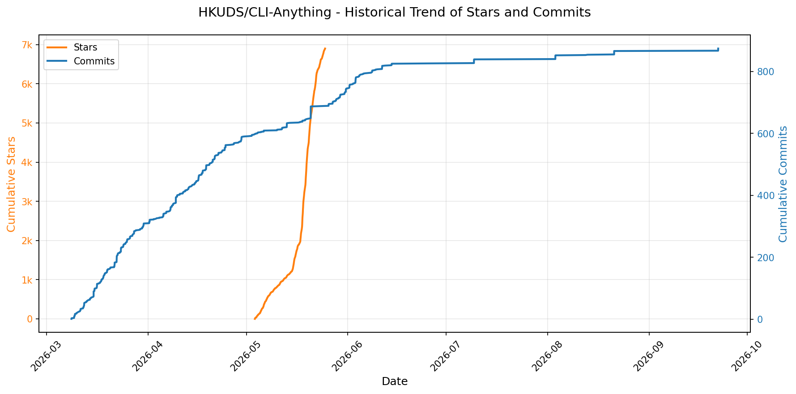

> *橙色：累计 Stars｜蓝色：累计 Commits（次 Y 轴）*

</details>

<details>
<summary><b>📄 README 摘要</b></summary>

## 1. 这个项目做什么？

**CLI-Anything** 的目标是把现有软件、代码库、桌面应用和内部工具封装成适合 AI 代理调用的“Agent-Native”命令行接口，让 Claude Code、Cursor、Pi、OpenClaw、Codex、OpenClaw、Nanobot 等代理能够像调用标准工具一样操作这些软件。

它并非只提供一个通用转换程序，而是由三部分组成：

1. **CLI Harness 生成器**
   - 用户将 CLI-Anything 插件或 Skill 安装到 AI 编码代理中。
   - 代理运行一个七阶段生成流程，为目标软件创建完整 CLI Harness。
   - 生成内容不仅包括命令入口，还包括面向代理的 `SKILL.md`、`HARNESS.md`、分阶段指南、REPL 支持、安装配置以及测试。
   - Harness 通常通过目标软件的原生 CLI、API、脚本接口或 MCP 进行操作。

2. **CLI-Hub 中央注册表及包管理器**
   - 用于浏览、搜索、安装、更新、卸载和运行社区生成的 CLI。
   - 除了 CLI-Anything 项目自身生成的 Harness，也支持安装第三方公共 CLI。
   - 支持 `pip`、`npm`、`brew`、系统自带或随项目捆绑等安装来源。

3. **CLI-Hub Meta-Skill**
   - 让兼容 SKILL 的代理自行在 CLI-Hub 中查找、评估并安装完成任务所需的 CLI。
   - 代理最终可以直接执行安装后的 CLI，而不必由用户手工选择工具。

典型使用流程是：AI 编码代理分析目标软件 → 生成 Agent-Native CLI → 测试和文档化 → 发布到 CLI-Hub → 用户或其他代理安装并调用。

## 2. 关键功能

### Agent-Native 命令行设计

- **结构化、可组合**：文本命令便于大模型理解、串联和构建复杂工作流。
- **自描述接口**：通过 `--help` 自动暴露命令、参数和用途，代理可以自行发现能力。
- **结构化输出**：同时支持 JSON 和人类可读输出，降低代理解析日志或表格的难度。
- **确定性执行**：相较于依赖视觉识别或自由格式 GUI 操作，CLI 更稳定、可预测、可重复。
- **轻量且通用**：尽量减少额外运行依赖，并能跨操作系统和软件部署方式使用。

### CLI-Hub 包管理与发现

CLI-Hub 提供统一命令：

- `cli-hub list`：浏览注册表
- `cli-hub search <query>`：按关键词搜索
- `cli-hub info <name>`：查看 CLI 详情
- `cli-hub install <name>`：安装
- `cli-hub update <name>`：更新
- `cli-hub uninstall <name>`：卸载
- `cli-hub launch <name> [args...]`：启动已安装 CLI

还提供 Web Hub、公开注册表元数据、安装量统计和远程 `skill_md` 支持。

### 代理自主发现和安装

- Meta-Skill 可通过以下方式全局安装：

  ```bash
  npx skills add HKUDS/CLI-Anything --skill cli-hub-meta-skill -g -y
  ```

- 安装后，代理可执行类似“到 CLI-Hub 找到合适的 CLI 并完成任务”的指令。
- 所有 CLI Skill 统一放在仓库顶层 `skills/` 目录，便于通过 `npx skills` 统一发现和安装。
- 已适配 OpenClaw、Nanobot、Claude Code、Codex、Reasonix、Antigravity 等 SKILL 兼容平台。

### 七阶段 Harness 生成流程

项目通过插件或 Skill 驱动 AI 编码代理完成 CLI 构造，流程包括目标分析、实现、验证及交付。文档体系采用渐进式披露设计：

- `HARNESS.md` 提供总体结构和渐进加载的上下文。
- 详细资料拆入 `guides/`，避免一次性向代理注入过多文档。
- 每个生成的 CLI 附带 AI 可发现的 `SKILL.md`。
- 支持 REPL 交互、自动执行、参数补全式帮助及技能路径提示。

### 预览、实时预览和轨迹闭环

演示中展示了代理使用生成 CLI 时的完整工作方式，包括：

- 预览即将产生的文件或结果
- 实时预览修改
- 根据执行轨迹继续修正
- 最终产出 CAD、3D 场景、流程图、游戏内容、字幕等实际制品

README 标注了 18 个应用演示。

### 广泛的软件生态

项目已合入或登记大量不同类型的 Harness，覆盖：

- **图形与设计**：GIMP、Blender、FreeCAD、Krita、Inkscape、Sketch
- **GIS 与工程**：QGIS、Unreal Insights、RenderDoc、UEAtelier
- **视频、音频与媒体**：Kdenlive、Shotcut、Openscreen、VideoCaptioner、MuseScore、Rekordbox、MiniMax
- **知识与文档**：Obsidian、Zotero、Joplin、Calibre
- **自动化与开发**：n8n、Dify、Exa、WireMock、Godot
- **云、监控和企业系统**：CloudAnalyzer、Zoom、IntelWatch、Teltonika RMS

部分项目仍在提议或登记阶段，实际成熟度可能不同。

### 质量、安全与跨平台支持

- README 报告 **2,461 个测试通过**，并覆盖单元测试、Smoke Test 和 E2E 测试。
- XML、SVG、ODF、MLT、MusicXML、CSL 等不可信输入使用 `defusedxml` 解析。
- 增加路径穿越、符号链接逃逸、URL 校验、DOM 清理等安全防护。
- 对 Rekordbox 等工具的数据库写入采用 SQLCipher 防护、写前备份和受控写入策略。
- 支持 Windows、macOS 和 Linux；Claude Code 在 Windows 下建议安装 Git Bash/`cygpath`，或使用 WSL。

### 社区协作

- 社区可提交新的 CLI Harness，也可以通过 Wishlist 请求支持特定软件。
- 提供中、英、日、德等多语言 README。
- 使用 Apache 2.0 许可证。

## 3. 技术栈

| 类别 | 技术与说明 |
|---|---|
| **核心语言** | Python 3.10+ |
| **CLI 框架** | Click 8.0+ |
| **测试框架** | pytest |
| **覆盖率与验证** | Coverage、单元测试、Smoke Test、端到端测试 |
| **输出格式** | JSON 与人类可读文本 |
| **代理文档标准** | `SKILL.md`、`HARNESS.md`、`guides/` 渐进式文档体系 |
| **交互方式** | Click CLI、REPL、`--help` 自描述接口、预览与执行轨迹 |
| **软件集成方式** | 目标软件原生 CLI、REST/API、Python 脚本代理、插件或 MCP；不同 Harness 的后端并不统一 |
| **包管理** | PyPI 包 `cli-anything-hub`，提供 `cli-hub` 命令 |
| **Skill 分发** | npm/npx `skills` 生态、GitHub 托管的插件市场及仓库级 Skill |
| **公共 CLI 来源** | 支持 pip、npm、Homebrew、系统工具及捆绑工具 |
| **代理平台集成** | Claude Code、Cursor、Pi Coding Agent、OpenClaw、OpenCode、Codex、Hermes、Reasonix、Qodercli、GitHub Copilot CLI 等 |
| **安全组件** | `defusedxml`、路径规范化、符号链接检查、DOM/URL 清理、受控数据库写入 |
| **项目交付** | GitHub 仓库、Web CLI-Hub、PyPI 发布流水线、插件市场、Apache 2.0 License |

CLI-Hub 本身提供 Web 前端，但 README 未说明其具体前端框架；核心生成器和包管理器则明确以 **Python + Click** 为主。

</details>

---

### 14. [Nutlope/hallmark](https://github.com/Nutlope/hallmark)
- 📅 **创建日期**：2026-04-27  
- 🔄 **最近更新**：2026-11-24  
- ⭐ **Stars**：4,289（日 +0｜周 +0｜月 +0）  
- 📝 **描述**：Anti-AI-slop design skill for Claude Code, Cursor, and Codex.  

<details>
<summary><b>📈 Star 与 Commit 历史趋势</b></summary>


> *橙色：累计 Stars｜蓝色：累计 Commits（次 Y 轴）*

</details>

<details>
<summary><b>📄 README 摘要</b></summary>

## 1. 项目用途

**Hallmark 是一套面向 AI 编程助手的网页设计 Skill**，可用于 Claude Code、Codex CLI、Cursor、OpenCode 等工具。它的目标不是简单生成“看起来像 AI”的页面，而是根据产品、用户任务和真实业务内容，设计出具有明确视觉方向、可用且不模板化的网站。

主要工作模式包括：

- **从提示词新建网站**：根据用户目标创建完整页面。
- **使用真实产品作为依据**：指向一个 URL、开发服务器或现有应用，Hallmark 会自行截取页面截图作为设计素材。
- **重设计现有页面**：保留原有内容和功能连接，重新设计视觉系统与布局。
- **只审计现有页面**：识别常见的 AI 味设计问题并输出报告，不直接修改页面。
- **自定义设计**：不套用预设主题，仅依据项目约束和简短方向，从零发展独特方案。

Hallmark 的核心原则是：

1. 先确定页面要完成的业务任务，例如预约、商品购买、订阅或记录核对。
2. 再围绕任务组织信息结构、行动入口和页面结尾。
3. 使用主题提供视觉“材料”，而不是直接复制固定页面模板。
4. 通过静态规则、真实浏览器渲染和独立审阅共同把关。
5. 不编造事实、截图、产品数据或表单反馈。

生成结果通常是**自包含的 HTML 和 CSS 页面**，并在首个 CSS 注释中标明本次设计做出的关键决策。

---

## 2. 核心功能

### 2.1 五十套主题系统

- 内置 **50 种主题**。
- 主题不是固定页面方案，而是一套完整的视觉“材料”，包括：
  - 字体与排版风格
  - 配色
  - 表面、纹理和组件样式
  - 与该风格匹配的成品页面示例
- 每套主题位于一个独立文件中，单个文件不超过 **8 KB**，旁边配有参考图片。
- 构建时只读取一套主题，不会把多套风格混在一起。
- 主题系统会先从目录中提供三套适合当前提示词的主题，再根据页面任务推导页面结构。
- README 展示的主题示例包括 Dusk、Cobalt、Studio、Atelier、Ribbon、Furrow、Dose、Refract、Vantage 和 Hedgerow。

同一主题可以生成结构完全不同的页面，因为主题只决定视觉语言，不规定页面必须包含哪些内容或采用什么顺序。

### 2.2 自定义模式

在提示词中指定 **custom** 后，Hallmark 会移除预设主题、组件方案和调色板配方，仅保留：

- 强制质量底线
- 各类检查规则
- `direction.md` 中的简短设计方向

这种方式用于从客户自身需求中发展专属于该项目的视觉创意。

### 2.3 从业务任务构建页面

Hallmark 不只是制作视觉上漂亮但用途模糊的落地页，而是先识别页面的主要任务：

- 预约页面应真正提供预约能力。
- 商店页面应突出商品和销售行为。
- 新闻订阅页面应包含有效订阅流程。
- 主要行动会放在该类页面最自然的位置，而不是机械地放在页尾。
- 页面结尾应服务于用户真正要完成的动作，避免每页都附加泛化的邮件订阅模块。

### 2.4 分层质量门禁

检查规则分为三层：

- **Floor（底线）**  
  属于不可发布问题，包括：
  - 颜色对比度不足
  - 键盘焦点状态缺失
  - 未处理减少动态效果偏好
  - 编造事实或业务数据
  - 手机端布局损坏  
  这类问题会阻止最终交付。

- **Reflex（模型惯性）**  
  针对 AI 经常无意识采用的默认模式。若设计有充分理由，可以记录理由后覆盖该规则。

- **Finish（完成度）**  
  检查排版、间距、组件和交互等工艺细节，但不会阻止项目发布。

### 2.5 “AI 味”专项检查

Hallmark 会在真实浏览器中检查容易被识别为机器生成的视觉模式，包括：

- 每个标题上方都出现 eyebrow 小标题
- 大量使用增加字距的全大写标签
- 标题中只给一个单词使用强调色
- 页面由空框架或纯照片堆叠组成
- Hero 区域没有正确适配屏幕
- 每页结尾都放置邮件订阅
- 表单只显示“谢谢”，实际并未提交
- 整体使用通用模板式布局和装饰

除了自动检查，还会由具有新鲜上下文的子代理或审阅者进行最终判断，避免生成过程本身形成思维盲区。

### 2.6 标准化构建流程

完整构建大致遵循以下流程：

1. **预检项目**
   - 读取字体、配色、框架和可能已锁定的 `design.md`。
   - 一次性请求照片、截图和真实业务数字等素材。
   - 禁止自行发明事实。

2. **选择主题并规划页面**
   - `theme.mjs deal` 提供三套符合提示词且通过日志检查的主题。
   - `draw` 根据页面的实际任务推导页面结构。

3. **先完成 Hero**
   - Hero 单独构建、渲染并在冷启动状态下接受审阅。
   - Hero 通过后，才继续完成其余页面。

4. **浏览器质量检查**
   - `sloplint.mjs --render` 在八种宽度下渲染和检查页面。
   - 再由独立审阅者从全新视角复核。

### 2.7 重设计与审计

支持以下命令：

```bash
/hallmark redesign ./src/app
/hallmark audit ./index.html
```

重设计模式提供三种不同范围：

- **完整重设计**：保留内容和功能连接，改变视觉系统与页面布局。
- **keep the layout**：保留布局，仅更新视觉风格。
- **polish**：只修复明显的 AI 味设计问题。

完整性保护机制包括：

- `sloplint --before` 在修改前记录所有链接、表单字段、事件处理器和标题。
- `sloplint --kept` 检查重设计后是否遗漏这些元素；如有缺失则判定失败。
- 最终交付附带修改前后的并排对比。

### 2.8 真实截图与开放授权照片

- 可将 Hallmark 指向真实 URL、开发服务器或应用，由工具自行捕获截图。
- 内置照片元数据目录包含 **755 张开放授权照片**。
- 照片位于 Wikimedia Commons，并根据主题或主体进行选择。
- 每张图片保留独立的 CC0、公共领域、CC BY 或 CC BY-SA 许可信息。
- 页面中会为使用的照片提供署名。
- 项目不包含图片文件，只保存照片索引和许可信息。
- 不使用 Unsplash、Pexels、Pixabay 等禁止 AI 工具自动选图的图库。

### 2.9 安装与多工具支持

全局安装：

```bash
npx skills add nutlope/hallmark -g
```

- 去掉 `-g` 可仅安装到当前项目。
- 可通过 `--agent` 只安装给单一工具，如 `claude-code`、`codex`、`opencode`、`cursor` 或 `github-copilot`。
- 可作为 Claude Code 插件安装：

```bash
/plugin marketplace add nutlope/hallmark
/plugin install hallmark@hallmark
```

- 支持直接从仓库克隆后运行：

```bash
node skills/hallmark/scripts/install.mjs
```

安装脚本会先验证所有主题和参考文件。

### 2.10 许可

项目采用 **MIT License**，允许使用、修改和发布。

---

## 3. 技术栈

### 核心形态

- **类型**：面向 AI 编程助手的跨工具设计 Skill／插件，而非独立 Web 应用或后端服务。
- **支持的宿主工具**：
  - Claude Code
  - Codex CLI
  - Cursor
  - OpenCode
  - GitHub Copilot
- **Claude Code 集成**：
  - 可作为普通 Skill 使用。
  - 也支持 Marketplace 插件形式。
  - `install-hook.mjs` 可添加编辑阶段的 Floor 检查钩子。

### 运行环境与脚本

- **Node.js 18 或更高版本**。
- 工具脚本主要使用 **JavaScript ES Modules（`.mjs`）**。
- 主要脚本包括：
  - `theme.mjs`：主题选择与页面结构推导。
  - `sloplint.mjs`：静态检查、浏览器渲染、多尺寸检查及重设计完整性验证。
  - `install.mjs`：安装与主题、参考文件校验。
  - `install-hook.mjs`：Claude Code 编辑时钩子。

### 前端输出

- 主要输出为**自包含 HTML 和 CSS**。
- 页面可独立交付，也能与现有项目的字体、配色、框架及交互逻辑结合。
- 重设计时需要保留既有链接、表单字段、事件处理器和标题等 wiring。

### 浏览器自动化与截图

- **Puppeteer Core**。
- 本机安装的 **Google Chrome**。
- 用于：
  - 渲染页面
  - 捕获截图
  - 在八种视口宽度下执行响应式检查
  - 检查 Hero 和完整页面的视觉表现
- Puppeteer Core 与 Chrome 属于浏览器检查的可选依赖；未安装时仍可运行静态检查。

### 资源与内容管理

- 主题定义：`skills/hallmark/references/themes/`。
- 自定义设计方向：`references/direction.md`。
- 照片索引：`skills/hallmark/scripts/photos.json`。
- 图片由 Wikimedia Commons 托管，仓库内不保存原始图片文件。
- README 未显示 Hallmark 依赖某个特定前端框架；它能够读取并适配项目现有框架，也能够直接输出静态 HTML/CSS。

</details>

---

### 15. [Tracer-Cloud/opensre](https://github.com/Tracer-Cloud/opensre)
- 📅 **创建日期**：2026-01-13  
- 🔄 **最近更新**：2026-11-24  
- ⭐ **Stars**：3,378（日 +0｜周 +0｜月 +0）  
- 📝 **描述**：The open-source agent for CI/CD reliability.  

<details>
<summary><b>📈 Star 与 Commit 历史趋势</b></summary>

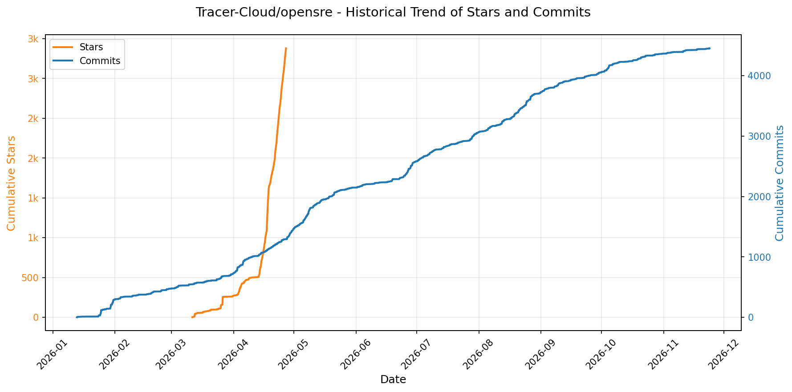

> *橙色：累计 Stars｜蓝色：累计 Commits（次 Y 轴）*

</details>

<details>
<summary><b>📄 README 摘要</b></summary>

## 1. 项目做什么

OpenSRE 是一个开源的 **CI/CD 可靠性与生产事故调查智能体**，目前处于 **Public Alpha** 阶段，采用 Apache 2.0 许可证。

它的核心目标是解决传统 CI 只报告“构建失败”，却无法说明原因和修复方式的问题：

- 读取失败的 CI 检查、构建日志及代码仓库上下文。
- 关联近期提交、部署记录、日志、指标和链路追踪信息。
- 通过工具调用循环验证故障假设，判断问题究竟来自 CI、环境、配置还是代码本身。
- 定位根因后直接修改代码，并将修复提交到 PR 分支供开发者审核，而不是简单地重新运行流水线。
- 如果无法自动修复，则给出有证据支撑的结论和下一步操作建议。
- 在生产事故场景中，也可以根据自然语言描述或告警自动调查日志、指标、Pod 状态、部署历史等信息，并执行可选的补救操作。

项目不仅用于修复失败的 CI，还用于量化 CI 的业务成本，例如失败率、不可靠构建造成的开发者工时损失，以及主分支保持失败状态的时长，让团队获得更一致、接近资深工程师深度的故障分析能力。

## 2. 关键功能

- **端到端 CI 故障调查**
  - 自动获取失败检查、CI 日志、近期提交与部署信息。
  - 跨监控系统关联日志、指标、分布式追踪和基础设施状态。
  - 区分“CI 自身导致的失败”和“业务代码导致的失败”，避免修错方向。

- **自动修复与人工审核**
  - 找到根因后可直接修改代码。
  - 将修复推送到 PR 分支，由开发者审查。
  - 无法安全自动修复时，提供证据链接、修复建议或后续排查步骤。

- **多种使用入口**
  - **交互式 CLI/REPL：**在终端中使用自然语言描述问题，实时查看智能体执行过程。
  - **无头 CLI：**通过 `opensre ask "..."` 在脚本或 CI Job 中执行单轮任务，支持标准输入、JSON 输出和工具审批。
  - **嵌入式 Python API：**可直接在现有 Python 服务或自动化程序中创建会话并调用智能体。
  - **Web 管理端：**用于身份认证、组织管理和托管网关配置。

- **会话与运行控制**
  - REPL 支持 `/help`、`/status`、`/cost`、`/sessions`、`/resume`、`/compact`、`/new`、`/exit`。
  - 支持 `/integrations list` 和 `/integrations verify` 检查集成状态。
  - `Ctrl+C` 可以取消当前执行，同时保留会话状态。

- **生产事故响应**
  - 支持通过交互式终端或告警路由触发调查。
  - 可检查日志、指标、追踪、Pod 状态、部署历史和告警上下文。
  - 可选择执行补救操作，并将事故摘要发送到 Slack、PagerDuty 或 Telegram。

- **CI/CD 可靠性度量**
  - 统计失败率。
  - 估算不可靠 CI 消耗的开发者时间。
  - 衡量主分支持续处于失败状态的时间。
  - 帮助团队识别 flaky checks 和长期影响交付效率的问题。

- **60+ 工具与服务集成**
  - **LLM：**Anthropic、OpenAI、OpenAI Codex、Ollama、Gemini、OpenRouter、TrustedRouter、NVIDIA NIM、Bedrock。
  - **可观测性：**Grafana Loki/Mimir/Tempo、Datadog、CloudWatch、Sentry、Elasticsearch、Splunk、OpenSearch、New Relic 等。
  - **基础设施：**Kubernetes、AWS S3/Lambda/EKS/EC2/CloudTrail、Azure、ArgoCD、Helm。
  - **数据库：**PostgreSQL、MySQL、MariaDB、MongoDB、ClickHouse、Redis、Snowflake、Supabase 等。
  - **数据平台：**Apache Kafka、Airflow、RabbitMQ、Dagster、Temporal、Prefect。
  - **开发工具：**GitHub、GitHub MCP、Bitbucket、GitLab、Jenkins。
  - **事故管理：**PagerDuty、Jira、Alertmanager、incident.io、ServiceNow；Trello 目前仅提供客户端辅助功能。
  - **通信：**Slack、Telegram、Discord、Rocket.Chat、WhatsApp、Buzz、Google Docs。
  - **协议：**MCP。

- **部署方式灵活**
  - OpenSRE Cloud 托管网关。
  - AWS EC2 AMI 加 systemd 的网关部署，不依赖 Docker；当前重点支持 Telegram 网关。
  - 使用仓库中的 `Dockerfile` 自托管，可部署到 Railway、ECS、Vercel 等环境。
  - 网关需要跨实例共享状态时，可使用 PostgreSQL 和 `DATABASE_URL`。

- **隐私与模型选择**
  - 可在调用外部 LLM 前对日志中的敏感标识符进行脱敏。
  - 支持自托管基础设施，并可选择组织自己的模型或兼容的模型提供商。
  - 输出附带证据链接，便于审核智能体的判断依据。

- **工程质量保障**
  - 使用真实、云端支持的端到端场景验证完整工作流。
  - 测试目录采用语义化命名，明确区分端到端测试、单元测试、本地环境和云环境边界。
  - 项目仍在快速迭代，API 和集成方式可能发生变化。

## 3. 技术栈

| 技术层 | 使用的技术或实现方式 |
|---|---|
| 核心语言 | **Python**；仓库入口包括 `main.py`，并提供 `surfaces.embedded` 嵌入式 Python API |
| 用户界面 | 终端 CLI、TTY 交互式 REPL、无头命令行模式，以及用于认证和管理的 Web 应用 |
| 智能体架构 | 代码级工具调用循环；支持多轮会话、假设验证和证据收集；旧有 graph/chain 框架层已移除 |
| 模型层 | 提供商无关的 LLM 抽象，支持 Anthropic、OpenAI、OpenAI Codex、Gemini、Ollama、Bedrock、NVIDIA NIM、OpenRouter 等 |
| 外部协议 | MCP、GitHub MCP，以及各云平台、可观测性平台和事故管理系统提供的 API/SDK |
| 运行时与打包 | 跨平台 CLI 安装脚本；macOS/Linux 使用 Shell，Windows 使用 PowerShell；可获取 `main` 分支最新构建且无需 sudo |
| 容器化 | 仓库提供 `Dockerfile`，支持 Railway、ECS、Vercel 等容器环境 |
| 网关与基础设施 | AWS EC2 AMI、systemd、Telegram Gateway；也支持 OpenSRE Cloud 托管网关 |
| 数据与状态 | 可选 PostgreSQL；`DATABASE_URL` 用于 Slack Events API 多副本等需要共享状态的场景 |
| 可观测性生态 | Grafana、Datadog、CloudWatch、Elasticsearch、OpenSearch、Splunk、Sentry、Loki、Mimir、Tempo 等 |
| 云原生生态 | Kubernetes、EKS、AWS、Azure、ArgoCD、Helm |
| 数据与消息生态 | PostgreSQL、MySQL、MariaDB、MongoDB、ClickHouse、Redis、Snowflake、Kafka、RabbitMQ、Airflow、Temporal 等 |
| 外部服务交互 | Slack、PagerDuty、Telegram、Discord、GitHub、GitLab、Bitbucket、Jenkins 等 |
| 测试体系 | 单元测试、云端支持的端到端测试和语义化测试目录；README 未明确披露具体测试框架或 Web 前端框架 |

</details>

---

### 16. [cursor/plugins](https://github.com/cursor/plugins)
- 📅 **创建日期**：2026-01-23  
- 🔄 **最近更新**：2026-11-24  
- ⭐ **Stars**：1,619（日 +0｜周 +0｜月 +0）  
- 📝 **描述**：Cursor plugin specification and official plugins  

<details>
<summary><b>📈 Star 与 Commit 历史趋势</b></summary>

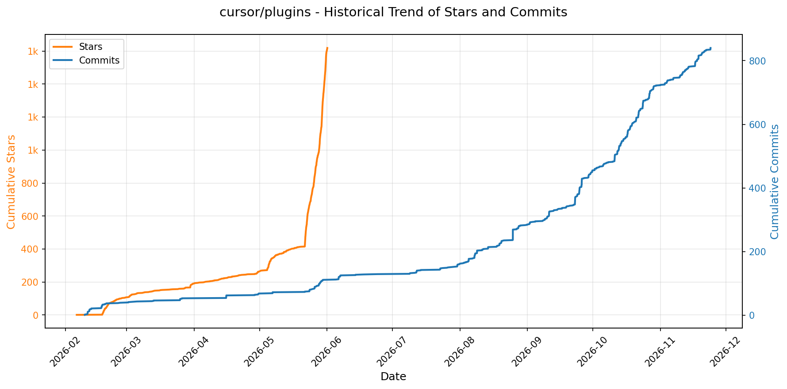

> *橙色：累计 Stars｜蓝色：累计 Commits（次 Y 轴）*

</details>

<details>
<summary><b>📄 README 摘要</b></summary>

## 1. 项目做什么

- 这是一个面向 **Cursor** 的官方插件集合/插件目录，为 Cursor AI 智能体扩展开发工作流、第三方工具及 SaaS 服务能力。
- 仓库采用**插件化、多目录结构**：每个插件都是仓库根目录下的独立目录，并通过 `.cursor/plugin/plugin.json` 清单文件描述名称、作者、分类、描述等信息。
- 项目主要服务于以下场景：
  - 改进编码、测试、代码审查、发布和持续集成流程。
  - 使用多个云端或本地智能体并行处理大型任务。
  - 让 Cursor 访问 GitHub、Google Workspace、Salesforce、HubSpot 等外部服务。
  - 自动执行搜索、查询、创建、更新、报告生成和业务自动化操作。
  - 通过 SDK、API、CLI、MCP 等方式扩展 Cursor，并支持开发新的 Cursor 插件。

## 2. 关键功能

### AI 研发与智能体编排

- **Teaching**：提供技能映射、练习计划和学習复盘。
- **Continual Learning**：根据会话记录增量更新 `AGENTS.md`，仅保留高信号、可执行的要点。
- **Cursor Team Kit**：覆盖 CI、代码审查、发布、本地自动化和结果验证等团队流程。
- **Thermos**：执行严格的安全性、正确性和代码质量审计，可使用并行子智能体、任务编排及可合并 PR 流程。
- **Ralph Loop**：使用 “Ralph Wiggum” 模式运行迭代式、自引用 AI 循环。
- **Orchestrate**：将大型任务拆分给规划器、工作智能体和验证器，并通过结构化交接协同完成。
- **Advisor**：在重大决策、遇到阻塞或宣布完成前，咨询更强的模型进行复核。
- **pstack / dyl-stack**：强调少而精的代码、严格且可并行的智能体工作流、根因分析、简洁交付和 PR 审查；`dyl-stack` 还包含 Figma 到 UI 的视觉评审能力。

### 插件开发与扩展

- **Create Plugin**：用于创建和验证新的智能体插件。
- **Cursor SDK**：通过 TypeScript SDK 构建应用、脚本和自动化流程。
- **Origin Apps**：面向 Cursor Origin API 开发，强调先获取实时规范，并处理凭据、权限范围、Webhook、分页和错误；还提供将现有 GitHub App 迁移到 Origin 的规划能力。
- **CLI for Agents**：总结面向编码智能体的 CLI 设计模式，包括明确参数、带示例的帮助信息、管道支持、错误处理、幂等性和 dry-run。

### 审查、兼容性与可视化

- **PR Review Canvas**：将 PR Diff 按重要性分组，以审查画布形式展示。
- **Docs Canvas**：将文档渲染为可导航画布。
- **Agent Compatibility**：通过 CLI 扫描代码仓库兼容性，并由智能体核对启动流程、校验逻辑和文档是否与实际实现一致。
- **Excalidraw**：在对话中生成并导出手绘风格图表。
- **Playwright**：驱动真实浏览器完成导航、点击、截图和端到端测试。

### 外部 SaaS 与业务系统集成

插件目录覆盖了大量第三方服务，主要包括：

- **代码与开发者工具**：GitHub、Google Cloud BigQuery、Databricks Genie、Statsig。
- **办公与生产力**：Gmail、Google Drive、Google Calendar、Google Docs、Google Sheets、Google Slides、Microsoft Teams、SharePoint、Todoist、Calendly。
- **CRM、销售与客服**：Salesforce、HubSpot、Gong、Intercom、Attio、Zoho CRM、Zoho Desk、HighLevel。
- **营销、广告与分析**：Google Ads、Google Analytics、Google Search Console、X Ads、Meta Ads、TikTok for Business、Semrush、Ahrefs、Similarweb、Meltwater。
- **招聘与人才**：Ashby、Workable、Workday、Juicebox、Outreach、Amplemarket、Upwork。
- **文档、知识库与会议**：Coda、Guru、Fireflies、Otter.ai、Fathom、Craft、Mem、Readwise、Smartsheet、Wrike。
- **企业系统与合规**：SAP S/4HANA Cloud、Microsoft Dynamics 365 Business Central、Square、ServiceNow、Vanta、Rippling、Gusto。
- **金融与交易**：QuickBooks、Xero、Brex、Navan、Finary、OnePay、Webull、Robinhood、Coinbase、eToro、Interactive Brokers、S&P Global、Daloopa、PitchBook。
- **通信与协作**：Zoom、WhatsApp Business、Lark、飞书、RingCentral、X、Tailscale。
- **电商及其他服务**：Shopify、Google Cloud、Gopuff 等。

这些插件通常支持搜索、读取、创建、编辑、查询、报告生成、预览变更或触发工作流等操作。

### 语音、数据与跨平台能力

- **Grok Voice** 支持实时语音对话、语音转文字、文字转语音，以及基于日志的语音会话修复循环。
- 数据类插件可查询 BigQuery、Databricks、GA4、Statsig 等数据源。
- Tailscale 插件允许智能体访问私有 Tailnet 中的 MCP 服务。
- Gopuff 通过官方 MCP 服务完成搜索、购物车和下单操作。

### 安全与可靠性机制

- 在 Origin API 等集成中明确处理凭据、权限范围、Webhook、分页和错误。
- CLI 插件强调幂等执行、dry-run 和结构化错误信息。
- 广告及金融交易类插件普遍提供预览步骤；部分交易、车辆命令等操作要求用户确认。
- 兼容性插件会检查启动、参数校验和文档是否与仓库真实行为一致。

## 3. 技术栈

| 技术层 | 内容 |
|---|---|
| 平台 | Cursor 插件体系、Cursor AI 智能体、Skills、Agent/Subagent 工作流 |
| 插件结构 | 每个插件一个独立目录，使用 `.cursor/plugin/plugin.json` 作为清单文件 |
| 编程语言 | 明确提及 **TypeScript**，主要用于 Cursor SDK；README 未说明其他插件是否也使用 TypeScript |
| 开发接口 | Cursor SDK、Cursor Origin API、各 SaaS 的 API、MCP 服务和 CLI |
| 浏览器自动化 | Playwright |
| 数据查询 | Google Cloud BigQuery SQL、Databricks Genie、GA4、Statsig 等数据服务 |
| 研发集成 | GitHub、CI、PR Diff、代码审查、仓库兼容性扫描 |
| 外部系统 | Google Workspace、Microsoft 365、Salesforce、HubSpot、GitHub、QuickBooks、SAP、Workday、Shopify 等 |
| 自动化形态 | 智能体规划、并行执行、结构化交接、验证器、Webhook、幂等任务、定时或批处理流程 |

README 片段没有提供该仓库整体使用的包管理器、Node.js 版本、构建工具、测试框架、容器化方式或 CI/CD 技术，因此无法进一步确认这些工程细节。

</details>

---

### 17. [heygen-com/hyperframes](https://github.com/heygen-com/hyperframes)
- 📅 **创建日期**：2026-03-10  
- 🔄 **最近更新**：2026-11-24  
- ⭐ **Stars**：700（日 +0｜周 +0｜月 +0）  
- 📝 **描述**：Open-source AI video editor: edit your own footage, or create and remake any video with Claude Code, Codex or the free Studio app. Write HTML, render MP4. By HeyGen.  

<details>
<summary><b>📈 Star 与 Commit 历史趋势</b></summary>

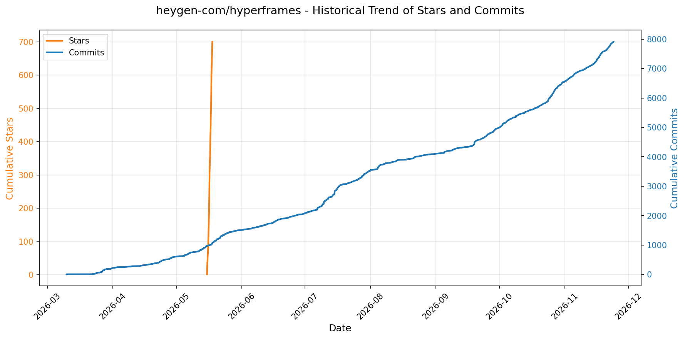

> *橙色：累计 Stars｜蓝色：累计 Commits（次 Y 轴）*

</details>

<details>
<summary><b>📄 README 摘要</b></summary>

## 1. 项目是做什么的？

**HyperFrames 是 HeyGen 推出的开源 AI 视频编辑器兼视频渲染框架**，主要面向普通创作者和 AI 编程代理。

它分为两个核心形态：

- **HyperFrames Studio 桌面应用**
  - 无需编程，通过文字描述、导入素材或参考视频生成视频。
  - 生成的不是扁平化成片，而是一个可以继续修改的真实项目。
  - 支持 Mac、Windows 和 Linux。
  - 用户可以修改标题大小、剪辑速度、字幕、旁白等具体内容，代理也能只修改指定元素，而不是重做整条视频。

- **HyperFrames 开源框架**
  - 使用 Apache 2.0 许可证。
  - 将 **HTML、CSS、JavaScript、媒体素材和可定位（seekable）的动画**转换成确定性的 MP4 视频。
  - 可通过 CLI 在本地运行，也可接入 Claude Code、Codex、Cursor 等 AI 编程代理。
  - 还能作为托管视频创作、自动化内容流水线或云端渲染服务的底层渲染核心。
  - 不强制使用 React。

典型工作流是：**描述需求或导入素材 → 生成可编辑项目 → 精确修改脚本、字幕、布局、动画和素材 → 浏览器预览 → 渲染 MP4 → 分享审阅**。

项目提供三种使用方式：

1. **Studio 应用**：适合不写代码的普通用户。
2. **AI 编程代理**：适合 Claude Code、Codex、Cursor、Gemini CLI 等。
3. **聊天式创建（Beta）**：通过 MCP/连接器在 Claude、ChatGPT、Grok 等聊天界面中生成视频；ChatGPT 侧面向 Business、Enterprise 和 Edu 工作区。

---

## 2. 核心功能

### AI 视频创作与精细编辑

- 根据自然语言描述生成完整视频项目。
- 可以导入自己的手机拍摄素材、录屏、旁白、图片和音频。
- 可以参考或复刻喜欢的视频，再将内容修改为自己的版本。
- 支持直接编辑脚本，让视频内容随脚本变化。
- 支持针对单个元素下达指令，例如：
  - 放大标题；
  - 加快剪辑节奏；
  - 替换或添加字幕；
  - 只修改某一处动画或素材。
- 输出可继续编辑的项目，而非只能重新导出的固定视频。

### 多来源内容导入

项目可以从多种来源开始创作：

- 产品网站 URL；
- 文档和网站链接；
- 屏幕录制；
- 手机拍摄素材；
- 多机位播客录像；
- Figma 文件；
- Remotion 项目；
- Pull Request 和代码变更；
- 主题、脚本或旁白文本；
- 已有参考视频。

### 丰富的视频类型

可用于制作：

- TikTok、Instagram 品牌 UGC 视频；
- 带动态字幕、叠加文字和音乐的社交媒体视频；
- 视频播客和多机位访谈；
- 产品演示、教程、功能公告和发布视频；
- 无真人出镜的 YouTube 讲解视频；
- 科普、解释型动画和动态图表；
- 图表竞速和地图动画；
- PR 演示、Changelog 视频和代码差异动画；
- 文档转视频、站点导览；
- 基于代码的动态图形；
- 带演讲者模式的演示文稿；
- Figma 动画；
- 从 Remotion 迁移过来的项目；
- 3D 字体、生成式动态设计和单镜头预告片。

### 面向 AI 代理的 Skills 工作流

HyperFrames 提供 9 个 Skills，使代理能够按照标准化制作流程工作：

1. 规划视频；
2. 编写有效的 HTML；
3. 构建可定位动画；
4. 接入媒体素材；
5. 执行代码检查；
6. 浏览器预览；
7. 渲染视频。

主要技能包括：

- `/hyperframes`：核心视频制作规范与参考；
- `/style-sampling`：复用已验证的系列视频风格；
- `/reverse-any-video`：复刻并改造已有视频；
- `/slideshow`：创建带演讲者模式的幻灯片；
- `/figma`：将 Figma 设计转成动画；
- `/remotion-to-hyperframes`：迁移 Remotion 项目。

Skills 可安装到 Claude Code、Codex、Cursor、Gemini CLI、Copilot、VS Code、OpenCode、IBM Bob 等代理环境中。还提供社区 Skills，例如 3D 字幕、拼贴式讲解、手写绘制动画、实时编码音乐视频和并列梗图等。

### CLI 预览、渲染与云端部署

开发者可以直接使用：

```bash
npx hyperframes init my-video
cd my-video
npx hyperframes preview
npx hyperframes render
```

其中：

- `preview` 在浏览器中实时预览；
- `render` 输出 MP4；
- `hyperframes cloud render` 使用云端渲染；
- 支持部署到 AWS Lambda；
- 本地官方运行要求为 **Node.js 22+ 和 FFmpeg**。

代理安装可使用：

```bash
npx skills add heygen-com/hyperframes
# 或
npx hyperframes skills update
```

### 分享与审阅

- 使用 `npx hyperframes auth login` 登录。
- 通过 `npx hyperframes share` 创建审阅链接并设置访问权限。
- `share --update` 可在编辑后生成新版本。
- `share --manage` 用于管理网页端共享设置。
- CLI 和桌面端使用同一套分享系统。
- 每个工作区提供 5 个免费共享项目。

### 可复用组件与扩展能力

- 提供可复用的内容模块 Catalog。
- 包含数据图表、地图等视频积木。
- 支持代码驱动的动态图形，便于接入自动化视频生产流水线。
- 支持导入现有 Remotion 项目以及从 Figma 生成动画。
- 社区可维护自己的 Skills，扩充字幕、视觉风格和自动化工作流。

### 产品版本

- Studio 提供免费方案。
- Pro 方案为每月 25 美元，增加 25,000 credits，并可使用 HeyGen Video 1、Seedance 2.5、Lyria 3 Pro 等视频、图片、声音和音乐模型。
- 底层框架本身免费且开源，采用 Apache 2.0 许可证。

---

## 3. 技术栈

| 类别 | 技术/工具 | 用途 |
|---|---|---|
| 核心创作语言 | HTML、CSS、JavaScript | 定义视频画面、布局、交互式内容和动画时间线 |
| 动画模型 | 可定位动画（seekable animations） | 支持跳转到任意时间点并进行精确编辑，而非只能实时录制 |
| 媒体支持 | 视频、图片、音频等媒体资源 | 导入并混合用户素材及生成内容 |
| 输出格式 | 确定性 MP4 | 标准化、可重复地生成最终视频 |
| 本地运行环境 | Node.js 22+ | 运行 HyperFrames CLI、初始化项目和调用 Skills |
| 包管理与 CLI | npm / `npx` | 使用 `hyperframes` npm 包和命令行工具 |
| 视频处理 | FFmpeg | 本地媒体处理和 MP4 渲染 |
| 预览方式 | 浏览器实时预览 | 在渲染前检查画面和动画 |
| 云端渲染 | HyperFrames Cloud、AWS Lambda | 在云端或无状态基础设施上执行渲染 |
| AI 代理集成 | Skills、Claude Code Plugin、MCP/连接器 | 对接 Claude Code、Codex、Cursor、Gemini CLI、Copilot、ChatGPT、Grok 等 |
| 外部工作流集成 | Remotion、Figma、AWS Lambda、GitHub PR | 迁移项目、从设计生成动画、部署渲染任务、生成代码变更视频 |
| 桌面端支持 | macOS、Windows、Linux | 提供 Studio 图形化编辑和分享能力 |
| 开源许可 | Apache 2.0 | 支持免费使用、修改和二次开发 |
| 前端框架要求 | 无需 React | 核心框架可直接使用原生 Web 技术构建 |

README 没有披露 Studio 桌面应用的具体 UI 框架，也没有明确指定底层浏览器渲染引擎，因此不能据此确认其是否使用 Electron、React 或 Chromium 等具体实现。

</details>

---

