# 🌟 GitHub Trending 概览

> 数据更新于：2026-07-06

---

## 🔍 项目详情

### 1. [anthropics/claude-code](https://github.com/anthropics/claude-code)
- 📅 **创建日期**：2025-02-22  
- 🔄 **最近更新**：2026-07-06  
- ⭐ **Stars**：193,160（日 +229｜周 +1588｜月 +6370）  
- 📝 **描述**：Claude Code is an agentic coding tool that lives in your terminal, understands your codebase, and helps you code faster by executing routine tasks, explaining complex code, and handling git workflows - all through natural language commands.  

<b>📈 Star 与 Commit 历史趋势</b>

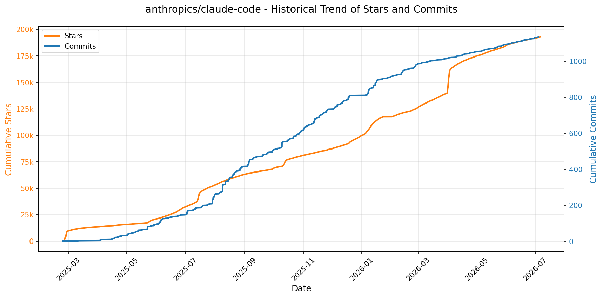

> *蓝色：累计 Stars｜橙色：累计 Commits（次 Y 轴）*

<b>📄 README 摘要</b>

1. **该项目做什么？**  
Claude Code 是一款终端原生的智能编程助手，以“代理式”（agentic）方式运行，能够深度理解用户本地代码库，通过自然语言指令完成日常开发任务。其核心能力包括：自动执行重复性编码操作（如生成/修改代码）、解释复杂代码逻辑、自动化处理 Git 工作流（如提交、分支管理、冲突分析等），并支持在终端、IDE 或 GitHub 中（通过 `@claude` 提及）直接调用。

2. **关键特性**  
- **上下文感知代码理解**：基于本地代码库进行语义分析，提供精准、上下文相关的响应；  
- **自然语言驱动开发**：无需编写脚本，仅用日常语言即可完成编码、调试、文档生成等任务；  
- **全栈 Git 集成**：支持自然语言描述完成 `git commit`、`git rebase`、`git diff` 解释、PR 描述生成等；  
- **插件扩展架构**：内置可插拔机制，允许开发者通过官方插件目录添加自定义命令与专用智能体（agents）；  
- **多平台一键安装**：提供面向 macOS/Linux 的 `curl` 安装脚本、Homebrew 支持，以及面向 Windows 的 PowerShell 脚本和 WinGet 包管理器支持；  
- **内建反馈闭环**：集成 `/bug` 命令，支持在工具内部直接上报问题并附带会话上下文与操作日志。

3. **技术栈**  
- **运行时环境**：Node.js 18+（官方明确要求）；  
- **客户端架构**：终端原生 CLI 应用（非 Web 前端），深度集成系统 Shell 与 Git CLI；  
- **部署分发**：跨平台二进制分发（通过 shell/PowerShell 脚本下载预编译可执行文件），辅以 Homebrew / WinGet / npm（已弃用）等包管理渠道；  
- **后端依赖**：底层调用 Anthropic 的 Claude 大模型 API（具体模型版本未公开，但强调针对代码场景优化）；  
- **数据安全层**：本地会话数据最小化采集，敏感信息设定严格保留期限，明确禁止将用户代码或对话用于模型再训练。

---

### 2. [iptv-org/iptv](https://github.com/iptv-org/iptv)
- 📅 **创建日期**：2018-11-14  
- 🔄 **最近更新**：2026-07-06  
- ⭐ **Stars**：131,759（日 +173｜周 +1586｜月 +14132）  
- 📝 **描述**：Collection of publicly available IPTV channels from all over the world  

<b>📈 Star 与 Commit 历史趋势</b>

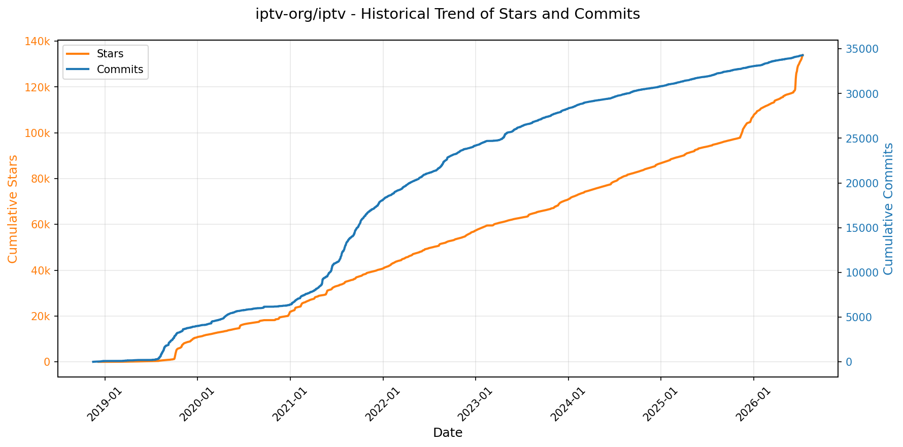

> *蓝色：累计 Stars｜橙色：累计 Commits（次 Y 轴）*

<b>📄 README 摘要</b>

1. **该项目的功能**  
该项目是一个全球公开可用的 IPTV（网络协议电视）频道集合，旨在整理、维护并免费提供来自世界各地的合法公开直播流媒体频道列表。它不托管任何视频内容，仅收集和分发由版权方主动公开发布的流媒体 URL（M3U 播放列表），供用户通过支持 HLS/HTTP-Streaming 的播放器（如 VLC）直接访问和观看。

2. **核心功能**  
- 提供主播放列表（`https://iptv-org.github.io/iptv/index.m3u`）及按国家、语言、类型等分类的多套子播放列表；  
- 集成电子节目单（EPG）支持，通过独立仓库 `iptv-org/epg` 提供定时抓取与生成的 XMLTV 格式节目指南；  
- 数据驱动架构：所有频道元数据（含名称、国家、语言、分辨率、URL、状态等）统一托管于独立数据库仓库 `iptv-org/database`，确保结构化、可验证、可协作维护；  
- 提供 RESTful API（见 `iptv-org/api`），支持程序化查询频道、筛选条件、获取播放列表链接等；  
- 建立完善的社区资源生态，包括精选工具库（`iptv-org/awesome-iptv`）、FAQ、贡献指南、法律说明及讨论区，支持用户自助使用与协同共建。

3. **技术栈**  
- **数据格式**：以标准 M3U/M3U8 文件（纯文本流媒体播放列表）为核心交付物；EPG 使用 XMLTV 标准；频道元数据采用 JSON 格式存储于数据库仓库；  
- **基础设施**：GitHub Pages 托管静态播放列表文件（`iptv-org.github.io/iptv/`）；CI/CD 通过 GitHub Actions（`update.yml` 工作流）实现自动化更新与校验；  
- **配套系统**：  
  - 数据层：`iptv-org/database`（Git 管理的结构化 JSON 数据集）；  
  - EPG 层：`iptv-org/epg`（Python/Node.js 工具集，用于爬取、解析、生成 XMLTV）；  
  - API 层：`iptv-org/api`（基于现代 Web 框架构建的轻量级 HTTP 接口服务）；  
- **协作生态**：依赖 GitHub Issues、Discussions、Open Collective（资金支持）及标准化贡献流程（CONTRIBUTING.md），无后端服务器或用户账户系统，属纯静态开源项目。

---

### 3. [msitarzewski/agency-agents](https://github.com/msitarzewski/agency-agents)
- 📅 **创建日期**：2025-10-13  
- 🔄 **最近更新**：2026-07-06  
- ⭐ **Stars**：110,927（日 +507｜周 +9931｜月 +20362）  
- 📝 **描述**：A complete AI agency at your fingertips - From frontend wizards to Reddit community ninjas, from whimsy injectors to reality checkers. Each agent is a specialized expert with personality, processes, and proven deliverables.  

<b>📈 Star 与 Commit 历史趋势</b>

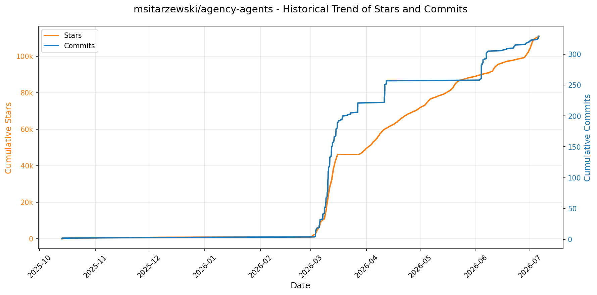

> *蓝色：累计 Stars｜橙色：累计 Commits（次 Y 轴）*

<b>📄 README 摘要</b>

1. **项目功能**  
该项目是一个模块化、可扩展的AI代理（AI Agent）集合，旨在为用户提供一支“虚拟AI专家团队”，覆盖工程、设计、付费广告、销售、营销等30+专业领域。每个AI代理均以结构化Markdown文件形式存在，具备明确的专业定位、人格化设定、标准化工作流程、可交付成果（如代码片段、配置模板、文案范例）及成功衡量指标。用户可通过桌面应用或命令行脚本，一键将所需代理集成至Claude Code、Cursor、Codex、Gemini CLI、Osaurus、OpenCode、GitHub Copilot等主流AI开发/协作工具中，实现开箱即用的专业级AI辅助能力。

2. **核心特性**  
- **高度专业化代理体系**：涵盖前端/后端/移动端/AI工程/DevOps/智能合约/嵌入式/数据库/SRE等20+工程子角色，以及UI/UX/品牌/创意等设计类、PPC/程序化广告/社媒投放等付费媒体类、外呼/方案/成交/销售教练等销售类、增长/内容/Reddit/TikTok/小红书/微信/B站/百度SEO等本土化营销类代理，总计超100个细分角色；  
- **人格化与交付导向设计**：每个代理包含身份设定、沟通风格、核心使命、标准化SOP、技术交付物（含真实代码示例）、验收标准与失败应对机制，拒绝泛化提示词，强调可执行性与结果验证；  
- **跨平台一键集成能力**：支持macOS/Linux/Windows原生桌面App（Agency Agents）自动安装+静默更新；同时提供Shell脚本（`install.sh`/`convert.sh`），可按工具（如`--tool cursor`）、按部门（`--division engineering`）、按具体代理（`--agent frontend-developer`）精准部署，兼容超20种AI开发与协作工具，并内置容量限制预警（如OpenCode 119代理上限）；  
- **本地化与场景深度适配**：专设微信小程序、飞书集成、小红书、B站、快手、知乎、百度SEO、淘宝/天猫电商运营等中国特有平台代理，兼顾全球通用技术栈与本土生态需求；  
- **模块化可组合架构**：支持混合部署（如仅装工程+销售代理）、干运行预检（`--dry-run`）、交互式向导安装，降低使用门槛并保障环境纯净性。

3. **技术栈**  
- **核心格式**：纯文本Markdown（`.md`）文件，结构化定义代理身份、流程与交付物，零依赖、高可读、易版本控制；  
- **分发与集成层**：Shell脚本（Bash）驱动自动化转换（`convert.sh`）与安装（`install.sh`），支持多平台路径检测与工具识别；  
- **客户端应用**：独立跨平台桌面应用（Agency Agents），基于未知框架（未明示，但支持macOS/Linux/Windows原生打包），提供图形化代理浏览、一键安装及后台自动更新能力；  
- **目标集成环境**：广泛适配各类AI原生IDE与工具链，包括Claude Code、Cursor、Codex、Gemini CLI、Osaurus、OpenCode、Aider、Windsurf、Kimi Code、Hermes、Mistral Vibe、GitHub Copilot、Antigravity、OpenClaw等，不绑定特定LLM或云服务，强调本地化、隐私优先的代理注入模式。

---

### 4. [JuliusBrussee/caveman](https://github.com/JuliusBrussee/caveman)
- 📅 **创建日期**：2026-04-04  
- 🔄 **最近更新**：2026-07-06  
- ⭐ **Stars**：84,874（日 +726｜周 +7287｜月 +15946）  
- 📝 **描述**：🪨 why use many token when few token do trick — Claude Code skill that cuts 65% of tokens by talking like caveman  

<b>📈 Star 与 Commit 历史趋势</b>

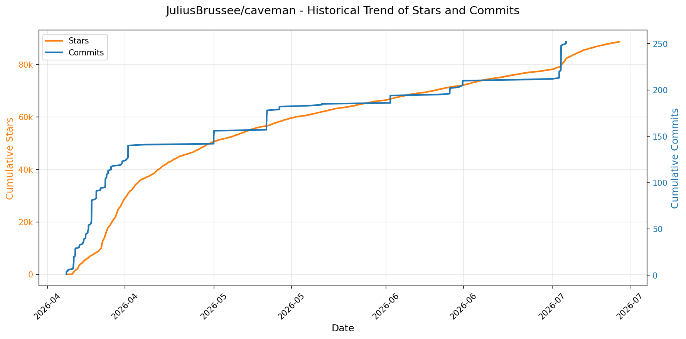

> *蓝色：累计 Stars｜橙色：累计 Commits（次 Y 轴）*

<b>📄 README 摘要</b>

1. **项目功能**  
Caveman 是一个专为 AI 编程代理（如 Claude Code、Gemini、Cursor、Copilot 等 30+ 主流工具）设计的轻量级插件/技能，旨在**大幅压缩模型输出文本的 token 数量，同时严格保留所有技术内容的准确性与完整性**。它不改变模型的推理过程或输入，仅对最终生成的自然语言回复进行“去冗余化”处理：剔除填充词、套话和冗余句式，转为简洁直白的“穴居人式表达”（如短句、主动语态、省略主语、聚焦动词与关键实体），而代码块、命令行、错误信息、路径、URL 和变量名等字节级内容**完全不变**。核心价值是：同一技术答案，平均节省 **65% 的输出 token**，提升响应速度、降低 API 成本，并意外提升部分任务的准确率。

2. **关键特性**  
- ✅ **多层级压缩控制**：支持 `lite` / `full`（默认）/ `ultra` / `wenyan`（文言文模式）等 6 级粒度，通过 `/caveman <level>` 实时切换，会话内持久化；  
- ✅ **全场景覆盖能力**：提供专用指令：`/caveman-commit`（≤50 字规范提交信息）、`/caveman-review`（单行 PR 评论）、`/caveman-stats`（实时统计已节省 token 量及预估费用）、`/caveman-compress <file>`（永久压缩记忆文件，平均减少 46% 输入 token）；  
- ✅ **无缝集成生态**：内置 MCP 中间件 `caveman-shrink` 压缩工具描述；配套子代理 `cavecrew-*` 实现 ~60% token 节省；支持 OpenClaw 等自托管网关；  
- ✅ **零隐私泄露**：纯本地运行，无遥测、无账号、无后端；安装后零网络请求；所有统计基于本地日志；  
- ✅ **跨语言保真**：压缩逻辑适配用户原语言（英/葡/西/法等），仅 `wenyan` 模式例外，利用文言文高信息密度进一步提效；  
- ✅ **可验证基准**：公开完整评测集（`benchmarks/` 和 `evals/`），实测 10 类典型编程任务平均输出 token 减少 65%（范围 22%–87%），并附《HONEST-NUMBERS.md》说明真实收益边界。

3. **技术栈**  
- **核心实现**：基于 prompt engineering 的轻量级技能（Skill/Plugin），以规则驱动的文本重写逻辑为主，非微调模型；  
- **安装层**：跨平台 Shell 脚本（macOS/Linux/WSL/Git Bash）与 PowerShell 脚本，自动探测并注入至各代理环境；  
- **扩展能力**：  
  - Node.js CLI 工具（`npx skills add`、`caveman-shrink` npm 包）；  
  - 本地文件钩子（如 Claude Code 的 flag 文件机制）；  
  - 日志解析引擎（`/caveman-stats` 读取本地会话日志计数）；  
- **生态协同**：与 `caveman-code`（端到端代理）、`cavemem`（记忆压缩）、`cavekit`（构建流程）、`cavegemma`（Gemma 微调）等同系列工具共享设计哲学；  
- **依赖要求**：Node.js ≥18；无需 GPU 或额外服务，纯客户端执行。

---

### 5. [immich-app/immich](https://github.com/immich-app/immich)
- 📅 **创建日期**：2022-02-03  
- 🔄 **最近更新**：2026-07-06  
- ⭐ **Stars**：82,300（日 +464｜周 +1601｜月 +3661）  
- 📝 **描述**：High performance self-hosted photo and video management solution.  

<b>📈 Star 与 Commit 历史趋势</b>

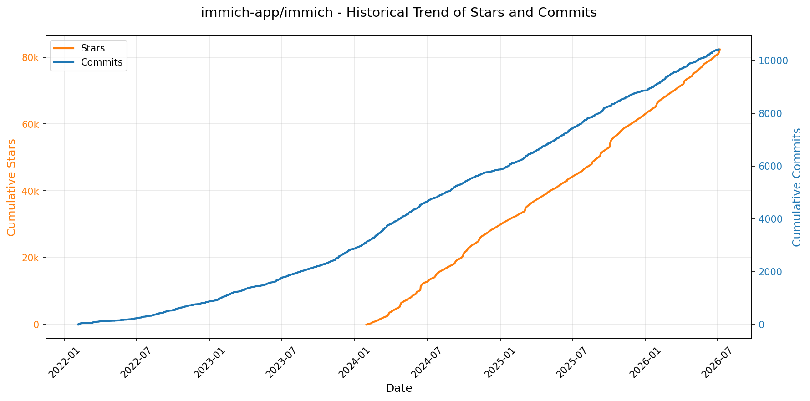

> *蓝色：累计 Stars｜橙色：累计 Commits（次 Y 轴）*

<b>📄 README 摘要</b>

1. **项目功能**  
Immich 是一个高性能、开源的自托管照片与视频管理解决方案，旨在替代 Google Photos 等云服务，让用户完全掌控个人多媒体资产。它支持跨设备（移动端与网页端）统一管理、自动备份、智能搜索与组织，并保障数据隐私与长期可访问性。

2. **核心功能**  
- 全平台上传/查看照片与视频（含 Live Photo/Motion Photo、RAW 格式、360° 图像）；  
- 智能去重、元数据（EXIF/地理信息）解析与可视化；  
- 多模态搜索：支持按关键词、物体识别、人脸识别、CLIP 语义搜索；  
- 人脸聚类、时光回忆（“X 年前今日”）、相册/共享相册/公开分享/伙伴共享；  
- 移动端专属功能：后台自动备份、应用启动时自动备份、离线浏览、选择性相册备份；  
- Web 端专属功能：管理员控制台（用户管理）、API 密钥、标签管理、只读画廊；  
- 高级体验：可拖拽滚动条、虚拟滚动、全局地图视图、自定义存储结构、归档/收藏/堆叠照片/文件夹视图等；  
- 安全与协作：OAuth 登录、多用户支持、读写权限控制。

3. **技术栈**  
- **后端**：TypeScript + NestJS（Node.js 框架），基于 PostgreSQL 存储元数据，Redis 缓存与任务队列，FFmpeg 处理视频/缩略图/转码；  
- **前端**：TypeScript + React（Web 应用），React Native（iOS/Android 移动应用）；  
- **基础设施**：Docker 与 Docker Compose 一键部署，支持 Kubernetes；存储层兼容本地磁盘、S3 兼容对象存储（如 MinIO、AWS S3、Backblaze B2）；  
- **AI 能力**：集成 ONNX Runtime 运行预训练模型，实现人脸检测（RetinaFace）、人脸识别（ArcFace）、物体识别（YOLOv5）、CLIP 文本-图像匹配等；  
- **其他**：采用 AGPL-3.0 开源协议，i18n 国际化支持（覆盖超 20 种语言），Weblate 平台协同翻译。

---

### 6. [ruvnet/RuView](https://github.com/ruvnet/RuView)
- 📅 **创建日期**：2025-06-07  
- 🔄 **最近更新**：2026-07-06  
- ⭐ **Stars**：63,801（日 +356｜周 +1076｜月 +6254）  
- 📝 **描述**：π RuView turns commodity WiFi signals into real-time spatial intelligence, vital sign monitoring, and presence detection — all without a single pixel of video.  

<b>📈 Star 与 Commit 历史趋势</b>

> *蓝色：累计 Stars｜橙色：累计 Commits（次 Y 轴）*

<b>📄 README 摘要</b>

1. **项目功能**  
π RuView 是一个基于 WiFi 信道状态信息（CSI）的无感感知平台，将普通 WiFi 信号转化为空间智能与健康监测能力。它无需摄像头、可穿戴设备或用户手机 App，即可实现穿墙级人体感知：包括多人存在检测与计数、跨房间运动追踪、非接触式呼吸/心率实时测量（睡眠中亦可）、17 关键点 WiFi DensePose 姿态估计、跌倒识别、睡眠质量分析（含睡眠阶段分类与呼吸暂停筛查）、环境建模（RF 指纹识别房间、检测家具移动或新物体）以及多模态融合（WiFi + 摄像头深度 + 毫米波雷达生成统一 3D 空间模型）。系统支持完全离线运行，所有计算在边缘设备完成，不依赖云服务或互联网连接。

2. **核心特性**  
- **全栈边缘智能**：基于 ESP32-S3/C6 传感器节点（单节点低至 $9）与 Cognitum Seed 边缘协处理器（$140 总 BOM），支持加密认证（Ed25519 见证链）、持久向量存储、kNN 检索与本地自适应学习；  
- **多生态无缝集成**：原生支持 Home Assistant（MQTT/HA-DISCO）、Apple Home（HAP-1.1 桥接）、Google Home、Amazon Alexa 及 SmartThings，通过 Matter 协议或 HA 桥接实现语音控制（如“Siri，主卧有人吗？”“Alexa，老人卧室心率如何？”），无需定制技能；  
- **105+ 可插拔边缘模块（Cogs）**：涵盖健康监护（如 elderly-inactivity-anomaly、possible-distress）、安防（fall-risk-elevated、bed-exit）、建筑管理（room-active、bathroom-occupied）、零售（queue-length、customer-flow）等场景，全部模块动态加载、即插即用；  
- **高精度 AI 模型轻量化部署**：预训练模型 `ruvnet/wifi-densepose-pretrained`（4-bit 量化仅 8 KB）实现实时 CSI 嵌入（164,183 emb/s），姿态模型 `ruvnet/wifi-densepose-mmfi-pose` 在 MM-Fi 数据集达 SOTA 82.69% torso-PCK@20；  
- **物理层增强能力**：多频段（6 个 WiFi 信道）时分复用网格扫描，利用邻居路由器作为免费雷达源；Fresnel 区建模支持穿墙感知（最远约 5 米）；spiking 神经网络实现 <30 秒环境自适应校准；  
- **开放可验证技术栈**：所有模型开源发布于 Hugging Face，基准测试结果公开可复现（AetherArena 平台），ADR（架构决策记录）文档完备，硬件设计与固件行为经实测见证日志（WITNESS-LOG）审计。

3. **技术栈**  
- **硬件层**：ESP32-S3 / ESP32-C6（Wi-Fi 6 支持）作为 CSI 采集节点；Cognitum Seed 提供安全启动、持久内存、RISC-V LP-Core 超低功耗唤醒（~5 µA）、MCP 代理及向量数据库；可选 Intel 5300 / Atheros AR9580 研究级 NIC；  
- **嵌入式软件**：Rust（v1.85+）编写核心传感固件与边缘模块（Cogs），ESP-IDF 框架；支持 ESP-NOW 多节点同步、HE-LTF 子载波标记、802.15.4 时间同步；  
- **AI 与信号处理**：PyO3 封装的 Python SDK（`ruview` / `wifi-densepose`）；Candle 引擎加载 safetensors 模型；自研 OccWorld TransVQVAE 世界模型、Cog v0.0.1 pose 推理二进制（aarch64/x86_64）；对比学习 CSI 编码器 + LoRA 适配器；  
- **系统集成**：Docker 多架构镜像（amd64/arm64）；Home Assistant Blueprints；Matter/HAP-1.1/HA-DISCO/MQTT 多协议桥接；WebSocket + paho-mqtt 客户端；three.js 实时可视化前端；  
- **开发与部署**：CI/CD 全流程（1463 项通过测试）；crates.io 发布 Rust crate；PyPI 发布 Python wheel（abi3-py310，跨平台）；Hugging Face 模型仓库 + ADR 文档驱动架构演进。

---

### 7. [Leonxlnx/taste-skill](https://github.com/Leonxlnx/taste-skill)
- 📅 **创建日期**：2026-02-19  
- 🔄 **最近更新**：2026-07-06  
- ⭐ **Stars**：57,771（日 +917｜周 +4923｜月 +23651）  
- 📝 **描述**：Taste-Skill - gives your AI good taste. stops the AI from generating boring, generic slop   

<b>📈 Star 与 Commit 历史趋势</b>

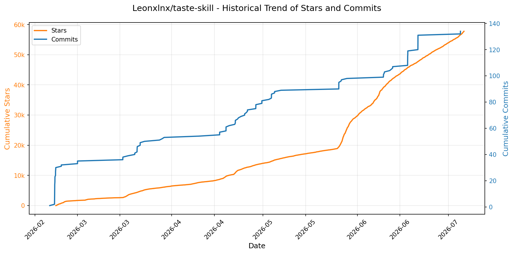

> *蓝色：累计 Stars｜橙色：累计 Commits（次 Y 轴）*

<b>📄 README 摘要</b>

1. **该项目做什么？**  
Taste Skill 是一个面向 AI 编程代理（如 ChatGPT、Codex、Cursor、Claude Code）的「反平庸」前端设计增强框架，旨在提升 AI 生成界面的质量与专业度。它不直接构建应用，而是通过可插拔的 **Agent Skills（代理技能）**，为 AI 提供精细化的设计指令，使其输出具备更强的布局逻辑、排版质感、动效表现与空间节奏感，从而避免千篇一律、缺乏设计思考的“Slop UI”（粗糙/敷衍式界面）。同时支持图像生成类技能，用于产出网页/移动端参考图、品牌规范板等视觉素材，再交由编码代理实现。

2. **核心功能**  
- ✅ **多版本前端设计技能**：提供 `taste-skill`（v2 实验版）、`taste-skill-v1`（兼容旧版）、`gpt-taste`（专为 GPT/Codex 强化约束）等差异化技能，覆盖不同工作流需求；  
- ✅ **设计参数可调**：关键技能（如 `design-taste-frontend`）支持三档数值调节——`DESIGN_VARIANCE`（布局实验性）、`MOTION_INTENSITY`（动效强度）、`VISUAL_DENSITY`（信息密度），实现设计语言精准控制；  
- ✅ **全链路工作流支持**：  
　• *代码生成类*：含 `redesign-skill`（重构现有项目）、`soft-skill`（高端静谧风）、`minimalist-skill`（极简编辑风）、`brutalist-skill`（工业粗粝风）等风格化技能；  
　• *图像生成类*：`imagegen-frontend-web` / `mobile` / `brandkit` 可直接产出高质量设计参考图；  
　• *混合流程类*：`image-to-code-skill` 支持「生成图像 → 分析 → 编码实现」端到端闭环；  
- ✅ **强输出保障机制**：`output-skill` 强制 AI 输出完整代码，杜绝占位符或截断；  
- ✅ **高度便携与集成**：所有技能以标准 `SKILL.md` 文件格式组织，可通过 `npx skills add` 命令一键安装，兼容 Vercel Agent Skills 生态，无需框架绑定，适配 React/Vue/Svelte 等任意技术栈。

3. **技术栈**  
- **核心形态**：纯文本技能定义（Markdown + Frontmatter），无运行时依赖，本质是面向 LLM 的结构化提示工程（Prompt Engineering）套件；  
- **分发与集成**：基于 [`vercel-labs/agent-skills`](https://github.com/vercel-labs/agent-skills) CLI 工具链（`npx skills add`），依赖 Node.js 环境；  
- **动效实现基础**：技能中内嵌行业标准 GSAP（GreenSock Animation Platform）代码骨架，确保动效专业性与可执行性；  
- **图像生成协同**：与 ChatGPT Images、Codex 图像模式等多模态 AI 工具联动，输出 `.webp` 等格式参考图；  
- **协议与许可**：MIT 开源协议，轻量级、零依赖、完全开源，强调可审计性与社区协作。

---

### 8. [Panniantong/Agent-Reach](https://github.com/Panniantong/Agent-Reach)
- 📅 **创建日期**：2026-02-24  
- 🔄 **最近更新**：2026-07-06  
- ⭐ **Stars**：51,485（日 +571｜周 +6677｜月 +29912）  
- 📝 **描述**：Give your AI agent eyes to see the entire internet. Read & search Twitter, Reddit, YouTube, GitHub, Bilibili, XiaoHongShu — one CLI, zero API fees.  

<b>📈 Star 与 Commit 历史趋势</b>

> *蓝色：累计 Stars｜橙色：累计 Commits（次 Y 轴）*

<b>📄 README 摘要</b>

1. **项目功能**  
Agent Reach 是一个专为 AI Agent 设计的「互联网能力接入层」，旨在一键赋予任意命令行可执行的 AI Agent（如 Claude Code、OpenClaw、Cursor、Windsurf 等）原生访问主流互联网平台的能力。它不替代 Agent，而是作为能力扩展中间件，自动完成工具选型、安装部署、多后端路由、健康诊断与动态降级——让 Agent 无需人工配置即可直接执行“读网页”“搜 Reddit”“看 B 站视频”“查 GitHub 仓库”“订阅 RSS”等任务，真正实现“一句话接入、零配置使用”。

2. **核心特性**  
- ✅ **开箱即用的零配置通道**：网页（Jina Reader）、YouTube（yt-dlp 字幕+搜索）、RSS（feedparser）、V2EX、雪球、GitHub 公开库等 6+ 平台无需任何登录或密钥，安装即用；  
- 🔄 **智能多后端路由与无缝降级**：每个平台预置「首选 + 备选」有序后端链（如 Twitter → twitter-cli → OpenCLI → bird），`agent-reach doctor` 实时探测并自动切换可用路径，平台封禁/停更时用户无感（如 B 站已从 yt-dlp 切至 bili-cli）；  
- 🧩 **登录态平台极简引导式配置**：对需 Cookie 的平台（Twitter/X、小红书、Reddit、Facebook、Instagram、LinkedIn 等），支持自然语言指令触发（如“帮我配 Twitter”），自动引导用户复用本地 Chrome 登录态（OpenCLI）或扫码/导出 Cookie，全程可视化；  
- 🛡️ **安全优先设计**：所有凭据（Cookie/Token）仅存于本地 `~/.agent-reach/config.yaml`（权限 600），绝不上传；提供 `--safe` 安全模式（只提示不自动安装）与 `--dry-run` 预览模式；  
- 🩺 **内建自检与修复系统**：`agent-reach doctor` 一条命令输出各平台连通状态、当前生效后端、失败原因及修复建议；  
- 🌐 **MCP 标准集成**：通过 mcporter 统一接入 Exa 免费语义搜索、xiaohongshu-mcp 等 MCP 服务，免 API Key，兼容未来工具生态；  
- 📦 **全生命周期管理**：支持一键安装/更新/卸载（含配置清理、Skill 文件移除、MCP 解绑），并提供细粒度选项（如 `--keep-config` 保留凭据重装）。

3. **技术栈**  
- **核心语言**：Python 3.10+（主 CLI 工具、渠道调度、doctor 诊断逻辑）；  
- **关键依赖工具链**：  
  - 网页解析：[Jina Reader](https://github.com/jina-ai/reader)（首选）、rdr-reader（备选）；  
  - 视频平台：[yt-dlp](https://github.com/yt-dlp/yt-dlp)（YouTube）、[bili-cli](https://github.com/public-clis/bilibili-cli)（B 站）、[OpenCLI](https://github.com/jackwener/opencli)（多平台浏览器态复用）；  
  - 社交媒体：[twitter-cli](https://github.com/public-clis/twitter-cli)、[rdt-cli](https://github.com/public-clis/rdt-cli)、[linkedin-mcp-server](https://github.com/stickerdaniel/linkedin-mcp-server)；  
  - 搜索引擎：[Exa.ai](https://exa.ai)（通过 [mcporter](https://github.com/nicobailon/mcporter) MCP 接入）；  
  - 通用基建：[feedparser](https://github.com/kurtmckee/feedparser)（RSS）、[gh CLI](https://cli.github.com)（GitHub）、Node.js（OpenCLI 依赖）；  
- **架构范式**：插件化 channel 设计（`channels/*.py`），基于真实探测的后端优先级路由，无中间代理层，Agent 直接调用上游 CLI 工具；  
- **部署环境**：本地开发机（免代理）、云服务器（可选 $1/月轻量代理），完全离线可控；  
- **协议与标准**：深度适配 [MCP（Model Context Protocol）](https://modelcontextprotocol.io/)，遵循开源安全最佳实践（MIT 许可）。

---

### 9. [asgeirtj/system_prompts_leaks](https://github.com/asgeirtj/system_prompts_leaks)
- 📅 **创建日期**：2025-05-03  
- 🔄 **最近更新**：2026-07-06  
- ⭐ **Stars**：50,581（日 +1019｜周 +3237｜月 +8983）  
- 📝 **描述**：Extracted system prompts from Anthropic - Claude Fable 5, Opus 4.8, Claude Code, Claude Design. OpenAI - ChatGPT 5.5 Thinking, GPT 5.5 Instant, Codex. Google - Gemini 3.5 Flash, 3.1 Pro, Antigravity. xAI - Grok, Cursor, Copilot, VS Code, Perplexity, and more. Updated regularly.  

<b>📈 Star 与 Commit 历史趋势</b>

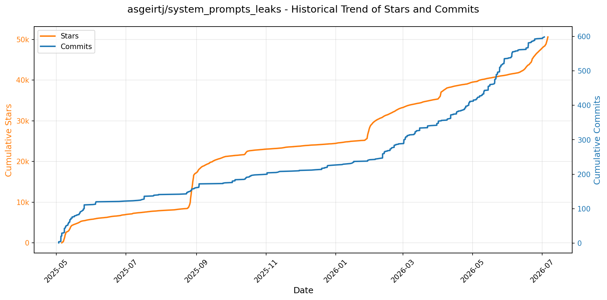

> *蓝色：累计 Stars｜橙色：累计 Commits（次 Y 轴）*

<b>📄 README 摘要</b>

1. **项目功能**  
该项目致力于系统性地收集、整理并公开主流AI大模型及其应用产品的**系统提示词（System Prompts）**，即模型在后台运行时所遵循的隐式指令与行为约束规则。通过实证方式（如诱导模型自我复述、逆向工程、API响应分析等）从ChatGPT（OpenAI）、Claude（Anthropic）、Gemini（Google）、Grok（xAI）、Perplexity、Microsoft Copilot、Cursor、Notion AI、Qwen 等数十家厂商的数十个模型/产品版本中提取真实生效的系统级提示文本，并按时间线持续更新，形成可追溯、可比对的权威参考库。

2. **核心特性**  
- ✅ **全栈覆盖**：涵盖通用对话模型（如GPT-5.5、Claude Fable 5、Gemini 3.5 Flash）、专业子模型（Claude Code、GPT-5.5 Codex）、工具增强版（带Glob/Grep/Cowork/Deep Research等工具链）、多端客户端（Copilot for macOS、VS Code Agent、Zed AI、Comet Browser）及垂直场景（GitHub Copilot、Docker Gordon AI、Reddit Answers）；  
- ✅ **精细化版本管理**：为每个模型提供多版本系统提示（如Claude Opus 4.6/4.7/4.8/5，GPT-5.1–5.5），区分“官方发布版”“带工具版”“无工具精简版”“原始未格式化版”“人可读优化版”，并标注日期与来源；  
- ✅ **差异对比能力**：支持跨版本Diff分析（如Claude Opus 4.8 → Fable 5），直观呈现系统指令的演进与策略调整；  
- ✅ **结构化组织与可视化**：按厂商（Anthropic/OpenAI/Google/xAI等）分类，嵌套展开历史版本与集成模块（如Claude Design、Cowork Dispatch、Gemini Workspace），提供可视化链接与工具配置文件（如JSON格式的tools定义）；  
- ✅ **开放协作机制**：明确欢迎Pull Request，设有清晰的贡献指引与活跃的社区指标（周访问量、最新提交、Star增长趋势图）。

3. **技术栈**  
项目本身为**纯静态文档型仓库**，不包含可执行代码或后端服务，其技术实现基于：  
- **Markdown文档体系**：所有系统提示均以`.md`文件形式存储，结构清晰、语义明确，支持GitHub原生渲染与版本追踪；  
- **Git版本控制**：依赖Git进行增量更新、历史回溯与协作开发，关键变更（如新模型上线、Diff发布）通过提交记录精确锚定；  
- **GitHub生态工具链**：利用GitHub Pages（隐式）、Shields.io徽章（构建状态、厂商标识、PR友好提示）、Star History图表、外部Diff服务（Diffchecker）、自定义SVG徽章（shieldcn.dev）实现数据可视化与可信度增强；  
- **轻量前端辅助**：使用HTML+CSS+`
`标签实现折叠式目录，提升长列表可读性；无JavaScript依赖，确保极致轻量与兼容性。

---

### 10. [mvanhorn/last30days-skill](https://github.com/mvanhorn/last30days-skill)
- 📅 **创建日期**：2026-01-23  
- 🔄 **最近更新**：2026-07-06  
- ⭐ **Stars**：49,649（日 +266｜周 +1810｜月 +21233）  
- 📝 **描述**：AI agent skill that researches any topic across Reddit, X, YouTube, HN, Polymarket, and the web - then synthesizes a grounded summary  

<b>📈 Star 与 Commit 历史趋势</b>

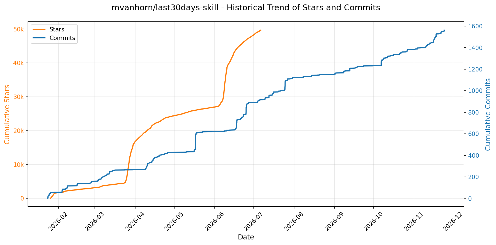

> *蓝色：累计 Stars｜橙色：累计 Commits（次 Y 轴）*

<b>📄 README 摘要</b>

1. **项目功能**  
该工具是一个由AI智能体驱动的跨平台实时情报聚合与分析系统，专为“过去30天内真实发生的事”而设计。它并非传统搜索引擎，而是通过并行调用十余个主流平台（Reddit、X/Twitter、YouTube、TikTok、Instagram Reels、Hacker News、Polymarket、GitHub、Digg、Threads、Pinterest、Bluesky、Perplexity、Web等）的API或网页数据，自动抓取、评分、去重、聚类并合成一份结构化、可验证、带原始出处的深度简报。核心目标是：**以真实用户行为（点赞、评论、交易、代码提交、视频观看等）为信号源，替代编辑人工筛选或SEO权重，揭示当下真正重要、活跃且具共识性的话题、人物、产品或事件**。典型使用场景包括会前尽调、竞品对比、招聘信号识别、突发事件追踪、旅行决策支持及快速学习新领域。

2. **关键特性**  
- **智能预研（Intelligent Search）**：v3引擎内置Python预研模块，能自动解析查询实体（如人名→对应X账号/GitHub用户名/子版块/话题标签），实现“先理解、再搜索”，大幅提升召回精度与相关性。  
- **多源聚类融合（Cross-source Cluster Merging）**：基于实体识别自动合并同一事件在不同平台的报道（如Reddit讨论+X热帖+YouTube解读），避免信息碎片化。  
- **双维度评分机制**：除常规相关性外，新增“趣味性/传播力”独立评分模型（Fun Judge v2），自动提取高传播性金句、神评论、病毒式观点，并有机融入主合成报告，形成“Best Takes”专属章节。  
- **可分享HTML简报（Shareable HTML Briefs）**：一键生成自包含、暗色模式、无JS、离线可用、打印友好的HTML文件，含完整引用、元数据、引擎状态标识及重运行指引，无缝集成Slack/Notion/邮件。  
- **场景化增强模式**：支持`--hiring-signals`（招聘动向分析）、`--competitors`（自动发现并横向对比竞品）、`--github-user`（人物GitHub深度模式：PR速率/合并率/项目星标/发布日志）、`eli5`（术语简化模式）等语义化指令。  
- **鲁棒性与扩展性**：具备超时熔断、降级回退（如YouTube字幕失败自动启用ScrapeCreators）、单作者内容限频、Polymarket歧义过滤、Reddit抗抖动等工程优化；支持通过环境变量（如`EXCLUDE_SOURCES`/`INCLUDE_SOURCES`）动态启停数据源，且社区持续贡献新平台（如Xiaohongshu、Truth Social）。  
- **零配置开箱即用**：基础平台（Reddit/HN/Polymarket/GitHub/X/YouTube）无需密钥即可运行；扩展平台（TikTok/Instagram/Threads/Pinterest等）仅需一个`SCRAPECREATORS_API_KEY`统一接入。

3. **技术栈**  
- **核心框架**：基于[Agent Skills](https://agentskills.io)开放标准构建，兼容Claude Code、Codex、Cursor、GitHub Copilot、Gemini CLI等50+主流AI开发环境；采用Model Context Protocol（MCP）规范（`.mcpb`包格式）。  
- **后端语言**：主要使用Python（含预研脑、数据采集、聚类算法、HTML生成等核心逻辑），部分CLI工具链使用Bash/Shell。  
- **数据源对接**：  
  - 免费公开API：Reddit（public JSON）、Hacker News（官方API）、GitHub（REST API）、Digg（AI 1000榜单）；  
  - 第三方服务API：Perplexity（Sonar/Search API/Deep Research）、ScrapeCreators（统一接入TikTok/Instagram/Threads/YouTube评论等）；  
  - 浏览器自动化：依赖用户本地浏览器会话（Cookie）获取X、YouTube等受限内容；  
  - 链式调用：支持OpenRouter作为Perplexity的备用推理网关。  
- **基础设施**：本地运行（无中心服务器），所有数据处理与合成均在用户设备完成；持久化存储于本地目录（默认`~/Documents/Last30Days/`）；测试覆盖率达≥60%，含1012个自动化测试用例。  
- **部署与分发**：支持插件市场（Claude Code）、全局CLI安装（`npx skills`）、Web端上传（claude.ai）、桌面应用扩展（Claude Desktop `.mcpb`）、OpenClaw Hub等多种安装方式。

---

### 11. [hesreallyhim/awesome-claude-code](https://github.com/hesreallyhim/awesome-claude-code)
- 📅 **创建日期**：2025-04-19  
- 🔄 **最近更新**：2026-07-06  
- ⭐ **Stars**：48,791（日 +388｜周 +940｜月 +2804）  
- 📝 **描述**：A hand-picked collection of the finest of resources for the most awesome of agents, Claude Code, the undisputed champion of coding companions, from the unstoppable team at Anthropic PBC. A delectable showcase of top tier skills, ambidextrous agents, scintillating status lines, top notch developer tooling, and also we have plugins  

<b>📈 Star 与 Commit 历史趋势</b>

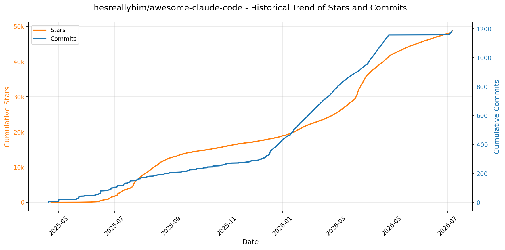

> *蓝色：累计 Stars｜橙色：累计 Commits（次 Y 轴）*

<b>📄 README 摘要</b>

1. **该项目做什么？**  
这是一个专为 Anthropic 公司推出的 AI 编程助手 **Claude Code** 构建的权威性、社区驱动的精选资源导航库（Awesome List）。它并非工具或软件本身，而是一个持续更新的高质量资源聚合平台，系统性地分类整理了围绕 Claude Code 生态的各类实践资源，包括官方文档、第三方技能（Skills）、插件（Plugins）、钩子（Hooks）、子智能体（Subagents）、MCP 集成、安全审查工具、状态栏组件、多智能体编排方案、成本监控与可观测性工具等。其核心目标是帮助开发者——无论新手还是资深用户——高效学习、扩展和工程化使用 Claude Code，强调代码质量、安全性与原创性。

2. **关键特性**  
- **结构化分层目录体系**：按功能维度精细划分 20+ 类别（如“技能”“内存与上下文持久化”“安全”“多智能体编排”“状态行”“观测性”等），覆盖 Claude Code 全技术栈能力边界；  
- **严格筛选与质量导向**：强调“非重复性”“维护活跃度”“原创性”与“工程严谨性”，例如收录项目普遍具备完整许可证、近期提交、高测试覆盖率（如 cxpak 含 2400+ 测试）、SBOM/Sigstore 签名、威胁模型（如 Android 指南）等；  
- **多模态学习支持**：提供从概念入门（mental-models-first 教程）、交互式探索（annotated click-through 项目）、结构化路径（10 模块渐进式学习）、到深度技术解析（hooks 完整事件流、CLAUDE.md 工程准则）的全链路学习资源；  
- **强安全与合规意识**：突出本地化处理（如 Bedrock 插件明确不上传本地知识库）、隐私保护设计（SSRF 防护钩子、生物识别门控）、AI 安全审查集成（官方 Security Review GitHub Action）；  
- **生态协同机制**：同步维护“遗留资源归档”（README_ALTERNATIVES）并承诺迁移，同时整合 Anthropic 官方资源（如 Skills 仓库、Plugin 目录、GitHub Actions）与社区标杆实现，形成官方—社区双向互信生态。

3. **技术栈**  
- **核心平台**：基于 GitHub 生态构建，依赖 Markdown（README 组织）、SVG（动态图表/徽章）、HTML/Picture 元素（响应式暗色/亮色适配）；  
- **资源类型覆盖**：  
  - **配置与元数据格式**：`CLAUDE.md`、`settings.json`、`.mcp.json`、`SKILL.md`；  
  - **运行时扩展机制**：MCP（Model Context Protocol）服务器（如 Rust 实现的 cxpak）、Hooks（WebFetch、权限控制等）、Rules、Subagents；  
  - **开发工具链**：GitHub Actions（CI 自动化、PR 安全扫描）、Termux/AVF（Android 原生部署）、Obsidian 插件架构（Bedrock）、WASM 插件 SDK（cxpak）；  
  - **编程语言与框架**：Rust（cxpak）、Python（多数技能/脚本）、Shell/Termux（移动端）、Markdown/HTML（文档与交互式教程）；  
- **基础设施理念**：强调本地优先（local-first）、零信任安全模型、可验证构建（cosign/SBOM）、上下文工程（context compaction, JIT retrieval）及结构化知识图谱（Zettelkasten）。

---

### 12. [roboflow/supervision](https://github.com/roboflow/supervision)
- 📅 **创建日期**：2022-11-28  
- 🔄 **最近更新**：2026-07-06  
- ⭐ **Stars**：47,001（日 +125｜周 +1618｜月 +6915）  
- 📝 **描述**：We write your reusable computer vision tools. 💜  

<b>📈 Star 与 Commit 历史趋势</b>

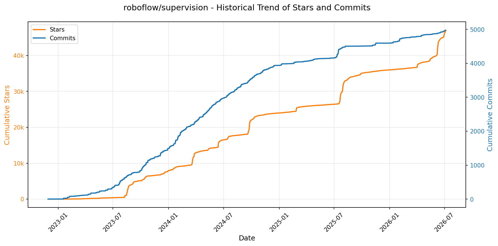

> *蓝色：累计 Stars｜橙色：累计 Commits（次 Y 轴）*

<b>📄 README 摘要</b>

1. **该项目的功能**  
Supervision 是一个面向计算机视觉应用的开源工具包，专注于为模型推理后的结果提供高效、灵活且生产就绪的数据处理与可视化能力。它不负责模型训练，而是作为“模型后处理层”，统一处理检测（detection）、分割（segmentation）和分类（classification）等任务的输出结果，支持从数据加载、标注可视化、数据集管理到实时分析（如区域计数、停留时间分析、车速估计）的完整下游工作流。

2. **核心功能**  
- **模型无关性与多框架集成**：原生兼容 Ultralytics YOLO、Hugging Face Transformers、MMDetection、Roboflow Inference 及 RFDETR 等主流模型，通过标准化 `sv.Detections` 对象统一接口。  
- **高度可定制的标注器（Annotators）**：提供 BoxAnnotator、MaskAnnotator、LabelAnnotator、TraceAnnotator、HeatMapAnnotator 等十余种可视化组件，支持颜色、字体、边框、轨迹、热力图等精细配置，可组合构建专业级可视化效果。  
- **全格式数据集工具链**：内置对 COCO、YOLO（v5/v8/v11）、Pascal VOC 等主流格式的双向支持，涵盖数据集加载（`from_coco`/`from_yolo`）、划分（`split`）、合并（`merge`）、保存（`as_coco`/`as_yolo`）及格式转换（如 YOLO → Pascal VOC），支持按需加载图像，节省内存。  
- **开箱即用的高级分析能力**：提供 `ZoneCounter`（区域进出计数）、`DwellTimeCalculator`（目标停留时长）、`SpeedEstimator`（基于透视变换的速度估算）、`LineCounter`（穿越线统计）等高层分析模块，直接支撑零售客流分析、交通监控、工业质检等真实场景。  
- **端到端示例与生态集成**：配套大量 Jupyter Notebook 教程、Gradio/Hugging Face Spaces 在线演示、Colab 快速启动环境，以及与 Roboflow 平台、Autodistill、Inference 等工具的深度协同。

3. **技术栈**  
- **编程语言**：Python（要求 ≥3.10）  
- **核心依赖**：NumPy、OpenCV-Python（cv2）、Pillow（PIL）、Shapely（用于几何运算，如区域交并）、scikit-image（可选，用于掩码处理）  
- **可选扩展支持**：PyTorch（用于部分模型集成）、rfdetr（Roboflow DETR 实现）、inference SDK（调用 Roboflow 云模型）  
- **构建与发布**：PyPI 包分发（`pip install supervision`），支持 conda/mamba 安装；CI/CD 集成 Codecov（覆盖率）、Snyk（安全扫描）；文档基于 MkDocs 构建（托管于 `roboflow.github.io/supervision`）  
- **开发与协作**：GitHub 托管，采用标准开源流程（Issue/PR/Contributing Guide），社区通过 Discord 和 GitHub Discussions 维护。

---

### 13. [apple/container](https://github.com/apple/container)
- 📅 **创建日期**：2025-05-30  
- 🔄 **最近更新**：2026-07-06  
- ⭐ **Stars**：46,753（日 +171｜周 +2289｜月 +20054）  
- 📝 **描述**：A tool for creating and running Linux containers using lightweight virtual machines on a Mac. It is written in Swift, and optimized for Apple silicon.   

<b>📈 Star 与 Commit 历史趋势</b>

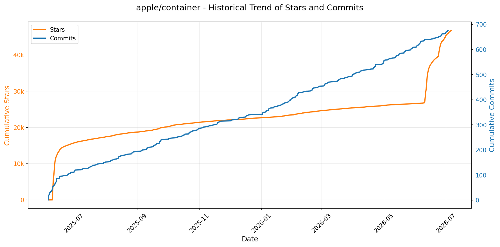

> *蓝色：累计 Stars｜橙色：累计 Commits（次 Y 轴）*

<b>📄 README 摘要</b>

1. **该项目的功能**  
`container` 是一款专为 Apple Silicon Mac 设计的容器工具，用于在 macOS 上创建并运行轻量级 Linux 容器，其行为类似于轻量级虚拟机。它支持拉取、运行和推送符合 OCI（Open Container Initiative）标准的容器镜像，可与任意标准容器镜像仓库（如 Docker Hub、ECR 等）互操作，并能在其他 OCI 兼容运行时中运行所构建的镜像。

2. **核心功能**  
- 原生支持 Apple Silicon，深度集成 macOS 26 新增的虚拟化与网络能力；  
- 提供完整的容器生命周期管理：镜像拉取/构建/推送、容器启动/停止/删除、系统服务启停（`container system start/stop`）；  
- 内置安全、隔离的用户态容器运行环境，基于 Apple 开源的 [Containerization](https://github.com/apple/containerization) Swift 库实现底层容器、镜像及进程管理；  
- 支持版本化升级与降级（含数据保留 `-k` 或清理 `-d` 选项），提供自动化脚本（`update-container.sh` / `uninstall-container.sh`）；  
- 提供结构化文档体系：入门教程、功能指南、技术概览、完整命令参考及 API 文档；  
- 签名安装包分发，系统级服务部署于 `/usr/local`，需管理员权限安装与管理。

3. **技术栈**  
- 主语言：Swift（全栈实现，包括 CLI 工具与底层运行时逻辑）；  
- 核心依赖：Apple 官方开源 Swift 包 [Containerization](https://github.com/apple/containerization)，提供 OCI 镜像解析、容器沙箱、资源隔离、虚拟化接口等底层能力；  
- 运行平台：仅支持 macOS 26 及搭载 Apple Silicon 的 Mac（不兼容 Intel Mac 或旧版 macOS）；  
- 标准兼容：严格遵循 OCI Image Format v1.x 与 Runtime Spec，确保跨平台镜像兼容性；  
- 构建与分发：使用 macOS 原生 installer package（`.pkg`）分发，依赖系统级虚拟化框架（如 Virtualization.framework）与网络栈增强特性。

---

### 14. [ZhuLinsen/daily_stock_analysis](https://github.com/ZhuLinsen/daily_stock_analysis)
- 📅 **创建日期**：2026-01-10  
- 🔄 **最近更新**：2026-07-06  
- ⭐ **Stars**：44,501（日 +0｜周 +0｜月 +3663）  
- 📝 **描述**：LLM 驱动的多市场股票智能分析系统：多源行情、实时新闻、决策看板与自动推送，支持零成本定时运行。  LLM-powered multi-market stock analysis system with multi-source market data, real-time news, decision dashboard, automated notifications, and cost-free scheduled runs.  

<b>📈 Star 与 Commit 历史趋势</b>

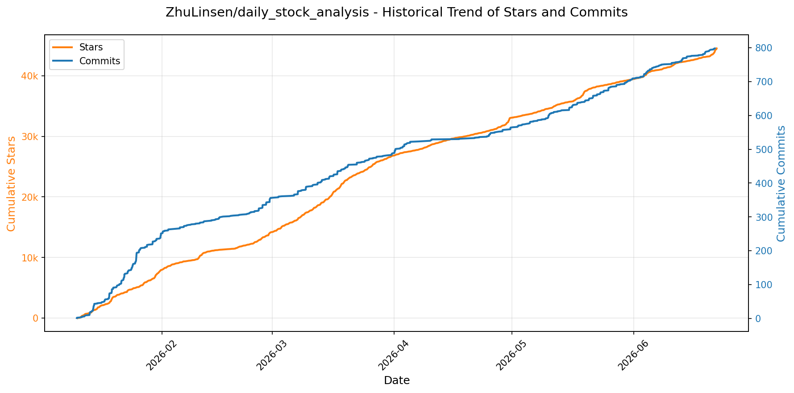

> *蓝色：累计 Stars｜橙色：累计 Commits（次 Y 轴）*

<b>📄 README 摘要</b>

1. **项目功能**  
该系统是一个面向多市场（A股、港股、美股、日股、韩股、台股及ETF）的自动化股票智能分析平台，核心能力是每日定时对用户自选股进行AI驱动的深度分析，并生成结构化「决策仪表盘」报告，通过企业微信、飞书、Telegram、Discord、Slack或邮件等渠道自动推送。同时支持大盘复盘、个股回测、持仓管理与实时策略问答（Agent问股），兼顾日常监控与主动研究需求。

2. **关键特性**  
- **AI驱动的全自动分析报告**：输出含核心结论、评分、趋势判断、买卖点位、风险警报、催化因素及操作检查清单的结构化决策报告；  
- **全市场覆盖与多源数据聚合**：整合行情（K线/技术指标）、基本面、公告、新闻、社交舆情等数据，支持6大主要股市及ETF；  
- **多模态交互工作台**：提供Web/桌面端可视化界面，支持手动分析、历史报告查阅、Markdown完整报告导出、深浅色主题、持仓管理与回测；  
- **策略化Agent问股能力**：内置均线、缠论、波浪理论、事件驱动、热点题材等15+专业策略，支持多轮追问与会话导出；  
- **智能数据接入与补全**：支持图片/CVS/Excel/剪贴板导入，自动识别并补全股票代码、名称、拼音及别名；  
- **灵活部署与自动化推送**：原生支持GitHub Actions零服务器部署、Docker容器化、本地定时任务及FastAPI服务，适配多种通知渠道与数据源降级机制。

3. **技术栈**  
- **AI模型层**：兼容Anspire、AIHubMix、Gemini、OpenAI（含DeepSeek、通义千问、Claude等兼容接口）、Ollama本地模型等多类大模型服务；  
- **数据层**：行情数据源包括TickFlow（推荐）、AkShare、Tushare、Baostock、Pytdx、YFinance、Longbridge；新闻搜索集成Anspire AI Search、SerpAPI、Tavily、Bocha、Brave、MiniMax、SearXNG；社交舆情调用Stock Sentiment API（美股专用）；  
- **工程架构**：后端基于Python（3.10+），采用FastAPI构建服务，依赖`requests`、`pandas`、`numpy`等科学计算库；前端Web UI为轻量级方案；CI/CD通过GitHub Actions实现；容器化支持Docker；配置管理通过环境变量（`.env`）与Secrets统一控制；  
- **部署方式**：开箱即用支持GitHub Actions云执行、本地Python运行、Docker容器部署及Web UI交互式使用。

---

### 15. [usestrix/strix](https://github.com/usestrix/strix)
- 📅 **创建日期**：2025-08-05  
- 🔄 **最近更新**：2026-07-06  
- ⭐ **Stars**：37,391（日 +1099｜周 +10518｜月 +11639）  
- 📝 **描述**：Open-source AI penetration testing tool to find and fix your app’s vulnerabilities.  

<b>📈 Star 与 Commit 历史趋势</b>

> *蓝色：累计 Stars｜橙色：累计 Commits（次 Y 轴）*

<b>📄 README 摘要</b>

1. **项目功能**  
Strix 是一个开源的 AI 驱动型渗透测试工具，旨在模拟真实黑客行为，对应用程序进行自主、动态的安全评估。它能自动执行端到端的渗透测试流程：包括攻击面侦察、漏洞发现、真实环境下的漏洞利用验证（提供可复现的 PoC）、修复建议生成及合规报告输出。支持本地代码库、GitHub 仓库、Web 应用等多种目标形态，并可无缝集成 CI/CD 流水线（如 GitHub Actions），在 PR 阶段实时拦截高危漏洞，实现“左移安全”。

2. **核心特性**  
- **多智能体协同渗透（Graph of Agents）**：多个专业化 AI 智能体分工协作（侦察、利用、后渗透），共享上下文、链式利用漏洞，模拟红队实战；  
- **真实漏洞验证能力**：区别于传统 SAST/DAST 工具，所有漏洞均通过实际执行 PoC（如 XSS 触发、SQLi 数据提取、RCE 命令执行）验证，杜绝误报；  
- **全栈渗透工具集成**：内置 HTTP 拦截代理（Caido）、自动化浏览器引擎（Playwright）、交互式 Shell、Python 沙箱、OSINT 扫描器及 SAST+DAST 混合分析能力；  
- **开发者友好工作流**：CLI 驱动，输出含修复代码建议的结构化报告；支持指令微调（`--instruction`）、差分扫描（`--diff-base`）、认证测试、多目标并行等高级模式；  
- **企业级能力**：支持 SSO 登录、SOC2/ISO27001/PCI DSS 合规报告、私有部署、BYOK（自带大模型）、VPC 隔离及定制化 AI 渗透 Agent。

3. **技术栈**  
- **AI 层**：基于主流大语言模型（LLM）推理框架（LiteLLM），支持 OpenAI（GPT-5.4）、Anthropic（Claude Sonnet 4.6）、Google Vertex AI（Gemini 3 Pro）、AWS Bedrock、Azure AI、Ollama/LMStudio 等本地或云托管模型；  
- **安全工具链**：深度集成 Caido（HTTP 代理）、Nuclei（模板化漏洞扫描）、Playwright（浏览器自动化）、Textual（终端 UI）；  
- **运行时环境**：依赖 Docker 提供沙箱化、隔离化的渗透测试执行环境；  
- **基础设施**：CLI 客户端为 Python 实现，平台侧（app.strix.ai）为全栈 Web 应用；支持 GitHub/GitLab/Bitbucket 等源码平台及 Slack/Jira/Linear 等协作工具的 DevSecOps 集成。

---

### 16. [coreyhaines31/marketingskills](https://github.com/coreyhaines31/marketingskills)
- 📅 **创建日期**：2026-01-15  
- 🔄 **最近更新**：2026-07-06  
- ⭐ **Stars**：36,489（日 +370｜周 +1184｜月 +4537）  
- 📝 **描述**：Marketing skills for Claude Code and AI agents. CRO, copywriting, SEO, analytics, and growth engineering.  

<b>📈 Star 与 Commit 历史趋势</b>

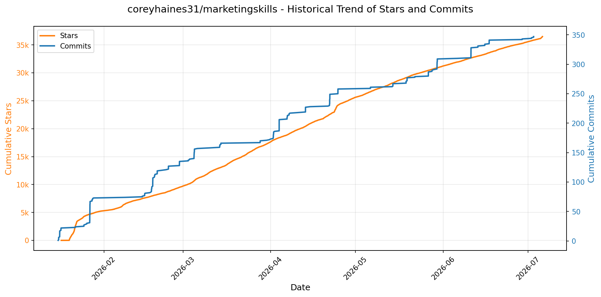

> *蓝色：累计 Stars｜橙色：累计 Commits（次 Y 轴）*

<b>📄 README 摘要</b>

1. **项目功能**  
该项目是一个面向营销场景的 AI 代理（AI Agent）技能库，专为技术型营销人员和创业者设计，旨在赋能 AI 编程代理自动执行各类专业营销任务。其核心作用是通过结构化 Markdown 技能文件，为 AI 代理提供领域知识、标准化工作流程与最佳实践框架，使其能精准识别用户意图（如“优化落地页转化率”或“撰写邮件序列”），并调用对应技能完成端到端任务。所有技能以 `product-marketing` 为统一上下文基础，确保跨技能协同时共享产品定位、目标用户与市场策略，实现语义连贯、逻辑一致的自动化营销操作。

2. **关键特性**  
- **模块化技能体系**：涵盖 45+ 个高复用性营销技能，按职能划分为转化优化（CRO）、内容与文案、SEO 与发现、付费投放、数据分析与 A/B 测试、用户留存、增长工程、战略与变现、销售与营收运营（RevOps）九大类别；  
- **深度技能协同**：技能间存在明确依赖与交叉引用关系（如 `copywriting` ↔ `cro` ↔ `ab-testing`，`seo-audit` ↔ `schema` ↔ `ai-seo`），支持多步骤、跨领域复合任务自动化；  
- **统一上下文锚点**：强制所有技能优先读取 `product-marketing.md` 文件，构建产品-用户-定位三要素基线，保障输出一致性与业务对齐；  
- **多平台兼容性**：原生支持 Claude Code、OpenAI Codex、Cursor、Windsurf 等主流 AI 编程代理，并遵循开放的 [Agent Skills 规范](https://agentskills.io)，具备良好扩展性；  
- **灵活部署方案**：提供 CLI 安装（`npx skills`）、Claude 插件、Git 子模块、SkillKit 多代理管理、手动克隆及定制化 Fork 六种集成方式，适配不同开发工作流；  
- **版本演进与迁移支持**：v2.0 实现技能命名规范化与功能整合（如合并 `page-cro`/`form-cro` 为 `cro`），并提供完整旧版清理指南与上下文文件迁移脚本，保障平滑升级。

3. **技术栈**  
- **核心格式**：纯文本 Markdown（`.md`）文件，作为 AI 代理可解析的知识载体与指令模板；  
- **运行环境**：不依赖特定后端服务，完全运行于支持 Agent Skills 规范的 AI 编程代理客户端（如 Claude Code、Cursor 等）；  
- **安装与管理工具**：基于 Node.js 的命令行工具链（`npx skills`、`npx skillkit`），利用 npm 包管理机制实现技能的发现、安装、更新与卸载；  
- **基础设施层**：采用 Git 版本控制托管技能源码，支持 submodule、fork + sync 等协作模式；  
- **协议标准**：遵循开源的 [Agent Skills Specification](https://agentskills.io)，确保技能定义、加载机制与调用接口的跨平台互通性；  
- **许可证**：MIT 开源许可，允许自由使用、修改与分发。

---

### 17. [lfnovo/open-notebook](https://github.com/lfnovo/open-notebook)
- 📅 **创建日期**：2024-10-21  
- 🔄 **最近更新**：2026-07-06  
- ⭐ **Stars**：35,081（日 +136｜周 +1169｜月 +8986）  
- 📝 **描述**：An Open Source implementation of Notebook LM with more flexibility and features  

<b>📈 Star 与 Commit 历史趋势</b>

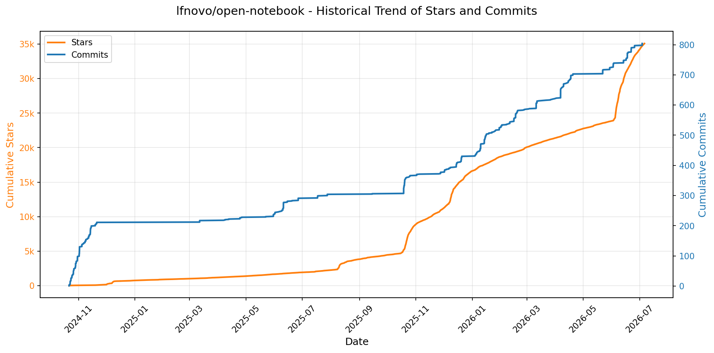

> *蓝色：累计 Stars｜橙色：累计 Commits（次 Y 轴）*

<b>📄 README 摘要</b>

1. **项目功能**  
Open Notebook 是一个开源、注重隐私的本地化知识管理与 AI 协作平台，旨在替代 Google Notebook LM。它允许用户完全自主地管理研究数据，支持在本地或私有环境中部署，所有内容（PDF、视频、音频、网页、Office 文档等）均存储于用户可控环境；通过集成多种 AI 服务，实现基于个人知识库的智能问答、内容摘要、多模态搜索、专业级多角色播客生成及结构化笔记创作，核心目标是提供数据主权、模型自由选择和免厂商锁定的全栈研究增强体验。

2. **关键特性**  
- **隐私优先架构**：100% 本地/自托管运行，无数据上传至第三方云服务；支持端到端加密与可选密码保护。  
- **多模型 AI 支持**：原生兼容 18+ AI 提供商（OpenAI、Anthropic、Google GenAI、Ollama、LM Studio、Groq、Mistral、DeepSeek、xAI 等），涵盖大语言模型、嵌入、语音识别与合成能力。  
- **多模态内容处理**：统一导入并索引 PDF、音视频、网页、文本等多种格式，支持全文检索与向量搜索。  
- **高级播客生成**：支持 1–4 名定制化虚拟发言人（含声音、语调、角色设定），生成专业级对话式播客，远超竞品的双人限制。  
- **上下文感知交互**：在笔记、聊天、搜索中自动关联用户知识库，实现“用你的资料对话 AI”。  
- **可编程性与扩展性**：提供完整 REST API、MCP（Model Context Protocol）集成（支持 Claude Desktop/VS Code）、自定义内容转换流水线及开源代码级定制能力。  
- **多语言支持**：UI 全面支持简体中文、繁体中文、日语、韩语、葡萄牙语、俄语、西班牙语、德语、法语、孟加拉语等 10+ 语言。

3. **技术栈**  
- **后端**：Python（FastAPI 框架）、LangChain（AI 编排与 RAG）、Esperanto（统一 AI 提供商适配层）  
- **数据库**：SurrealDB（实时、图+文档混合型数据库，支持 WebSocket RPC 与 ACID 事务）  
- **前端**：Next.js（React 框架，SSR/ISR 支持）、TypeScript、Tailwind CSS  
- **部署与基础设施**：Docker / Docker Compose（默认一键部署）、支持 Ollama 本地模型运行、兼容云服务器与边缘设备  
- **AI 集成层**：通过 Esperanto 库抽象化各厂商 API（LLM、Embedding、STT、TTS），实现跨平台模型即插即用

---

### 18. [calesthio/OpenMontage](https://github.com/calesthio/OpenMontage)
- 📅 **创建日期**：2026-03-29  
- 🔄 **最近更新**：2026-07-06  
- ⭐ **Stars**：33,794（日 +520｜周 +6408｜月 +29410）  
- 📝 **描述**：World's first open-source, agentic video production system. 12 pipelines, 52 tools, 500+ agent skills. Turn your AI coding assistant into a full video production studio.  

<b>📈 Star 与 Commit 历史趋势</b>

> *蓝色：累计 Stars｜橙色：累计 Commits（次 Y 轴）*

<b>📄 README 摘要</b>

1. **项目功能**  
OpenMontage 是首个开源、基于智能体（agentic）的端到端视频生产系统。它将AI编程助手（如Cursor、Copilot、Claude Code等）转化为完整的视频制作工作室：用户仅需用自然语言描述创意需求（例如“制作一段60秒的量子计算科普动画”），系统即自动执行全流程——包括实时网络调研、脚本撰写与语音合成、多源资产生成（AI图像/视频、免费开源影像库检索、 royalty-free 音乐自动匹配）、分镜策划、逐帧编辑、字幕精准同步（词级时间戳）、多引擎渲染（Remotion或HyperFrames）及最终视频封装。其核心突破在于支持真正意义上的**实拍素材视频生成**（而非仅靠静态图+动画模拟），通过CLIP语义检索从Archive.org、NASA、Wikimedia Commons、Pexels等开放资源库中获取真实动态镜头，并剪辑合成完整成片，全程无需依赖闭源大模型视频生成API。

2. **关键特性**  
- **全链路智能体驱动流程**：严格遵循 `research → proposal → script → scene_plan → assets → edit → compose` 七阶段标准化管线，每阶段由可审计的Markdown技能文档（director skill）指导AI执行；  
- **双模渲染架构**：默认使用React框架的Remotion实现数据可视化/图文动画；支持HTML+GSAP的HyperFrames引擎，专用于动态图形、SVG角色动画及网页转视频；  
- **实时协作式创作界面Backlot**：本地化“片场看板”，动态展示生产进度、剧本页、分镜卡（含多版本预览/成本/质量评分）、人工审批闸门（script gate/storyboard gate），支持回放完整生产过程；  
- **零API键免费能力完备**：内置离线Piper TTS语音、FFmpeg后处理、开源影像库（NASA/Archive.org/Wikimedia）检索、Remotion/HyperFrames渲染、WhisperX字幕生成；  
- **参考视频启动模式**：粘贴YouTube/Short/TikTok链接，自动解析节奏、结构、风格，输出保留原优点+主题/视觉重构的差异化方案及成本预估；  
- **多模态资产融合**：支持混合使用AI生成图像（FLUX/GPT-4o）、AI生成视频（Veo/Kling）、实拍素材、SVG角色动画、数据图表及自定义粒子特效（火花/花瓣/萤火虫）；  
- **透明化决策机制**：所有工具调用均经7维评分（质量/成本/速度/版权/兼容性/稳定性/可复现性），生成可追溯日志；每步创意决策需人工确认，杜绝黑箱输出。

3. **技术栈**  
- **核心语言与运行时**：Python 3.10+（主控逻辑、Agent调度、工具注册中心、Backlot服务）、Node.js 18+（Remotion/HyperFrames渲染引擎）；  
- **AI模型与服务层**：  
  - 文本/语音：OpenAI GPT、Claude、XAI Grok、ElevenLabs、Google TTS、Piper（离线TTS）；  
  - 图像生成：FLUX、GPT-4o Image、Recraft、Imagen；  
  - 视频生成：Google Veo、Kling、MiniMax、Runway Gen-4、HeyGen网关、本地GPU模型（Wan2.1、Hunyuan、CogVideo）；  
  - 语音识别/字幕：WhisperX（词级对齐）；  
- **媒体处理**：FFmpeg（编码/混音/调色/硬字幕烧录）；  
- **渲染引擎**：Remotion（React-based，支持弹簧动画/数据图表/对话头像）、HyperFrames（HTML/CSS/GSAP，支持SVG角色绑定/运动轨迹/动态排版）；  
- **素材检索**：CLIP多模态向量检索（对接Pexels、Pixabay、Unsplash、Archive.org、NASA、Wikimedia Commons）；  
- **基础设施**：Git版本控制、Makefile自动化部署、`.env`密钥管理、JSON可扩展工具注册表（tool_registry）；  
- **开发体验**：深度适配AI编程助手（Cursor/Copilot等），支持自然语言指令驱动全流程。

---

### 19. [harvard-edge/cs249r_book](https://github.com/harvard-edge/cs249r_book)
- 📅 **创建日期**：2023-09-06  
- 🔄 **最近更新**：2026-07-06  
- ⭐ **Stars**：27,125（日 +276｜周 +1891｜月 +2254）  
- 📝 **描述**：Machine Learning Systems  

<b>📈 Star 与 Commit 历史趋势</b>

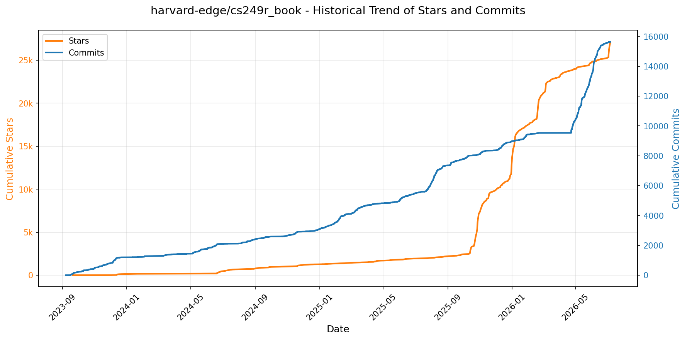

> *蓝色：累计 Stars｜橙色：累计 Commits（次 Y 轴）*

<b>📄 README 摘要</b>

1. **该项目做什么？**  
该项目是一个面向“机器学习系统工程”（ML Systems Engineering）的开源、一体化教学与实践平台，旨在填补当前AI教育中“仅训练模型”与“真实世界工程化部署”之间的根本性鸿沟。它不聚焦于算法或模型本身，而是系统性地教授如何设计、构建、优化、部署和治理端到端的智能系统——涵盖从单芯片/单设备（如Arduino、Raspberry Pi）到千卡GPU集群、从训练推理延迟瓶颈到功耗/带宽/容错等物理约束的全栈能力。其核心产出是一套MIT Press出版的两卷本权威教材（2026年发行纸质版），并配套可执行、可验证、可扩展的工程化学习组件，服务于学生自学、高校授课与工业界人才能力建设。

2. **关键特性**  
- **一体化课程架构**：所有组件（教材、TinyTorch、Labs、硬件套件、MLSys·im模拟器、StaffML面试训练、Socratiq智能学习工具等）深度耦合，形成“读→探→建→模→部→练→教”的闭环学习循环；  
- **动手优先（Build-First）范式**：通过TinyTorch（20步手写完整PyTorch风格框架）强制内化底层机制；通过真实嵌入式硬件套件（Arduino/Seeed/Grove/RPi）直面内存、功耗、实时性等物理约束；  
- **可量化的系统建模能力**：MLSys·im提供基础设施级仿真引擎，支持在无法访问真实超大规模集群的情况下，精确计算KV缓存内存占用、网络带宽饱和点、调度延迟瓶颈等关键指标；  
- **面向工程实践的能力验证体系**：StaffML提供基于物理原理的ML系统岗位面试题库（含模拟面试、进度追踪、错题分析），超越工具链操作，聚焦系统级权衡判断；  
- **教育者就绪（Instructor-Ready）生态**：提供完整16周双学期教学蓝图（AI Engineering Blueprint）、Beamer课件（含4种主题变体）、评估量规、助教手册及课程地图，支持开箱即用的课堂教学；  
- **开放演进与社区共建**：全栈开源（CC BY-NC-SA 4.0许可），持续集成CI验证各模块（教材、TinyTorch、实验、套件、模拟器等），由全球贡献者协同迭代内容、修复错误、适配新硬件。

3. **技术栈**  
- **核心语言与框架**：Python（主导，用于TinyTorch、MLSys·im、Labs/Marimo笔记本、StaffML后端）；C/C++（硬件套件底层驱动与性能敏感模块）；LaTeX（教材与课件排版，Beamer）；  
- **交互式学习环境**：Marimo（现代化Python笔记本框架，支撑Labs交互实验）；Socratiq（基于AI的阅读增强工具，集成上下文测验与间隔重复）；  
- **仿真与建模**：MLSys·im（自研Python仿真引擎，支持量化基础设施建模与性能预测）；  
- **硬件与嵌入式**：Arduino IDE、PlatformIO、Raspberry Pi OS、Grove传感器生态、Seeed Studio开发板；  
- **教学交付与协作**：GitHub Actions（全链路CI/CD验证，覆盖教材渲染、代码测试、幻灯片生成、新闻简报同步）；Jupyter/Marimo（实验环境）；Google Slides/Beamer（课件）；Buttondown（邮件简报）；  
- **辅助工具链**：Git（版本协同）、OpenCollective（资金支持）、IEEE引用标准（学术规范）。

---

### 20. [DeusData/codebase-memory-mcp](https://github.com/DeusData/codebase-memory-mcp)
- 📅 **创建日期**：2026-02-24  
- 🔄 **最近更新**：2026-07-06  
- ⭐ **Stars**：26,757（日 +446｜周 +6610｜月 +23788）  
- 📝 **描述**：High-performance code intelligence MCP server. Indexes codebases into a persistent knowledge graph — average repo in milliseconds. 158 languages, sub-ms queries, 99% fewer tokens. Single static binary, zero dependencies.  

<b>📈 Star 与 Commit 历史趋势</b>

> *蓝色：累计 Stars｜橙色：累计 Commits（次 Y 轴）*

<b>📄 README 摘要</b>

1. **项目功能**  
该项目是一个面向 AI 编程代理（AI coding agents）的超高速、本地化代码智能引擎，核心能力是**对代码库进行毫秒级全量结构化索引，并构建持久化的知识图谱（Knowledge Graph）**。它不运行大语言模型（LLM），而是作为 MCP（Model Context Protocol）标准下的结构化分析后端，为各类兼容 MCP 的编程代理（如 Claude Code、VS Code、Aider 等）提供低延迟、高精度的代码理解能力。用户只需说“Index this project”，即可自动完成索引；后续所有查询（如“谁调用了 ProcessOrder？”“影响哪些 HTTP 路由？”“检测死代码？”）均由该引擎在图谱上执行毫秒级结构化查询并返回结构化结果，由代理层负责自然语言解释与呈现。

2. **关键特性**  
- **极致性能**：Linux 内核（2800 万行代码、7.5 万文件）3 分钟完成全量索引；典型查询（如 Cypher 图遍历、调用链追踪）响应 <1ms；内存使用为 RAM-first 设计（LZ4 压缩读取 + 内存 SQLite + 索引完成后释放）。  
- **全栈语言支持**：原生内置 158 种编程语言的 Tree-sitter 语法解析器（全部编译进二进制），并为 Python、TS/JS、PHP、C#、Go、C/C++、Java、Kotlin、Rust 等 9 种语言提供 **Hybrid LSP 语义类型解析**（纯 C 实现，兼容主流语言服务器逻辑），实现精准的函数签名、类型推导、继承/实现关系、HTTP 路由绑定等。  
- **14 个开箱即用的 MCP 工具**：涵盖 `search_graph`（结构化图搜索）、`semantic_query`（多信号融合的向量语义搜索，含内置 `nomic-embed-code` 模型）、`trace_path`（调用链追踪）、`get_architecture`（架构概览）、`detect_changes`（Git diff 影响分析）、`manage_adr`（架构决策记录）、`dead_code_detection`、`cypher_query`、跨服务 HTTP/gRPC/GraphQL 链接、跨仓库（Cross-repo）知识图谱聚合、基础设施即代码（Docker/K8s/Kustomize）节点建模等。  
- **零依赖单体二进制**：全平台（macOS/Linux/Windows）静态链接，无 Docker、无运行时依赖、无 API Key；支持一键安装（`install.sh`/`install.ps1`），自动适配并配置 11 种主流编码代理（Claude Code、Zed、VS Code 等）的 MCP 集成。  
- **团队协作增强**：支持将压缩的知识图谱快照（`.codebase-memory/graph.db.zst`）提交至 Git 仓库，新成员克隆后可秒级加载基础图谱并仅增量索引本地变更，消除重复索引开销；自动配置 `.gitattributes` 防止二进制文件合并冲突。  
- **安全与隐私优先**：100% 本地运行，代码永不离开设备；所有发布版本经 VirusTotal 多引擎扫描、SLSA Level 3 供应链认证、OpenSSF Scorecard 评估；二进制签名+校验和验证。

3. **技术栈**  
- **核心语言与运行时**：纯 C 语言实现（关键模块如 Hybrid LSP 解析器、索引管道、SQLite 接口），确保零依赖、高性能与跨平台兼容性；静态链接所有依赖（zlib、LZ4、SQLite3）。  
- **解析与语义分析**：Tree-sitter（158 种语言语法树构建）；自研 Hybrid LSP（C 实现，支持类型推断、泛型替换、JSX 分发、JSDoc 解析、命名空间/特质/静态绑定等语义能力）。  
- **知识图谱存储与查询**：基于 SQLite（内存中构建，最终持久化至 `~/.cache/codebase-memory-mcp/`）；支持 FTS5 全文检索（定制 camelCase/snake_case 分词器）、Cypher 类图查询语法、自定义边类型（`CALLS`, `HTTP_CALLS`, `EMITS`, `DATA_FLOWS`, `SEMANTICALLY_RELATED` 等）。  
- **嵌入与搜索**：内置量化版 `nomic-embed-code` 模型（int8, 768 维），支持无网络语义向量搜索；融合 11 种信号（TF-IDF、RRI、AST 特征、数据流、Halstead 度量、MinHash、模块邻近度等）的混合打分。  
- **基础设施与分发**：LZ4 压缩、zstd 快照打包；支持 Homebrew / Scoop / Winget / Chocolatey / AUR / npm / PyPI / `go install` 多渠道分发；内置 3D 图可视化 UI（可选变体，基于 Web 技术运行于 `localhost:9749`）。

---

### 21. [JCodesMore/ai-website-cloner-template](https://github.com/JCodesMore/ai-website-cloner-template)
- 📅 **创建日期**：2026-03-13  
- 🔄 **最近更新**：2026-07-06  
- ⭐ **Stars**：25,866（日 +226｜周 +2799｜月 +9587）  
- 📝 **描述**：Clone any website with one command using AI coding agents  

<b>📈 Star 与 Commit 历史趋势</b>

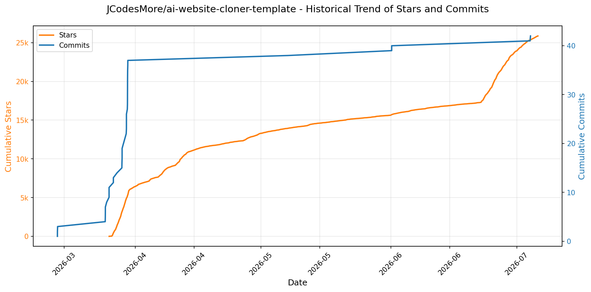

> *蓝色：累计 Stars｜橙色：累计 Commits（次 Y 轴）*

<b>📄 README 摘要</b>

1. **该项目的功能**  
该项目是一个可复用的 AI 网站克隆模板，旨在通过 AI 编程代理（AI coding agents）对任意目标网站进行逆向工程，自动生成结构清晰、现代化的 Next.js 代码库。用户只需提供目标网站 URL，运行 `/clone-website` 指令，AI 代理便会自动完成：全站截图与交互探测（滚动、点击、悬停、响应式测试）、设计令牌（字体、颜色、间距等）提取、静态资源（图片、图标、视频、SEO 资源）下载、组件级详细规格文档生成，并并行构建各页面区块，最终组装成功能完整、视觉一致的 Next.js 应用。

2. **核心特性**  
- **多阶段自动化克隆流水线**：涵盖侦察（Reconnaissance）、基础配置（Foundation）、组件规格化（Component Specs）、并行构建（Parallel Build）及集成质检（Assembly & QA）五大阶段；  
- **精准设计还原能力**：基于 `getComputedStyle()` 获取真实 CSS 值，支持多状态（hover/focus/active）、响应式断点、交互行为建模与资产路径绑定，杜绝“猜测式”实现；  
- **多 AI 代理兼容架构**：原生支持 Claude Code（推荐 Opus 4.8）、Codex CLI、GitHub Copilot、Cursor、Gemini CLI 等 13+ 主流 AI 编程工具，通过统一配置文件（`AGENTS.md`）驱动跨平台适配；  
- **开箱即用的现代前端栈**：内置 shadcn/ui + Tailwind CSS v4（Oklch 色彩模型）、React 19、TypeScript 严格模式与 Next.js 16 App Router；  
- **工程化可维护性设计**：采用 Git worktree 实现并行构建隔离，自动生成研究文档（`docs/research/`）、设计参考截图（`docs/design-references/`）及提取图标（`src/components/icons.tsx`），支持一键同步各平台指令与技能定义。

3. **技术栈**  
- **框架与运行时**：Next.js 16（App Router）、React 19、Node.js 24+；  
- **样式与 UI**：Tailwind CSS v4（基于 Oklch 色彩空间的设计令牌系统）、shadcn/ui（基于 Radix UI Primitives 的可定制组件库）；  
- **开发与工具链**：TypeScript（严格类型检查）、ESLint、Docker Compose（支持容器化开发/部署）、`npm` 脚本驱动工作流；  
- **AI 集成层**：以 Markdown 技能文档（`.claude/skills/...`）和标准化指令文件（`AGENTS.md`、`CLAUDE.md`、`GEMINI.md`）为桥梁，实现与各类 AI 编程代理的协议互通；  
- **资源处理**：自动下载并归类 `public/images/`、`public/videos/`、`public/seo/` 等静态资源，SVG 图标自动提取并注入为 React 组件。

---

### 22. [openai/codex-plugin-cc](https://github.com/openai/codex-plugin-cc)
- 📅 **创建日期**：2026-03-30  
- 🔄 **最近更新**：2026-07-06  
- ⭐ **Stars**：25,686（日 +944｜周 +3898｜月 +5454）  
- 📝 **描述**：Use Codex from Claude Code to review code or delegate tasks.  

<b>📈 Star 与 Commit 历史趋势</b>

> *蓝色：累计 Stars｜橙色：累计 Commits（次 Y 轴）*

<b>📄 README 摘要</b>

1. **该项目的作用**  
该插件为 Claude Code 用户提供与 OpenAI Codex 的深度集成，使其能够在不离开当前开发环境的前提下，直接调用 Codex 执行各类代码智能任务。核心用途包括：对本地代码变更或分支差异进行自动化代码审查（含常规审查与对抗式审查）、将调试/修复/重构等开发任务委托给 Codex 异步执行、在 Claude Code 与 Codex 之间双向迁移会话上下文、实时监控和管理后台 Codex 任务状态（启动、查询、取消、获取结果），并支持可选的“审查门控”机制——即在 Claude 生成响应前自动触发针对性 Codex 审查，拦截潜在问题。

2. **关键特性**  
- **多模式代码审查**：`/codex:review` 提供标准只读审查；`/codex:adversarial-review` 支持 steerable（可引导）审查，聚焦设计权衡、隐含假设、失败模式及替代方案，支持自定义焦点文本。  
- **任务委托与协作**：`/codex:rescue` 可将 bug 调查、补丁生成、回归分析等任务交由 Codex 处理，支持模型选择（如 `spark`/`gpt-5.4-mini`）、努力等级（`effort`）、断点续跑（`--resume`）及后台执行。  
- **会话无缝迁移**：`/codex:transfer` 将当前 Claude Code 对话导出为持久化 Codex 会话，生成 `codex resume <id>` 命令，实现跨工具上下文延续。  
- **全生命周期任务管理**：通过 `/codex:status` 实时查看运行中/历史任务；`/codex:result` 获取结构化输出及会话 ID；`/codex:cancel` 终止活跃任务。  
- **智能门控机制**：`/codex:setup --enable-review-gate` 启用审查门控，在 Claude 输出前自动触发轻量级 Codex 审查，阻断高风险建议（需人工监控以防循环耗尽配额）。  
- **配置继承与本地化**：完全复用用户已有的 Codex CLI 配置（`~/.codex/config.toml` 或项目级 `.codex/config.toml`），支持模型、推理强度、API 端点等全量参数覆盖。

3. **技术栈**  
- **运行时依赖**：Node.js ≥18.18（用于插件自身执行与 CLI 集成）；全局安装的 `@openai/codex` CLI 工具（v0.7+，提供 `codex` 二进制命令及 App Server）；ChatGPT 订阅或 OpenAI API Key（用于 Codex 身份认证与计费）。  
- **集成架构**：基于 Claude Code 插件系统开发，通过命令行接口（slash commands）与底层 Codex CLI 进程通信；利用 Codex App Server 提供的本地 HTTP 接口协调任务调度；会话迁移依赖 Codex 内置的外部代理会话导入功能（JSONL 格式转换）。  
- **配置体系**：采用 TOML 格式配置文件（`config.toml`），支持用户级与项目级配置层级，兼容 Codex 官方配置规范（如 `model`、`model_reasoning_effort`、`openai_base_url`）。

---

### 23. [mukul975/Anthropic-Cybersecurity-Skills](https://github.com/mukul975/Anthropic-Cybersecurity-Skills)
- 📅 **创建日期**：2026-02-25  
- 🔄 **最近更新**：2026-07-06  
- ⭐ **Stars**：24,755（日 +218｜周 +1924｜月 +10322）  
- 📝 **描述**：817 structured cybersecurity skills for AI agents · Mapped to 6 frameworks: MITRE ATT&CK, NIST CSF 2.0, MITRE ATLAS, D3FEND, NIST AI RMF & MITRE F3 (Fight Fraud) · agentskills.io standard · Works with Claude Code, GitHub Copilot, Codex CLI, Cursor, Gemini CLI & 20+ platforms · 29 security domains · Apache 2.0  

<b>📈 Star 与 Commit 历史趋势</b>

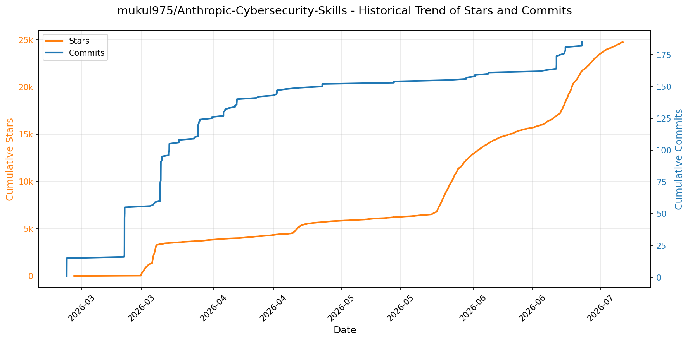

> *蓝色：累计 Stars｜橙色：累计 Commits（次 Y 轴）*

<b>📄 README 摘要</b>

1. **该项目做什么？**  
该项目是一个面向AI代理（AI agents）的、大规模开源网络安全技能库，旨在为AI系统赋予资深安全分析师级别的专业能力。它不提供可执行脚本或工具，而是以结构化、标准化的方式封装817个生产级网络安全技能，覆盖29个安全领域（如云安全、威胁狩猎、数字取证、红队、API安全等），使AI代理能在真实安全任务中按专家级流程自主决策与执行——例如分析内存转储识别凭证窃取、检测商业邮件欺诈（BEC）、响应勒索软件事件等。其核心价值是填补当前大模型“懂通用知识但缺领域工作流”的关键缺口，将人类分析师的实战经验转化为AI可理解、可检索、可执行的结构化知识单元。

2. **关键特性**  
- **全框架统一映射**：每个技能均严格映射至六大权威安全与AI治理框架——MITRE ATT&CK v19.1（15战术/286技术）、NIST CSF 2.0（6职能/22类别）、MITRE ATLAS v5.4（AI对抗威胁）、MITRE D3FEND v1.3（267防御技术）、NIST AI RMF 1.0（AI风险管理）、MITRE Fight Fraud Framework（F3）v1.1（首次引入金融欺诈专属战术“Positioning”与“Monetization”，含94个欺诈相关技能）。  
- **AI原生设计**：遵循[agentskills.io](https://agentskills.io)开放标准，采用YAML前言+结构化Markdown格式，支持亚秒级技能发现（仅扫描30 token前言即可匹配）与渐进式加载（完整技能500–2000 tokens），适配有限上下文窗口。  
- **深度领域覆盖**：817个技能全部源自真实安全实践，非LLM生成摘要；涵盖29个垂直领域（如OT/ICS、硬件固件安全、欺骗技术等冷门但关键方向），并明确标注使用场景（When to Use）、前提条件（Prerequisites）、分步工作流（Workflow）及结果验证方法（Verification）。  
- **合规与安全优先**：明确声明仅限授权场景使用（渗透测试、研究、防御、教育），内置法律与伦理约束提示；所有技能均经人工验证，ATT&CK ID零废弃、零过期；提供完整的MITRE Navigator图层、STIX兼容映射及开放式贡献机制（PR Welcome）。  
- **即插即用生态集成**：开箱支持Claude Code、GitHub Copilot、Cursor、Gemini CLI等主流AI开发平台，且已验证兼容Hermes Agent等先进智能体框架；提供Playground（Casky.ai）实现零配置实时技能演练。

3. **技术栈**  
- **数据格式标准**：`agentskills.io`开放规范（YAML frontmatter + Markdown body）  
- **核心内容组织**：纯文本文件系统（Git托管），目录结构清晰（`skills/{skill-name}/SKILL.md`, `references/`, `scripts/`, `assets/`）  
- **元数据验证工具**：`mitreattack-python`（ATT&CK v19.1映射校验）、STIX 2.1（F3框架上游数据对接）  
- **前端展示与交互**：GitHub Pages / Markdown渲染；Casky.ai Playground（基于Web的AI技能沙箱环境）  
- **构建与分发**：`npx skills add` CLI命令（标准化技能安装协议）；GitHub Releases（含ATT&CK Navigator图层等资产包）  
- **许可证**：Apache License 2.0（允许商用、修改与分发，需保留版权声明）

---

### 24. [OthmanAdi/planning-with-files](https://github.com/OthmanAdi/planning-with-files)
- 📅 **创建日期**：2026-01-03  
- 🔄 **最近更新**：2026-07-06  
- ⭐ **Stars**：24,732（日 +225｜周 +674｜月 +2061）  
- 📝 **描述**：Persistent file-based planning for AI coding agents and long-running agentic tasks. Crash-proof markdown plans that survive context loss and /clear, plus a deterministic completion gate and multi-agent shared state on disk. Manus-style. Works with Claude Code, Codex CLI, Cursor, Kiro, OpenCode and 60+ agents via the SKILL.md standard.  

<b>📈 Star 与 Commit 历史趋势</b>

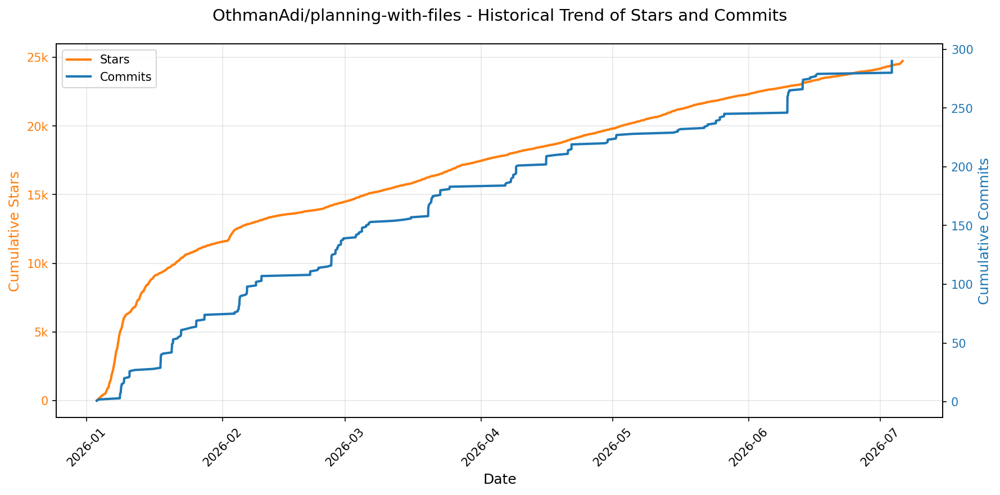

> *蓝色：累计 Stars｜橙色：累计 Commits（次 Y 轴）*

<b>📄 README 摘要</b>

1. **项目功能**  
该项目是一个面向 AI 编程代理（AI coding agents）的**持久化、基于文件的规划能力（file-based planning skill）**，核心目标是解决 AI 代理在运行过程中因上下文丢失（context loss）、手动清空对话（`/clear`）、进程崩溃或会话中断而导致的规划状态丢失问题。它通过在本地磁盘持续保存三个关键 Markdown 文件——`task_plan.md`（任务计划）、`findings.md`（发现记录）和 `progress.md`（进度日志）——实现规划状态的跨会话持久化与自动恢复。v3.0.0 起新增**可选的自主模式（autonomous mode）与门控模式（gated mode）**，支持长时间运行的智能体任务，并引入**完成门控机制（completion gate）**：仅当满足五项严格条件（如存在进行中阶段、门控启用、未达阻塞上限等）时才主动暂停代理，确保“计划真正完成”而非仅表面完成，从而显著提升任务可靠性与终态确定性。

2. **关键特性**  
- ✅ **持久化规划状态**：三文件（`task_plan.md`/`findings.md`/`progress.md`）本地存储，抗 `/clear`、崩溃、重启；支持 Windows/macOS/Linux 多平台路径与编码鲁棒性修复。  
- ✅ **多代理兼容性**：遵循 SKILL.md 标准，开箱即用于 **60+ 种 AI 编程代理**（Claude Code、Codex、Pi、Hermes、Cursor、CodeBuddy、Continue 等），含 IDE 特定适配器与完整钩子生命周期支持（SessionStart/PreToolUse/Stop/PreCompact 等）。  
- ✅ **v3 智能运行模式**：  
　• `--autonomous`：针对强模型优化，减少冗余计划注入，仅在回合起始注入；  
　• `--gated`：启用完成门控，结合结构化 JSONL 运行账本（`ledger-append`）、SHA256 计划认证（attestation）、nonce 防篡改、realpath 安全路径解析。  
- ✅ **安全与可靠性强化**：计划文件 SHA256 哈希认证（`/plan-attest`）、原子写入+可选 `flock` 并发锁、防注入分隔符、Windows/Git Bash 兼容性修复、POSIX 脚本可移植性、执行策略加固。  
- ✅ **生态扩展能力**：支持多项目、多级任务编排（plan-cascade）、多智能体协作、GitHub 仓库审计流水线、融资里程碑托管（agentfund-skill）等社区衍生方案；提供 `npx skills add` 一键安装、技能注册中心（Skills Playground）、双语（EN/中文）技能枢纽集成。

3. **技术栈**  
- **核心语言与脚本**：Bash（主逻辑，含 POSIX 兼容改造）、PowerShell（Windows 支持）、Python（路径解析、测试、工具脚本如 `session-catchup.py`）、TypeScript（Pi 扩展 SDK）；  
- **协议与标准**：SKILL.md 技能描述规范、JSONL（运行账本 `ledger-append`）、YAML（SKILL.md frontmatter）、Markdown（规划文件格式）；  
- **基础设施**：`$XDG_CACHE_HOME/pwf-sha`（SHA 缓存目录）、SQLite（OpenCode 适配）、Git（会话同步）、`flock`（文件锁）、`rg`/`grep`（CLI 工具链）；  
- **测试与质量保障**：pytest（单元/集成测试）、Tessl CI（SKILL.md 质量审查）、A/B 盲测、SkillCheck 验证、第三方安全审计（Security Verified）、96.7% 基准通过率；  
- **部署与分发**：npm（`npx skills add`）、GitHub Releases、ClawHub、Codex/Cursor 插件系统、`.pi`/`.codex`/`.hermes` 等平台专属适配器。

---

### 25. [alibaba/page-agent](https://github.com/alibaba/page-agent)
- 📅 **创建日期**：2025-09-23  
- 🔄 **最近更新**：2026-07-06  
- ⭐ **Stars**：24,116（日 +707｜周 +3510｜月 +5815）  
- 📝 **描述**：JavaScript in-page GUI agent. Control web interfaces with natural language.  

<b>📈 Star 与 Commit 历史趋势</b>

> *蓝色：累计 Stars｜橙色：累计 Commits（次 Y 轴）*

<b>📄 README 摘要</b>

1. **项目功能**  
Page Agent 是一个嵌入网页的客户端 GUI 智能体（GUI Agent），允许用户通过自然语言指令直接操控当前网页的界面元素（如点击按钮、填写表单、导航菜单等）。它无需后端服务、浏览器扩展或 headless 浏览器，所有操作均在浏览器内完成，基于 DOM 解析与文本化指令理解实现 Web 界面的语义化控制，适用于 SaaS 应用集成、智能表单填充、无障碍访问（语音/屏幕阅读器支持）等场景。

2. **核心特性**  
- **零依赖轻量集成**：仅需一行 `<script>` 标签或 NPM 引入，纯前端运行，不依赖浏览器扩展、Python 或远程渲染环境；  
- **纯文本 DOM 操作**：不依赖截图或视觉模型，完全基于 HTML 结构分析与可访问性（a11y）属性进行元素定位与操作；  
- **BYO-LLM（自带大模型）**：支持对接任意兼容 OpenAI 兼容 API 的 LLM（如 Qwen、DashScope、Ollama 等），可自定义模型、baseURL 和 API Key；  
- **可选增强能力**：提供 Chrome 扩展支持跨标签页任务编排，以及 MCP Server（Beta）实现外部系统对浏览器的远程控制；  
- **开箱即用的 Demo 模式**：提供免费测试 API（含使用条款），支持一键启用交互式演示代理；  
- **多语言与无障碍优先**：内置国际化支持（en-US/zh-CN），天然适配语音输入与辅助技术，降低交互门槛。

3. **技术栈**  
- **核心语言**：TypeScript（强类型、高可维护性）；  
- **运行环境**：纯浏览器端（Client-side only），基于现代 Web API（DOM、MutationObserver、Element Internals 等）；  
- **构建与分发**：采用 IIFE（Immediately Invoked Function Expression）格式打包，支持 CDN（jsDelivr / npmmirror）和 NPM；  
- **依赖基础**：深度复用并扩展开源库 [`browser-use`](https://github.com/browser-use/browser-use) 的 DOM 解析、提示工程与交互逻辑；  
- **协议标准**：遵循 OpenAI 兼容 API 规范，支持主流 LLM 服务商（如阿里云 DashScope）；  
- **许可证**：MIT 开源协议。

---

### 26. [alirezarezvani/claude-skills](https://github.com/alirezarezvani/claude-skills)
- 📅 **创建日期**：2025-10-19  
- 🔄 **最近更新**：2026-07-06  
- ⭐ **Stars**：20,789（日 +404｜周 +1312｜月 +3390）  
- 📝 **描述**：337 Claude Code skills & agent skills & plugins (30+ Agents, 70+ custom commands, 330+ skills, customizable references, scripts)for Claude Code, Codex, Gemini CLI, Cursor, and 8 more coding agents — engineering, marketing, product, compliance, C-level advisory, research, business operations, commercial & finance, and your daily productivity skills.  

<b>📈 Star 与 Commit 历史趋势</b>

> *蓝色：累计 Stars｜橙色：累计 Commits（次 Y 轴）*

<b>📄 README 摘要</b>

1. **该项目的功能**  
该项目是一个面向AI编程代理（AI coding agents）的开源技能库，提供354个生产就绪的“Claude Code技能”（亦称代理技能或插件），覆盖工程、DevOps、营销（含AEO——大模型引用优化）、安全（含PreToolUse钩子）、合规、C级高管顾问（支持13类高管角色如CFO/CMO/CISO等及21个`/cs:*`指令）、生产力（如捕获/邮件/反思）、学术研究（文献综述/基金申请/专利分析/课程设计/NotebookLM集成/深度研究等）以及企业级研究运营（临床/市场/产品/研发金融等）。其核心价值在于：将结构化领域知识封装为可复用、跨平台的“专家能力包”，使各类AI编码代理无需从零学习即可获得专业级执行能力。

2. **关键特性**  
- **多平台原生兼容**：开箱支持13种AI编码工具（Claude Code、OpenAI Codex、Gemini CLI、Cursor、Aider、Kilo Code、Windsurf、OpenCode、Augment、Antigravity、Hermes Agent、Mistral Vibe、OpenClaw），通过`convert.sh`脚本一键转换全部技能格式，零手动适配；  
- **三层能力架构**：明确区分Skills（任务执行方法）、Agents（任务目标定义）、Personas（角色化思维模式），支持灵活组合（如“Startup CTO”人格调用工程+战略技能）；  
- **企业级安全与合规**：内置`skill-security-auditor`工具，静态扫描技能包中的命令注入、数据泄露、提权等风险，返回PASS/WARN/FAIL分级结果；预置ISO/FDA/GDPR/SOC2等监管框架模板及签名式决策凭证（agent-decision-receipts）；  
- **高级POWERFUL技能集**：包含25个深度能力技能（如`rag-architect`、`database-designer`、`incident-commander`、`zero-hallucination-coder`工作流），覆盖AI系统设计、可观测性、技术债治理、CI/CD生成等生产级场景；  
- **研究与生产力增强栈**：集成学术研究全链路工具（`litreview`/`deep-research`/`patent`）、企业研究运营（`clinical-research`/`market-research`）、AEO内容优化、多模态输出（Markdown→HTML幻灯片/审阅页/文档）及Loop Library智能循环管理；  
- **完全无依赖Python工具链**：593个CLI脚本全部仅依赖Python标准库，无需pip安装，可在任意Python环境运行（含容器/边缘设备）。

3. **技术栈**  
- **核心格式标准**：遵循`agentskills.io`统一规范，以`SKILL.md`（结构化指令+决策框架）为核心元数据，辅以纯Python CLI工具（stdlib-only）和711份参考模板/检查清单；  
- **跨平台适配层**：Shell脚本（`install.sh`/`convert.sh`）、Python脚本（`sync-hermes-skills.py`）、Bash/PowerShell安装器（如`gemini-install.sh`/`vibe-install.sh`），支持Linux/macOS/WSL；  
- **前端与交付格式**：支持`.mdc`（Cursor）、`CONVENTIONS.md`（Aider）、`.kilocode/rules/`（Kilo Code）、`.windsurf/skills/`（Windsurf）等各工具原生格式；HTML输出模块基于WCAG-AA合规设计系统；  
- **基础设施无关**：所有技能与工具不绑定云服务、数据库或外部API（除可选集成如Google Search Console），离线可用；安全审计、代码分析、指标计算等功能均在本地执行。

---

### 27. [topoteretes/cognee](https://github.com/topoteretes/cognee)
- 📅 **创建日期**：2023-08-16  
- 🔄 **最近更新**：2026-07-06  
- ⭐ **Stars**：19,685（日 +181｜周 +2186｜月 +9567）  
- 📝 **描述**：Cognee is the open-source AI memory platform for agents. Give your AI agents persistent long-term memory across sessions with a self-hosted knowledge graph engine.  

<b>📈 Star 与 Commit 历史趋势</b>

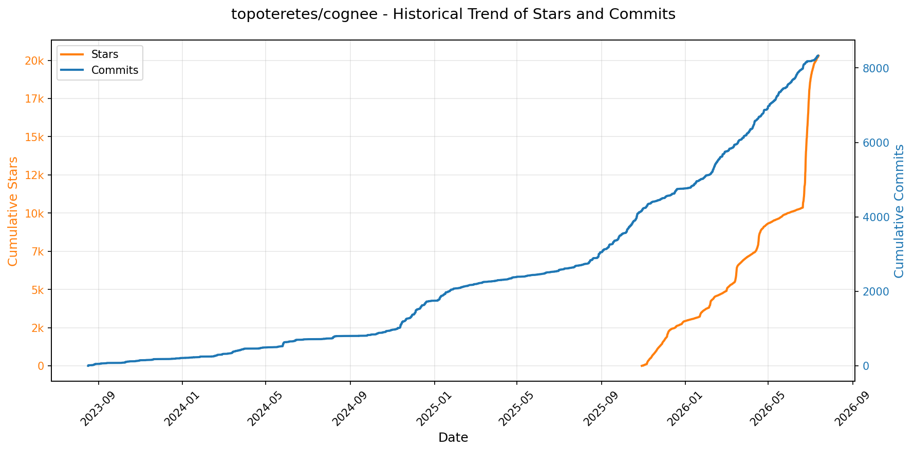

> *蓝色：累计 Stars｜橙色：累计 Commits（次 Y 轴）*

<b>📄 README 摘要</b>

1. **项目功能**  
Cognee 是一个开源的 AI 记忆平台，专为 AI 智能体（Agents）设计，提供跨会话的**持久化长期记忆能力**。它支持从任意格式（文本、PDF、网页、数据库等）摄入数据，自动构建并维护一个**自托管的知识图谱（Knowledge Graph）**，使智能体能够基于语义理解、关系推理与上下文演化进行“回忆”（recall）、“学习”（improve）、“存储”（remember）和“遗忘”（forget）。其核心目标是解决 AI 智能体记忆碎片化、会话孤立、知识无法沉淀与复用的问题，实现企业级“公司大脑”（Company Brain）——统一多源数据、赋予智能体领域知识、支持跨智能体知识共享与持续演进。

2. **关键特性**  
- **多模态统一记忆层**：集成向量检索（语义搜索）、图结构推理（关系导航）与认知科学驱动的本体生成（ontology grounding），实现文档“按意义可搜、按关系可连”。  
- **双层记忆架构**：支持**会话内存**（高速缓存，自动后台同步至图谱）与**永久知识图谱**（长期存储、可追溯、可审计）协同工作。  
- **全栈 Postgres 支持**：首创将图谱关系、向量嵌入（pgvector）、会话缓存、元数据全部运行于单一 PostgreSQL 实例，消除多数据库运维负担，且性能优于传统分离架构（CI 基准快约 10%）。  
- **开箱即用的智能体集成**：提供官方插件支持 Claude Code（持久化会话记忆+自动图谱同步）、OpenClaw；支持 Rust（`cognee-rs`）与 TypeScript（`@cognee/cognee-ts`）客户端，适配多语言生态。  
- **企业级可靠性**：支持租户/用户隔离、OpenTelemetry（OTEL）追踪、审计日志、反馈驱动的学习闭环（`improve` 操作），保障可信、可控、可追溯的智能体行为。  
- **灵活部署与扩展**：支持本地 Python CLI、Docker Compose（含 UI/MCP/Postgres/Neo4j 多配置）、云托管（Cognee Cloud）及一键部署到 Modal/Railway/Fly.io/Render/Daytona 等平台。

3. **技术栈**  
- **核心语言**：Python（主服务，3.10–3.14）  
- **数据库与存储**：PostgreSQL（默认，集成 pgvector + 自研图谱后端）、SQLite（开发模式）、LanceDB / KuzuDB（嵌入式选项）；可选 Neo4j、Amazon Neptune（图谱）、Redis（会话缓存）、Qdrant / ChromaDB / Weaviate / Milvus（向量库，通过社区适配器）  
- **AI 与推理**：LLM 驱动（支持 OpenAI 及其他兼容 API 的提供商），用于文档理解、本体生成、关系抽取与认知建模  
- **基础设施**：Docker / Docker Compose、OCI 兼容运行时（Colima 等）；MCP（Model Context Protocol）服务器支持 HTTP/SSE/stdio 多种传输协议  
- **客户端与 SDK**：Python SDK、Rust crate（`cognee-rs`）、TypeScript 包（`@cognee/cognee-ts`）、CLI 工具（`cognee-cli`）  
- **前端与 UI**：基于 React 的本地 Web UI（通过 `cognee-cli -ui` 启动）  
- **监控与可观测性**：OpenTelemetry（OTEL）集成，支持分布式追踪与审计  
- **研究基础**：融合知识图谱与 LLM 推理的优化方法论（见 arXiv:2505.24478），强调认知科学启发的本体构建与动态关系演化

---

### 28. [allenai/olmocr](https://github.com/allenai/olmocr)
- 📅 **创建日期**：2024-09-17  
- 🔄 **最近更新**：2026-07-06  
- ⭐ **Stars**：18,796（日 +68｜周 +1216｜月 +1455）  
- 📝 **描述**：Toolkit for linearizing PDFs for LLM datasets/training  

<b>📈 Star 与 Commit 历史趋势</b>

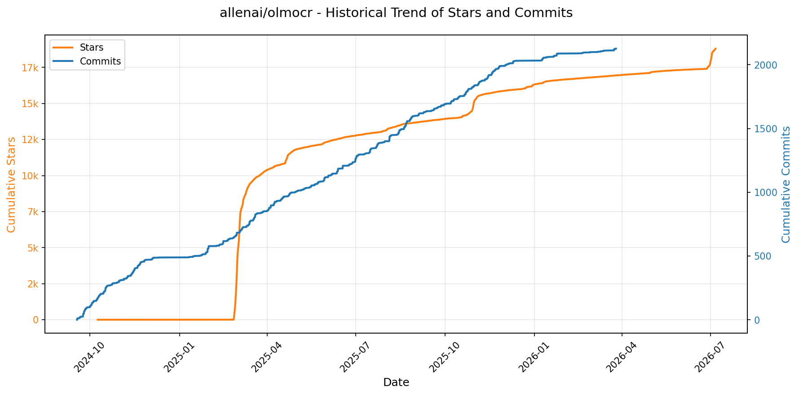

> *蓝色：累计 Stars｜橙色：累计 Commits（次 Y 轴）*

<b>📄 README 摘要</b>

1. **项目功能**  
olmOCR 是一个面向学术与专业文档的高精度视觉语言模型（VLM）驱动型 OCR 工具包，专注于将 PDF、PNG 和 JPEG 等图像类文档（含扫描件、手写稿、多栏排版、公式图表等复杂格式）自动转换为结构清晰、语义连贯、符合自然阅读顺序的纯文本或 Markdown 格式。其核心目标是高效解锁海量 PDF 文档中的高质量文本内容（如科研论文、技术报告），支持大规模批量处理（百万级页面），并已部署为可公开访问的在线演示服务（[olmocr.allenai.org](https://olmocr.allenai.org)）。

2. **关键特性**  
- ✅ **多格式输入支持**：原生处理 PDF（含扫描/数字PDF）、PNG、JPEG；自动解析页面图像。  
- ✅ **复杂内容理解**：精准识别并保留数学公式、表格结构、手写体、嵌入图/文本框、多栏布局及图文混排的逻辑顺序。  
- ✅ **智能预处理**：自动检测并移除页眉/页脚、水印、页码等干扰元素。  
- ✅ **高质量输出**：生成语义完整、段落连贯的 Markdown，保留标题层级、列表、代码块等结构化信息。  
- ✅ **高性能与低成本**：基于 7B 参数 VLM 模型，单卡 GPU（如 RTX 4090/A100）即可运行，处理成本低于 200 美元/百万页。  
- ✅ **灵活部署模式**：支持本地 GPU 推理、远程 vLLM/OpenAI 兼容服务（如 Cirrascale/DeepInfra）、Docker 容器化、AWS S3 分布式队列及 AI2 Beaker 集群调度。  
- ✅ **开箱即用评测体系**：内置 `olmOCR-Bench`——覆盖 7,000+ 测试用例、1,400+ 文档的综合性基准套件，涵盖数学公式、老旧扫描件、表格、多栏、页眉页脚等 8 类挑战场景。  
- ✅ **持续迭代优化**：通过合成数据增强、强化学习（RL）微调、FP8 量化、温度采样调优等手段，版本迭代显著提升精度（v0.4.0 较初版整体得分提升约 4 分）与推理速度。

3. **技术栈**  
- **核心模型**：基于 AllenAI 自研的开源视觉语言模型（OLMo 系列衍生），当前主力模型为 `olmOCR-2-7B-1025-FP8`（7B 参数，FP8 量化）；底层架构为多模态 Transformer，融合图像编码器（ViT 类）与语言解码器。  
- **推理引擎**：默认集成 `vLLM`（替代早期 sglang），支持张量并行、FlashInfer 加速；兼容 OpenAI API 协议的第三方服务（DeepInfra/Cirrascale/Parasail）。  
- **文档处理依赖**：`poppler-utils`（PDF 渲染与提取）、`Pillow`/`OpenCV`（图像预处理）、`PyMuPDF`（PDF 页面解析）。  
- **部署与运维**：  
  - 环境管理：Conda（Python 3.11）；  
  - 容器化：Docker（提供含模型镜像 `~30GB` 及轻量基础镜像）；  
  - 分布式：AWS S3 作为工作队列与存储后端；AI2 Beaker 集群任务调度；  
  - 云服务集成：支持 Hugging Face Model Hub 模型加载、S3 存储桶读写。  
- **开发与评测工具**：自研 `olmOCR-Bench` 基准框架、Dolma 数据格式兼容、模块化训练 pipeline（`olmocr/train`）、结构化 YAML 引导解码（guided decoding）。

---

### 29. [simplex-chat/simplex-chat](https://github.com/simplex-chat/simplex-chat)
- 📅 **创建日期**：2019-12-21  
- 🔄 **最近更新**：2026-07-06  
- ⭐ **Stars**：17,980（日 +86｜周 +2579｜月 +6817）  
- 📝 **描述**：SimpleX - the first messaging network operating without user identifiers of any kind - 100% private by design! iOS, Android and desktop apps 📱!  

<b>📈 Star 与 Commit 历史趋势</b>

> *蓝色：累计 Stars｜橙色：累计 Commits（次 Y 轴）*

<b>📄 README 摘要</b>

1. **该项目做什么？**  
SimpleX 是一个完全去标识化的私密即时通讯平台，其核心目标是彻底消除任何形式的用户身份标识（如手机号、邮箱、用户名、公钥地址等），实现“设计即隐私”（privacy by design）。它不依赖中心化身份系统，所有通信均基于一次性、匿名的加密链接（通过 QR 码或安全链接建立点对点连接），不存储、不追踪用户身份、联系人关系、通信时间、频率等任何元数据。用户通过共享临时链接完成连接，无需注册账户，无中央服务器持有用户身份信息，从根本上防止监控、关联分析与大规模数据泄露风险。

2. **关键特性**  
- ✅ **零用户标识（No User Identifiers）**：无账号、无手机号、无邮箱、无全局公钥地址；每个连接均为独立、匿名、一次性的加密通道。  
- ✅ **端到端加密增强架构**：采用双棘轮协议（Double Ratchet）并叠加额外加密层，保障消息内容与传输层双重安全。  
- ✅ **元数据保护（Metadata Protection）**：不收集、不存储、不传输通信对象、时间、频次、设备信息等敏感元数据，杜绝社交图谱推断。  
- ✅ **跨平台全端支持**：提供 Android（Google Play / F-Droid / APK）、iOS（App Store / TestFlight）、桌面终端 CLI（Linux/macOS/Windows）三端一致体验。  
- ✅ **去中心化连接机制**：通过扫描 QR 码或点击安全链接建立连接，验证过程支持安全码比对，无需可信第三方中介。  
- ✅ **开放协议与公共领域承诺**：所有 SimpleX 协议规范永久开源、置于公共领域，允许任何人自由实现客户端与服务端，确保生态长期自主可控。  
- ✅ **多语言与社区驱动**：依托 Weblate 实现超 20 种语言的完整本地化（含简体中文、法语、捷克语、波兰语等），文档、App、网站全面覆盖。  
- ✅ **抗垃圾与抗滥用设计**：因无全局标识，无法被主动添加、搜索或批量骚扰，天然抵御 spam、钓鱼与自动化攻击。

3. **技术栈**  
- **客户端开发**：Android（Kotlin/Java）、iOS（Swift）、跨平台终端 CLI（Rust 或 Go，依据官方文档及代码库推断，CLI 工具 `zap` 明确使用 Rust）；UI 层适配原生平台规范。  
- **加密协议**：基于 Signal 协议双棘轮（Double Ratchet）并扩展自研加密层；使用 X25519 密钥交换、AES-GCM 加密、SHA-256 哈希等标准密码学原语。  
- **网络与协议**：基于自研的 SimpleX Messaging Protocol（SMP），采用洋葱路由风格的中继架构（通过分布式中继节点转发加密消息），不依赖固定中心服务器；支持 Tor 集成（获 Whonix 推荐）。  
- **基础设施与工具链**：CI/CD 使用 GitHub Actions；国际化由 Weblate 托管；安全审计由 Trail of Bits 等权威机构完成；构建与发布流程全自动化。  
- **开源许可**：核心代码采用 MIT 许可证（依据 GitHub 仓库默认实践及项目理念推断，虽 README 未明示，但“公共领域协议”声明指向宽松开源）。

---

### 30. [Zackriya-Solutions/meetily](https://github.com/Zackriya-Solutions/meetily)
- 📅 **创建日期**：2024-12-26  
- 🔄 **最近更新**：2026-07-06  
- ⭐ **Stars**：17,148（日 +1673｜周 +4235｜月 +4656）  
- 📝 **描述**：Privacy first, AI meeting assistant with 4x faster Parakeet/Whisper live transcription, speaker diarization, and Ollama summarization built on Rust. 100% local processing. no cloud required. Meetily (Meetly Ai - https://meetily.ai) is the #1 Self-hosted,  Open-source Ai meeting note taker for macOS & Windows.    

<b>📈 Star 与 Commit 历史趋势</b>

> *蓝色：累计 Stars｜橙色：累计 Commits（次 Y 轴）*

<b>📄 README 摘要</b>

1. **项目功能**  
Meetily 是一款隐私优先的本地化 AI 会议助手，专为保障数据主权而设计。它在用户本地设备（macOS、Windows、Linux）上完整运行，无需上传任何音频、转录文本或会议内容至云端：实时捕获系统音频与麦克风输入、本地执行语音转文字（支持 Whisper 和 Parakeet 模型）、基于用户选择的 AI 后端（如 Ollama、Claude、Groq 等）生成结构化会议摘要，并支持导入已有录音进行本地重转录与增强处理。所有数据——包括原始录音、转录稿、摘要及模型权重——均严格保留在用户本地基础设施中，满足高敏感行业（如法律、医疗、国防、金融）对 GDPR、合规性与零数据外泄的刚性要求。

2. **核心功能**  
- ✅ **全链路本地处理**：音视频采集、语音识别、AI 总结全程离线运行，无网络依赖；  
- ✅ **多模型/多后端支持**：内置 Whisper.cpp 与 Parakeet ONNX 模型；支持 Ollama（本地大模型）、Claude、Groq、OpenRouter 及任意 OpenAI 兼容 API；  
- ✅ **专业级音频混合**：同步录制系统声音与麦克风，集成智能降噪、自动压限（ducking）与削波防护；  
- ✅ **GPU 硬件加速**：macOS（Metal/CoreML）、Windows/Linux（CUDA/Vulkan）自动启用，显著提升转录与推理性能；  
- ✅ **灵活工作流**：支持会议导入增强、自定义摘要模板（PRO）、PDF/DOCX/Markdown 多格式导出（PRO）、会议编辑器与时间戳标注；  
- ✅ **企业就绪能力**：PRO 版提供发言人分离（即将上线）、日历集成、自托管部署、GDPR 审计追踪与团队协作功能；  
- ✅ **开放可定制**：开源代码（MIT 许可），支持私有化部署、模型替换与功能二次开发。

3. **技术栈**  
- **前端框架**：Next.js（React 生态），负责 UI 渲染与交互逻辑；  
- **桌面应用层**：Tauri（Rust + WebView），替代 Electron，实现轻量、安全、高性能的跨平台桌面封装；  
- **核心后端**：Rust（含 FFI 调用 C/C++ 模型），承担音频处理、模型推理调度、文件管理与系统级操作；  
- **语音识别引擎**：Whisper.cpp（C/C++ 实现）、Parakeet（ONNX 格式，由 NVIDIA 开发，istupakov 提供转换）；  
- **AI 推理支持**：Ollama（本地 LLM 运行时）、OpenAI 兼容协议（对接 Claude/Groq/OpenRouter 等）；  
- **构建与包管理**：PNPM（前端依赖）、Rust Cargo（后端构建）、Shell 脚本（如 `build-gpu.sh`）；  
- **跨平台适配**：Metal（macOS）、CUDA（NVIDIA）、Vulkan（AMD/Intel）硬件加速抽象层。

---

### 31. [steipete/CodexBar](https://github.com/steipete/CodexBar)
- 📅 **创建日期**：2025-11-16  
- 🔄 **最近更新**：2026-07-06  
- ⭐ **Stars**：16,545（日 +479｜周 +897｜月 +2174）  
- 📝 **描述**：Show usage stats for OpenAI Codex and Claude Code, without having to login.  

<b>📈 Star 与 Commit 历史趋势</b>

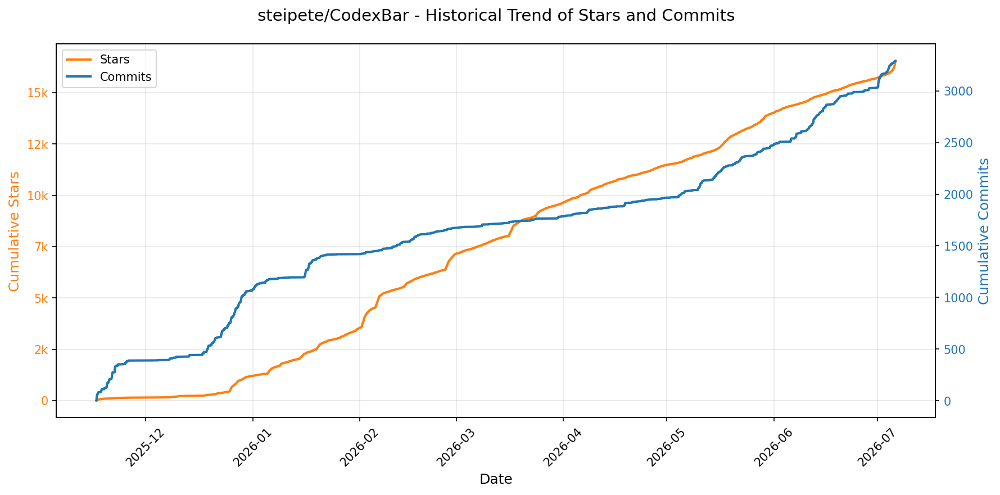

> *蓝色：累计 Stars｜橙色：累计 Commits（次 Y 轴）*

<b>📄 README 摘要</b>

1. **项目功能**  
CodexBar 是一款专为 macOS 14+（Sonoma）设计的轻量级菜单栏应用，核心功能是**实时监控并可视化各类 AI 编程服务提供商的使用配额与重置周期**。它不替代任何 AI 工具，而是作为统一状态面板，在系统菜单栏中为多达 57+ 家服务商（如 OpenAI、Claude、Gemini、Copilot、Cursor、Groq、ElevenLabs、AWS Bedrock、Zed、LiteLLM 等）提供独立或聚合式状态指示。用户可直观查看各服务商的剩余信用额度、已用/限额比例、下次重置倒计时（按会话、每日、每周、每月等不同窗口），并支持基于实际消耗的本地成本估算与图表分析，帮助开发者精准规划长任务执行时机，避免因配额耗尽中断工作流。

2. **关键特性**  
- ✅ **多提供商统一监控**：支持 57+ AI 编程/语音/LLM 服务商，每家可独立启停，支持“合并图标”模式以节省空间；  
- ✅ **精细化配额可视化**：每个服务商显示动态进度条、精确重置时间（含倒计时）、错误/过期状态标识（图标变暗或叠加告警徽章）；  
- ✅ **多源身份复用与隐私优先**：自动复用现有认证方式（OAuth 设备码、浏览器 Cookie、CLI 配置文件、API Key、Keychain 存储凭证），**不存储密码，不扫描全盘**，仅按需读取预定义安全路径（如 `~/.codex`、浏览器 Cookie 文件、本地日志）；  
- ✅ **深度数据洞察**：对支持 API 的服务商（如 OpenAI Admin API、Claude Admin、AWS Cost Explorer、LiteLLM）提供内联折线图，展示用量趋势、花费历史与预算追踪；  
- ✅ **跨平台 CLI 工具链**：内置 `codexbar` 命令行工具，支持脚本化配置（启用/禁用提供商、注入 API Key）、成本查询（`codexbar cost`）、CI 集成及 Linux/macOS 二进制分发；  
- ✅ **高度可定制体验**：支持刷新频率调节（1m–15m）、图标/标签/进度条显隐、重置时间格式、最高用量自动聚焦、WidgetKit 小组件、21 种语言本地化（含 RTL）及可选通知与动画反馈；  
- ✅ **企业级权限控制与审计友好**：明确说明 macOS 所需权限（Full Disk Access 仅用于 Safari Cookie、Keychain 访问可精细授权或完全禁用）、提供 Keychain ACL 配置指南与故障排查文档。

3. **技术栈**  
- **主应用**：Swift（要求 Swift 6.2+），基于 macOS AppKit/UIKit 构建，适配 macOS 14+，采用原生菜单栏集成（无 Dock 图标），使用 Sparkle 实现自动更新；  
- **CLI 工具**：Rust（跨平台构建，支持 macOS ARM64/x86_64、Linux glibc/musl aarch64/x86_64）；  
- **配置与存储**：JSON 配置文件（`~/.config/codexbar/config.json` 或遗留路径），Keychain 用于安全凭证管理，SQLite（部分提供商如 OpenCode Go）；  
- **前端与生态**：HTML/CSS/JS 构建官网（codexbar.app），支持多语言 i18n；第三方集成依赖 SwiftUI WidgetKit（macOS 小组件）、Waybar/GNOME/KDE 插件（Linux 桌面）、SketchyBar/tmux/Zellij（终端状态条）；  
- **开发与构建**：Xcode 构建流程，Shell 脚本自动化打包（`package_app.sh`）、测试与格式化（SwiftFormat/SwiftLint），GitHub Actions CI/CD，Homebrew（Cask + tap）、AUR（Arch Linux）分发。

---

### 32. [gastownhall/gastown](https://github.com/gastownhall/gastown)
- 📅 **创建日期**：2025-12-16  
- 🔄 **最近更新**：2026-07-06  
- ⭐ **Stars**：16,417（日 +189｜周 +322｜月 +703）  
- 📝 **描述**：Gas Town - multi-agent workspace manager  

<b>📈 Star 与 Commit 历史趋势</b>

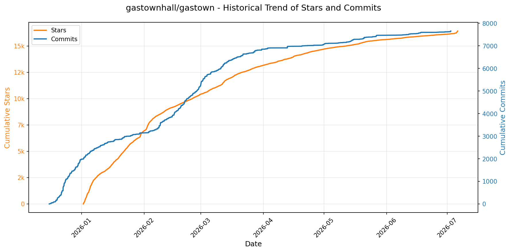

> *蓝色：累计 Stars｜橙色：累计 Commits（次 Y 轴）*

<b>📄 README 摘要</b>

1. **项目功能**  
Gas Town 是一个面向 AI 编程代理（如 Claude Code、GitHub Copilot、Codex、Gemini 等）的**多智能体协同编排系统**，核心目标是实现**可扩展、高可靠性、上下文持久化的自动化软件开发工作流**。它不替代单个 AI 工具，而是作为“智能市政厅”，统一调度多个异构 AI 代理并行处理不同任务（如编码、测试、发布、修复），同时通过 Git 背书的持久化机制（Hooks、Beads）确保工作状态在代理重启、崩溃或跨会话中不丢失，从而支撑数十级规模的稳定多代理协作。

2. **关键特性**  
- **持久化工作状态**：所有代理产出与中间状态均以结构化数据（Beads）存于 Git worktree（Hooks），实现崩溃恢复与会话延续（Seance）。  
- **分层智能协调架构**：  
  - *Mayor*（市长）：基于 Claude 的主协调 AI，全局感知 workspace/agents/convoy；  
  - *Witness/Deacon/Dogs*（见证者/执事/猎犬）：三层健康监护体系，自动检测卡死、触发恢复（nudge/handoff）、执行运维；  
  - *Refinery*（炼 refinery）：Bors 风格的合并队列，批量验证、二分隔离失败 MR，保障 `main` 分支稳定性；  
  - *Escalation*（升级机制）：按严重等级（CRITICAL/HIGH/MEDIUM）自动路由阻塞问题至 Mayor 或 Overseer。  
- **工作流抽象与复用**：  
  - *Convoys*（船队）：工作单元容器，支持标签化（如 `mountain`）与智能跳过逻辑；  
  - *Molecules*（分子）：TOML 定义的可实例化工作流模板（如 release），支持运行时动态生成（wisps）或全步骤固化（poured wisps）；  
  - *Formulas*（配方）：内置标准化流程（如版本发布），支持变量注入与跟踪执行。  
- **联邦协作能力**：*Wasteland*（荒原）模块通过 DoltHub 实现跨 Gas Town 的任务发布、认领与声誉系统，构建去中心化开发网络。  
- **全栈可观测性**：`gt feed`（交互式 TUI 仪表盘）、Web Dashboard（实时监控 agents/convoy/hooks/escalations）、`gt seance`（历史会话追溯）、`gt feed --problems`（智能故障定位）等。

3. **技术栈**  
- **核心语言与运行时**：Go（主程序 `gt`，含 daemon、scheduler、witness 等组件）；CLI 依赖 `claude` / `copilot` / `codex` / `gemini` 等第三方 AI 运行时；  
- **持久化与数据层**：Git（worktree 作为 Hooks 底层存储）、Dolt（分布式 SQL 数据库，支撑 Wasteland 联邦同步）、SQLite（本地 convoy 数据库）、Beads（自研 Git 结构化数据格式，`bd` CLI 工具链）；  
- **基础设施**：tmux（会话管理与终端复用）、Docker Compose（可选容器化部署）；  
- **配置与扩展**：TOML（Molecules/Formulas 定义）、JSON（运行时配置 `settings/config.json`）、`.events.jsonl`（事件日志驱动 Seance）；  
- **前端与交互**：Web Dashboard（基于 htmx 的轻量实时界面）、TUI（`gt feed` 基于终端的三面板交互式监控）。

---

### 33. [browser-use/video-use](https://github.com/browser-use/video-use)
- 📅 **创建日期**：2026-04-12  
- 🔄 **最近更新**：2026-07-06  
- ⭐ **Stars**：15,072（日 +283｜周 +3779｜月 +5981）  
- 📝 **描述**：Edit videos with coding agents  

<b>📈 Star 与 Commit 历史趋势</b>

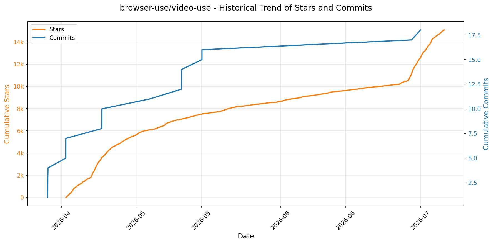

> *蓝色：累计 Stars｜橙色：累计 Commits（次 Y 轴）*

<b>📄 README 摘要</b>

1. **该项目的功能**  
video-use 是一个完全开源的视频自动化编辑工具，通过与 Claude Code 等大语言模型代理协同工作，实现“对话式视频剪辑”。用户只需将原始视频素材放入指定文件夹，向 AI 发送自然语言指令（如“编辑成发布用的启动视频”），系统即可全自动完成整套专业级后期流程：识别并精准切除填充词（“um”、“uh”）、静音段与无效停顿；基于语音时间戳进行帧级精确剪辑；自动应用色彩分级；添加带30ms音频淡入淡出的硬切；内嵌风格可定制的烧录字幕（默认为两词大写分段）；并行生成动画覆盖层（支持 HyperFrames、Remotion、Manim 或 PIL）；最终输出 `edit/final.mp4`。整个过程无需预设模板、图形界面或手动时间轴操作，适用于访谈、教程、旅行 Vlog、口播类等任意真人出镜内容。

2. **核心特性**  
- **语义级智能剪辑**：依赖 ElevenLabs Scribe 生成带毫秒级时间戳、说话人分离及非语言事件（如笑声、叹息）标注的文本转录（`takes_packed.md`），作为 LLM 唯一主输入源，避免海量帧处理。  
- **轻量可视化辅助决策**：按需调用 `timeline_view` 生成含胶片条、波形图、词标签与静音候选点的复合 PNG 图像，仅在关键裁剪点（如模糊停顿、重拍对比）提供视觉验证，大幅降低 token 开销（从 4500 万 tokens 降至 ~12KB 文本 + 少量 PNG）。  
- **端到端自验证渲染流水线**：执行 EDL（编辑决策列表）驱动的 FFmpeg 渲染后，自动对每个剪辑点进行回溯式自我评估（self-eval），检测画面跳变、音频爆音、字幕遮挡等问题，失败则自动修复并最多重试 3 次，确保交付质量。  
- **持久化会话记忆**：所有编辑策略、决策日志与项目状态均存于 `project.md`，支持跨会话连续编辑。  
- **多引擎动画集成**：通过子智能体并行调用 HyperFrames、Remotion、Manim 或 Python Imaging Library（PIL）生成动态图形叠加层，解耦动画逻辑与主剪辑流程。  
- **零假设内容适配**：不预设视频类型或结构，始终先分析素材、主动提问确认意图，再执行编辑，保障普适性与可控性。  

3. **技术栈**  
- **核心运行时**：Python（使用 `uv` 或 `pip` 管理依赖），依赖 `ffmpeg`（必需）、`yt-dlp`（可选，用于下载在线视频）。  
- **AI 代理集成**：专为 Claude Code、Codex、Hermes、Openclaw 等具备 Shell 访问能力的 LLM 代理设计，通过符号链接注入技能目录，支持一键注册与 API 密钥（ElevenLabs）交互式配置。  
- **音视频处理**：ElevenLabs Scribe（高精度语音转写与声纹分离）、FFmpeg（剪辑、调色、编码、音频淡入淡出、字幕烧录）、FFmpeg 自定义滤镜链（支持任意色彩分级方案）。  
- **可视化与动画**：`timeline_view`（自研复合图像生成器，融合波形/胶片/文字标注）、HyperFrames / Remotion / Manim / PIL（四选一动画渲染后端）。  
- **工程架构**：文本优先（Text-First）设计，以 Markdown 文档（`takes_packed.md`, `project.md`）为状态载体；EDL（Edit Decision List）驱动渲染；模块化脚本位于 `helpers/` 目录；全链路支持本地 VPS 或 Telegram Bot 部署（通过 Browser Use Box）。

---

### 34. [logto-io/logto](https://github.com/logto-io/logto)
- 📅 **创建日期**：2021-06-19  
- 🔄 **最近更新**：2026-07-06  
- ⭐ **Stars**：13,845（日 +94｜周 +1570｜月 +1740）  
- 📝 **描述**：🧑‍🚀 Authentication and authorization infrastructure for SaaS and AI apps, built on OIDC and OAuth 2.1 with multi-tenancy, SSO, and RBAC.  

<b>📈 Star 与 Commit 历史趋势</b>

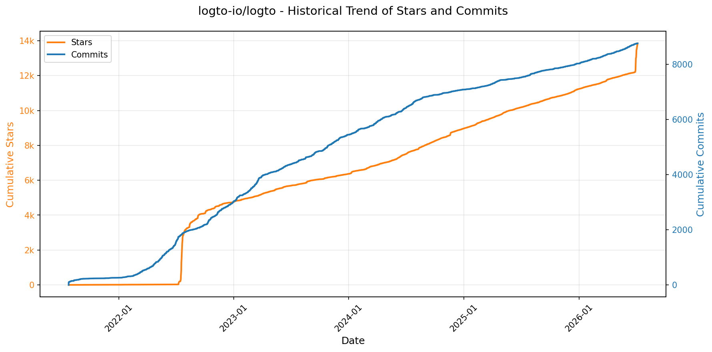

> *蓝色：累计 Stars｜橙色：累计 Commits（次 Y 轴）*

<b>📄 README 摘要</b>

1. **该项目的功能**  
Logto 是一个面向 SaaS 和 AI 应用的现代化、开源身份认证（Auth）基础设施，专注于简化企业级身份管理。它提供开箱即用的生产就绪型认证服务，核心解决 OIDC、OAuth 2.1 和 SAML 等标准协议在实际落地中的复杂性问题；支持多租户（Multi-tenancy）、企业级单点登录（Enterprise SSO）、基于角色的访问控制（RBAC），并原生适配模型上下文协议（Model Context Protocol）与代理驱动（agent-based）AI 架构，使开发者能快速构建安全、可扩展的身份层。

2. **关键特性**  
- ✅ **开箱即用的企业级能力**：内置多租户管理、组织架构、成员邀请、即时供应（JIT provisioning）、细粒度 RBAC 及企业 SSO（支持 Azure AD、Okta、Google 等主流 IdP）。  
- ✅ **全协议兼容与标准化支持**：完整实现 OIDC（含 PKCE）、OAuth 2.1（RFC 9126）、SAML 2.0，无需手动处理协议细节。  
- ✅ **全场景集成能力**：提供覆盖 30+ 技术栈的 SDK（React、Next.js、Vue、Angular、Flutter、Go、Python 等），支持 SPA、Web、移动端、API 后端、M2M 通信及 CLI 工具。  
- ✅ **开发者体验优先**：预置可定制化登录流程（含社交登录、Google One Tap、MFA）、直观管理控制台、GitPod 一键启动、Docker Compose 与 Node.js 本地部署双路径。  
- ✅ **AI 原生就绪**：专为 SaaS、AI Agent、LLM 应用设计，无缝支撑上下文感知的身份验证与动态权限模型。

3. **技术栈**  
- **后端**：TypeScript（Node.js 运行时），基于 PostgreSQL 持久化，采用模块化微服务架构（含鉴权服务、资源服务器、管理 API 等）；  
- **前端**：TypeScript + React（管理控制台及嵌入式 UI 组件），支持主题定制与白标；  
- **基础设施**：Docker Compose 官方部署方案，兼容 Render、Gitpod 等云开发/部署平台；  
- **协议与标准**：严格遵循 OIDC Core / RP-Initiated Logout / OAuth 2.1 / RFC 9126 / SAML 2.0；  
- **许可证**：Mozilla Public License 2.0（MPL-2.0），开源且允许商业使用。

---

### 35. [phuryn/pm-skills](https://github.com/phuryn/pm-skills)
- 📅 **创建日期**：2026-03-01  
- 🔄 **最近更新**：2026-07-06  
- ⭐ **Stars**：12,927（日 +142｜周 +1097｜月 +10693）  
- 📝 **描述**：PM Skills Marketplace: 100+ agentic skills, commands, and plugins — from discovery to strategy, execution, launch, and growth.  

<b>📈 Star 与 Commit 历史趋势</b>

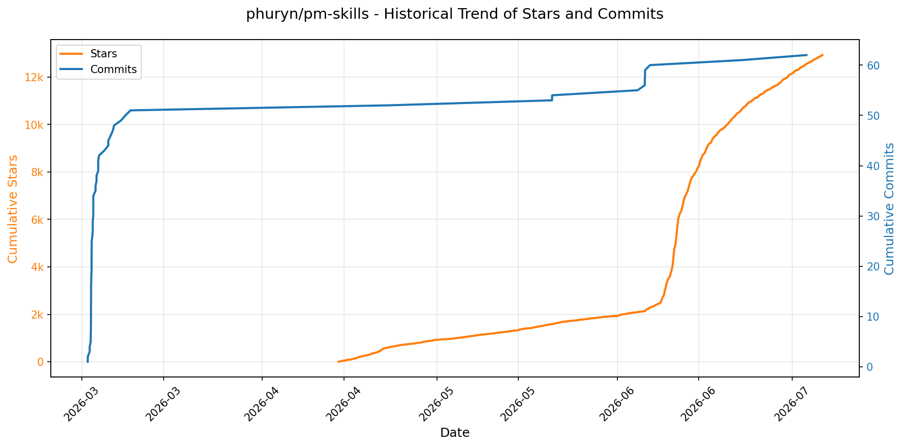

> *蓝色：累计 Stars｜橙色：累计 Commits（次 Y 轴）*

<b>📄 README 摘要</b>

1. **项目功能**  
该项目是一个面向产品经理（PM）的AI增强型技能市场（PM Skills Marketplace），旨在将经过验证的产品管理方法论（如Teresa Torres的机会解决方案树、Marty Cagan的产品策略框架、Alberto Savoia的精益验证实践等）结构化为可被AI助手（尤其是Claude系列）直接理解与执行的“技能”（Skills）和“命令”（Commands）。它不生成泛化文本，而是提供端到端、分步引导式工作流，覆盖产品全生命周期——从创意发现、战略制定、PRD撰写、用户研究、数据分析、GTM规划、营销增长，到AI驱动的代码交付。核心价值在于将专业PM知识内嵌为AI的“操作能力”，使AI成为具备领域认知与结构化决策能力的协作伙伴。

2. **关键特性**  
- **三层能力架构**：  
  - **Skills（技能）**：68个原子级、文档化的PM方法论模块（如`opportunity-solution-tree`、`prioritize-assumptions`），以标准Markdown格式编写，兼容多平台；自动触发或显式调用，提供领域知识与分析框架；  
  - **Commands（命令）**：42个用户触发的链式工作流（如`/discover`、`/write-prd`），每个命令串联多个Skills，模拟真实PM工作流（例如`/discover` = `brainstorm-ideas` → `identify-assumptions` → `prioritize-assumptions` → `brainstorm-experiments`）；  
  - **Plugins（插件）**：9个垂直领域插件包（如`pm-product-discovery`、`pm-execution`），按PM职能组织Skills与Commands，支持按需安装与复用。  
- **跨平台兼容性**：原生支持Claude Cowork（一键安装）、Claude Code（CLI）、Codex（OpenAI CLI）；Skills文件（`.md`）遵循通用格式，可手动适配Gemini、Cursor、Kiro等其他AI工具；Commands为Claude专属，但Codex可通过自然语言描述触发等效流程。  
- **智能协同设计**：Commands执行后自动推荐下一步操作；Skills可被多Commands共享复用；支持在Codex中将Claude命令文件“反向生成”为本地Skills，实现模型驱动的迁移适配。  
- **开箱即用的工作流覆盖**：完整覆盖9大PM域，含13项发现技能、12项战略技能、16项执行技能、7项市场研究技能、3项数据分析技能、6项GTM技能、5项营销增长技能等，总计68技能+42命令。

3. **技术栈**  
- **核心格式**：纯文本Markdown（`.md`）技能定义文件，遵循通用AI技能规范，无依赖、零运行时；  
- **分发机制**：基于GitHub仓库的插件市场（Plugin Marketplace）模式，通过`claude plugin marketplace add` / `codex plugin marketplace add`等CLI指令集成；  
- **客户端支持**：深度适配Anthropic生态（Claude Cowork图形界面、Claude Code CLI）、OpenAI生态（Codex CLI），并提供Shell脚本示例（如`for plugin in pm-*/; do cp -r ...`）实现跨平台Skills批量部署；  
- **基础设施**：CI/CD由GitHub Actions驱动（`tests.yml`），许可证为MIT，开源协作友好（明确欢迎PR）；  
- **无服务端组件**：项目本身不包含后端服务、数据库或API，完全静态交付，所有逻辑由AI模型在客户端侧解析与执行。

---

### 36. [stablyai/orca](https://github.com/stablyai/orca)
- 📅 **创建日期**：2026-03-17  
- 🔄 **最近更新**：2026-07-06  
- ⭐ **Stars**：12,549（日 +386｜周 +3770｜月 +8297）  
- 📝 **描述**：Orca is the ADE for working with a fleet of parallel agents. Run any coding agent with your own subscription. Available on desktop and mobile.  

<b>📈 Star 与 Commit 历史趋势</b>

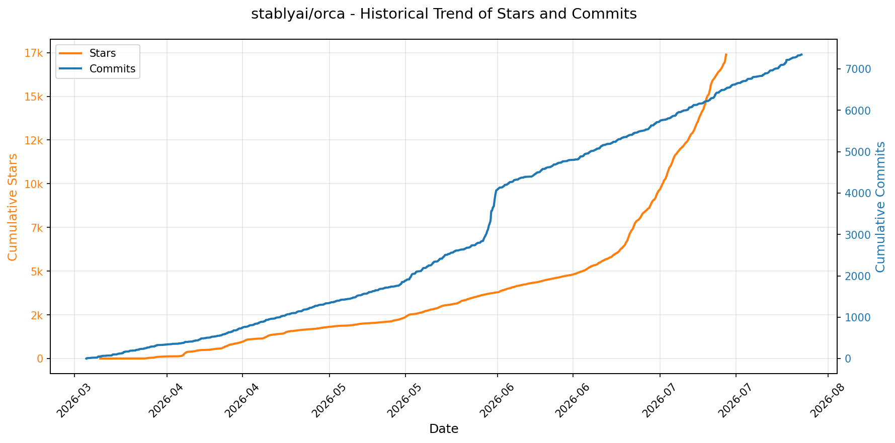

> *蓝色：累计 Stars｜橙色：累计 Commits（次 Y 轴）*

<b>📄 README 摘要</b>

1. **项目功能**  
Orca 是一个面向 AI 开发者的桌面级 AI 编排平台（AI Orchestrator），核心目标是统一管理、并行运行和协同调度多个命令行式 AI 编程代理（CLI agents）。它允许用户在同一界面中同时启动 Codex、ClaudeCode、OpenCode、Pi 等数十种主流 CLI AI 代理，每个代理在独立的 Git 工作树（worktree）中隔离执行；支持跨本地/远程环境（含 SSH）运行代理，并提供端到端工作流闭环——从提示工程、代码生成、差异审阅、文件拖拽交互，到移动端实时监控与干预。

2. **关键特性**  
- **并行工作树（Parallel Worktrees）**：单次指令可分发至多个代理，各代理在独立 Git worktree 中执行，支持结果比对与一键合并。  
- **移动伴侣应用（Mobile Companion）**：iOS/Android 端实时监控代理状态、接收完成通知、发起后续指令，实现“ anywhere steering”。  
- **高性能终端分屏（Terminal Splits）**：基于 WebGL 渲染的 Ghostty 类终端，支持无限嵌套分屏、持久化滚动历史（重启不丢失）。  
- **设计模式（Design Mode）**：在内嵌 Chromium 浏览器中点击任意 UI 元素，自动截取对应 HTML/CSS 及局部截图，直接注入代理 prompt。  
- **原生集成 GitHub & Linear**：内置 PR/Issue/看板浏览，支持一键为任务创建 worktree，免上下文切换完成开发与评审。  
- **SSH 远程工作树**：在远程服务器上运行代理，支持完整文件编辑、Git 操作、终端交互及自动重连/端口转发。  
- **AI 差异标注（Annotate AI Diffs）**：在 diff 视图中逐行添加评论，直接反馈给代理迭代，支持就地编辑与提交。  
- **拖放式文件交互**：VS Code 风格编辑器，支持拖拽文件/图片至 agent prompt，自动保存与上下文关联。  
- **Orca CLI**：提供 `orca worktree create`、`snapshot`、`click` 等命令，支持用脚本完全自动化整个 AI 编程流程。  
- **其他增强能力**：Quick Open 全局搜索、多账号快速切换与用量追踪、富媒体仓库预览（Markdown/PDF/图像）、计算机操作（Computer Use）API（让 agent 控制桌面应用）、智能通知与未读状态管理等。

3. **技术栈**  
- **客户端框架**：基于 Electron 构建跨平台桌面应用（支持 macOS / Windows / Linux），结合 Chromium 渲染引擎实现高性能 UI 与内嵌浏览器能力。  
- **终端渲染**：自研或深度定制的 WebGL 加速终端（类 Ghostty），保障高帧率与持久化 scrollback。  
- **移动端**：iOS 原生 App（App Store / TestFlight）、Android 原生 APK（独立发布）。  
- **后端通信与协议**：通过标准 CLI 进程管理与 IPC 机制与各类 AI agent 交互（无强制依赖特定模型服务），支持 SSH 隧道、WebSocket 实时同步、本地 socket 通信。  
- **基础设施**：Git 作为底层工作树与版本协同核心；Chromium Embedded Framework（CEF）支撑 Design Mode 与浏览器集成；支持 headless Linux 服务器部署（`orca serve`）。  
- **构建与分发**：使用 AppImage（Linux）、DMG/EXE（macOS/Windows）、Homebrew（macOS）、AUR（Arch Linux）等多渠道打包分发。

---

### 37. [ogulcancelik/herdr](https://github.com/ogulcancelik/herdr)
- 📅 **创建日期**：2026-03-27  
- 🔄 **最近更新**：2026-07-06  
- ⭐ **Stars**：12,279（日 +665｜周 +4265｜月 +7655）  
- 📝 **描述**：agent multiplexer that lives in your terminal.  

<b>📈 Star 与 Commit 历史趋势</b>

> *蓝色：累计 Stars｜橙色：累计 Commits（次 Y 轴）*

<b>📄 README 摘要</b>

1. **项目功能**  
herdr 是一个专为 AI 编程代理（coding agents）设计的终端原生会话管理器，核心目标是**在单个终端中统一运行、监控和协调多个 AI 代理进程**。它并非传统终端复用器（如 tmux）的简单替代，而是具备“代理感知能力”（agent-aware）的运行时环境：自动识别各代理的实时状态（空闲/工作中/阻塞/已完成），提供真实终端视图（非模拟渲染），支持跨设备持久化会话（断开 SSH 后代理持续运行，可随时重连），并允许用户通过鼠标或快捷键灵活组织工作区、标签页与分屏。其本质是将终端从“输入输出界面”升级为“AI 代理协同操作系统”。

2. **关键特性**  
- **真实终端隔离**：每个 AI 代理独占一个底层伪终端（PTY），完整支持全屏 TUI 应用（如 Vim、htop），无图形层抽象失真；  
- **零配置状态感知**：基于进程名匹配 + 终端输出启发式分析，自动标注代理状态（🔴阻塞 / 🟡工作中 / 🔵完成 / 🟢空闲），无需修改代理代码或注入钩子；  
- **可视化工作流管理**：原生支持鼠标拖拽创建/调整工作区（Workspaces）、标签页（Tabs）、分屏（Panes），界面即操作；  
- **强持久化与远程协同**：后台服务常驻运行，支持任意终端（含手机 SSH） detach/reattach；`--remote` 模式实现本地客户端直连远程服务器，保留图像粘贴等高级终端能力；  
- **轻量跨平台部署**：单个约 10MB 的 Rust 静态二进制文件，原生支持 Linux/macOS，Windows 处于 Beta 阶段，无 GUI 依赖、无账户体系、无遥测；  
- **代理可编程性**：提供 Unix Socket API 与 CLI 工具，使 AI 代理能主动创建工作区、拆分面板、订阅状态变更；支持通过 `npx skills add` 安装可复用的代理技能包；  
- **深度代理集成**：官方提供对 pi、Claude Code、GitHub Copilot CLI、Devin、Cursor 等 15+ 主流代理的原生集成，支持会话恢复与语义状态上报。

3. **技术栈**  
- **核心语言**：Rust（构建高性能、内存安全、静态链接的二进制）；  
- **终端交互**：基于 `libc` 和 `termios` 实现底层 PTY 管理，兼容 ANSI/VT100 协议，确保 TUI 正确渲染；  
- **通信机制**：本地 Unix Domain Socket（用于代理与 herdr 服务间双向通信），辅以 CLI 工具封装；  
- **构建与包管理**：Cargo（Rust 生态标准构建工具），支持 Homebrew（macOS）、Mise（多语言版本管理）、Nix（声明式包管理）及 Shell 脚本一键安装；  
- **前端交互**：纯终端文本界面（TUI），使用 `crossterm` 或类似库处理跨平台键盘/鼠标事件，无 Web 或 Electron 依赖；  
- **扩展生态**：通过 `npx` 集成 Node.js 技能包，支持任意语言编写的插件通过 Socket API 交互。

---

### 38. [diegosouzapw/OmniRoute](https://github.com/diegosouzapw/OmniRoute)
- 📅 **创建日期**：2026-02-13  
- 🔄 **最近更新**：2026-07-06  
- ⭐ **Stars**：11,947（日 +577｜周 +4435｜月 +6238）  
- 📝 **描述**：Never stop coding. Free AI gateway: one endpoint, 231+ providers (50+ free), connect Claude Code, Codex, Cursor, Cline & Copilot to FREE Claude/GPT/Gemini. RTK+Caveman stacked compression saves 15-95% tokens, smart auto-fallback, MCP/A2A, multimodal APIs, Desktop/PWA.  

<b>📈 Star 与 Commit 历史趋势</b>

> *蓝色：累计 Stars｜橙色：累计 Commits（次 Y 轴）*

<b>📄 README 摘要</b>

1. **项目功能**  
OmniRoute 是一个开源的 AI 请求智能网关，核心作用是将本地或第三方 AI 工具（如 Claude Code、Cursor、Copilot、Cline 等 24+ 编程代理）统一接入 **237 个 AI 服务商**（含 90+ 免费 tier），仅需配置单一 OpenAI 兼容端点（`/v1`）。它自动执行跨供应商的请求路由、故障转移与成本优化，在任一服务商配额耗尽、响应失败或限流时毫秒级切换至备用 provider，确保开发流程零中断；同时聚合并实时可视化全栈免费额度（约 1.6B tokens/月，首月可达 2.1B），消除手动管理多平台 API 密钥、配额与账单的复杂性。

2. **关键特性**  
- ✅ **智能自动路由（Auto-Combo）**：支持 `auto` 及 `auto/coding`/`auto/cheap` 等 6 种零配置模式，基于 9 维实时评分（健康度、剩余配额、延迟、成功率等）动态选择最优模型；提供 **17 种可组合路由策略**（如优先级、加权轮询、成本优化、上下文接力、Fusion 融合投票等）。  
- ✅ **深度令牌压缩**：集成 RTK（Retrieval-based Token Kernel）与 Caveman 双层压缩技术，对工具调用类请求（如 `git diff`、日志）实现 **15–95% 的 token 节省**（平均约 89%），显著延长免费额度使用周期。  
- ✅ **企业级弹性与隔离**：三层韧性机制——全局熔断器（provider 级）、连接冷却（key 级）、模型锁定（model+provider 级）；支持 **Quota-Share 配额共享引擎**，允许多密钥公平共享同一上游订阅（如 Codex Pro），按权重分配时间/请求/token 配额，并支持借闲余额度的“工作守恒”模式。  
- ✅ **开箱即用的 AI 基础设施**：内置 MCP（Model Context Protocol）服务器（95+ 工具、3 种传输协议）、A2A（Agent-to-Agent）协议支持、本地向量+FTS5 混合内存、PII/注入/多模态安全护栏、TLS 指纹隐身代理，适配全球网络封锁环境。  
- ✅ **透明化免费生态**：精准聚合 40+ provider pools / 500+ 模型的**去重后真实免费额度**（非夸大上限值），区分永久免额度提供商（如 Kiro、Qoder、Pollinations）与临时补贴（$10 OpenRouter 充值），提供每模型用量明细与条款标注。

3. **技术栈**  
- **核心语言与框架**：Node.js（主服务）、TypeScript（强类型保障）、Electron（桌面客户端）、Docker（容器化部署）；  
- **协议兼容**：OpenAI REST API v1 兼容接口（无缝对接现有 SDK/CLI），支持 MCP v0.6、A2A JSON-RPC 2.0；  
- **基础设施**：TLS 代理层（规避地域封锁）、SQLite + FTS5（本地全文检索）+ 向量数据库（内存上下文管理）、Redis（可选分布式状态）；  
- **构建与分发**：npm（`omniroute` 包）、Docker Hub（`diegosouzapw/omniroute`）、GitHub Releases（Electron 安装包）；  
- **许可证**：MIT 开源协议；支持 42+ 种语言的国际化文档（含简体中文）。

---

### 39. [CoplayDev/unity-mcp](https://github.com/CoplayDev/unity-mcp)
- 📅 **创建日期**：2025-03-18  
- 🔄 **最近更新**：2026-07-06  
- ⭐ **Stars**：11,921（日 +250｜周 +796｜月 +1584）  
- 📝 **描述**：Unity MCP acts as a bridge between AI assistants and your Unity Editor. Give your LLM tools to manage assets, control scenes, edit scripts, and automate tasks within Unity.  

<b>📈 Star 与 Commit 历史趋势</b>

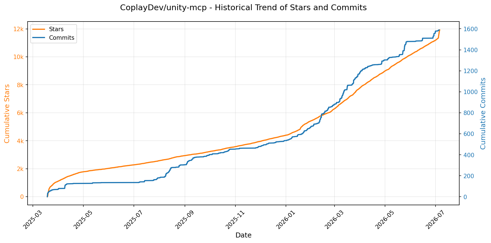

> *蓝色：累计 Stars｜橙色：累计 Commits（次 Y 轴）*

<b>📄 README 摘要</b>

1. **该项目的功能**  
MCP for Unity 是一个开源插件，旨在将大型语言模型（LLM）与 Unity 编辑器深度集成，通过 **Model Context Protocol（MCP）** 标准协议实现双向通信。它允许用户使用自然语言指令（如“在原点创建一个带 Rigidbody 的立方体”）直接操控 Unity 编辑器：生成/编辑场景、创建/修改 GameObject、管理资源（Assets）、编辑 C# 脚本、运行单元测试、性能分析（profiling）及构建项目。支持任意符合 MCP 协议的客户端（如 Claude Desktop、VS Code、Cursor、Windsurf、Gemini CLI 等），提供 **47 个专注、可组合的 MCP 工具入口点**，全部免费且基于 MIT 许可。

2. **核心特性**  
- ✅ **全编辑器控制能力**：覆盖 Unity 开发全流程——场景构建、脚本编辑（含 Roslyn 静态验证）、资源导入/导出、测试执行、Profiler 控制、Build 自动化；  
- ✅ **多客户端兼容性**：无缝对接所有标准 MCP 客户端，无需定制适配；  
- ✅ **多 Unity 实例支持**：通过「多实例路由」机制同时管理多个 Unity 编辑器进程；  
- ✅ **模块化工具分组**：按领域（VFX、动画、UI、测试等）组织工具，支持按需启用/禁用；  
- ✅ **生产级可靠性增强**：内置 Roslyn 脚本语法与语义校验、远程服务器身份认证（OAuth/JWT）、v10 版本资产生成与迁移支持；  
- ✅ **开箱即用与深度可扩展**：Unity Package Manager 一键安装，完整文档、贡献指南与高级配置（如远程托管服务）均已完备。

3. **技术栈**  
- **Unity 层**：C# 编写，兼容 Unity 2021.3 LTS 至 6.x；基于 Unity Editor API 深度集成，支持实时反射式操作与事件驱动响应；  
- **协议层**：严格遵循 [Model Context Protocol (MCP)](https://modelcontextprotocol.io/introduction) v1.x 标准，实现标准化工具注册、调用与上下文传递；  
- **运行时依赖**：后端服务由 Python（≥3.10）驱动，使用 `uv` 作为包管理与运行时环境（替代 pip/virtualenv）；  
- **基础设施**：GitHub Actions 自动化 CI/CD、OpenUPM 包分发、Starlight 文档站点（Docusaurus）、Discord 社区协作；  
- **安全与质量**：集成 Roslyn 分析器进行 C# 脚本静态检查，支持远程服务 JWT/OAuth 认证，符合 MIT 开源许可。

---

### 40. [n0-computer/iroh](https://github.com/n0-computer/iroh)
- 📅 **创建日期**：2022-03-14  
- 🔄 **最近更新**：2026-07-06  
- ⭐ **Stars**：11,148（日 +41｜周 +265｜月 +2486）  
- 📝 **描述**：IP addresses break, dial keys instead. A library that adds QUIC + NAT Traversal to your apps.  

<b>📈 Star 与 Commit 历史趋势</b>

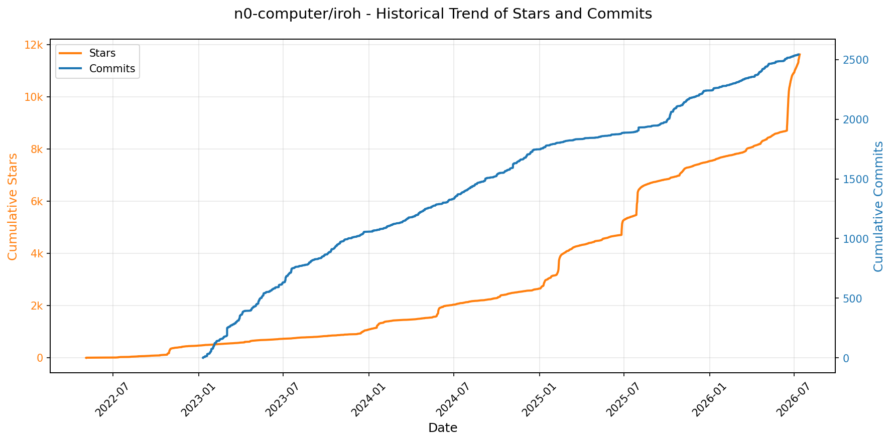

> *蓝色：累计 Stars｜橙色：累计 Commits（次 Y 轴）*

<b>📄 README 摘要</b>

1. **该项目的功能**  
Iroh 是一个面向去中心化网络通信的底层协议栈，核心功能是提供基于公钥（而非 IP 地址或域名）的端到端连接建立能力。它自动发现、协商并维护两个对等节点之间的最优通信路径：优先尝试 P2P 直连（通过 NAT 穿透/打洞），失败时无缝回退至去中心化、开放的公共中继网络（relay servers）。其目标是“为网络减少网络开销”（less net work for networks），即屏蔽底层网络拓扑复杂性，让开发者只需关注“连接到某个公钥标识的节点”，其余路由、连接维持、故障恢复均由 Iroh 透明处理。

2. **关键特性**  
- **智能连接管理**：自动执行 STUN/TURN 类型的 hole-punching，并持续性能测量（[iroh-perf](https://perf.iroh.computer)）以动态选择最快路径（直连 > 中继）；  
- **QUIC 原生支持**：基于自研 QUIC 协议栈 [noq]，默认提供前向安全的认证加密、多路复用流（stream multiplexing）、流优先级、抗队头阻塞（head-of-line blocking）及可靠/不可靠混合传输能力；  
- **协议组合范式（Compose Protocols）**：提供可插拔、模块化的高层协议构建块，包括：  
  • `iroh-blobs`：基于 BLAKE3 内容寻址的高效二进制大对象传输协议，支持 KB–TB 级数据；  
  • `iroh-gossip`：轻量级、手机友好型发布-订阅（pub/sub）覆盖网络，具备强扩展性与低资源占用；  
  • `iroh-docs`：最终一致性键值存储，底层以 `iroh-blobs` 存储数据，适用于协同文档等场景；  
- **跨语言支持**：通过 `iroh-ffi` 提供 C 兼容 FFI 接口，便于集成至 Rust 以外的编程语言生态；  
- **去中心化地址解析**：集成 DNS/PKARR 机制（由 `iroh-dns-server` 实现），将公钥映射为人类可读的 DNS 名称（如 `dns.iroh.link`），实现无需中心化 CA 的可信身份寻址。

3. **技术栈**  
- **主语言**：Rust（全栈实现，强调内存安全、并发性能与零成本抽象）；  
- **网络协议**：QUIC（基于自研 [noq] 库），替代传统 TCP/UDP，提供现代传输层能力；  
- **加密与哈希**：BLAKE3（用于内容寻址与完整性校验）、X25519（密钥交换）、Ed25519（签名）、TLS 1.3（QUIC 加密层）；  
- **NAT 穿透**：结合 STUN、ICE 原理与自适应打洞策略，辅以可插拔的中继服务器（`iroh-relay`）；  
- **基础设施组件**：  
  • `iroh-base`：共享基础类型（如 `EndpointId`, `RelayUrl`）；  
  • `iroh-relay`：生产就绪的中继客户端/服务端实现；  
  • `iroh-dns-server`：运行于 `dns.iroh.link` 的 PKARR-DNS 混合解析服务；  
- **构建与分发**：Cargo（Rust 包管理器）、Crates.io 发布、GitHub Actions CI/CD；  
- **许可证**：双许可——Apache License 2.0 与 MIT License。

---

### 41. [rommapp/romm](https://github.com/rommapp/romm)
- 📅 **创建日期**：2023-03-08  
- 🔄 **最近更新**：2026-07-06  
- ⭐ **Stars**：10,630（日 +362｜周 +1541｜月 +1703）  
- 📝 **描述**：A beautiful, powerful, self-hosted rom manager and player.  

<b>📈 Star 与 Commit 历史趋势</b>

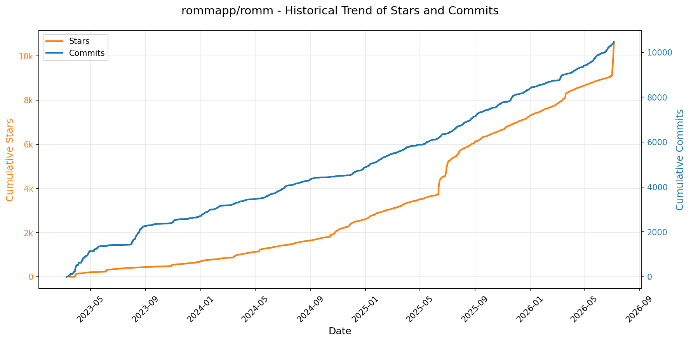

> *蓝色：累计 Stars｜橙色：累计 Commits（次 Y 轴）*

<b>📄 README 摘要</b>

1. **项目功能**  
RomM 是一个美观、强大且可自托管的 ROM 管理与游戏播放平台。它支持扫描本地游戏文件库，自动获取并增强元数据（如标题、描述、发行年份、厂商等），并提供跨平台的浏览器内直接游玩能力（通过 WebAssembly/JS 模拟器）。用户可通过现代网页浏览器完成游戏浏览、搜索、筛选、编辑、上传、删除等全生命周期管理，并支持多设备协同（如移动端、掌机、桌面客户端）及共享库（带权限控制）。

2. **核心特性**  
- 多源元数据整合：对接 IGDB、Screenscraper、MobyGames 等 API 自动补全游戏信息；  
- 高质量视觉资源：从 SteamGridDB 获取封面、横幅、图标等自定义艺术图；  
- 成就系统集成：显示 RetroAchievements 平台的成就进度；  
- 全面平台支持：覆盖 400+ 游戏平台（含主机、掌机、街机、计算机等）；  
- 浏览器原生游玩：内置 EmulatorJS（支持多种架构模拟）和 RuffleRS（Flash 游戏兼容）；  
- 高级内容管理：原生支持多光盘游戏、DLC、MOD、作弊补丁、说明书 PDF 等；  
- 智能文件标记：解析文件名中的自定义标签（如 `[BIOS]`、`[Hack]`、`[Translated]`）并用于过滤与分类；  
- 多端官方应用：提供 Playnite 插件、Android 客户端（Argosy）、muOS/NextUI 掌机客户端（Grout）等第一方生态支持；  
- 权限可控共享：支持为朋友创建受限访问的只读或编辑权限库链接。

3. **技术栈**  
- **后端**：Go（Golang）语言开发，轻量高效，适用于自托管场景；  
- **前端**：TypeScript + React 构建响应式 Web UI，适配桌面与移动设备；  
- **模拟器集成**：EmulatorJS（基于 WebAssembly 的多平台模拟器框架）、RuffleRS（Rust 重写的 Flash 模拟器）；  
- **部署方案**：官方提供 Docker 镜像（`rommapp/romm`），支持一键容器化部署；  
- **基础设施依赖**：支持 SQLite（默认）或 PostgreSQL 数据库存储；  
- **元数据服务**：通过 HTTP 客户端调用 IGDB、Screenscraper、MobyGames、SteamGridDB、RetroAchievements 等第三方 API；  
- **跨平台客户端生态**：基于 Electron（RommBrowser）、Kotlin/Swift（Android/iOS 原生 App）、Rust（Grout）、C#（Playnite 插件）等构建外围工具链。

---

### 42. [Robbyant/lingbot-map](https://github.com/Robbyant/lingbot-map)
- 📅 **创建日期**：2026-04-15  
- 🔄 **最近更新**：2026-07-06  
- ⭐ **Stars**：9,914（日 +134｜周 +1579｜月 +2918）  
- 📝 **描述**：A feed-forward 3D foundation model for reconstructing scenes from streaming data  

<b>📈 Star 与 Commit 历史趋势</b>

> *蓝色：累计 Stars｜橙色：累计 Commits（次 Y 轴）*

<b>📄 README 摘要</b>

1. **项目功能**  
LingBot-Map 是一个面向**流式（streaming）三维重建任务的前馈式（feed-forward）3D基础模型**，专为实时、长序列、大规模场景的在线三维几何建模而设计。它直接从单目视频或图像序列中，端到端地估计相机位姿并重建稠密、一致、几何准确的3D点云地图，无需迭代优化或后处理。其核心目标是解决传统SLAM/NeRF方法在长时序下的累积漂移、计算延迟高、内存爆炸等问题，支持从室内步行（25,000帧）、城市驾驶到航拍等多样化真实场景的稳定、高效、可扩展重建。

2. **关键特性**  
- **几何上下文Transformer（Geometric Context Transformer, GCT）架构**：首创性地统一坐标锚定（coordinate grounding）、稠密几何线索（如深度、法向）与长程漂移校正，在单一前馈框架内集成锚点上下文、位姿参考窗口（pose-reference window）和轨迹记忆（trajectory memory），实现跨帧几何一致性建模。  
- **超高效率流式推理**：采用分页KV缓存（paged KV cache）注意力机制（基于FlashInfer），支持~20 FPS（518×378分辨率）的稳定实时推理；通过`--keyframe_interval`与`--mode windowed`策略，可处理超长序列（>10,000帧，实测达25,000帧），有效缓解RoPE长度限制与显存瓶颈。  
- **开箱即用的鲁棒性增强模块**：内置天空掩膜（Sky Masking）——基于ONNX轻量分割模型自动过滤天空区域，显著提升户外场景可视化质量；支持GPU加速的批量掩膜推理与缓存复用。  
- **全栈式部署能力**：提供交互式浏览器可视化（viser）、离线批渲染（MP4飞越视频生成）、多数据集基准评测（KITTI/Oxford Spires/Tanks&Temples等9个主流数据集）及完整CLI工具链，覆盖研发、演示与生产全流程。

3. **技术栈**  
- **深度学习框架**：PyTorch 2.8.0（CUDA 12.8编译），依赖NVIDIA Kaolin（用于体素化与视锥裁剪）及FlashInfer（核心KV缓存加速引擎，支持JIT CUDA编译）。  
- **核心算法组件**：几何上下文Transformer（GCT）、视频RoPE位置编码、分页KV缓存注意力、双向尺度初始化（bidirectional scale frames）、流式位姿优化头（camera head with iterative refinement）。  
- **渲染与可视化**：Open3D（点云处理）、viser（Web端实时3D查看器）、FFmpeg（视频合成）、ONNX Runtime（GPU/CPU版天空分割）、Kaolin CUDA扩展（`voxel_morton_ext`/`frustum_cull_ext`）。  
- **工程基础设施**：Conda环境管理、Hugging Face/ModelScope双模型仓库、Apache-2.0开源协议，支持CPU/GPU混合卸载（`--offload_to_cpu`）与细粒度性能调优（`--camera_num_iterations`, `--num_scale_frames`等）。

---

### 43. [t8y2/dbx](https://github.com/t8y2/dbx)
- 📅 **创建日期**：2026-04-29  
- 🔄 **最近更新**：2026-07-06  
- ⭐ **Stars**：8,781（日 +176｜周 +1259｜月 +4884）  
- 📝 **描述**：20MB, lightweight, cross-platform database client. Supports MySQL, PostgreSQL, SQLite, Redis, MongoDB, DuckDB, ClickHouse, SQL Server and more.20MB，轻量级跨平台数据库客户端、数据库管理工具。支持 MySQL、PostgreSQL、SQLite、Redis、MongoDB、DuckDB、ClickHouse、SQL Server 等。  

<b>📈 Star 与 Commit 历史趋势</b>

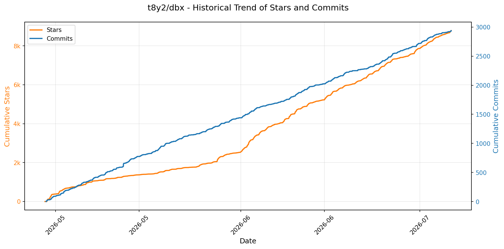

> *蓝色：累计 Stars｜橙色：累计 Commits（次 Y 轴）*

<b>📄 README 摘要</b>

1. **项目功能**  
DBX 是一款轻量级、开源的跨平台数据库管理工具，核心目标是提供“单体应用、多库支持、AI 原生”的一体化数据库操作体验。它将对 60+ 种数据库（含关系型、NoSQL、向量库、时序库、消息队列等）的原生或代理连接能力，集成于一个仅约 20 MB 的独立二进制文件中，支持桌面端（macOS/Windows/Linux）、Docker 容器化部署及 Web 浏览器访问，无需运行时依赖（如 Java、Python 或 Chromium）。用户可通过统一界面完成连接管理、SQL 查询、数据浏览与编辑、模式设计、ER 图可视化、结构对比、数据迁移/同步、文件预览（Parquet/CSV/JSON）及安全运维等全流程数据库操作。

2. **关键特性**  
- **超广数据库支持**：原生支持 MySQL、PostgreSQL、SQLite、Redis、MongoDB、DuckDB、ClickHouse、SQL Server、Oracle、Elasticsearch 等主流数据库；通过 JDBC Agent 拓展支持 Snowflake、Trino、Hive、DB2、Neo4j、BigQuery、SAP HANA、Teradata 等；另内置 Redis/MongoDB 专用浏览器、Pulsar/Kafka/RocketMQ 消息队列管理模块。  
- **智能 AI SQL 助手**：集成自然语言转 SQL、SQL 解释、错误修复、性能优化等功能，支持 OpenAI、Claude 及本地 Ollama 模型，并内置 SQL 安全审查机制，防止危险语句执行。  
- **MCP（Model Context Protocol）标准兼容**：提供官方 MCP Server，使 Cursor、Claude Code、Windsurf 等 AI 编程代理可直接复用 DBX 已配置的数据库连接，实现“一处配置、全域调用”。  
- **专业级数据操作能力**：虚拟滚动大数据网格（支持百万行）、内联编辑、WHERE/ORDER BY 快捷过滤、全文搜索、字段血缘分析、Schema Diff、执行计划可视化、表结构编辑、ER 图生成、跨库数据迁移与比对。  
- **开箱即用的安全与体验**：SSH 隧道（密钥/密码）、连接自动重连、破坏性操作二次确认、加密配置导出/导入、彩色连接标识、9 种编辑器主题、深色模式、多语言（简体中文/英文/西班牙语）、拖拽式文件预览（基于 DuckDB）、DBeaver/Navicat 连接配置导入。  
- **全栈自托管能力**：提供 Docker 镜像（含 amd64/arm64 多架构）、反向代理支持（`DBX_PUBLIC_BASE_PATH`）、CLI 工具（`dbx-cli`）及 MCP 客户端集成，满足个人开发、团队协作与企业私有化部署需求。

3. **技术栈**  
- **框架层**：Tauri 2（Rust + WebView，替代 Electron，实现极小体积与高性能）  
- **前端层**：Vue 3 + TypeScript + shadcn-vue + Tailwind CSS（现代化响应式 UI）  
- **编辑器层**：CodeMirror 6（深度定制的 SQL 语法高亮、元数据感知自动补全、格式化与诊断）  
- **后端/驱动层**：Rust 主导，集成多种成熟异步驱动：  
  - SQL 数据库：`sqlx`（通用）、`tiberius`（SQL Server）、`postgres`/`mysql` crate（原生协议）  
  - NoSQL：`redis-rs`（Redis）、`mongodb`（MongoDB 官方 Rust 驱动）  
  - 其他：DuckDB（嵌入式 OLAP）、JDBC Agent（Java 侧扩展，支持 H2/Snowflake/Trino 等）  
- **构建与生态**：pnpm 包管理、Rust Cargo 构建、Tauri CLI 打包；配套提供 `@dbx-app/mcp-server`（Node.js 实现）和 `@dbx-app/cli`（全局 CLI 工具）。

---

### 44. [facebook/astryx](https://github.com/facebook/astryx)
- 📅 **创建日期**：2026-01-09  
- 🔄 **最近更新**：2026-07-06  
- ⭐ **Stars**：5,975（日 +532｜周 +5037｜月 +5974）  
- 📝 **描述**：An open source design system that's fully customizable and agent ready  

<b>📈 Star 与 Commit 历史趋势</b>

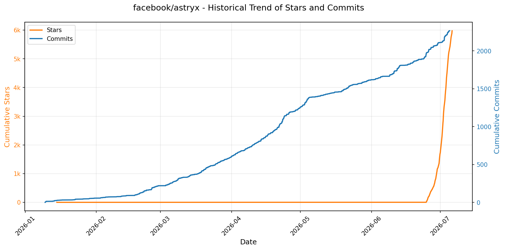

> *蓝色：累计 Stars｜橙色：累计 Commits（次 Y 轴）*

<b>📄 README 摘要</b>

1. **项目功能**  
Astryx 是一个开源、面向现代协作开发（人与 AI 代理协同）的可完全自定义设计系统。它源自 Meta 内部八年演进，已支撑超 13,000 个应用，提供开箱即用的 UI 基础设施：包含 150+ 符合无障碍标准（a11y）的 React 组件、品牌级主题系统（含深色模式）、预构建模板及配套 CLI 工具；支持零配置集成（无需构建插件、PostCSS 或 Babel），开发者可直接导入 CSS 并使用类型安全的 React 组件，同时确保人类开发者与 AI 编程助手使用同一套工具链和 API。

2. **核心特性**  
- **开放内部结构**：所有组件层级均开放可组合，支持“swizzle”机制——一键将任意组件完整源码注入项目本地，实现深度定制与自主控制；  
- **无样式锁定**：底层采用 StyleX 编写样式，但对使用者完全透明；支持通过 `className` 无缝对接 Tailwind CSS、CSS Modules 或原生 CSS，兼容现有工程体系；  
- **免封装式主题定制**：主题基于 CSS 自定义属性（CSS Custom Properties）实现，设计师仅需覆盖变量即可完成品牌化改造，无需 fork 代码或封装组件；  
- **人机共建优先设计**：API、文档、CLI 均统一设计，确保人类开发者与 AI 助手遵循相同范式、共享同一参考体系，提升协作一致性与自动化效率；  
- **原则驱动开发**：强调“引导优于强制”（如组件接受任意合法值并渲染）、强约定（统一命名/Props/组合规范）、实证验证（所有设计决策经数据测量与迭代验证）。

3. **技术栈**  
- **前端框架**：React（v18+，TypeScript 原生支持）；  
- **样式方案**：StyleX（作为底层样式引擎，但对外隐藏，不强制用户学习）；  
- **构建与工具链**：pnpm 10（通过 Corepack 管理）、自研 CLI（`@astryxdesign/cli`）、StyleX 构建插件（`@astryxdesign/build`）；  
- **主题与扩展**：7 套预置主题包（如 `theme-neutral`、`theme-butter` 等），均基于 CSS 自定义属性；  
- **发布与生态**：模块化 NPM 包体系（`@astryxdesign/core`、`@astryxdesign/cli` 等），支持 Next.js、Vite、CDN 等多种集成场景。

---

### 45. [xbtlin/ai-berkshire](https://github.com/xbtlin/ai-berkshire)
- 📅 **创建日期**：2026-04-07  
- 🔄 **最近更新**：2026-07-06  
- ⭐ **Stars**：5,748（日 +0｜周 +14｜月 +5719）  
- 📝 **描述**：AI 时代的伯克希尔：基于 Claude Code / Codex 的价值投资研究框架。巴菲特·芒格·段永平·李录四大师方法论 + 多Agent并行研究。| AI-era Berkshire: a value investing research framework built for Claude Code / Codex. 4 masters' methodologies + multi-agent adversarial analysis.  

<b>📈 Star 与 Commit 历史趋势</b>

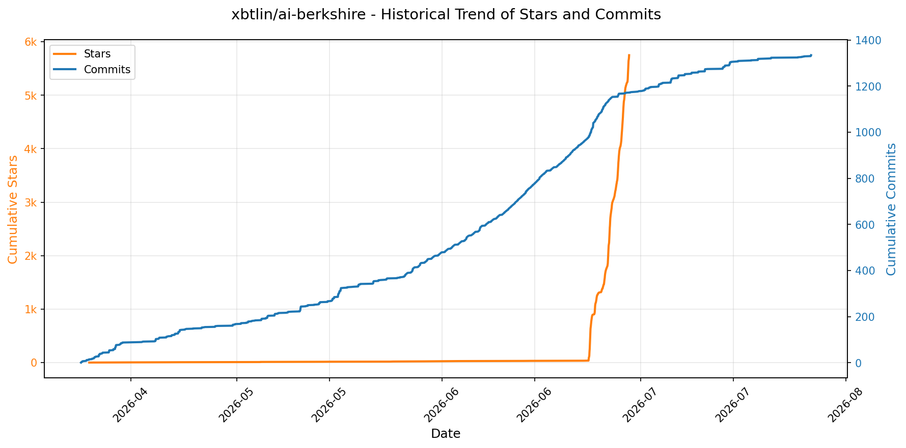

> *蓝色：累计 Stars｜橙色：累计 Commits（次 Y 轴）*

<b>📄 README 摘要</b>

1. **项目功能**  
AI Berkshire 是一个面向价值投资领域的 AI 原生研究框架，旨在将巴菲特、芒格、段永平、李录四位大师的投资哲学系统化、结构化，并通过多 Agent 协同的 AI 工作流，实现专业级、可复现、高决策质量的投资研究。它不提供泛泛而谈的分析，而是强制输出明确结论（通过/不通过/灰色地带）、分层操作建议（激进/稳健/保守型）及精确价格区间；支持从单公司深度研究、财报精读、行业全景扫描与漏斗筛选，到未上市公司“侦探式”尽调、持仓动态管理及股价异动快速归因等全链条投研场景。核心目标是：**一人 + Claude Code / Codex = 一个具备纪律性、对抗性与金融严谨性的虚拟投研团队**。

2. **关键特性**  
- **强制决策导向输出**：摒弃平衡式“两面分析”，统一采用“镜子测试”（5句话说不完整即否决）和三档策略建议（含具体价格区间），确保结论可直接用于交易决策。  
- **四大师视角对抗机制**：四大 Agent 分别以段永平（商业模式）、巴菲特（财务估值）、芒格（逆向风险）、李录（长期确定性）独立研判，生成冲突性评分与判断，暴露认知盲区。  
- **结构化反偏见体系**：内置信息丰富度评级（A/B/C）、芒格式失败情景推演、8条一票否决红线、反共识检查、留白原则（拒绝伪确定性）等五层防骗机制。  
- **金融级数据严谨性**：所有计算基于 `decimal.Decimal` 精确十进制，关键指标（市值、PE、DCF）强制双源交叉验证+手算校验，单位错误、小数点偏差零容忍。  
- **可复现标准化流程**：19个原子化 Skill（如 `/investment-team`、`/industry-funnel`）覆盖全场景，确保同一输入必得结构一致、维度对齐、深度可控的输出，支持横向对比与纵向追踪。  
- **多 Agent 并行架构**：`/investment-team` 等 Skill 启动4个独立 Agent 同步执行搜索、验证、评分，再由 Team Lead 综合，实现信息量、视角广度与研究深度的指数级提升。  

3. **技术栈**  
- **AI 层**：深度适配 **Claude Code**（Anthropic）与 **Codex**（OpenAI）两大主流代码优先型 AI 客户端，支持其原生 command/skill/prompt 调用范式。  
- **Agent 架构**：基于多 Agent 协同范式，构建 Team Lead + 四大师 Agent 的调度模型，各 Agent 具备独立网络检索、工具调用与推理能力。  
- **工具层**：自研 Python 工具集 `tools/financial_rigor.py`，集成市值/估值验算、多源交叉验证、三情景DCF、Benford定律检测等功能，全部采用 `decimal.Decimal` 保障金融计算精度。  
- **工程规范**：Skill 源文件统一为 Markdown（`skills/*.md`），通过同步脚本（`sync-codex-skills.py`）自动转换为 Codex Skill 包与 Slash Prompt，实现跨平台 workflow 一致性；安装脚本（Bash/PowerShell）支持 macOS/Linux/Windows 全平台一键部署。  
- **数据与验证**：依赖实时网络检索（新闻、财报、监管文件）、权威金融数据库（Wind/Bloomberg/Yahoo Finance 预留接口），关键数据强制 ≥2 个独立信源比对，偏差超 1% 触发告警。

---

### 46. [apache/maven](https://github.com/apache/maven)
- 📅 **创建日期**：2009-05-21  
- 🔄 **最近更新**：2026-07-06  
- ⭐ **Stars**：5,287（日 +15｜周 +176｜月 +224）  
- 📝 **描述**：Apache Maven core  

<b>📈 Star 与 Commit 历史趋势</b>

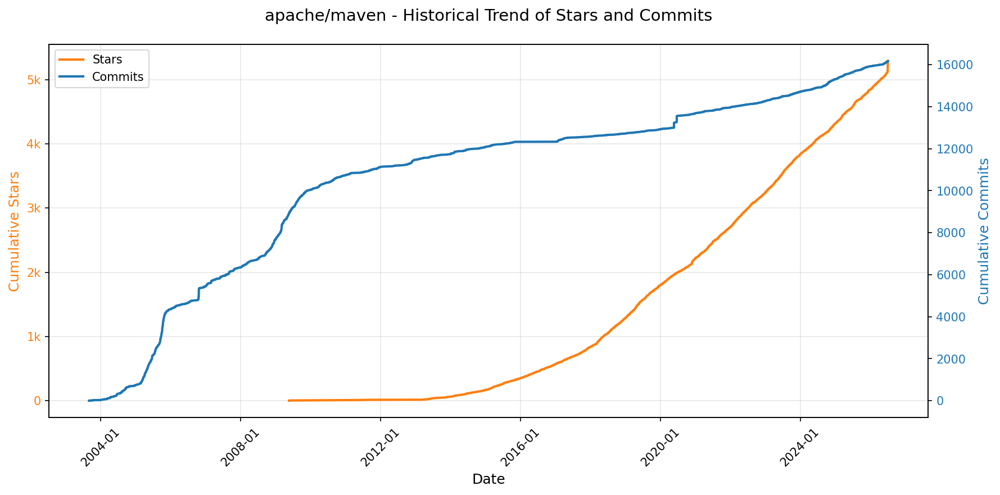

> *蓝色：累计 Stars｜橙色：累计 Commits（次 Y 轴）*

<b>📄 README 摘要</b>

1. **该项目做什么？**  
Apache Maven 是一个软件项目管理和构建自动化工具，基于“项目对象模型”（POM, Project Object Model）理念，通过单一的 `pom.xml` 配置文件统一管理项目的构建流程、依赖管理、文档生成、报告生成及生命周期管理。它标准化了 Java（及其他 JVM 语言）项目的构建方式，支持跨平台、可重复、可预测的构建过程，并能自动解析和下载依赖、执行编译、测试、打包、部署等任务。

2. **核心功能**  
- **声明式构建配置**：通过 XML 格式的 `pom.xml` 定义项目结构、依赖、插件及构建生命周期；  
- **依赖管理与传递性解析**：自动下载、缓存并解决依赖及其传递依赖，支持本地/远程仓库（如 Maven Central）；  
- **标准化构建生命周期**：提供清晰的阶段（如 `validate`、`compile`、`test`、`package`、`install`、`deploy`）和绑定插件行为；  
- **丰富的插件生态系统**：内置或可扩展数百种官方及社区插件（如 Surefire 测试、Compiler 编译、Jar 打包、Site 文档生成）；  
- **多模块项目支持**：支持聚合（aggregation）与继承（inheritance），便于大型企业级项目的分层管理；  
- **可重现构建（Reproducible Builds）**：通过确定性构建机制保障相同输入产生完全一致的输出二进制文件；  
- **跨版本长期维护**：持续支持多个稳定分支（如 3.9.x、3.10.x、4.0.x、4.1.x），兼顾向后兼容与现代化演进（如 JDK 17+ 支持、模块化增强）。

3. **技术栈**  
- **编程语言**：Java（核心实现）；  
- **运行环境**：要求 JDK 17 或更高版本；  
- **构建工具自身依赖**：构建 Maven 项目需预装 Maven 3.9.0+（用于自举构建）；  
- **基础设施**：CI/CD 基于 Jenkins 和 GitHub Actions；  
- **依赖仓库**：集成 Maven Central 等标准仓库，使用 Apache Maven Repository 协议；  
- **许可证**：Apache License, Version 2.0；  
- **开发规范**：遵循 Apache 软件基金会（ASF）贡献流程，含 CLA（Contributor License Agreement）及代码风格约定。

---

### 47. [interviewstreet/hiring-agent](https://github.com/interviewstreet/hiring-agent)
- 📅 **创建日期**：2025-07-29  
- 🔄 **最近更新**：2026-07-06  
- ⭐ **Stars**：4,858（日 +130｜周 +1612｜月 +4046）  
- 📝 **描述**：AI agent to evaluate and score resumes.  

<b>📈 Star 与 Commit 历史趋势</b>

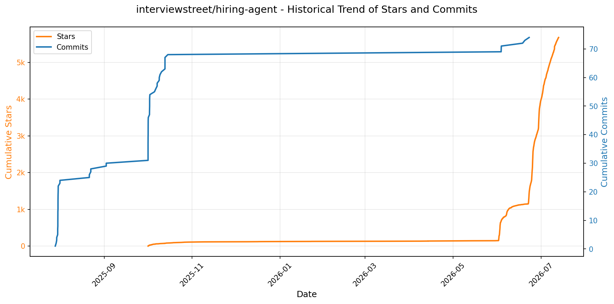

> *蓝色：累计 Stars｜橙色：累计 Commits（次 Y 轴）*

<b>📄 README 摘要</b>

1. **项目功能**  
该工具是一个面向招聘场景的自动化评估系统，实现从PDF简历到结构化评分的端到端流水线。它首先将PDF简历转换为Markdown格式文本，再通过大语言模型（LLM）按预定义章节（如基本信息、工作经历、教育背景等）提取结构化JSON数据；随后自动识别并抓取候选人GitHub个人资料及仓库信息，结合规则与LLM筛选出最具代表性的7个技术项目；最终依据预设公平性约束与评分逻辑（如开源贡献、个人项目、生产环境经验、技术能力等维度），生成可解释、带证据支撑的量化评分报告，并支持CSV导出用于批量分析。

2. **核心特性**  
- ✅ **全本地或云端双模LLM支持**：兼容Ollama（本地运行，支持gemma3系列等轻量模型）与Google Gemini（云端API，需密钥）；  
- ✅ **结构化简历解析**：基于PyMuPDF精准提取PDF内容，结合Jinja模板驱动的分节提示工程，确保JSON输出符合JSON Resume标准；  
- ✅ **GitHub智能增强**：自动提取GitHub用户名，拉取Profile与Repo数据，利用LLM进行项目分类与质量筛选（设定作者提交阈值、去重、优先有意义贡献）；  
- ✅ **公平可解释评估**：内置严格评分规则引擎（`evaluator.py`），输出多维分数（open_source / self_projects / production / technical_skills）、加分项/扣分项及对应证据链；  
- ✅ **开发友好工作流**：支持缓存中间结果（PDF解析、GitHub数据）、CSV批量导出、配置化开关（`DEVELOPMENT_MODE`），便于调试与迭代；  
- ✅ **模块化高可维护架构**：清晰分层（提取→解析→增强→评估→编排），各模块职责单一（如`transform.py`做标准化、`prompt.py`统一模板管理），适配多LLM提供商。

3. **技术栈**  
- **编程语言**：Python 3.11+（严格版本锁定）；  
- **核心依赖**：  
  - `PyMuPDF`（`fitz`）：高性能PDF文本与布局提取；  
  - `Ollama`（本地LLM服务）或 `google-generativeai`（Gemini SDK）：大模型推理后端；  
  - `Pydantic`：定义强类型数据模型（`models.py`）及验证；  
  - `Jinja2`：驱动提示词模板化（`prompts/templates/`下10+专用.jinja文件）；  
- **关键框架/工具**：  
  - `Black`：代码格式化；  
  - 环境变量驱动配置（`.env` + `config.py`）；  
  - CLI入口（`score.py`）提供简洁命令行交互；  
- **架构风格**：轻量级单体应用，无数据库/前端，纯Python命令行工具，强调可复现性与离线可用性。

---

### 48. [every-app/open-seo](https://github.com/every-app/open-seo)
- 📅 **创建日期**：2026-02-27  
- 🔄 **最近更新**：2026-07-06  
- ⭐ **Stars**：4,107（日 +77｜周 +410｜月 +1973）  
- 📝 **描述**：Open source alternative to Semrush and Ahrefs  

<b>📈 Star 与 Commit 历史趋势</b>

> *蓝色：累计 Stars｜橙色：累计 Commits（次 Y 轴）*

<b>📄 README 摘要</b>

1. **项目功能**  
OpenSEO 是一个开源、可自托管的 SEO 工具，旨在提供 Semrush 和 Ahrefs 等商业工具的轻量级、高性价比替代方案。它不依赖订阅制，而是采用“按需付费”模式：用户自行接入第三方 SEO 数据服务（核心为 DataForSEO API），仅为自己实际调用的数据请求付费；OpenSEO 本身完全免费。项目核心定位是“为普通人和 AI 代理服务的全栈 SEO 工具”，支持关键词研究、排名追踪、竞品分析、外链挖掘、网站健康审计及 AI 驱动的可见性优化等端到端 SEO 工作流，并深度集成 AI 代理（如 Claude Code、Hermes 等），使其能直接调用 SEO 数据并执行结构化 SEO 任务。

2. **关键特性**  
- ✅ **AI 代理原生支持**：内置 MCP（Model Context Protocol）服务器，允许任意兼容 MCP 的 AI 代理（如 Claude Code、OpenClaw、Hermes）实时接入并使用 OpenSEO 数据；  
- ✅ **预置可复用的 AI Agent Skills**：提供开箱即用的标准化技能包，包括 `seo-project-setup`、`keyword-research`、`keyword-clustering`、`competitor-analysis`、`link-prospecting` 等，显著提升 AI 在 SEO 场景中的专业性与准确性；  
- ✅ **双路径灵活部署**：支持本地 Docker 快速启动（单用户、免认证）与生产级 Cloudflare Workers 全网部署（自动备份、多设备/团队协作）；  
- ✅ **开放扩展生态**：完全开源，支持 Fork 后定制开发；用户可自主添加新技能、对接 Google Search Console（OAuth 自托管）、或集成其他数据源；  
- ✅ **聚焦工作流的极简 UI**：摒弃传统 SEO 工具的臃肿界面，以任务为中心组织功能（如“关键词研究”“站点审计”），降低使用门槛；  
- ✅ **零应用费用 + 透明成本模型**：OpenSEO 无许可费、无订阅费；所有成本仅来自 DataForSEO API 调用，提供详细费用参考表（如 100 次关键词研究约 $3.50）。

3. **技术栈**  
- **前端**：基于 React（推测，由 Next.js 或 Vite 类框架支撑，文档中体现现代化 UI 与路由能力）；  
- **后端/服务层**：采用 MCP 协议实现 AI 代理通信；后端逻辑围绕 DataForSEO REST API 封装与调度构建；  
- **部署与基础设施**：  
  - 容器化：Docker + Docker Compose（本地/测试环境）；  
  - Serverless：Cloudflare Workers（生产级、全球分发、无服务器托管）；  
- **第三方集成**：  
  - 核心数据源：DataForSEO API（SERP、Keywords Data、Backlinks、Lighthouse 等模块）；  
  - 可选数据源：Google Search Console（通过 OAuth 2.0 自托管接入）；  
- **开发与运维**：支持 `.env` 环境变量管理、GitHub 原生 CI/CD（部署按钮直连 Cloudflare）、结构化文档（Markdown + `/docs/` 目录）。

---

### 49. [openai/plugins](https://github.com/openai/plugins)
- 📅 **创建日期**：2026-03-04  
- 🔄 **最近更新**：2026-07-06  
- ⭐ **Stars**：4,104（日 +47｜周 +359｜月 +2518）  
- 📝 **描述**：OpenAI Plugins  

<b>📈 Star 与 Commit 历史趋势</b>

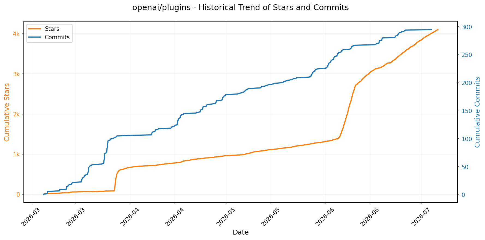

> *蓝色：累计 Stars｜橙色：累计 Commits（次 Y 轴）*

<b>📄 README 摘要</b>

1. **该项目的功能**  
该项目是一个 Codex 插件示例的精选集合仓库，旨在为 Codex 平台提供可复用、即插即用的功能扩展。每个插件封装了特定领域的能力（如设计、开发、协作、部署等），支持通过标准化接口集成到 Codex 环境中，用于增强 AI 编程助手在真实工程场景中的任务执行能力（例如调用 Figma API、操作 Notion 数据库、构建 iOS/macOS/Web 应用、管理 Expo 项目等）。

2. **核心功能**  
- 提供结构化插件模板：每个插件须包含标准 `plugins/<name>/.codex-plugin/plugin.json` 清单文件，并可选集成技能（`skills/`）、应用配置（`.app.json`）、MCP（Model Control Protocol）定义（`.mcp.json`）、智能体（`agents/`）、命令（`commands/`）、钩子（`hooks.json`）及静态资源（`assets/`）等模块；  
- 支持双市场机制：默认用户使用 `.agents/plugins/marketplace.json`，API 密钥认证用户使用独立的 `.agents/plugins/api_marketplace.json`，实现权限与分发隔离；  
- 覆盖多技术栈开发全周期：涵盖 UI 设计（Figma）、知识管理（Notion）、跨平台移动开发（iOS/macOS/Web/Expo）、云部署（Netlify）、视频生成（Remotion）及办公自动化（Google Slides）等高价值场景；  
- 内置丰富工程实践能力：如 SwiftUI 实现与性能调优、AppKit 集成、EAS 构建流程、Codex Run 自动化操作、设计系统规则校验等。

3. **技术栈**  
- **平台层**：基于 Codex 平台（由 Cursor 或类似 AI 编程工具驱动），遵循其插件规范与运行时协议；  
- **协议标准**：深度集成 MCP（Model Control Protocol）以实现模型与外部服务的可控交互，同时支持 Codex 原生技能（Skills）机制；  
- **开发语言与框架**：插件逻辑不限定具体语言，但示例聚焦于 Apple 生态（SwiftUI/AppKit）、Web（React/Next.js）、跨平台（React Native/Expo）、云服务（Netlify CLI、Figma REST API、Notion API）及多媒体（Remotion + React）等主流技术；  
- **配置与元数据**：采用 JSON 格式定义插件元信息（`plugin.json`）、市场清单（`marketplace.json`）、钩子行为（`hooks.json`）及应用级配置（`.app.json`）。

---

### 50. [dotnet/skills](https://github.com/dotnet/skills)
- 📅 **创建日期**：2026-02-03  
- 🔄 **最近更新**：2026-07-06  
- ⭐ **Stars**：4,083（日 +210｜周 +524｜月 +800）  
- 📝 **描述**：Repository for skills to assist AI coding agents with .NET and C#  

<b>📈 Star 与 Commit 历史趋势</b>

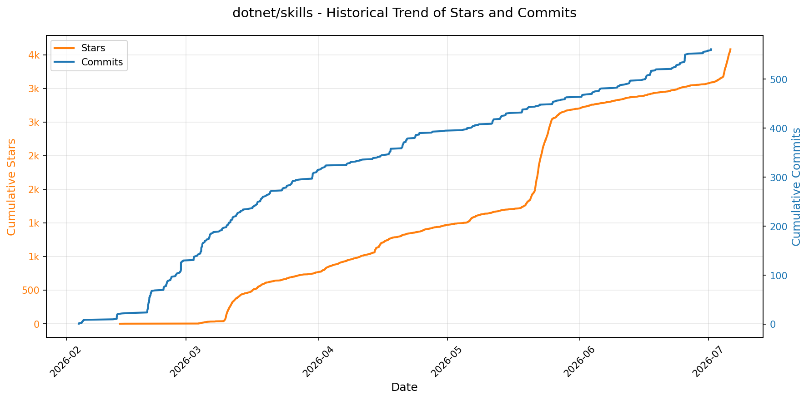

> *蓝色：累计 Stars｜橙色：累计 Commits（次 Y 轴）*

<b>📄 README 摘要</b>

1. **该项目做什么？**  
该项目是一个面向 .NET 开发者的开源技能库（Agent Skills），旨在为 AI 编程代理（如 GitHub Copilot、Claude Code、Cursor、Codex 等）提供标准化、可插拔的领域专用能力。它不运行独立服务，而是通过符合 [agentskills.io](https://agentskills.io) 开放标准的“技能插件”（Skills）形式，赋能编码代理执行专业化的 .NET 开发任务——涵盖从基础语言支持、项目构建、测试、诊断到前沿技术（如 AI/ML、Blazor、MAUI、.NET 11）的全栈开发场景。

2. **关键特性**  
- **模块化插件架构**：提供 15 个高内聚、低耦合的官方插件（如 `dotnet`, `dotnet-aspnetcore`, `dotnet-ai`, `dotnet-upgrade` 等），每个插件封装特定领域的技能集（如 LSP 集成、EF Core 数据操作、MSBuild 故障诊断、LLM 工作流编排、.NET 版本迁移等）。  
- **跨平台代理兼容性**：原生支持主流 AI 编程工具链，包括 GitHub Copilot CLI / Claude Code、VS Code（预览）、Cursor 和 OpenAI Codex CLI，通过统一 marketplace 机制实现一键安装与更新。  
- **标准化与可扩展性**：严格遵循 [agentskills.io](https://agentskills.io) 开放标准，确保技能定义、元数据、执行契约的互操作性；提供清晰的贡献指南（CONTRIBUTING.md），支持社区共建新插件。  
- **可观测性与质量保障**：配套公开仪表板（[Dashboard](https://dotnet.github.io/skills/)），持续追踪各插件在准确性与执行效率维度的量化评分趋势。

3. **技术栈**  
- **核心规范**：基于 [agentskills.io](https://agentskills.io) 定义的开放技能标准（JSON Schema 描述技能接口、输入输出、元数据等）。  
- **交付格式**：纯静态资源仓库，所有技能以声明式 JSON/YAML 文件和可选辅助脚本（如 Bash/PowerShell）组织，无运行时依赖。  
- **集成生态**：深度适配多款 AI 编程代理的插件系统——  
  - GitHub Copilot / Claude Code：通过 `/plugin` 命令行指令管理；  
  - VS Code：依赖 `chat.plugins.*` 设置启用插件市场；  
  - Cursor：作为官方插件市场（[cursor.com/marketplace](https://cursor.com/marketplace)）认证源；  
  - OpenAI Codex：通过 `.agents/plugins/marketplace.json` 清单文件提供原生 marketplace 支持，并兼容 `skill-installer` 工具直链安装。  
- **基础设施**：GitHub Pages 托管仪表板，GitHub Actions 自动化构建与部署。

---

### 51. [kenn-io/agentsview](https://github.com/kenn-io/agentsview)
- 📅 **创建日期**：2026-02-19  
- 🔄 **最近更新**：2026-07-06  
- ⭐ **Stars**：3,775（日 +155｜周 +386｜月 +2591）  
- 📝 **描述**：Local-first session search, analytics, insights, and token use statistics for coding agents, supporting Claude Code, Codex, and more than 20 other agents.   

<b>📈 Star 与 Commit 历史趋势</b>

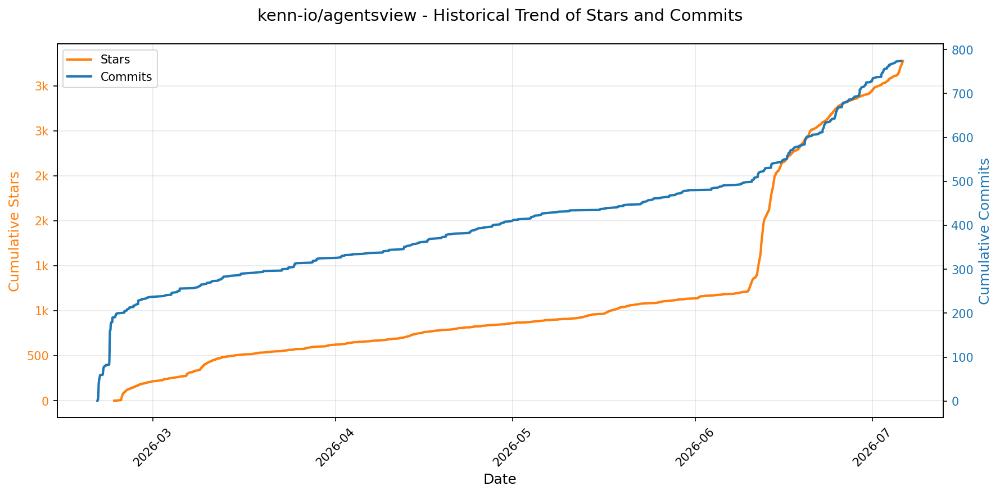

> *蓝色：累计 Stars｜橙色：累计 Commits（次 Y 轴）*

<b>📄 README 摘要</b>

1. **项目功能**  
`agentsview` 是一个本地化、无需账户的 AI 编程智能体（AI coding agents）统一监控与分析工具。它自动扫描、聚合并索引用户本地机器上数十种主流 AI 编程代理（如 Claude Code、Devin CLI、Forge、Cursor、Aider 等）产生的会话数据，构建本地 SQLite（或可选 PostgreSQL/DuckDB）数据库，并提供实时 Web 仪表盘，用于浏览会话、全文搜索、追踪 token 消耗与实际美元成本、分析使用模式（如活跃度热力图、工具调用分布、项目关联性等），同时支持离线 CLI 快速查询（如 `agentsview usage daily`），无需网络或远程服务。

2. **核心特性**  
- ✅ **多代理统一支持**：原生兼容超 30 种 AI 编程代理（Claude、Devin、Codex、Forge、Cursor、Aider、gptme、OpenCode 等），自动发现其本地会话目录；Aider 和 Amp 等支持按需启用或降级兼容。  
- ✅ **精准成本追踪**：基于 LiteLLM 官方定价（含离线 fallback），区分 prompt cache 创建/读取 token，计算输入/输出/缓存 token 对应的 USD 成本；支持按模型、代理、日期范围、时区进行细粒度过滤与聚合（`--breakdown`, `--since`, `--timezone`）。  
- ✅ **高性能本地分析**：所有会话数据预索引至本地 SQLite，CLI 查询（如 `usage`, `session usage`, `stats`）毫秒级响应，比实时解析原始日志快 100 倍以上。  
- ✅ **交互式 Web 仪表盘**：提供 Dashboard（成本图表、热力图）、Session Viewer（消息时间线+代码变更高亮）、全文搜索（FTS5）、Recent Edits 文件变更流、键盘优先导航（Cmd+K / j/k）、HTML 导出与 GitHub Gist 发布。  
- ✅ **灵活部署与数据源**：支持单二进制 CLI、桌面应用、Docker 容器（含 PostgreSQL/DuckDB 后端选项）、S3 兼容对象存储远程同步（增量拉取）、Quack 协议远程 DuckDB 访问；支持 SSH 端口转发/反向代理安全访问（`--public-url` + `--require-auth`）。  
- ✅ **生产就绪设计**：后台守护进程（daemon）自动启停与空闲退出；CLI 命令智能选择直连 SQLite 或连接 daemon；Git/GitHub 结果指标（提交数、LOC、PR 数）按需启用，避免性能拖累。

3. **技术栈**  
- **后端**：Rust（主程序，高性能 CLI 与 HTTP server）、SQLite（默认嵌入式持久化）、PostgreSQL（可选主数据库）、DuckDB（可选分析型只读镜像）、LiteLLM（模型定价与元数据）、Quack（DuckDB 远程协议）。  
- **前端**：TypeScript + React + Vite（Web UI），Tailwind CSS（样式），ESBuild（构建），Server-Sent Events（SSE 实时更新）。  
- **部署与集成**：Docker（多平台镜像 `ghcr.io/kenn-io/agentsview`）、docker-compose（生产示例）、Homebrew（macOS）、PowerShell/macOS Shell 安装脚本、S3 兼容存储（AWS S3/MinIO 等）、GitHub CLI（`gh`）集成。  
- **跨平台支持**：原生 macOS/Linux/Windows 二进制、桌面应用（Electron 或类似框架封装）、WSL2/Codespaces/Exe.dev 等远程开发环境适配。

---

### 52. [Starmel/OpenSuperWhisper](https://github.com/Starmel/OpenSuperWhisper)
- 📅 **创建日期**：2025-02-06  
- 🔄 **最近更新**：2026-07-06  
- ⭐ **Stars**：1,811（日 +83｜周 +507｜月 +1012）  
- 📝 **描述**：macOS dictation app  

<b>📈 Star 与 Commit 历史趋势</b>

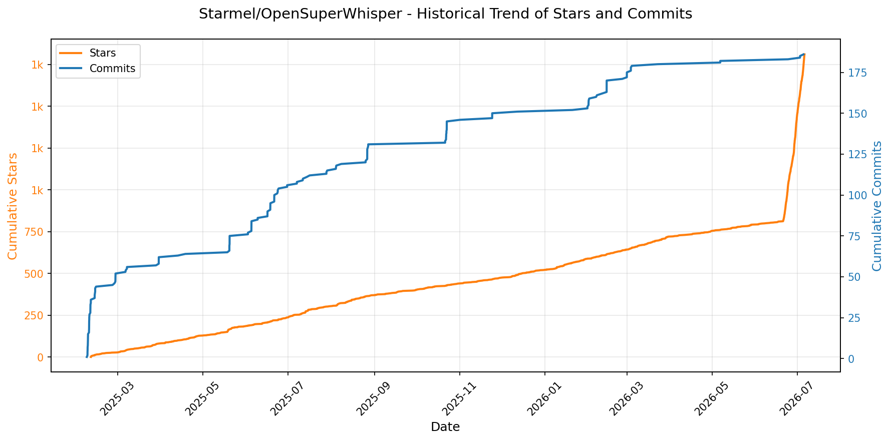

> *蓝色：累计 Stars｜橙色：累计 Commits（次 Y 轴）*

---

